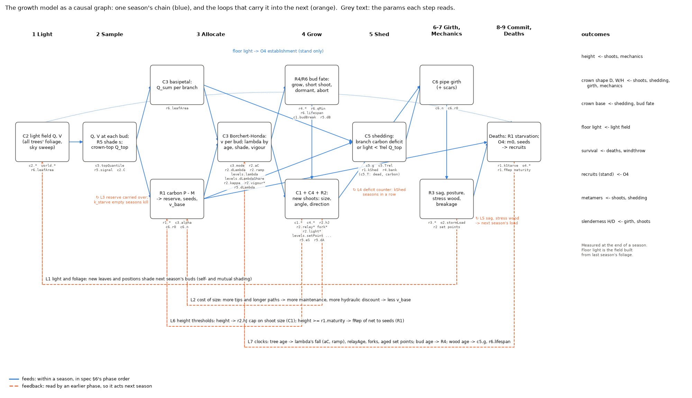
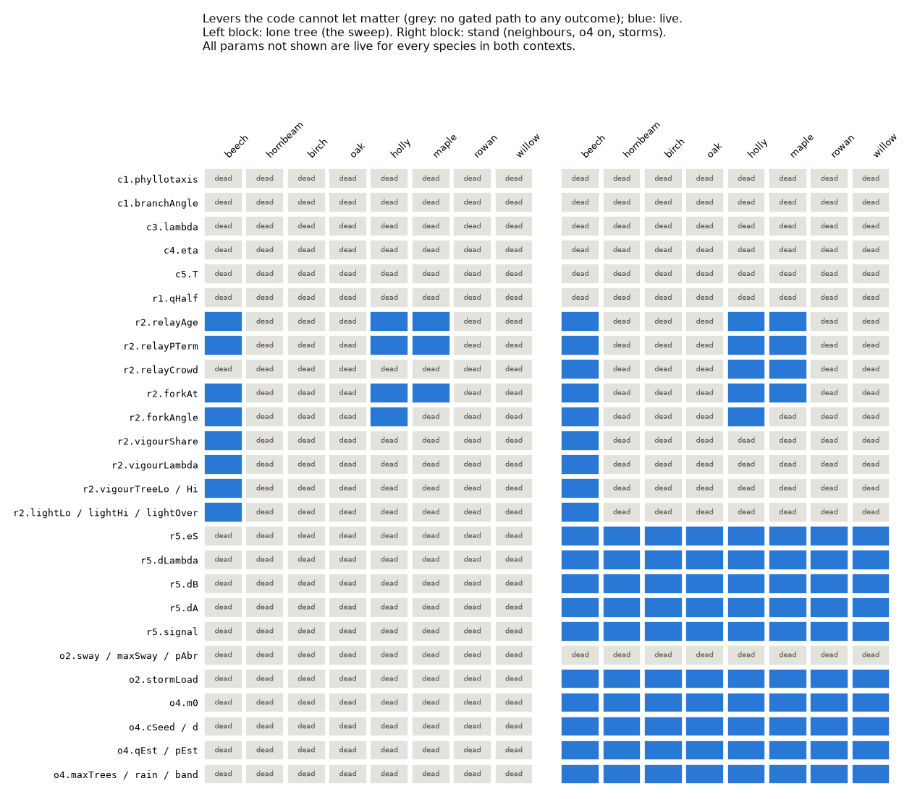

# The growth model as a DAG

_Built on the night of 6–7 Nov 2026 (N6, [night plan](../plans/2026-11-06-night2.md)) from the Rust core at c6b60df. The code and tables are in [code/2026-11-07-night2/dag/](../experiments/code/2026-11-07-night2/dag/): `build_dag.py` (read-only), `reach.md`, `reach_tables.md`, `sweep_effects.csv`._

## Durable tools (day-3 step 1, 2026-11-07)

The historical analysis below remains the night2 result at c6b60df. The maintained tools now live in
`analysis/treesim/`: `build_dag.py`, `dump_effective.ts`, `sweep_effects.py`, and `dead_overrides.py`.
See [usage and limitations](../../analysis/treesim/INSTRUMENTS.md). The builder regenerates missing
inputs and evaluates **separate lone and actual garden stand params**, recording source commits,
dirty status, source/input hashes and candidate patches. It no longer substitutes assumed forest
settings for the garden's O2/O4 settings. Its lexical parameter-read coverage test catches stale
entries but does not prove the hand-written gates correct. Re-evaluate after a candidate opens a gate.

An unchanged hash in E3 means **no observed effect at this setting**, never a proof of deadness.
E3 uses 20 seeds per perturbation/context, 150-season lone trials and 300-season garden stands;
it runs only on demand, outside the regular checks. No E3 simulation result was produced by the
promotion. The old three-seed sweep remains a probe selector, not adoption evidence.

Day-3 step 2 removes holly's unused vigour thresholds with **20/20** unchanged lone hashes
(seeds 1–20, 150 seasons). All reader gates remain closed in both dumped contexts. L4's deficit
memory now persists in checkpoint v3 (ADR 0059); the growth graph and hash schema are unchanged.
The night2 statements below describe their historical inputs; holly's measured deletion awaits
the user's merge of the step-2 PR.

## What it is

- **One season is a DAG.** It has 23 steps of `run_season` in spec §6's phase order:
  - light: obstacles → storm → C2 → owner grid;
  - sample: Q → R5 → s̄ → Q_top;
  - allocate: C3 basipetal → R1 → C3 split;
  - grow: R4 → R2 form → C4 → C1 → R6;
  - shed, girth and mechanics;
  - deaths: O2 → R1 starvation → O4.
- **Nodes:**
  - param groups (the 2–4 params a principle reads together);
  - principles;
  - state (tables, scalars, the light and owner grids);
  - outcomes (height, crown base, D, W/H, H/D, floor light, survival, recruits, metamers).
- **Edges:**
  - `reads`, which carries a gate: the condition under which the code reads that param;
  - `writes`;
  - `feeds`: within a season, in phase order;
  - `feedback`: a write read by an earlier phase, so it acts next season.

## The feedback loops (across seasons)

| id | loop | what it does |
|---|---|---|
| L1 | light and foliage | new foliage shades next season's buds |
| L2 | cost of size | more tips and longer paths raise maintenance, lowering next season's v_base |
| L3 | reserve and starvation | the reserve carries over; `kStarve` empty seasons kill the tree |
| L4 | carbon-shedding memory | a branch must run a deficit `r1.kShed` seasons in a row |
| L5 | mechanics | load gives sag and stress wood, which move next season's positions and load |
| L6 | height thresholds | the `r2.hJ` cap; at `r1.maturity`, `fRep` diverts production to seed |
| L7 | clocks | λ's ontogenetic fall, relay age, aged set points, R4's dormancy, `c5.g`, `r6.lifespan` |
| L8 | neighbours (stand) | other trees' foliage → R5 shade → λ, elongation, break, relay gate |
| L9 | demography (stand) | seeds → recruits → foliage → floor light → establishment |

## What it tells us, and what it cannot

- **Certain: which knobs cannot matter.** A knob is dead when every path from it is closed by another setting. The DAG and the ±10% sweep agree on all 17 swept params.
  - **`c5.T` is dead in every species:** all species shed by carbon (`r1.shed = "carbon"`), and that path tests `deficit ≥ kShed || light < Trel·Q_top`, never T. The live shedding knobs are `c5.Trel`, `c5.g`, `r1.kShed`, and through P/M `r1.mf`, `r1.mw`, `r1.Lh`, `c3.alpha`.
  - **Holly's `r2.vigourTreeLo/Hi` have no reader:** holly lacks all three rules that read the vigour gate (the C3 vigour drop of ADR 0041, light orthotropy, C5's `Tvig`). Its override comment cites ADR 0041, so this looks like a config slip (unfixed; the user's call).
  - **R5's shade knobs** are dead for a lone tree.
  - **Beech's `r2.dLambda`** is only 0.0138, so "twigs keep λ" (ADR 0057) barely moves beech.
- **Not given: the size or even the sign of an effect.**
  - Across seasons, L1 and L2 connect every live knob to every outcome, so reachability alone separates nothing.
  - Thresholds (λ near 0.5, the hJ cap, maturity) mean a small change can flip a crown: hornbeam's trunk λ +10% added 18 m.
- **"Deterministic" means reproducible, not predictable.** Randomness is keyed by birth id, so a knob that changes how many shoots grow reshuffles every later draw. In the ±10% sweep (840 lone runs, 3 seeds), −10% and +10% kept one sign of ΔD on all 3 seeds in only 69 of 272 species × param × season cases. Noise alone gives about 1 in 4.

## Using it as a knob tool

1. Prune the dead knobs with the DAG (`dead_levers.png`).
2. Read the local sign and size from `sweep_effects.csv` against the base's seed spread, and note band crossings.
3. Where −10% and +10% disagree, or a band is crossed, rerun with ≥ 20 seeds before believing an effect (AGENTS.md's seed rule).

