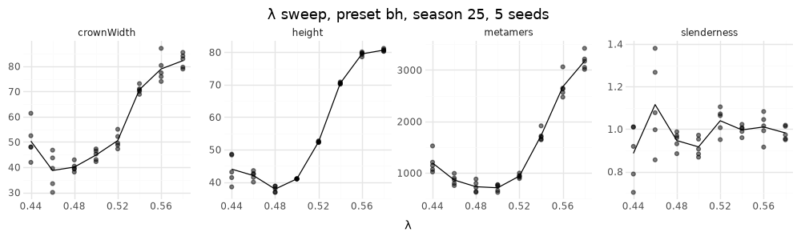

# M2: λ sweep (spec §8 sweeps)

## Question
Spec §8: "λ ∈ [0.44, 0.58] (look for a threshold-like shift in trunk dominance)". Does the Borchert–Honda bias λ switch the 2D tree from spreading (decurrent) to leader-dominated (excurrent), and is the switch gradual or abrupt?

**Expected:** taller, leader-dominated trees above λ ≈ 0.5 (Palubicki Fig. 7; Guerra: 0.46 "a spreading crown", 0.56 "a dominant leader").

## Setup
- Preset `bh`: C2 on (a = 0.2, b = 2, C = 1), C3 `bh`, α = 2, cap 3 metamers per shoot, world 120×90.
- λ ∈ {0.44, 0.46, …, 0.58} × seeds 1–5, measured at season 25.

```bash
uv run --project analysis python analysis/experiments/m2_lambda_sweep.py
```

## Result

| λ | height | width | height/width | metamers |
|---|---|---|---|---|
| 0.44 | 44.0 | 50.3 | 0.89 | 1193 |
| 0.46 | 42.0 | 38.7 | 1.12 | 862 |
| 0.48 | 37.8 | 40.0 | 0.95 | 732 |
| 0.50 | 41.0 | 44.8 | 0.92 | 712 |
| 0.52 | 52.4 | 50.5 | 1.04 | 940 |
| 0.54 | 70.4 | 70.7 | 1.00 | 1727 |
| 0.56 | 79.5 | 78.9 | 1.01 | 2675 |
| 0.58 | 80.6 | 82.2 | 0.98 | 3173 |



## Conclusion
- **Threshold.** Height, which measures how far the leader outruns the laterals, shifts in a threshold-like way between λ = 0.50 and 0.56 (41 → 80). Seeds agree closely above 0.5. This is the §8 prediction.
- **Saturation.** Above 0.56 the leader grows the maximum 3 metamers every season, so the curve saturates at the `c1.maxMetamersPerShoot` cap rather than at a biological limit.
- **Total growth** rises steeply with λ (712 → 3173 metamers). A dominant leader keeps the crown top in full light, and that light becomes more resource: loop B (§1) is positive feedback.
- **Low λ.** Height is lowest near λ = 0.48 and rises again at 0.44, where vigorous laterals reach as high as the main axis (decurrent forms).
- **Height/width doesn't measure dominance here.** It stays near 1 because the crown widens as fast as it grows taller, with no shedding yet (C5, M4). Better dominance measures for later: the share of v_base reaching the order-0 axis, or the leader's length relative to the longest lateral.

**Follow-ups:**
- Add a leader-share metric.
- Rerun after M4 (shedding), when stand-grown boles should separate the regimes more.
- Consider a larger cap or world, so high λ isn't truncated.
