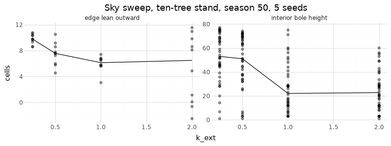

# M6: Beer–Lambert sky sweep — calibration and visible tests

## Question
Does the sky sweep (§C2.4 "recommended upgrade") give the M6 visible tests — edge trees lean outward, neighbours lean into a gap — and does it lift crown bases in stands, which the shadow triangle could not (M4/M5)? Which k_ext?

## Setup
Presets `skyStand` (10 trees, spacing 21, world 230×110) and `skyTree` (one tree), C2–C6 on, λ = 0.5, K = 7 directions from 15° to 165° elevation-weighted by sin(elevation), 50 seasons, seeds 1–5. Gap: fell tree 5 at season 25 (CLI `--replay`), compare neighbours 4 and 6 at season 50 with an intact stand.

```bash
uv run --project analysis python analysis/experiments/m6_sky_sweep.py
```

## Result (medians, season 50)

| k_ext | interior bole | interior width | stalled seedlings | edge lean outward | open-grown bole | open-grown size |
|---|---|---|---|---|---|---|
| 0.25 | 53.0 | 23 | 0/50 | 9.8 | 1.0 | 2,499 |
| **0.5** | **51.0** | **21** | **0/50** | **7.6** | **1.0** | **1,678** |
| 1.0 | 22.1 | 23 | 3/50 | 6.1 | 1.0 | 1,222 |
| 2.0 | 22.7 | 22 | 6/50 | 6.5 | 3.0 | 835 |

Gap (k_ext 0.5): the left neighbour's crown centroid moved +2.5 … +6.7 cells toward the gap and the right neighbour's −1.6 … −4.9, in all five seeds; both crowns widened. Oblique sun (tilt 0.5): isolated crowns leaned +7.8 … +14.1 cells toward the bright side (tilt 0: −0.4 … +1.4).



## Conclusion
- All M6 visible tests hold robustly. Stand trees now form tall clear boles (median 51 cells) while open-grown trees keep their low, side-lit branches — §8 "stand trees should have higher crown bases, narrower and more asymmetric crowns", which the distance-decaying shadow triangle could not produce.
- k_ext = 0.5 (default): strongest boles, no seedling stalls. At k_ext ≥ 1 a few seedlings stall and crowns are sparser.
- New emergent effect: a suppressed, decurrent stand tree can lose almost its whole crown in one season when its dominant fork (a lateral) falls below the shedding threshold — the onset of self-thinning that R1 (carbon balance, M8) will turn into death.
- K = 7 discrete directions show as faint radial streaks in the shade overlay; raise K for smoother light (cost is linear in K).
