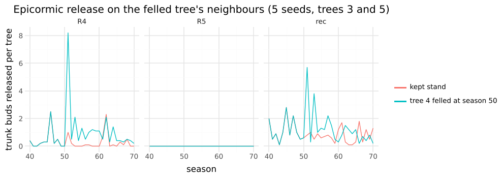

# M10: R4 dormancy and release, R5 shade avoidance

## Question
Do R4 and R5 give the §7 M10 visible test without spoiling the M6–M9 stand patterns, and what does each part contribute? The visible test asks for an epicormic flush after a neighbour is felled, and slender stand trees.

Expected beforehand:
- R4's hysteresis would hold dormant buds back until a gap's light raised their resource.
- R5's elongation would make stand trees slender.

Neither held as built from §R4.4 (ADR 0012).

## Setup
```bash
uv run --project analysis python analysis/experiments/m10_release_shade.py   # 135 runs, about 1.5 minutes on 4 cores
```
- **Runs.** `skyStand` for 100 seasons, kept or with tree 4 felled at season 50 (a replayed event). `skyTree` for 100 seasons. Seeds 1–5. Stand values are interior trees 1–8.
- **The recommended settings** ("rec", now in the sky presets):
  - R4: Q_rel 0.1, v_break 2, v_cont 1, δ 0.02, L_dorm 40, juvenile 1, bud bank on;
  - R5: e_s 0.1, δλ 0.02, δ_b 1, δ_A 0.5.
- **Conditions.** "off" has neither principle. "R4" and "R5" have one each. The other conditions change one thing from rec.
- **Epicormic shoots:** axes started in seasons 50–55 on trunk wood at least 10 seasons old, on the felled tree's neighbours 3 and 5, counted at season 56. The `epicormic` metric counts the same releases per season.

## Result

### Before the design change
R4 built as §R4.4 gave no dormant bud a break in any stand run, felled or kept, with or without R1.
- Dormant buds had v ≤ 0.15 under R1 and ≤ 0.4 without it.
- After felling, light on a neighbour's bole rose from 0.01–0.04 to 0.10–0.20 of open sky, but BH gives a lone bud on a bole a share proportional to its light against the whole crown above it.
- Bare boles held 0–2 dormant buds, since a shed branch left nothing behind.

The user chose a bud bank plus a light trigger (ADR 0012).

### With the bud bank and light trigger

| condition | stand height 50 / 100 | H/D 50 | crown base 50 | floor light 50 | dormant releases /tree/season | aborts | epicormic /tree/season | trunk shoots kept / felled | open height 100 | open H/D 50 |
|---|---|---|---|---|---|---|---|---|---|---|
| off | 61 / 80 | 61 | 32 | 7.1% | 0 | 0 | 0 | 0 / 0 | 92 | 41 |
| R4 | 60 / 78 | 57 | 31 | 4.7% | 3.4 | 1.4 | 0.27 | **1 / 60** | 91 | 36 |
| R5 | 68 / 86 | 81 | 44 | 9.3% | 0 | 0 | 0 | 0 / 0 | 101 | 55 |
| **rec** | **66 / 83** | **72** | **35** | **5.7%** | **2.7** | **0.9** | **0.48** | **22 / 64** | **101** | **47** |
| no bud bank | 68 / 85 | 78 | 44 | 8.6% | 1.1 | 0.05 | 0.02 | 0 / 0 | 101 | 52 |
| sugar route only | 67 / 84 | 80 | 35 | 6.3% | 0 | 1.3 | 0 | 0 / 0 | 101 | 56 |
| Q_rel 0.15 | 67 / 86 | 76 | 35 | 5.3% | 2.0 | 1.1 | 0.31 | 12 / 38 | 102 | 51 |
| δλ 0.04 | 73 / 88 | 87 | 32 | 6.2% | 2.6 | 1.0 | 0.63 | 20 / 65 | 102 | 61 |
| e_s 0.3 | 67 / 84 | 73 | 35 | 5.5% | 2.8 | 0.9 | 0.48 | 15 / 67 | 101 | 45 |



- **Epicormic flush.**
  - With R4, the felled tree's neighbours sprout from their boles in the season after the felling: a spike of ≈ 8 trunk releases per tree with R4 alone, against ≤ 1 in the kept stand. By season 56 this leaves 60 trunk shoots against 1.
  - With R5 as well, the background on boles rises (22 shoots in the kept stand against 64 felled). A likely cause is that R5 lifts the crown base (35 against 31 cells), leaving fresh bank buds just below it.
  - Without the bud bank, or with only the sugar route, no trunk shoot forms at all.
  - Q_rel 0.15 halves the flush.
- **Slender stand trees.** R5 raises interior stand H/D from 61 to 72, inside the 60–80 target, and open-grown H/D from 41 to 47.
  - Almost all of it comes from the leader bias δλ. Elongation barely matters: e_s 0.3 changes H/D by 1.
  - δλ 0.04 overshoots: stand H/D reaches 87 ("risky" above 80) and open-grown 61.
- **Side effects.**
  - R5 makes the open tree taller (101 against 92 at season 100), so `skyTree` reaches its 100-cell ceiling.
  - R4 lowers floor light (4.7% against 7.1%), since bank buds re-leaf the lower crown.
  - No stand tree dies in any condition, and edge trees still lean out (−7.5 cells).
  - R1's plateau holds: the stand gains 5.5 cells between seasons 70 and 100.
- **Breakage (R3).** No break occurred at σ_break 4000, 6000 or 9000 in `skyTree` or `skyStand` over 100 seasons (3 seeds): stress-driven girth keeps σ at or below σ_target (3000). It stays off.

## Conclusion
- The sky presets now carry R4 and R5 with the recommended settings. `release.test.ts` (5 seeds) automates the visible test:
  - felled > 2× kept and > 40 trunk shoots (64 against 22), none without R4;
  - stand H/D 60–85 and > 1.1× without R5 (73 against 58);
  - open-grown H/D < 0.75× the stand's.
- **Follow-ups:**
  - Separate neighbour shade from self-shade with §R5's far-red field, so R5 leaves open-grown trees squat.
  - Give `skyTree` headroom, or limit R5's effect on open-grown height.
  - Breakage needs wind loads (O2).
  - R4 does not unfreeze R1's plateau; recruitment (O4) is still to come at M11.
