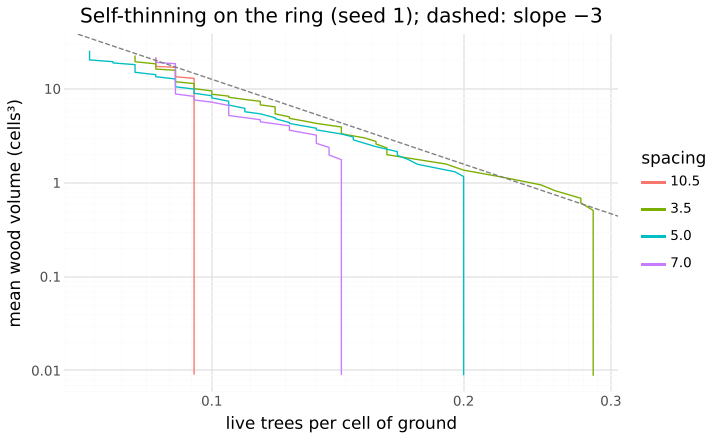

# M11: a forest without edges, self-thinning, gap regeneration, crown gaps

## Question
Does a dense even-aged stand thin itself along a log–log line, with size inequality and bimodality judged alongside the slope (§10; Reynolds & Ford 2005; Mrad et al. 2020; Ma et al. 2019)? With recruitment (O4), do gaps refill? Does abrasion (O2) open crown gaps?

Expected beforehand:
- Self-thinning would need R1 starvation in denser stands than M8's ten trees.
- §10's untested 2D hypotheses give a slope of −2 (mass ∝ L²) or −3 (3D cylinder mass kept).

## Setup
```bash
uv run --project analysis python analysis/experiments/m11_stand_dynamics.py   # 36 runs, about 1 minute on 4 cores
```
Everything runs on an edgeless ring: `world.sides: "periodic"`, 210 cells wide and 130 tall, with the sky presets' R1–R6 (ADR 0013).

1. **Self-thinning.** The `thinning` preset planted at 3.5, 5, 7 and 10.5 cells (60, 42, 30 and 20 trees), with no recruitment, for 150 seasons, seeds 1–5.
   - Mass is wood volume Σπr²l; density is live trees per cell.
   - The slope is the least-squares fit of log mean mass on log density over the seasons after the first death.
   - Bimodality is Sarle's coefficient (> 0.555 suggests two modes).
2. **Forest.** The `forest` preset (10 trees, f_rep 0.1 above 40 cells, O4: c_seed 5, d 20, Q_est 0.1, p_est 0.3, m₀ 0.002) for 300 seasons, kept or with tree 4 felled at season 100. Seeds 1–5.
3. **Crown gaps.** 21 trees 10 cells apart on the ring, without recruitment, for 80 seasons, O2 off or on (k_sway 0.0005, cap 3 cells, p_abr 0.5). Seeds 1–3.
   - Gaps are empty runs between two trees' young tips (≤ 3 seasons old) in the same row, in the top quarter of the canopy.

Sanity check of the boundary (`skyStand` planted on a 210-cell world, seeds 1–3, season 60):

| sides | edge-tree lean | height | H/D | crown base | floor light | ms/season |
|---|---|---|---|---|---|---|
| open | 4.1 | 74 | 77 | 28 | 6.3% | 9 |
| periodic | 1.5 | 74 | 77 | 45 | 3.4% | 23 |

## Result

### 1. Self-thinning

| planted | slope (median, range) | live at 150 | peak CV | CV at 150 | peak bimodality | bimodality at 150 |
|---|---|---|---|---|---|---|
| 60 (3.5 cells) | −2.98 (−3.12 … −2.61) | 17 | 0.61 | 0.34 | 0.54 | 0.37 |
| 42 (5) | −3.12 (−3.53 … −2.60) | 15 | 0.51 | 0.31 | 0.86 | 0.36 |
| 30 (7) | −4.07 (−5.12 … −3.14) | 16 | 0.43 | 0.28 | 0.58 | 0.40 |
| 20 (10.5) | −4.51 (−6.73 … −1.63) | 17 | 0.30 | 0.30 | 0.56 | 0.32 |



- **A common thinning line.** Every planting density converges on 15–17 live trees per 210 cells, and the trajectories join one boundary line.
  - The dense stands, which spend longest on the line, follow slope ≈ −3. This is §10's hypothesis for 3D cylinder mass kept in a 2D world (w ∝ ρ^−3), not the −2 of planar mass.
  - Sparser stands reach the line late, while still growing fast, so their fitted slopes are steeper and noisier.
- **Size inequality** rises with density: peak CV is 0.61 at 3.5 cells against 0.30 at 10.5 (Weiner 1990; Weiner et al. 2001). It falls again as the suppressed die.
- **Bimodality** is marginal: the peak coefficient sits at or just above the 0.555 threshold (0.54–0.86), and every stand ends unimodal (0.32–0.40).
- All deaths are R1 starvation; background mortality and recruitment are off here.

### 2. Forest and gap regeneration

| | live trees, season 50 / 100 / 150 / 200 / 300 | canopy trees (≥ 40 cells) | planted trees dead by 300 | recruits within 12 cells of tree 4, seasons 100–140 |
|---|---|---|---|---|
| kept | 13 / 18 / 20 / 21 / 24 | 9 → 6–7 → 8 | 26 of 50 | 3 |
| tree 4 felled at 100 | 13 / 18 / 22 / 24 / 25 | 9 → 6–7 → 7 | 30 of 50 | 9 |

- Seeds establish where ground light reaches 10% of open sky: in gaps, and at first under the young canopy. An understory of suppressed saplings, 10–20 cells tall, persists under the canopy (shown on the page).
- Over 300 seasons half of the planted trees die (background risk and starvation), the canopy holds 7–8 trees, and recruits replace the dead.
- A felled canopy tree's gap gets three times the recruits of the same spot in the kept stand.

### 3. Crown gaps

| O2 | neighbour pairs | median gap (cells) | touching (≤ 1 cell) | buds abraded / season |
|---|---|---|---|---|
| off | 60 | 46.5 | 3.3% | 0 |
| on | 54 | 56.5 | 0% | 8.2 |

- Crowns keep their distance without abrasion: in the canopy band, neighbouring trees' foliage touches in ≈ 3% of rows. In this model light competition alone leaves channels between crowns.
- Abrasion removes the remaining contacts and widens the median gap. With 3 seeds this is a hint, not a result, and O2 stays off in the presets.

## Conclusion
- `forest.test.ts` automates the M11 visible test:
  - the `thinning` stand loses > 60% of its trees, with slope in [−4, −2] (measured −2.8 to −3.1, 3 seeds), and its peak CV is > 1.5× that of the 10.5-cell stand;
  - more recruits near a felled tree than near the kept one (17 against 4, 5 seeds, 30 seasons);
  - edge trees on the ring lean < 0.6× as much as with open sides (1.1 against 4.0).
- **Follow-ups:**
  - The bimodal phase is weak. Asymmetric competition (Schwinning & Weiner 1998) could be probed by varying k_ext.
  - O2's effect needs more seeds and wind events.
  - The ring costs 2.5× the light; fewer laps would do for small H/W.
  - Recruits get no head start (advance regeneration) beyond R1's seed reserve.
