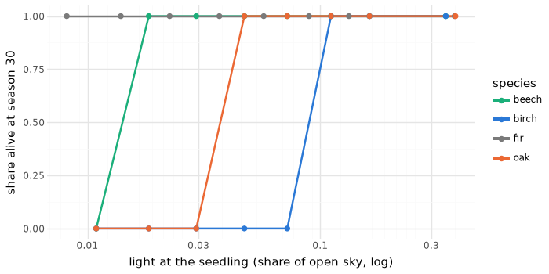
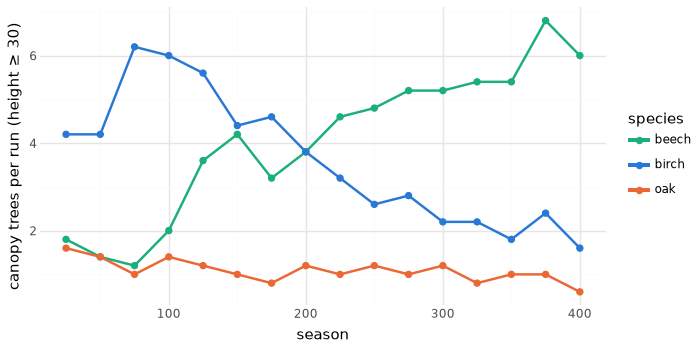

# M19: calibrating birch, oak, beech and fir

## Question
Can species patches (ADR 0016), fitted to published patterns, give each species its own shade tolerance, form and life history? Then, with no scripting, does a mixed forest of them go through birch → beech succession?

Expected beforehand:
- **Shade survival order:** fir ≈ beech < oak < birch.
- **Stand floors:** darkest under beech, lightest under birch.
- **Lone oak:** broad and squat.
- **Mixed forest:** birch takes the canopy early and loses it to beech. Oak hangs on only in gaps.

## Literature targets

| Pattern | Target | Source |
|---|---|---|
| Shade-tolerance score (0–5) | birch 2.03, oak 2.45, beech 4.56, silver fir 4.6 | Niinemets & Valladares 2006, Appendix A ([table](https://esapubs.org/archive/mono/M076/020/appendix-A.htm)) |
| Light a sapling survives at | tolerant ≈ 1–3%, intolerant 10–15% | Kobe et al. 1995; literature review §4 |
| Sapling growth vs light | beech outgrows oak at every light level; beech is optimal at 10%, oak needs > 20% | Ligot et al. 2013 ([link](https://consensus.app/papers/details/d383d761a8545573b277e77606038522/?utm_source=claude_desktop)) |
| Leaf economics | intolerant species: higher photosynthetic capacity and N per area; tolerant ones: long-lived, cheap leaves | Hallik et al. 2009 ([link](https://consensus.app/papers/details/9337178538b75b5680fa398374ae5c97/?utm_source=claude_desktop)) |
| Slenderness | stand-grown H/D 60–80; open-grown squat (≈ 40–55) | Watt et al. 2023; MacFarlane et al. 2017 |
| Open-grown crown | at maturity, crown width ≈ crown length | Hein et al. 2008 ([link](https://consensus.app/papers/details/c54923a1ccd658eb968b96c1c09d8e75/?utm_source=claude_desktop)) |
| Succession | beech replaces oak and pioneers under natural gap dynamics; pioneers (birch, willow) dominate after a stand-replacing windthrow and then decline | Rubio-Cuadrado et al. 2018 ([link](https://consensus.app/papers/details/0f7f1e4a3b475460aa980e2761e40e03/?utm_source=claude_desktop)), 2024 ([link](https://consensus.app/papers/details/ce6e3c86203455939796012e6c1fa8ee/?utm_source=claude_desktop)); Jaloviar et al. 2017 ([link](https://consensus.app/papers/details/e03b6950103953c7b0ade26357542b27/?utm_source=claude_desktop)) |

## Setup
```bash
uv run --project analysis python analysis/experiments/m19_species.py   # 200 runs, about 15 s
```

**Growth rules.** All runs use the woodland's growth rules: the `forest` principles with R5's neighbour signal (M19 step 2). The calibration settings come from the `oakOpen` preset, so they have no O4 recruitment and no storms.

**Settings per species**, 5 seeds each:
- a lone tree, 160 × 160, 60 seasons;
- a stand of ten trees 21 cells apart, interior trees 2–7, 60 seasons;
- a shade house: a seedling under a roof one cell thick across a 40-cell periodic world, at eight roof densities, 30 seasons.

**Mixed forest:** the `succession` preset, a ring of 7 birch, 2 oak and 2 beech, 400 seasons, 5 seeds. Canopy means trees at least 30 cells tall.

**What the species differ by** (the knobs, all per tree):
- **Shade survival:** Q_ss (`r6.qMin`). Below it a resting bud is a leafless dormant bud, so a seedling whose one bud sits in deeper shade produces nothing and starves. This turned out to be the survival threshold. Foliage cost (`r1.mf`) moved it very little.
- **Leaf economics:**
  - photosynthetic capacity α: birch 4, oak 3.5, beech and fir 3;
  - foliage cost m_f: birch 0.1, oak 0.08, beech 0.035, fir 0.05;
  - short-shoot leaf area a_ss: birch 1.2, oak 1.6, beech 2.6. This sets how much shade each species casts.
- **Crown depth:** relative shedding T and T_rel. Birch also has a high release light (`r4.qRel` 0.3). With the default 0.1, light under birch woke epicormic shoots all down the trunk and the crowns never lifted.
- **Height:** the hydraulic scale L_h. Birch levels off lower (45), oak higher (75).
- **Form:** R2 tables, plus stiffer wood and stronger posture control for oak. Before that the oak's limbs drooped like a willow's.
- **O4 life history:**
  - seed cost: birch 2, oak and beech 10;
  - dispersal d: birch 40, oak 25, beech 12;
  - establishment light: birch 0.25, oak 0.1, beech 0.03;
  - background mortality: birch 0.008, the others 0.002.

## Result

| Species | Open H | Open W/H | Open H/D | Open branch angle | Stand H | Stand H/D | Stand crown ratio | Lowest light all seedlings survive |
|---|---|---|---|---|---|---|---|---|
| Birch | 84 | 0.77 | 82 | 43° | 57 | 77 | 0.33 | 11% |
| Oak | 70 | 1.38 | 52 | 59° | 70 | 80 | 0.43 | 5% |
| Beech | 85 | 1.01 | 45 | 59° | 77 | 72 | 0.43 | 2% |
| Fir | 109 | 0.36 | 57 | 81° | 85 | 70 | 0.78 | 1% |



- **Shade tolerance.** The order matches the scores: fir (1%) ≈ beech (2%) < oak (5%) < birch (11%). These sit inside the published bands of 1–3% for tolerant species and 10–15% for intolerant ones.
- **Shade-house growth.** At 27% light, after 30 seasons, beech is 19–22 cells tall, oak 11 and birch 7. That is Ligot's ranking: beech grows more than oak at every light level. In full light birch is fastest.
- **Stand floors.** Light reaching the floor (calibration runs): beech 3%, oak 5%, birch 15–20%, so the floor darkens from birch to oak to beech. Birch lets through so much light that oak and beech seedlings can wait under it, and the succession depends on that.
- **Early growth.** Birch leads the stand: 44 cells at season 15, against beech's 33. Beech overtakes it after season 30.
- **Form.**
  - All stands are slender (H/D 70–80).
  - Open-grown oak and beech are squat (45–52) and broad: oak 1.38 W/H, beech 1.01.
  - Oak's first-order limbs leave the trunk at about 60°, birch's at about 43°.
- **Succession.** It emerges in every seed. Birch holds 4–6 of the canopy trees per run until season 100, then falls to 1.6 by season 400. Beech rises from 1.4 to 6. Oak holds about 1 tree and dwindles: it cannot regenerate under beech's 3% floor. That is the oak-to-beech replacement in old-growth beech–oak forests.



## Deviations and caveats
- **Lone birch is too slender** (H/D 82 in the open). It is a sparse tree: few tips, so a thin pipe-model trunk. It is not used on a page.
- **Fir keeps a deep crown in a stand** (0.78 against roughly 0.5–0.7 measured). Fir is a lab species.
- **The lone oak is still excurrent at 60 seasons.** The leader stays on top and the crown broadens below it, rather than the trunk dividing into big limbs. This is the open acrotony gap (R2 κ, still to do).
- **Windthrow depends only on height** (`0.06·stormLoad·(H/100)²`). A lone oak in the `woodland` storms was thrown in 4 of 10 seeds within 80 seasons. Squat open-grown trees should be windfirm, so `oakOpen` runs without storms or recruits. Follow-up: scale the throw by slenderness (it changes the `forest` goldens).
- **Storms in the woods.** `WOODLAND` has storms in 8% of seasons at load 2, against 1.5 in `forest`. That keeps gaps open for birch and oak, but it strips exposed crowns in the single-species woods. The woods are lab presets; recheck the look in the garden view at step 4.
- **The shade house is a lab abstraction:** a uniform roof, with no sunflecks and no seasonal light under deciduous canopies.

## Conclusion
- The four species differ only by per-tree patches, and they reproduce:
  - the published shade-tolerance order;
  - the survival bands;
  - Ligot's growth ranking;
  - realistic slenderness;
  - the canopy darkening from birch to oak to beech.
- Birch → beech succession, with oak dwindling, then emerges from local rules.
- **Follow-ups:**
  - **Step 4:** the home forest from `succession`, with per-species leaves, autumn colours and phenology on the page; Plate II from `oakOpen`.
  - Windthrow by slenderness.
  - Acrotony for decurrent oaks.
  - Willow as a calibrated species.
