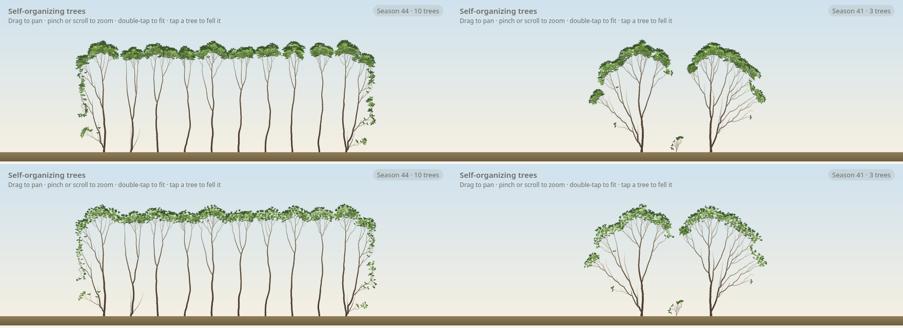

# M6d: relative shedding (C5) and short shoots (R6), calibration

## Question
Which T_rel (ADR 0007), Q_ss and a_ss (ADR 0006) satisfy several patterns at once: short-shoot leaf share > 50% (Millan et al. 2022), no extra crown losses or stalled seedlings, stand crown base and H/D unchanged, and overtopped trees keeping deeper crowns (Sprugel 2002)?

## Setup
```bash
uv run --project analysis python analysis/experiments/m6d_shedding_short_shoots.py   # T_rel × Q_ss × a_ss, 400 runs
uv run --project analysis python analysis/experiments/m6d_relative_floor.py          # T floor × T_rel, with the late tree
```
`skyStand`, `skyTree` and `late` under the sky sweep, 50 seasons, seeds 1–5.

## Result
- **Short shoots:** Q_ss 0.1, a_ss 2 gives a short-shoot leaf share of 0.50 (stand interior) and 0.58 (open-grown). Bole, H/D (67) and stalls (0) are unchanged; metamers +14%. Higher Q_ss (0.4) gives shares ≤ 0.2.
- **Relative shedding with T = 0.1 only raises thresholds:** every canopy tree's top sees near-open sky (Q_top ≈ 1), so max(T, T_rel·Q_top) acts like a larger T. T_rel ≥ 0.4 caused 50–100 crown losses (baseline 1) and lifted the open-grown tree's crown base to 24–88 cells.
- **With a low floor it works:** T = 0.03, T_rel = 0.12 keeps the canopy as at T = 0.1 (stand bole 53.6 vs 51.5, H/D 67, 0 crown losses, open tree unchanged), while the overtopped late tree keeps a crown 8.4 cells deep (vs 2.2), grows 51 metamers (vs 11) and survives in 5/5 seeds (vs 3/5).
- **Gaps:** neighbours still lean into a felled tree's gap in every seed, but less strongly (one shift +0.8 cells); R6 alone weakens the response.



## Conclusion
Sky presets now use T = 0.03 (shade-tolerance floor), T_rel = 0.12, R6 on with Q_ss 0.1, a_ss 2. Core defaults stay at the baseline (T 0.1, T_rel 0, R6 off). The relative rule's T is a floor, not the canopy threshold: revisit the §9 species values (tolerant ≈ 0.02–0.05) with this in mind at M7. Short shoots add foliage along older limbs, but the deep inner crown stays bare, as the light model says.
