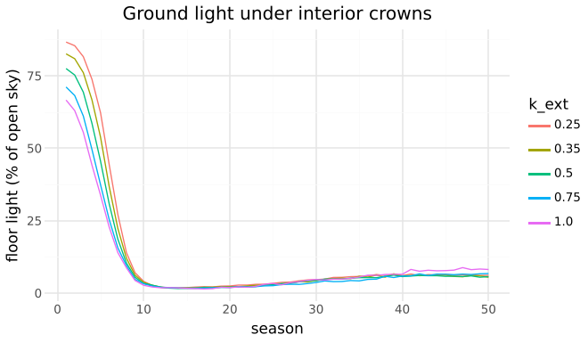
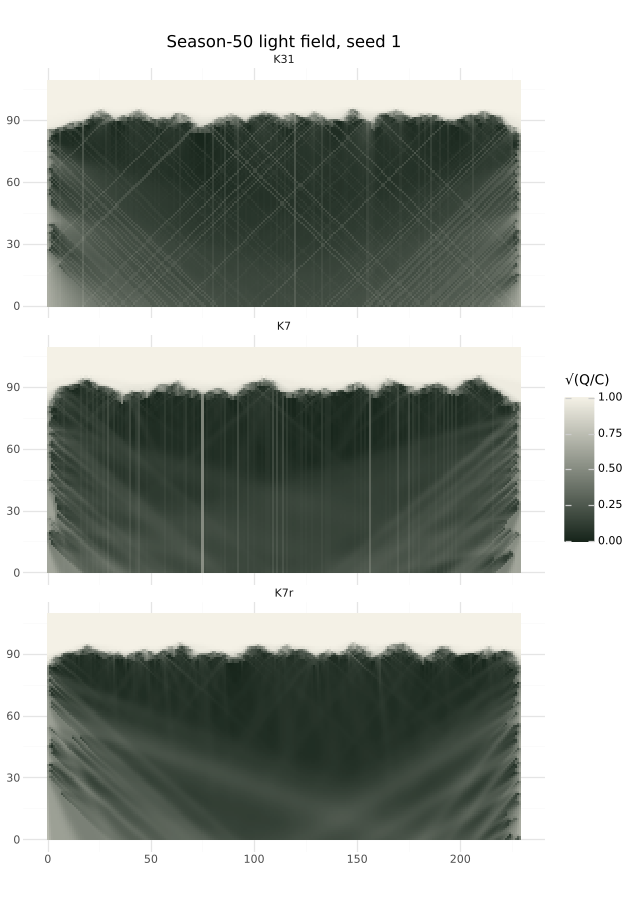

# M6e: light calibration of the sky sweep

## Question
Does the sky sweep let 2–10% of open-sky light reach the floor of a closed stand (§10; the ROADMAP calibration table), and at which k_ext? Do the tree patterns at K = 7 match a finer sky (K = 31), and does `c2.rotate` help? How does an overcast sky (p = 1.5) differ from the uniform one (p = 1)?

Expected beforehand: ground light falls as k_ext rises, so one k_ext band meets the target; K = 7 leaves streaks that bias the crown base a little.

## Setup
```bash
uv run --project analysis python analysis/experiments/m6e_light_calibration.py   # ≈ 400 runs, about 2 minutes on 4 cores
```
- `skyStand`, `skyTree` and `skyLate`, 50 seasons, seeds 1–5 (15 seeds for K = 7, K = 7 rotated and K = 31).
- New metric `groundLight`: mean Q/C in the bottom row of cells across a tree's crown, from the start-of-season field. "Floor" is its mean over interior trees 1–8, seasons 41–50.
- New CLI flag `--light` writes the per-cell field (`light.csv`) for the figure.

## Result
**1. k_ext barely moves the floor light.** Every value tested meets the target.

| k_ext | floor % (p10–p90) | interior bole | H/D | stalled | open-grown size | late tree size |
|---|---|---|---|---|---|---|
| 0.25 | 6.2 (3.4–9.4) | 50.4 | 57 | 0 | 2900 | 55 |
| 0.35 | 5.9 (3.4–9.5) | 55.5 | 63 | 0 | 2550 | 44 |
| **0.5** | **5.8 (3.1–9.3)** | **53.6** | **67** | **0** | **2123** | **51** |
| 0.75 | 6.4 (2.7–11.0) | 37.0 | 69 | 0 | 1834 | 32 |
| 1.0 | 8.0 (3.6–14.9) | 36.0 | 69 | 1 | 1673 | 38 |



- **The canopy regulates its own leaf area.** A larger k_ext gives fewer metamers (open-grown size falls by 42% from 0.25 to 1.0), so the shade a crown casts stays about the same. Shedding (C5) and short shoots (R6) set how dark the deepest foliage gets. k_ext mostly sets how much leaf area a crown carries.
- **Floor light over time:** about 80% at first, about 2% once the canopy closes (seasons 11–20), then 5–6% as crown bases lift.
- **Above 0.5, the crown base falls** (37 vs 54) and the overtopped late tree shrinks (32 vs 51). One seedling stalls at k_ext 1.0.

**2. Where the floor light comes from.** Rays from beyond the world's sides are open sky (ADR 0005), so low-angle light reaches under the lifted crowns from the edges. Floor light under each tree (k_ext 0.5, seasons 41–50):

| tree | 0 | 1 | 2 | 3 | 4 | 5 | 6 | 7 | 8 | 9 |
|---|---|---|---|---|---|---|---|---|---|---|
| % | 20.3 | 7.8 | 6.2 | 4.1 | 3.5 | 3.8 | 5.1 | 7.6 | 8.4 | 21.0 |

- **The two central trees get 3.5–3.8%** for every k_ext up to 0.75. They stand more than 80 cells from either side.
- **Closing the sides** with opaque full-height walls drops the floor to 0.6–2.6%. It also slows the whole stand: trees are 75 cells tall at season 50 instead of 96, and their crown bases have not yet lifted (median 8). A ten-tree stand in this box gets much of its light through its edges, more like a forest edge or clearing than an endless forest.

**3. K = 7 is converged for tree patterns; rotation does not change them.**

| | K7 | K7 rotated | K11 | K15 | K31 |
|---|---|---|---|---|---|
| interior bole (5 seeds) | 53.6 | 38.0 | 53.8 | 49.5 | 51.6 |
| interior bole, 15 seeds (mean ± sd over seeds) | 46.3 ± 11.2 | 46.1 ± 7.8 | | | 53.2 ± 8.9 |
| crown width | 21.5 | 21.7 | 22.0 | 22.9 | 22.4 |
| H/D | 67 | 68 | 67 | 68 | 69 |
| floor % | 5.8 | 5.0 | 6.4 | 5.4 | 6.2 |
| edge lean out | 10.1 | 10.1 | 10.2 | 10.5 | 9.3 |
| open-grown size | 2123 | 1916 | 2192 | 1864 | 2098 |
| run time, `skyStand` 50 seasons | 0.79 s | 0.89 s | 1.12 s | 1.16 s | 1.46 s |

- **Most patterns agree within seed noise.** Crown width, height, H/D, floor light, edge lean, stalls (none in any condition) and total metamers (2370 ± 127 vs 2343 ± 79 over 15 seeds) all match.
- **K = 7's crown base sits about 7 cells lower than K = 31's** (46 vs 53 over 15 seeds). That is about 2 standard errors, and small against the spread between trees (interquartile range 25–63 cells). Rotation does not close it (46.1).
- **The streaks are real but local** (figure, seed 1, season 50).
  - At K = 7, the zenith ray drops bright single-cell columns through gaps.
  - At K = 31, a fine lattice of diagonals remains.
  - Rotating at K = 7 turns the columns into soft fans that move every season.



**4. Overcast sky (p = 1.5)** against uniform (p = 1): floor 7.3% vs 5.8%, edge lean 9.0 vs 10.1 cells, bole 51 vs 54, H/D 66 vs 67. With less light from low angles, edge trees lean out a little less. The new preset `overcast` is the stand under this sky.

## Conclusion
- **Keep k_ext = 0.5, K = 7 and `c2.rotate` off.** Floor light under a closed stand is 3.5–6% (central trees and interior mean), inside the 2–10% target. No golden hash changes.
- **k_ext cannot be identified from floor light**, because the canopy adjusts its leaf area. For the §9 species knob (M7), fit k_ext on crown leaf area or density and crown depth, not on ground light.
- **The 7-cell crown-base difference is the one sampling bias left.** K = 11 removes it at 1.4× the run time. Revisit if a later milestone depends on crown base (M8's crown rise, M11's self-thinning).
- **`c2.rotate` stays as a page option.** It hides the zenith streaks in the shade overlay, but it changes no tree pattern.
- **Follow-up for M11:** the open sides make every stand an island lit from its edges. Stand-dynamics experiments need a boundary that behaves like a continuing forest, for example periodic sides or a canopy assumed beyond them.
