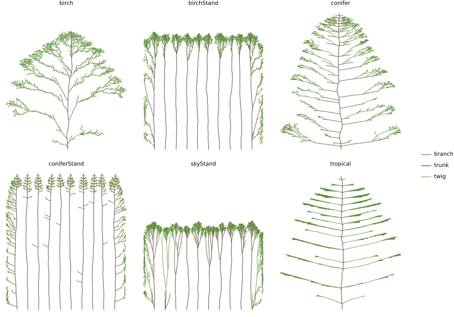

# M7: species from R2 tables

## Question
Do R2 tables (ADR 0009) turn the same local rules into the §9 silhouettes of a fir-like conifer (Massart), a birch-like pioneer and a *Terminalia*-like tropical tree (Aubréville)? Does the birch's λ decline make it "conical young, rounded old" (§R2.10)?

Expected beforehand: conifer and tropical first-order branches near horizontal, the conifer conical, the tropical tree in flat tiers widest at the base, the birch steep-branched and broader with age. Stands of conifers give narrow spires on clear boles, and the light-demanding birch lifts its crown higher.

## Setup
```bash
uv run --project analysis python analysis/experiments/m7_species.py   # 45 runs, about 20 s
```
- Presets `conifer`, `birch`, `tropical` (open-grown) and `coniferStand`, `birchStand`, against `skyTree` and `skyStand`.
- 50 seasons, seeds 1–5; stand values use the interior trees 1–8.
- `birchNoDecline` is the birch with Δλ = 0.
- The species worlds are 160 cells tall: their leaders grow ≈ 3 cells a season and hit a 110-cell ceiling by season 40.

## Result

| preset | height | width/height | bole/height | H/D | branch angle from vertical | lower/upper crown width |
|---|---|---|---|---|---|---|
| conifer | 149 | 0.61 | 0.01 | 38 | 77° | 1.61 |
| coniferStand | 150 | 0.13 | 0.64 | 78 | 77° | |
| birch | 129 | 0.80 | 0.02 | 55 | 25° | 1.21 |
| birchNoDecline | 149 | 0.54 | 0.01 | 61 | 22° | 1.13 |
| birchStand | 128 | 0.17 | 0.80 | 99 | 27° | |
| tropical | 146 | 0.64 | 0.05 | 62 | 69° | 1.27 |
| skyTree (M6d baseline) | 95 | 0.99 | 0.01 | 39 | 12° | 0.89 |
| skyStand | 96 | 0.22 | 0.56 | 67 | 13° | |



- **Conifer.**
  - One whorl per growth unit on a monopodial trunk (λ 0.58).
  - Plagiotropic branches (A_set 85°, η 2) give near-flat tiers (77° from vertical) and a cone 1.6× wider in its lower third than its upper third.
  - In a stand, interior trees are spires with a clear bole over 64% of their height.
  - The whorls carry few tips, so the pipe model first gave stand H/D 136. `c6.r0` = 0.035 brings it to 78, inside 60–80 (Watt et al. 2023). Open-grown H/D is 38.
- **Birch.**
  - Steep fine branches (25°).
  - A light-demanding shedding floor (T 0.08, T_rel 0.2) lifts the stand's crowns to 80% of height, against 64% for the shade-tolerant conifer.
  - Stand H/D 99: slender, as §9 asks for a pioneer.
  - The λ decline from age 15 broadens the crown from 0.54 to 0.80 of its height and costs 20 cells of height: the conical-young to rounded-old change.
- **Tropical.**
  - A tier every 7 trunk nodes.
  - Sympodial branch modules (p_term 1, two relays at the distal node, β 20°, η 2) form flat tiers at 69°.
  - The pagoda is widest at its base (1.27).
- **No stalls** in any run.
- **The leader never loses top position.** In every open-grown species the trunk tip stays the highest point. Decurrence shows as broadening, not as the leader being overtopped.
- **Page** (WebGL2, natural view): the tiers and the pagoda read clearly. Leaves are drawn the same for every species, so the conifer looks like a tiered broadleaf rather than a fir.

## Conclusion
- R2 tables are enough for the three architectures. The species differ only by params patches: generator, A_set, η, β, λ, p_term, the ontogeny knobs, and the species light knobs k_ext, T, T_rel and r0.
- These are qualitative fits to §9 silhouettes, not to measured trees. The Yun et al. 2025 branch-angle distributions are the next quantitative target.
- **Follow-ups:**
  - A per-species leaf style on the page (needle sprays for conifers).
  - The oak-like, willow and beech presets once R3 exists (ADR 0009).
  - Height growth is fast (≈ 3 cells a season), so species stands also need M8's plateau.
