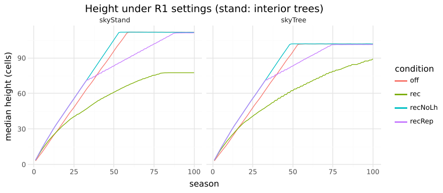

# M8: R1 carbon balance

## Question
Which R1 settings give the §7 M8 visible test (a height plateau, a suppressed tree that dies, a rising crown base) with costs of a plausible size, and what do the alternatives in ADR 0010 do?

Expected beforehand: the sapwood cost alone would level growth off, and a shaded late tree would starve.

## Setup
```bash
uv run --project analysis python analysis/experiments/m8_carbon.py   # 180 runs, about 3 minutes on 4 cores
```
- `skyTree`, `skyStand` and `skyLate`, plus "under": `skyStand` with a seedling planted at season 20 between trees 3 and 4. 100 seasons, seeds 1–5; stand values are interior trees 1–8.
- **The recommended settings** ("rec", now in the sky presets): m_w 1, m_f 0.06, L_h 60, s_r 0.1, store 2, k_starve 3, carbon-or-relative shedding, α 3.
- **"off"** is the pre-R1 stand. Every other condition changes one thing from "rec".

## Result

| condition | stand height 50 / 100 | growth 70→100 | crown base 50 → 100 | H/D 50 | stand deaths /40 | open height 100 | late tree dies /5 | understorey seedling dies /5 (seasons) | M/P |
|---|---|---|---|---|---|---|---|---|---|
| off | 96 / 112 (top) | 0 | 54 → 65 | 67 | 0 | 102 (top) | 0 | 0 | — |
| **rec** | **61 / 78** | **4.3** | **25 → 31** | **56** | **0** | **89** | **0** | **5 (5)** | **19%** |
| L_h 80 | 68 / 98 | 15.7 | 33 → 41 | 56 | 0 | 101 | 2 | 5 (5) | 18% |
| no plateau cause (L_h 0) | 105 / 112 | 0 | 32 → 46 | 68 | 12 | 102 | 4 | 5 (5) | 16% |
| reproduction instead (f_rep 0.6 from 70) | 83 / 111 | 13.3 | 26 → 38 | 62 | 2 | 101 | 4 | 5 (5) | 8% |
| C5 light rule instead of the carbon test | 61 / 77 | 4.7 | 24 → 29 | 55 | 0 | 91 | 0 | 5 (5) | 20% |
| no sapwood cost | 62 / 83 | 8.7 | 22 → 27 | 55 | 0 | 93 | 0 | 5 (4) | 14% |
| m_f 0.12 (Q_c 4%) | 57 / 69 | 2.2 | 20 → 23 | 54 | 0 | 77 | 0 | 5 (5) | 28% |
| α 2 | 46 / 56 | 1.0 | 10 → 10 | 52 | 0 | 62 | 0 | 5 (5) | 20% |



- **The plateau.** With the recommended settings the stand levels off at ≈ 78 cells, well below the 110-cell top. The open-grown tree is still rising slowly at season 100 (89 cells).
  - Without a plateau cause, trees reach the top as before.
  - Reproduction at f_rep 0.6 only slows growth; it does not stop it within 100 seasons.
- **Suppression death.** The seedling under the closed canopy (≈ 4–5% light) dies within 5 seasons in every R1 condition and lives on without R1. Its buds are below Q_ss, so they carry no leaves, and a leafless tree produces nothing.
  - The `skyLate` tree, in a three-tree gap with side light, is not truly suppressed and survives at L_h 60.
  - Under L_h 80 or without a plateau cause, taller neighbours kill it in 2–4 of 5 seeds.
- **Crown base.** It rises after canopy closure (25 → 31), but sits lower than without R1 (54 → 65) because the trees are shorter and less vigorous.
- **Costs.** Maintenance is 19% of production at season 50: stems at ≈ 10% (Ryan et al. 1995: 5–13%), plus foliage.
- **Self-thinning** does not emerge in this even, open ten-tree stand. Only the variant without a plateau cause kills stand trees (12 of 40), once they crowd against the top.
- **Things that went wrong on the way** (ADR 0010):
  - Charging live sapwood alone let trees shrink rather than starve.
  - Charging the whole C6 radius killed 12–21 of 40 stand trees, but only at a wood cost near 100% of production, which respiration studies refute.
  - Leafless dormant buds first counted as producers.
  - The seed's reserve outlasted any deficit.
  - Carrying a bud's unused resource into the next season (tried and reverted) did not unfreeze the plateau.
- **Species.** Under R1 the species presets still reach their 160-cell top or grow far too slender (stand H/D 100–160) at every α and L_h tried. They stay pre-R1 for now.

## Conclusion
- The sky presets now carry R1 with the recommended settings, which meets the visible test: a plateau, a suppressed seedling that dies, a rising crown base.
- The 70→100 growth check (4.3 against ≈ 61 in the first 50 seasons) and the seedling's death are automated in `carbon.test.ts`.
- **Follow-ups:**
  - Calibrate R1 per species (m_f as shade tolerance, L_h per species height).
  - Self-thinning on denser, uneven stands at M11.
  - Turnover at the plateau with R4 (M10).
  - Stand H/D is 56, just under the 60–80 target.
