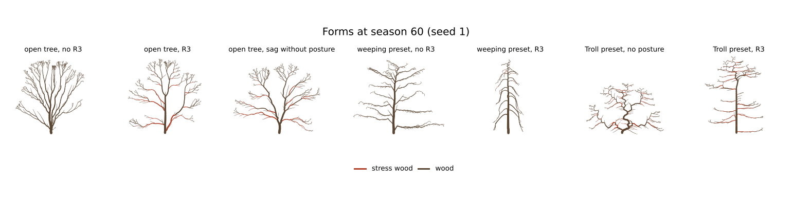

# M9: R3 mechanics

## Question
Which sag, posture and stress-girth settings give the §7 M9 visible test, without spoiling the M6–M8 stand patterns? The visible test asks for drooping limbs with upturned tips, a weeping form and Troll straightening; §10 adds Δ > 2 at heavy junctions. What do the §8 ablations do?

Expected beforehand:
- Old, heavy limbs droop because their relative girth growth Δr/r is too small for reaction wood to keep up. Young tips stay up.
- Without posture, limbs and trunks droop progressively (§8, Alméras & Fournier 2009).

## Setup
```bash
uv run --project analysis python analysis/experiments/m9_mechanics.py   # 150 runs, about 2 minutes on 4 cores
```
- **Open tree:** `skyTree` for 100 seasons, geometry read at season 60, seeds 1–5.
- **Stand:** `skyStand` with and without R3, interior trees 1–8.
- **Forms:** the `weeping` and `troll` presets at season 60, each with R3, without posture, and without R3.
- **The recommended settings** ("rec", now in the sky presets):
  - sag from the load increment (ADR 0011), E 10⁶, φ 1;
  - leaf mass 0.002 per unit of leaf area;
  - β_g 0.1, γ 0.2, c 0.05;
  - σ_target 3000, stress-girth gain 0.3.
  - Every other condition changes one thing.
- **Measures:**
  - *Droop*: base elevation minus the lowest elevation along a first-order limb of ≥ 10 metamers. *Upturn*: tip minus lowest.
  - *Trunk tilt*: median deviation of order-0 metamers from vertical. "Old" counts metamers ≥ 10 seasons old.
  - *Hanging twigs*: the share of order ≥ 1 metamers from the last 3 seasons pointing below −30°.
  - *Δ heavy*: the Leonardo exponent at junctions whose lateral carries > 10% stress wood. *Δ other*: at every other junction.

## Result

| preset, condition | height 60 | width | H/D | droop° | upturn° | trunk tilt° | hanging twigs | Δ heavy (n) | Δ other | height 100 |
|---|---|---|---|---|---|---|---|---|---|---|
| open, no R3 | 69 | 63 | 42 | 0 | 25 | 6.1 | 0 | — | 2.00 | 88 |
| **open, rec** | **70** | **80** | **43** | **22** | **15** | **1.6** | 0 | **2.08 (84)** | **2.00** | **92** |
| open, creep sag (spec as first written) | 37 | 47 | 29 | 100 | 15 | 31 | 0.21 | — | 2.00 | 13 |
| open, no posture (§8) | 64 | 87 | 38 | 56 | 13 | 34 | 0 | 2.11 (49) | 2.00 | 82 |
| open, no stress girth | 69 | 84 | 44 | 39 | 18 | 0.9 | 0.01 | — | 2.00 | 92 |
| open, E 2·10⁶ | 71 | 65 | 45 | 0 | 26 | 0.4 | 0 | 2.17 (35) | 2.00 | 93 |
| open, c 0.02 | 68 | 78 | 42 | 53 | 17 | 6.7 | 0 | 2.22 (75) | 2.00 | 87 |
| open, c 0.2 | 72 | 42 | 51 | 0 | 11 | 0.0 | 0 | 2.26 (17) | 2.00 | 98 |
| open, σ_target 1500 | 70 | 67 | 40 | 8 | 20 | 1.3 | 0 | 2.04 (303) | 2.00 | 92 |
| stand, no R3 | 67 | 20 | 58 | 0 | 22 | 5.0 | 0 | — | — | — |
| **stand, rec** | **68** | **19** | **65** | 6 | 15 | **1.4** | 0 | — | — | — |
| weeping, no R3 | 68 | 83 | 40 | 4 | 11 | 4.0 | 0.25 | — | — | — |
| **weeping, R3** | 68 | 29 | 42 | 73 | 11 | 0.0 | **0.59** | — | — | — |
| weeping, no posture | 65 | 76 | 37 | 22 | 10 | 5.5 | 0.37 | — | — | — |
| **Troll, R3** (old trunk) | 89 | 54 | 70 | — | — | **0.5** | — | — | — | — |
| Troll, no posture | 48 | 68 | 32 | — | — | 95 | — | — | — | — |
| Troll, no R3 | 62 | 80 | 38 | — | — | 45 | — | — | — | — |



- **Arching limbs.** With R3, old first-order limbs bend 22° below their base angle, and their tips turn back up 15°.
  - The crown widens (80 against 63 cells), and height is unchanged.
  - Stiffer wood (E 2·10⁶) or faster reaction wood (c 0.2) remove the droop. Slower reaction wood (c 0.02) doubles it.
  - The shape is a balance between load increments and girth growth, as Alméras & Fournier's stability ratio predicts.
- **Creep collapses trees.** With the spec's first rule, θ += φ·κ_e·l on the whole load every season, limbs keep sinking after growth slows. By season 60 trees are half as tall, and by season 100 they lie on the ground (13 cells). The user chose the load-increment rule (ADR 0011).
- **Posture (§8 ablation).** Without it, trunks tilt 34° and limbs droop 56°. With it, trunks stand within 2° of vertical, straighter than without R3 (6°). C4's noise leaves kinks that proprioception now irons out.
- **Weeping.** Limbs grow out at 50° but set toward 140°, and twigs toward 175°. The trunk's posture holds it upright.
  - The crown narrows to a column of arches (width 29). 59% of young twigs hang below −30°, against 25% without R3.
  - Without posture, the twigs still hang (37%) but the scaffold sprawls.
  - The first attempt, with low E for the whole tree, buckled the slender trunk. The preset now uses E 2·10⁶, r0 0.03 and c 0.3.
- **Troll.** The trunk's shoots grow at 70° from vertical, yet its wood older than 10 seasons stands within 1° of vertical: secondary straightening.
  - Without posture the same tree sprawls (95°, height 48). Without R3 it leans at its growth angle (45°).
  - On the page the top few seasons arch over and the trunk below rises in a staircase.
- **Stress wood and Δ.** Junctions whose lateral carries stress wood have Δ 2.08; all others stay at 2.00.
  - A lower σ_target spreads stress wood to 300 junctions and pulls Δ back toward 2, because parents get it too.
  - Without stress girth, limbs droop more (39° against 22°), since thicker bases are stiffer.
- **Stand.** R3 barely changes the stand: height 68, width 19, edge lean −6.8 against −7.3. H/D rises from 58 to 65, into the 60–80 target, and trunks straighten from 5° to 1.4°. M8's checks (`carbon.test.ts`) pass with R3 on.
- **Cost.** About 7 ms a season for the ten-tree stand with or without R3: the two passes are lost in the light sweep.

## Conclusion
- The sky presets now carry R3 with the recommended settings. The visible test is automated in `mechanics.test.ts` (5 seeds each):
  - limb droop > 10° and upturn > 8° (against < 3° without R3);
  - trunks < 10° with posture, > 20° without;
  - weeping > 60% of twigs hanging, against < 35% without R3;
  - the old Troll trunk < 10° from vertical, > 60° without posture;
  - Δ heavy > 2.03 with Δ other at 2.
- **Follow-ups:**
  - Breakage (σ_break) with R4 release at M10.
  - Calibrate oak, willow and beech as species after the main milestones (ADR 0009). The two presets here are demonstrations.
  - Limbs can sink below the ground; ground contact is not modelled.
  - Wind loads (O2) would dominate real stem design.
