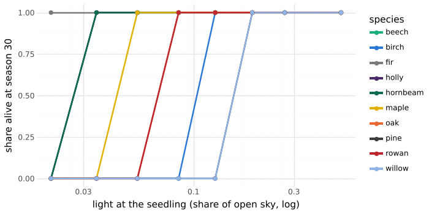
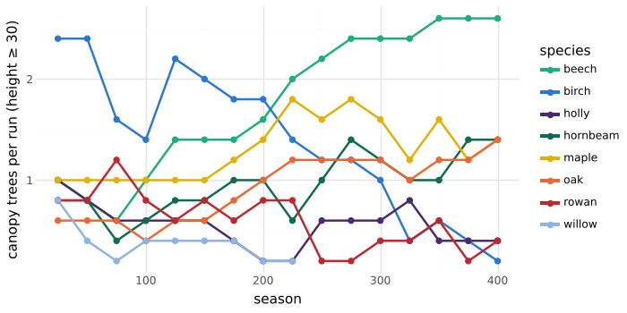

# M25: six new species and the mixed wood

## Question
Can six more species be fitted the M19 way, from per-tree patches alone (ADR 0016)? The six are hornbeam, field maple, holly, rowan and goat willow for the home forest, and Scots pine for the lab. Then, with no scripting, does a wood of nine of them sort itself the way mixed lowland woods do?

Expected beforehand:
- **Shade survival order:** pine ≈ willow < birch < oak ≈ rowan < maple < hornbeam ≈ holly ≈ beech.
- **Stand floors:** deep shade under hornbeam and holly, light shade under pine and willow.
- **Form:** a broad, low willow; a round maple; a conical holly; steep rowan limbs; pine with a high crown in a stand.
- **The mixed wood:** pioneers (birch, willow) lead early and fade. Beech takes the canopy, with hornbeam beside it. Holly, rowan and maple hold on beneath and in gaps.

## Literature targets

| Pattern | Target | Source |
|---|---|---|
| Shade-tolerance score (0–5) | Pinus sylvestris ≈ 1.7, Salix caprea ≈ 2, Betula 2.03, Quercus robur 2.45, Sorbus aucuparia ≈ 2.7, Acer campestre ≈ 3.2, Carpinus betulus ≈ 4, Ilex aquifolium ≈ 4, Fagus 4.56, Abies 4.6 | Niinemets & Valladares 2006, Appendix A. The new species' values are approximate: the appendix (esapubs.org) could not be reached from this session. **Verify before quoting.** |
| Holly seedlings | tolerate moderate shade, not deep shade: high mortality at 1% light, best survival at 12% (continental Spain; a facultative understorey tree in oceanic climates) | [Valladares et al. 2005](https://consensus.app/papers/details/b57cf88dba3b59e6bcdc75ade4c09517/?utm_source=claude_desktop) |
| Hornbeam against beech and oak | after storm gaps, beech and hornbeam saplings outnumber oak's about 9 to 1 | [Dietz et al. 2022](https://consensus.app/papers/details/38777eeceab856b89abbad1009ca8e63/?utm_source=claude_desktop) |
| Hornbeam against beech | hornbeam grows far more slowly than beech and is the weaker competitor; it is abundant in advance regeneration but recruits poorly to the canopy | [Szwagrzyk et al. 2012](https://consensus.app/papers/details/df480fb3180f5d3399da47b94410b17c/?utm_source=claude_desktop) |
| Shade-tolerant over light-demanding saplings | hornbeam, beech and ash survive and grow better than oak in gaps and under canopy | [Tinya et al. 2020](https://consensus.app/papers/details/c94dbffd81c650d1b1d4b001d5187af9/?utm_source=claude_desktop) |
| Rowan, holly, beech | in a mixed wood left alone, beech gains ground over holly, rowan and oak once the canopy closes | [Rubio-Cuadrado et al. 2024](https://consensus.app/papers/details/ce6e3c86203455939796012e6c1fa8ee/?utm_source=claude_desktop) |
| Field maple, hornbeam | slower-growing than beech and oak; field maple drought-hardy | [Schmucker et al. 2023](https://consensus.app/papers/details/99224059f2fa5278aab1f1febd922dd1/?utm_source=claude_desktop) |
| Size (field guides) | mature height: goat willow ≈ 10 m, holly and rowan 10–15 m, field maple 15–20 m, hornbeam 20–25 m, Scots pine 25–35 m (against beech's 30–40 m) | standard floras |

## Setup
```bash
uv run --project analysis python analysis/experiments/m25_species.py   # 300 runs, about 90 s
```

The settings are M19's (`oakOpen` principles, 5 seeds each): a lone tree on 160 × 160 for 60 seasons; a stand of ten, interior trees, for 60 seasons; and a shade house at eight roof densities for 30 seasons. Then the `mixedWood` preset, 400 seasons, 5 seeds. Canopy means at least 30 cells tall; understorey means 5–30.

**The mixed wood** is a 210-cell ring, one tree every 21 cells: birch, oak, goat willow, beech, birch, hornbeam, rowan, birch, holly and field maple. It has storms and O4 recruitment, like `succession`. The home forest (`forestParams`) plants the same cycle, turned by the seed.

**What the new species differ by:**
- **Shade survival,** through Q_ss (`r6.qMin`):

  | Species | Q_ss |
  |---|---|
  | willow, pine | 0.15 |
  | rowan | 0.06 |
  | maple | 0.045 |
  | hornbeam, holly | 0.03 |

- **Leaf economics,** α and m_f:
  - willow 5.5 and 0.12: fast and costly;
  - pine 3.8 and 0.09;
  - rowan 3.6 and 0.08;
  - maple 3.2 and 0.05;
  - hornbeam 3 and 0.04;
  - holly 2.6 and 0.03: evergreen leaves live several years, so their cost each season is low.
- **Height,** through L_h: willow 30, holly 25 (with a low α), rowan 38, maple 45, hornbeam 50, pine 60. The small trees also mature small (`r1.maturity` 20–30, against the woodland's 40), so they seed.
- **Form:**
  - **Hornbeam:** Troll's model, like beech, with weaker apical control.
  - **Maple:** decurrent, with ascending limbs and stiff wood (E as oak's), so the crown is round.
  - **Holly:** strong apical control and wide limbs: a cone that keeps its shaded lower limbs (T_rel 0.02).
  - **Rowan:** steep limbs (35–40°).
  - **Willow:** apical control fades by season 6, and it sheds less than birch (T_rel 0.25). Low limbs spread from a short, stout stem.
  - **Pine:** Rauh's model with whorled tiers. It sheds hard (T_rel 0.3), so stands lift their crowns, while open-grown pines keep low limbs.
- **Life history (O4):**
  - **Willow:** cheap plumed seeds (c_seed 1.5) blow far (d 60) but need lit ground (Q_est 0.3), and it dies young (m₀ 0.012).
  - **Rowan and holly:** bird-carried berries travel far (d 50, 40).
  - **Holly** is dioecious, so only about half its trees fruit. A doubled seed cost (8) stands in for that.
  - **Hornbeam and maple:** winged fruit, d 20–25.

## Result

| Species | Open H | Open W/H | Open H/D | Open branch angle | Stand H | Stand H/D | Stand crown ratio | Stand floor | Lowest light all seedlings survive |
|---|---|---|---|---|---|---|---|---|---|
| Birch | 89 | 0.46 | 65 | 43° | 69 | 71 | 0.43 | 19% | 13% |
| Oak | 75 | 1.66 | 42 | 56° | 75 | 75 | 0.38 | 6% | 8% |
| Beech | 84 | 1.06 | 40 | 57° | 79 | 68 | 0.47 | 3.4% | 3% |
| Fir | 110 | 0.41 | 49 | 75° | 84 | 65 | 0.76 | 6% | 2% |
| **Hornbeam** | 62 | 1.46 | 37 | 54° | 64 | 61 | 0.31 | 2.4% | 3% |
| **Field maple** | 62 | 0.97 | 57 | 45° | 59 | 74 | 0.40 | 3.4% | 5% |
| **Holly** | 63 | 0.49 | 55 | 65° | 54 | 62 | 0.76 | 2.4% | 3% |
| **Rowan** | 65 | 0.73 | 68 | 39° | 54 | 74 | 0.60 | 10% | 8% |
| **Goat willow** | 44 | 2.31 | 29 | 53° | 43 | 40 | 0.48 | 13% | 19% |
| **Scots pine** | 75 | 0.86 | 39 | 71° | 67 | 54 | 0.37 | 17% | 19% |

(Floors are from 3 seeds, the scratch harness that `flora.test.ts` mirrors; everything else is from 5.)



- **Shade tolerance.** The order matches the expected one:

  | Lowest light all seedlings survive | Species |
  |---|---|
  | 19% | pine, willow |
  | 13% | birch |
  | 8% | rowan, oak |
  | 5% | maple |
  | 3% | hornbeam, holly, beech |
  | 2% | fir |

  Holly survives 3% but not 2%, in line with Valladares et al. (high mortality at 1%).
- **Floors.**
  - Hornbeam and holly cast the deepest shade of all (2.4%).
  - Pine (17%) and willow (13%) let the most through, after birch (19%).
- **Form.**
  - Willow is the broadest tree (W/H 2.3) and the squattest (H/D 29).
  - Holly is a narrow cone (W/H 0.49) that keeps three quarters of its stem in crown, even in a stand.
  - Maple is round (W/H 0.97), and rowan's limbs are the steepest (39°).
  - Pine stands lift their crowns (crown ratio 0.37), with whorled tiers at 71°.
- **Size.** Willow is the smallest tree (44 cells, 11 m). Hornbeam, maple, holly and rowan reach 60–65 cells in the open at 60 seasons, and beech 84.



**The mixed wood** (canopy trees per run, mean of 5 seeds):

| Season | Beech | Birch | Hornbeam | Maple | Oak | Holly | Rowan | Willow |
|---|---|---|---|---|---|---|---|---|
| 50 | 0.8 | 2.4 | 0.8 | 1.0 | 0.6 | 0.8 | 0.8 | 0.4 |
| 100 | 1.0 | 1.4 | 0.6 | 1.0 | 0.4 | 0.6 | 0.8 | 0.4 |
| 200 | 1.6 | 1.8 | 1.0 | 1.4 | 1.0 | 0.2 | 0.8 | 0.2 |
| 300 | 2.4 | 1.0 | 1.2 | 1.6 | 1.2 | 0.6 | 0.4 | 0 |
| 400 | 2.6 | 0.2 | 1.4 | 1.4 | 1.4 | 0.4 | 0.4 | 0 |

- **Pioneers.** Birch leads for a century, and storm gaps keep it in the canopy to about season 250; by 400 it is almost gone. Goat willow holds a few small trees until about season 225 and then dies out. Its seeds need lit ground that an understorey of hornbeam, holly and maple seldom leaves.
- **Beech** rises steadily to the most canopy trees, with 3.6 more per run coming up beneath at season 400.
- **Hornbeam** rises beside it, as in oak–hornbeam–beech woods. Its saplings are always in the understorey (Dietz et al. 2022).
- **Field maple** does better than expected: it holds 1.4–1.6 canopy trees from season 200, with many saplings.
- **Oak** holds on at about one tree a run. Storm gaps let it back in, but its saplings rarely reach the canopy.
- **Holly and rowan** persist as small trees, in the canopy count and below it. Holly's numbers hinged on its seed cost: at c_seed 4 it overran the wood (3 canopy and 6 understorey trees a run by season 400), so the dioecy correction matters.

## Deviations and caveats
- **The new species' tolerance scores are approximate** (see the targets). The ordering is standard, but the numbers should be checked against Niinemets & Valladares's appendix.
- **Field maple's floor (3.4%) is as dark as beech's,** where maple should cast lighter shade. With opposite buds on every axis, which doubles the buds in the plane, it was darker still (2.5%), so maple now uses distichous buds (one a node in the plane, as a decussate pair turning 90° gives).
- **Field maple may be too vigorous** in the mixed wood: it is as common in the canopy as hornbeam.
- **Goat willow never re-establishes after its first generation.** A real wood reseeds willow into large storm gaps or clearings. The model's storms snap and throw single trees, which leaves the shade-bearers' understorey in place. A bigger disturbance (a clearing, or a felled patch in the garden) should let it back in; that is not tested here.
- **Rowan stands are slender (H/D 74),** and so is the open-grown rowan (68). Rowan is a slender tree, but the open value is likely high.
- **Pine is a lab species,** calibrated only in the open and in pure stands. Open-grown, it reads as a young pine (conical, whorled), not the flat-topped old pine of the Caledonian forest. That would need R2's late loss of apical control over more seasons.

## Conclusion
- The six new species, again from patches alone, reproduce:
  - the published shade-tolerance order;
  - holly's tolerance band;
  - deep shade under hornbeam and holly, light shade under pine and willow;
  - each species' characteristic form.
- In the mixed wood, pioneers fade, beech and hornbeam rise, and holly, rowan and maple persist beneath. That is the composition of an old lowland wood, and it emerges without scripting.
- **Follow-ups:**
  - check the tolerance scores against the appendix;
  - lighten field maple's shade, perhaps with a lower α;
  - willow's return after large disturbances.
