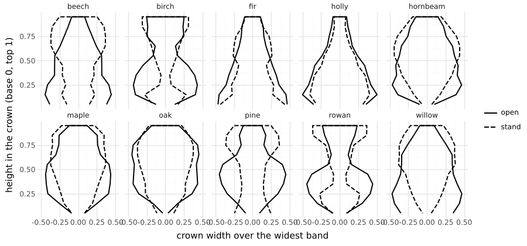
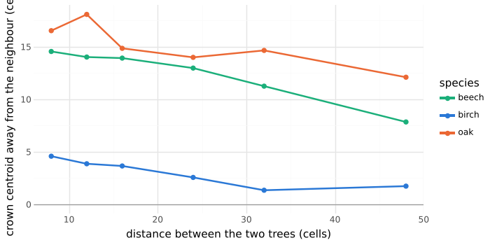
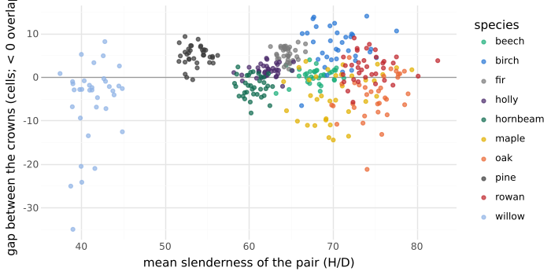
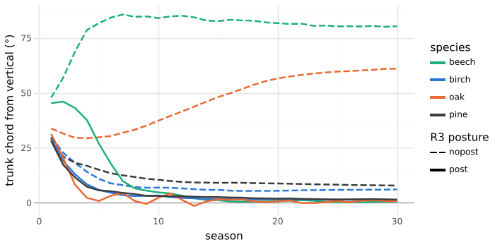

# M26: the unmeasured §10 targets, and crown form

## Question
Five §10 validation targets had never been measured. Do they emerge from the calibrated species? And what does each species' crown look like as numbers (`src/core/form.ts`), before M27 fits species to the literature?

Expected beforehand:
- **Junction exponent Δ:** about 2 everywhere, since C6 imposes n = 2 and stress wood is rare.
- **Length–diameter slope** (l ∝ d^(2/3), McMahon & Kronauer 1976): unclear. Elastic similarity isn't built in.
- **Leaf–section slope** (≈ 1, Shinozaki et al. 1964): close to 1, since the pipe model is that rule.
- **Neighbour response** (Purves et al. 2007): crowns displaced away from a neighbour, more so when it is close.
- **Crown shyness** (van der Zee et al. 2021): a gap that widens with slenderness. Probably absent, since O2 abrasion is off.
- **Gravitropic recovery** (Bastien et al. 2013): a tilted stem rights itself, overshooting a little, with R3 posture control. Without it, it does not.

## Setup
```bash
uv run --project analysis python analysis/experiments/m26_validation.py   # 230 runs, 77 s on 4 cores
```

- **Base:** M25's settings, the `oakOpen` woodland principles, all ten species, 5 seeds, measured at season 60:
  - **Lone tree:** 160 × 160.
  - **Stand:** ten trees 21 cells apart; interior trees 2–7.
- **Neighbour response:** birch, oak and beech, two trees 8–48 cells apart, at season 40. The crown centroid's offset *away* from the neighbour.
- **Crown shyness:** in the stands, the horizontal gap between adjacent crowns (negative = overlap), against the pair's mean H/D.
- **Gravitropic recovery:** a seedling planted at 40° to the right (new `trees[].lean`) of oak, beech, birch and pine, with R3 posture control on and off (new CLI `--species-patch`). Measured each season:
  - the trunk's chord (root to the top of the trunk axis);
  - the mid-stem metamer's tilt.

## Result

### Allometry (season 60, open and stand pooled)

| Species | Δ | l–d slope (± SD) | leaf–section slope (± SD) |
|---|---|---|---|
| beech | 2.0 | 1.01 ± 0.13 | 0.64 ± 0.07 |
| birch | 2.0 | 0.21 ± 0.71 | 0.46 ± 0.13 |
| fir | 2.0 | 1.05 ± 0.31 | 0.75 ± 0.08 |
| holly | 2.0 | 1.05 ± 0.16 | 0.74 ± 0.07 |
| hornbeam | 2.0 | 1.09 ± 0.39 | 0.57 ± 0.04 |
| maple | 2.0 | 1.41 ± 0.61 | 0.61 ± 0.08 |
| oak | 2.0 | 0.83 ± 0.27 | 0.49 ± 0.15 |
| pine | 2.0 | 0.74 ± 0.56 | 0.50 ± 0.10 |
| rowan | 2.0 | 1.05 ± 0.88 | 0.60 ± 0.11 |
| willow | 2.0 | 0.99 ± 0.27 | 0.47 ± 0.10 |
| **§10 target** | 1.8–2.3 | 2/3 | ≈ 1 |

- **Δ:** in the band, trivially. The median sits at the imposed n = 2 (M9 showed Δ > 2 only at the few junctions with stress wood).
- **l–d slope:** about 1, not 2/3. Limbs are geometrically similar (length grows with diameter), not elastically similar. Birch's and rowan's estimates are noisy: few limbs reach five metamers.
- **Leaf–section slope:** 0.46–0.75, below 1. C6's memory explains it: a section never thins, so old wood keeps the area of foliage it has since lost. The pipe model's proportionality concerns *functional* (sapwood) area, which R1 already tracks (r_live). Total section area includes the heartwood of lost pipes, so a slope below 1 is expected once branches have been shed. Measured against r_live it would be 1 by construction.

### Crown form



| Species | Grown | Widest at | Fullness | Fork height | Leader dominance | Order-2 angle |
|---|---|---|---|---|---|---|
| fir | open | 0.09 | 0.53 | 0.94 | 4.1 | 66° |
| holly | open | 0.15 | 0.54 | 0.90 | 3.2 | 54° |
| beech | open | 0.15 | 0.57 | 0.84 | 2.2 | 68° |
| birch | open | 0.33 | 0.54 | 0.84 | 3.2 | 45° |
| rowan | open | 0.35 | 0.49 | 0.82 | 2.9 | 46° |
| pine | open | 0.45 | 0.51 | 0.84 | 3.1 | 51° |
| hornbeam | open | 0.29 | 0.62 | 0.69 | 2.0 | 61° |
| maple | open | 0.41 | 0.59 | 0.45 | 2.6 | 49° |
| oak | open | 0.57 | 0.64 | 0.23 | 1.4 | 45° |
| willow | open | 0.29 | 0.65 | 0.15 | 1.1 | 28° |

What the numbers show:
- **Apical control** orders the species the way field guides do:
  - fir, holly, birch and pine are excurrent (fork height 0.84–0.94, the leader 3–4 times its thickest limb);
  - oak and willow fork low (0.15–0.23) with a leader no thicker than its limbs;
  - maple and hornbeam sit between.
- **Shape:**
  - fir and holly are cones (widest in the lowest bands);
  - oak, maple and hornbeam are full ellipses (fullness 0.59–0.64);
  - a stand pushes every broadleaf's widest band up (0.55–0.74), the crown lifting as in real stands, while fir stays a cone.
- **Misses** for M27 to fit:
  - **Open-grown birch** has an hourglass profile: widest at the base and again at the top. A birch should be a narrow oval.
  - **Beech** is widest at the bottom (0.15). An open-grown beech is a broad dome, widest at mid-crown.

### Neighbour response (season 40)



| Spacing (cells) | 8 | 12 | 16 | 24 | 32 | 48 |
|---|---|---|---|---|---|---|
| beech | 14.6 | 14.0 | 13.9 | 13.0 | 11.3 | 7.8 |
| birch | 4.6 | 3.9 | 3.7 | 2.6 | 1.3 | 1.7 |
| oak | 16.5 | 18.1 | 14.9 | 14.0 | 14.7 | 12.1 |

Every crown is displaced away from its neighbour, and the displacement falls with distance: Purves et al.'s pattern. Narrow birch shifts least; broad oak still shifts at 48 cells, inside its own crown radius.

### Crown shyness (stands, season 60)



- **No association:** gap against slenderness has Spearman ρ = 0.02 over all pairs (within species −0.11 to 0.34).
- **Gaps are a species trait:** birch, fir and pine crowns stand apart (94–100% of pairs, mean gap 5–7 cells); oak, maple, hornbeam and willow interlock (17–34% apart).

That is as expected with O2 off. Light competition alone separates narrow, light-demanding crowns. Nothing links the gap to sway.

### Gravitropic recovery (planted at 40°)



| Species | Posture | Chord at 5 | at 15 | at 30 | Mid-stem minimum |
|---|---|---|---|---|---|
| oak | on | 1° | 1° | 1° | −15° |
| oak | off | 30° | 48° | 61° | 16° |
| beech | on | 27° | 1° | 1° | −15° |
| beech | off | 82° | 83° | 80° | 40° |
| birch | on | 6° | 2° | 1° | −9° |
| birch | off | 11° | 6° | 6° | −10° |
| pine | on | 6° | 3° | 1° | −9° |
| pine | off | 15° | 9° | 8° | −11° |

- **With posture control:** every stem rights itself within 5–10 seasons. The mid-stem swings 9–15° past vertical on the way, then settles: Bastien et al.'s overshoot and straightening.
- **Without it:** oak and beech sag further under their own weight.
- **Birch and pine** come close to upright anyway: their upward tropism (C4 η) steers new growth, though the old stem keeps a residual 6–8° lean.

`mechanics.test.ts` checks the oak case over 5 seeds.

## Conclusion
- **As predicted:**
  - Δ, the neighbour response and gravitropic recovery match their targets;
  - crown shyness is absent, as expected without O2.
- **Misses:**
  - **The l–d slope is about 1, not 2/3.** The model has no rule that would make limbs elastically similar: girth follows the pipe model and length follows allocation. §11.2 already says Leonardo's and elastic similarity's explanations are contested. Recorded, not fixed. A fit that pushed it toward 2/3 would have to do so through R3's stress wood.
  - **The leaf–section slope is below 1,** because section area includes heartwood (C6 memory). Not a defect.
- **The form metrics separate the species** along field-guide lines, so they can be fit targets. Birch's hourglass and beech's bottom-heavy crown are the clearest misses for the M27 pilot.
- **Follow-ups:**
  - Report the leaf–section slope against live pipe area (r_live) as well.
  - M27's hold-out set includes Δ, the l–d slope and the neighbour response, so a fit can't trade them away unseen.
