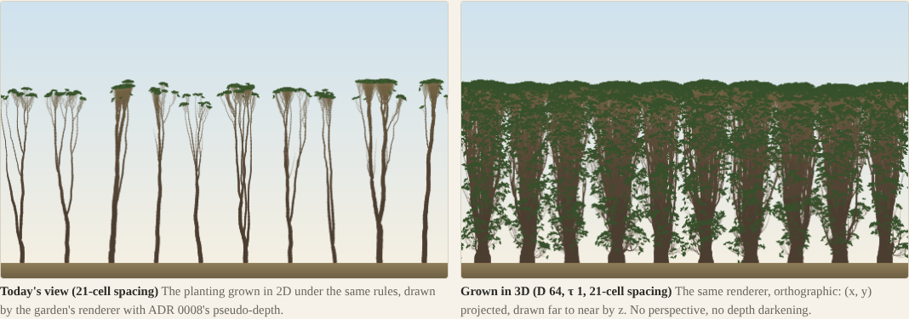
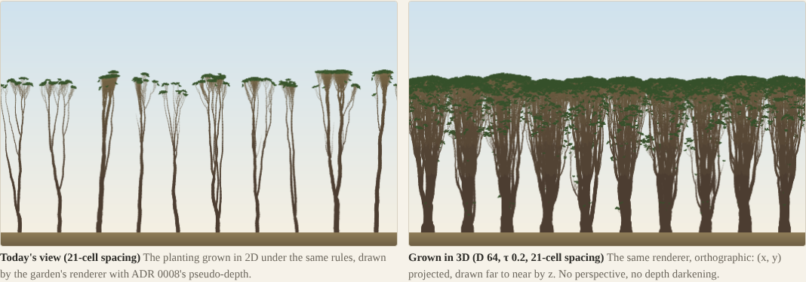
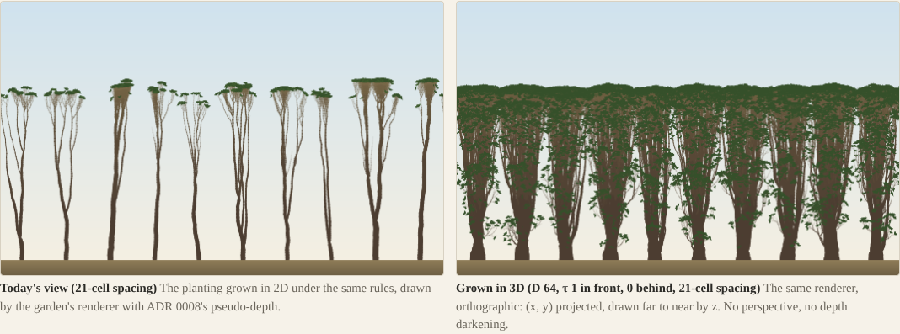
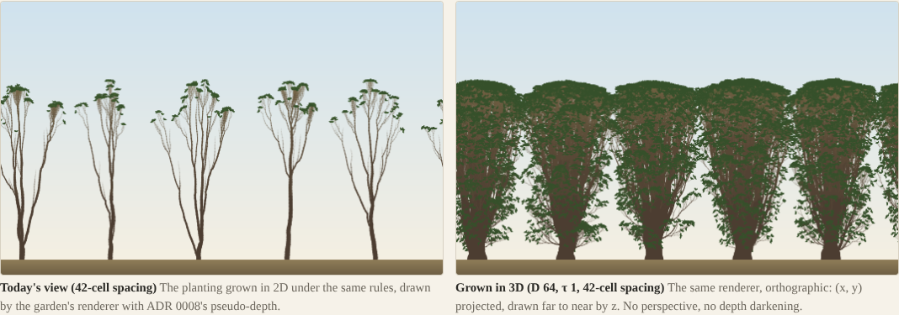

# 3D port: the faces' transmission τ, and what makes the prototype's stands read as hedges

## Question
The prototype's 3D stands read as hedges, leafy to the ground ([prototype note](2026-10-29-proto3d.md)). The user's thesis (2026-10-29): this is structural, not uncalibrated. With open sky beyond both z faces, the lower crown on each side is the best-lit foliage a tree has. It keeps that foliage, and R4 and R5, which prune unproductive foliage, would not prune it. So the faces decide the look, and that has to be seen before G2.

Asked:
1. Add a face transmission τ to the slab light, so the sky beyond each z face is attenuated by τ (1 is today's open sky, 0 is a dark face: the row standing inside a wood). Run the R6 set at D = 48 and 64 for τ ∈ {1, 0.5, 0.2, 0}, 100 seasons. Report:
   - the foliage profile across z;
   - the crown depth;
   - the share of each tree's leaves below half its height (the "leafy to the ground" measure);
   - m.
2. One wider planting (twice the 21-cell spacing) at τ = 1, for a row of individual trees.
3. All of them on the proto page beside today's 2D stand under the same rules.

**Added, and why:**
- **A wood edge** is one-sided: open country in front, a wood behind. No single τ makes one, so τ is set per face. The runs are front 1 with back 0, and front 1 with back 0.2.
- **The same "below half" share on today's full 2D model** (`forest`, `mixedWood`, `oakOpen`), as an anchor.
- **A measure of what the picture shows below half height,** since the share turned out not to separate the 3D stands from today's garden (Result §3).

## Setup
**Code:** this branch at 06447ed plus this session's changes; nothing in `src/` changed. Node 24, the same 4-core VM.

**τ** (`cli/slab-light.ts`, `SlabSweep`'s new last argument, default 1, so the bench is unchanged):
- The sweep marches rows down from the stand's top. A ray that enters the slab through a z face picks up a depth G from the padded line outside the slab.
- That pad was 0, the open sky. It is now −ln τ / k_ext (τ = 0 uses 50 / k_ext).
- So every direction arriving through a face below the stand's top carries transmission τ, as if a wood as tall as the stand stood beyond it. Above the top the sky stays open.
- One τ for both faces, or [front, back], where front is the viewer's face (z < 0, drawn last).
- **τ = 1 reproduces the prototype's stands exactly:** d48-hard has 87 294 metamers at season 40 and 150 852 at 100, so m is 20.1 and 8.8, as in the prototype note.

**The stands:** the prototype's R6 set (C1–C6, R1, R6; [setup](2026-10-29-proto3d.md#setup)):
- `forest`'s 10 trees on the 210 ring, at z = D/2, seed 1, hard faces;
- "wide": every other tree, so 5 trees 42 cells apart. Its 2D reference is the same 5 trees.

```bash
R6=1 SET=-a node docs/experiments/code/2026-10-29-proto3d/run.ts runs/proto3d-tau d48-hard d48-t050 d48-t020   # and -b … -f
python3 docs/experiments/code/2026-10-29-proto3d/agg_tau.py runs/proto3d-tau     # tables 1, 2, 4
OUT=runs/proto3d-tau/stands node docs/experiments/code/2026-10-29-proto3d/anchor2d.ts forest mixedWood oakOpen
python3 docs/experiments/code/2026-10-29-proto3d/cover.py runs/proto3d-tau/stands   # table 3
```

**The measures** (all leaf-area weighted, counting active buds and short shoots, as the light sees them; the prototype note counted every live bud):
- **Below half:** per tree, the leaf area below half the tree's height over its total.
  - p10, p50 and p90 are taken over trees.
  - In the 2D anchors only canopy trees are scored (those reaching half the tallest), so saplings do not count.
- **Cover below and above half:** the leaves projected to the picture's (x, y) in 1-cell cells, over the columns that hold any leaf.
  - H is the canopy trees' median height.
  - Cover is the share of cells holding a leaf below H/2, and from H/2 to H.
  - "Leaves per cell" is the mean count in a covered cell, which is how opaque the cell reads.
- **Crown depth:** the z extent of each tree's leaves, p50. **Faces:** leaf area in the outer 2 cells on each side, against an even spread's 4/D.

Per-season times were taken with 4–6 runs sharing 4 cores, so they are not used. Costs are scaled from the review's §2 instead (Result §5).

## Result

### 1. m, crown depth and the faces (3D over 2D under the same rules)

| Config | Season | 3D metamers | m | Crown depth | Faces (even) | Beyond |
|---|---|---|---|---|---|---|
| D 48, τ 1 | 40 | 87 294 | 20.1 | 48.0 | 5.7% (8.3) | 40 |
| | 100 | 150 852 | 8.8 | 48.0 | 12.8% | 0 |
| D 48, τ 0.5 | 40 | 72 530 | 16.7 | 43.5 | 0.1% | 0 |
| | 100 | 112 551 | 6.6 | 44.5 | 0.1% | 0 |
| D 48, τ 0.2 | 40 | 60 826 | 14.0 | 39.9 | 0 | 0 |
| | 100 | 99 118 | 5.8 | 37.5 | 0 | 0 |
| D 48, τ 0 | 40 | 54 440 | 12.5 | 35.1 | 0 | 0 |
| | 100 | 88 877 | 5.2 | 33.4 | 0 | 0 |
| D 48, edge 1 / 0 | 40 | 70 886 | 16.3 | 41.9 | 3.8% | 30 |
| | 100 | 115 414 | 6.7 | 41.6 | 9.4% | 0 |
| D 48, τ 1, 42 cells | 40 | 78 238 | 23.4 | 48.9 | 5.1% | 118 |
| | 100 | 125 611 | 21.2 | 48.0 | 10.8% | 0 |
| D 64, τ 1 | 40 | 88 849 | 20.5 | 55.6 | 0 (6.2) | 0 |
| | 100 | 150 050 | 8.7 | 63.9 | 2.0% | 0 |
| D 64, τ 0.5 | 40 | 78 325 | 18.0 | 49.5 | 0 | 0 |
| | 100 | 124 455 | 7.2 | 52.0 | 0 | 0 |
| D 64, τ 0.2 | 40 | 71 378 | 16.4 | 46.1 | 0 | 0 |
| | 100 | 108 801 | 6.3 | 46.4 | 0 | 0 |
| D 64, τ 0 | 40 | 65 640 | 15.1 | 43.5 | 0 | 0 |
| | 100 | 113 679 | 6.6 | 43.2 | 0 | 0 |
| D 64, edge 1 / 0 | 40 | 78 797 | 18.1 | 50.6 | 0 | 0 |
| | 100 | 121 871 | 7.1 | 53.8 | 1.2% | 0 |
| D 64, edge 1 / 0.2 | 40 | 78 326 | 18.0 | 51.4 | 0 | 0 |
| | 100 | 125 335 | 7.3 | 56.4 | 1.4% | 0 |
| D 64, τ 1, 42 cells | 40 | 78 536 | 23.5 | 60.7 | 0.2% | 0 |
| | 100 | 130 727 | 22.1 | 64.0 | 1.8% | 0 |

- **2D references:** 4342 metamers at season 40 and 17 168 at 100 (10 trees); 3340 and 5923 (5 trees, 42 cells).
- **Median height** is the same everywhere: 56–57 at season 40 and 83–86 at season 100. **Crown width in x** is 24–27 (closed row) and 44–46 (42 cells).
- Seasons 20 and 60 are in `runs/proto3d-tau/agg.txt`, made by `agg_tau.py`.

**Darker faces mean fewer metamers and shallower crowns:**
- **m:** 20.5 at τ 1 falls to 18.0, 16.4 and 15.1 at τ 0.5, 0.2 and 0 (D 64, season 40). At D 48 it falls from 20.1 to 12.5.
- **Crown depth:** at τ ≤ 0.5 crowns pull back from the faces to 33–52 cells. They fill neither D, so **nothing piles at the faces at any τ < 1.**
- **The pile is a τ = 1 effect:** at D 48 the outer bands hold 11–13% at season 100. D 64 keeps it to 2%.

### 2. The foliage profile across z (4-cell bands, % of leaf area, front face first)

| Config | Season 40 | Season 100 |
|---|---|---|
| D 48, τ 1 | 6.8 9.2 8.2 8.2 7.9 8.5 8.3 8.5 8.7 9.2 9.7 6.9 | 12.5 7.2 5.9 7.2 7.4 10.0 9.8 7.2 6.9 6.3 8.0 11.5 |
| D 48, τ 0.5 | 0.6 7.4 10.5 10.1 9.9 10.6 10.1 10.4 10.3 10.4 8.4 1.2 | 1.0 9.6 10.8 8.7 10.8 11.1 8.9 10.3 8.8 8.8 9.8 1.3 |
| D 48, τ 0.2 | 0.0 3.7 9.9 11.3 12.0 12.3 12.5 11.7 11.4 10.0 5.1 0.1 | 0.0 2.1 9.3 10.1 13.9 13.8 16.0 14.1 9.3 7.7 3.7 0.1 |
| D 48, τ 0 | 0.0 1.0 8.5 12.5 13.3 13.8 13.9 13.6 13.0 9.0 1.5 0.0 | 0.0 0.3 9.0 11.6 14.0 17.4 15.3 14.0 11.3 6.7 0.5 0.0 |
| D 48, edge 1 / 0 | 9.3 11.2 10.7 10.2 10.2 10.7 10.6 10.1 9.0 6.9 1.2 0.0 | 16.7 8.6 8.3 9.1 11.5 11.9 12.1 9.3 7.5 4.3 0.5 0.0 |
| D 48, τ 1, 42 cells | 6.4 8.0 9.1 9.0 8.4 8.8 8.9 8.9 9.0 9.1 8.6 5.9 | 11.4 8.6 6.8 7.2 6.7 8.5 9.8 7.2 6.9 7.0 9.3 10.6 |
| D 64, τ 1 | 0.1 2.3 6.3 8.5 8.1 7.8 8.0 8.0 8.2 8.0 8.5 9.0 9.1 6.1 1.7 0.2 | 3.2 6.2 6.2 6.3 6.1 6.2 7.2 8.5 9.2 6.9 6.3 6.4 7.2 6.7 5.4 2.1 |
| D 64, τ 0.5 | 0.0 0.4 3.9 8.6 9.0 9.0 9.1 9.6 9.4 9.2 9.2 9.4 9.3 3.8 0.2 0.0 | 0.0 0.9 6.4 8.6 7.1 8.0 9.0 9.7 10.2 8.8 8.0 7.3 8.3 6.7 1.0 0.0 |
| D 64, τ 0.2 | 0.0 0.0 2.3 8.1 8.6 10.0 10.3 10.5 10.5 9.9 9.8 9.3 8.3 2.4 0.0 0.0 | 0.0 0.0 2.3 7.0 7.0 9.1 12.5 11.2 12.9 10.9 8.3 7.7 7.0 4.1 0.0 0.0 |
| D 64, τ 0 | 0.0 0.0 0.6 6.1 9.3 10.5 11.1 11.5 11.3 10.8 10.4 9.8 7.2 1.3 0.0 0.0 | 0.0 0.0 0.9 5.7 7.6 9.5 12.6 14.2 16.2 12.8 8.5 6.5 4.9 0.6 0.0 0.0 |
| D 64, edge 1 / 0 | 0.3 2.8 7.4 10.6 9.6 9.1 9.4 9.4 9.4 9.1 8.3 7.8 5.7 1.0 0.0 0.0 | 3.2 7.0 8.1 7.2 8.0 8.9 9.2 9.8 10.0 8.5 8.0 6.6 5.0 0.6 0.0 0.0 |
| D 64, edge 1 / 0.2 | 0.4 2.8 7.8 10.1 9.0 9.0 9.0 9.0 8.8 8.5 8.3 7.9 7.2 2.0 0.0 0.0 | 3.7 6.8 9.1 6.8 7.0 7.7 9.9 9.7 9.1 7.9 7.2 6.1 5.7 3.2 0.1 0.0 |
| D 64, τ 1, 42 cells | 0.4 2.5 5.6 7.3 8.6 8.7 8.4 8.4 8.6 8.4 8.7 9.2 7.8 5.3 2.0 0.4 | 3.2 5.6 6.6 6.6 6.8 7.0 6.5 8.1 8.0 7.3 6.8 6.6 7.3 7.8 4.2 1.6 |

- **Below τ 1 the profile becomes a hump centred on the trunks,** and it narrows as τ falls: τ 0 holds 0–1% in the outer 8 cells.
- **The edge leans to the open side:** at D 48 the front band holds 16.7% by season 100 (a pile on the open face) and the back 8 cells under 1%. At D 64 the crown shifts forward without reaching the front face (3.2%).

### 3. Leafy to the ground: the share below half height, and the picture

| Stand | Season | Below half, p50 (p10–p90) | Cover below H/2 | Cover H/2–H | Leaves per covered cell, below / above |
|---|---|---|---|---|---|
| **2D, same rules** (10 trees) | 40 | 0 (0–0) | 0 | 5.7% | — / 5.6 |
| | 100 | 0 (0–0) | 0 | 2.2% | — / 16.5 |
| **2D, same rules, 42 cells** | 40 | 0 (0–0) | 0 | 5.6% | — / 4.3 |
| | 100 | 0 (0–0) | 0 | 3.3% | — / 9.9 |
| D 48, τ 1 | 40 | 13% (10–17) | 27.4% | 68.8% | 3.6 / 10.9 |
| | 100 | 15% (12–15) | 33.4% | 65.0% | 3.6 / 11.2 |
| D 48, τ 0.5 | 40 | 8% (6–9) | 14.4% | 55.1% | 3.0 / 11.5 |
| | 100 | 9% (7–10) | 18.6% | 51.0% | 3.0 / 11.3 |
| D 48, τ 0.2 | 40 | 0% (0–1) | 1.3% | 43.3% | 2.4 / 12.7 |
| | 100 | 0% (0–2) | 1.5% | 26.8% | 1.9 / 20.4 |
| D 48, τ 0 | 40 | 0 | 0 | 34.7% | — / 14.0 |
| | 100 | 0 | 0 | 19.3% | — / 25.6 |
| D 48, edge 1 / 0 | 40 | 5% (3–8) | 9.9% | 56.7% | 2.9 / 11.3 |
| | 100 | 7% (6–9) | 14.2% | 46.8% | 3.1 / 12.2 |
| D 48, τ 1, 42 cells | 40 | 13% (12–17) | 24.6% | 67.0% | 3.6 / 10.4 |
| | 100 | 16% (14–17) | 32.2% | 63.1% | 3.6 / 9.6 |
| D 64, τ 1 | 40 | 13% (10–18) | 26.3% | 71.4% | 3.7 / 10.9 |
| | 100 | 12% (11–15) | 29.9% | 67.6% | 3.6 / 11.4 |
| D 64, τ 0.5 | 40 | 7% (5–9) | 13.7% | 58.9% | 3.2 / 11.9 |
| | 100 | 7% (6–9) | 16.6% | 53.3% | 3.1 / 12.2 |
| D 64, τ 0.2 | 40 | 1% (0–2) | 2.2% | 52.6% | 2.8 / 12.5 |
| | 100 | 0% (0–1) | 1.3% | 37.9% | 2.0 / 15.1 |
| D 64, τ 0 | 40 | 0 | 0 | 45.7% | — / 13.1 |
| | 100 | 0 | 0 | 27.4% | — / 23.2 |
| D 64, edge 1 / 0 | 40 | 4% (3–7) | 9.6% | 61.2% | 2.9 / 11.7 |
| | 100 | 6% (4–9) | 13.0% | 51.6% | 3.1 / 12.7 |
| D 64, edge 1 / 0.2 | 40 | 7% (5–10) | 13.5% | 63.3% | 3.1 / 11.4 |
| | 100 | 7% (5–10) | 16.1% | 57.9% | 3.2 / 11.6 |
| D 64, τ 1, 42 cells | 40 | 14% (11–19) | 24.4% | 69.1% | 3.9 / 10.2 |
| | 100 | 15% (13–15) | 30.2% | 67.1% | 3.8 / 10.0 |
| **Today's full 2D model:** `forest` | 40 | 2% (0–22) | 0.8% | 6.5% | 1.8 / 2.5 |
| | 100 | 15% (8–16) | 2.5% | 2.9% | 2.3 / 2.1 |
| `mixedWood` (the home forest) | 40 | 15% (6–37) | 2.7% | 4.4% | 1.8 / 2.0 |
| | 100 | 13% (10–19) | 3.0% | 2.6% | 1.8 / 1.7 |
| `oakOpen` (one open-grown oak) | 40 | 12% | 1.4% | 10.7% | 1.7 / 1.6 |
| | 100 | 36% | 2.5% | 4.8% | 1.8 / 1.6 |

Leaf area by tenths of each tree's height, ground first, season 100 (%):

| Stand | 0–10 … 90–100% of height |
|---|---|
| 2D, same rules | 0 0 0 0 0 0 0 0 0 100 |
| D 64, τ 1 | 0 2 3 3 3 4 7 7 11 58 |
| D 64, τ 0.5 | 0 2 2 2 2 3 4 6 7 72 |
| D 64, edge 1 / 0 | 0 0 1 1 3 3 3 5 10 73 |
| D 64, τ 0.2 | 0 0 0 0 0 1 1 3 8 86 |
| D 64, τ 0 | 0 0 0 0 0 0 0 1 6 94 |
| D 64, τ 1, 42 cells | 0 2 3 4 4 6 7 9 16 47 |

**The thesis holds for the lower crown:**
- **τ = 1:** each tree keeps 12–16% of its leaf area below half its height, and leaves cover 26–33% of the picture's lower half. The same rules in 2D keep none.
- **τ = 0.5:** 7–9%, with 14–19% cover.
- **τ = 0.2:** 0–1%, with 1–2% cover. **τ = 0:** none, and the stems are bare.
- **The edge** sits between τ 0.5 and τ 1 in cover, and its low foliage is on the open side.

The lower crown follows the light through the faces: R4 and R5 are off in these runs, so nothing pruned it. **Spacing does not change it:** at 42 cells the share is 14–16%, as in the closed row.

**But the share does not separate the 3D stands from today's garden.** Today's full 2D `forest` and `mixedWood` keep 13–15% of their canopy trees' leaf area below half height by season 100, and the open-grown oak 36%. That is as much as the 3D τ = 1 stands. The garden's trees are not bare-stemmed; their lower foliage is sparse.

**What differs is how much of the picture the leaves cover:**
- **Today's garden:** 1–3% of the lower half and 3–7% of the upper, at about 2 leaves to a covered cell.
- **The 3D stands:** 26–33% below and 65–71% above at τ = 1, at 4 and 11 leaves to a cell.
- **Even at τ = 0** the upper half is 19–46% covered at 13–26 leaves a cell, against the garden's 2.

The 3D crown projects 10–20× as many leaves onto the same picture, from m and from R2–R5 being off. That density is what turns a row of crowns into a wall, and τ does not touch it.

### 4. The pictures (season 100, D 64; same renderer, orthographic; left: 2D under the same rules)





**What they show, for the user to judge:**
- **τ 1:** the hedge, leafy from the ground up, crowns merged.
- **τ 0.2 (and 0):** a canopy carried on bare stems, the look of the inside of a wood.
- **The edge:** the canopy, with foliage hanging lower on the viewer's side.
- **42 cells:** separate domes, each leafy to the ground, like open-grown trees. Their crowns (44–46 wide) touch at the rims.

In every 3D panel the trunks are far thicker than in 2D: the pipe model (C6) carries 10–20× the leaves.

### 5. What each costs (forest, season 40, tier (d): Rust, SIMD, 4 lanes)
Light does not depend on τ: the sweep is the same, with only the padded value changed. The tree passes and the snapshot scale with the 3D metamer count. Each row scales the review's §2 (d) cells (phone at D 48: 36 · 26 · 3 ms; at D 64: 43 · 29 · 3) by the config's metamers over d48-hard's or d64-hard's at season 40.

| Config | D | Metamers (ratio) | Phone, light · passes · snapshot = ms | Laptop, ms |
|---|---|---|---|---|
| τ 1 | 64 | 88 849 (1.00) | 43 · 29 · 3 = **75** | 56 |
| τ 1 | 48 | 87 294 (1.00) | 36 · 26 · 3 = **65** | 50 |
| τ 1, 42 cells | 64 | 78 536 (0.88) | 43 · 26 · 3 = **71** | 53 |
| edge 1 / 0 | 64 | 78 797 (0.89) | 43 · 26 · 3 = **71** | 53 |
| edge 1 / 0 | 48 | 70 886 (0.81) | 36 · 21 · 2 = **60** | 46 |
| τ 0.5 | 64 | 78 325 (0.88) | **71** | 53 |
| τ 0.2 | 64 | 71 378 (0.80) | 43 · 23 · 2 = **69** | 51 |
| τ 0.2 | 48 | 60 826 (0.70) | 36 · 18 · 2 = **56** | 43 |
| τ 0 | 48 | 54 440 (0.62) | 36 · 16 · 2 = **54** | 42 |

Each figure inherits §2's estimated parts: Rust's speed-up and the effect of R2–R5. **Memory** depends on D alone (review §2c): ≈ 112 MB at 48, ≈ 145 MB at 64.

## Conclusion
- **τ works as a world knob for the lower crown:**
  - τ = 1 keeps 12–16% of each tree's leaves below half height (26–33% cover), and τ = 0.5 halves that;
  - τ ≤ 0.2 leaves bare stems (0–2%);
  - the edge (front 1, back 0 or 0.2) gives 4–7%, on the viewer's side.
- **τ also removes the face pile.** At every τ < 1 the crowns stop short of the faces (33–56 cells deep), and m falls 12–38%, so a darker world is cheaper (54–71 ms on the phone against 65–75).
- **The thesis is right about the lower crown and incomplete about the hedge.** Today's garden keeps as large a share below half height (13–15%, the oak 36%). What makes the 3D stands walls is density: 10–20× the leaves on the same picture, at every τ. That is m and the missing R2–R5, so it is calibration's to fix, not the faces'.
- **42-cell spacing gives individual trees,** domes leafy to the ground. The lower foliage is no less than in the closed row: it is the faces' light, not the neighbours' absence.
- **Throwaway, as before:** uncalibrated, R2–R5 off, one seed, and the τ wood beyond a face uniform and as tall as the stand.
