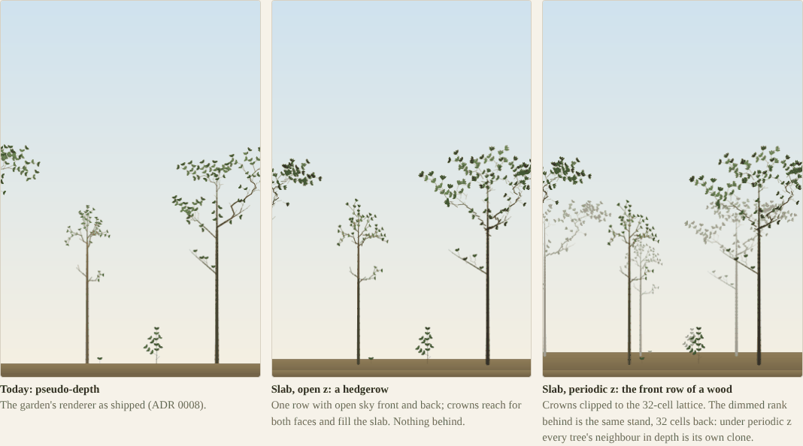
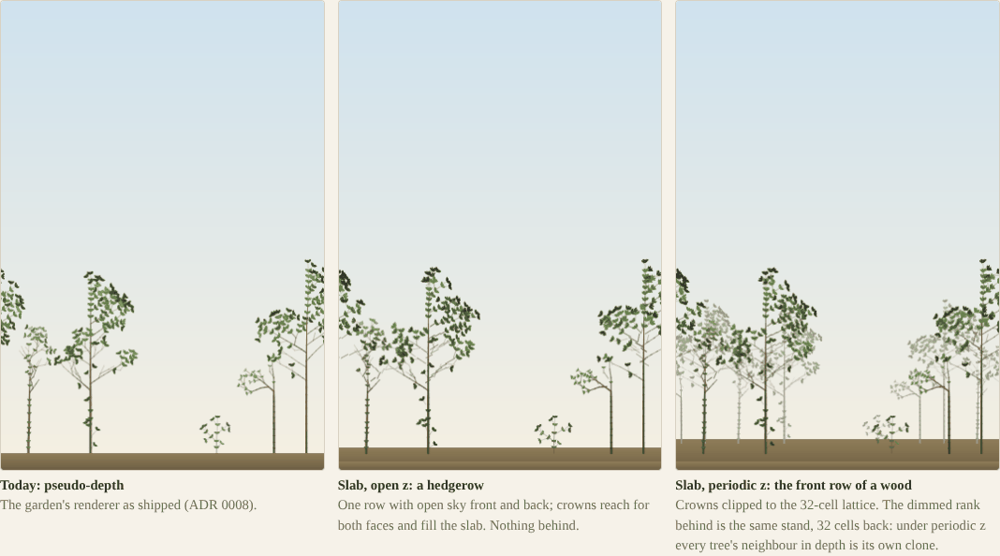
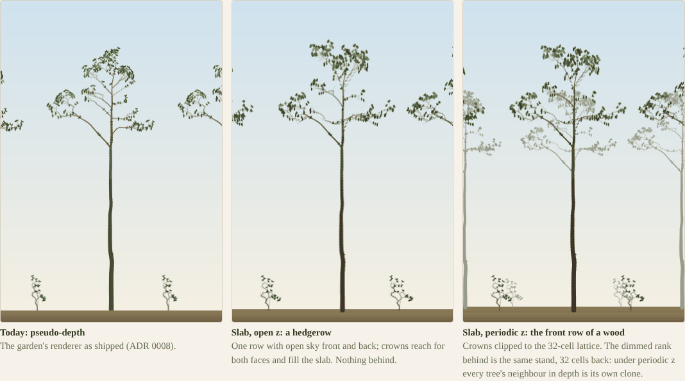
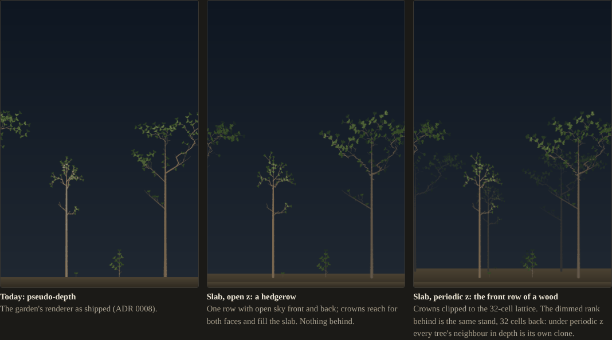
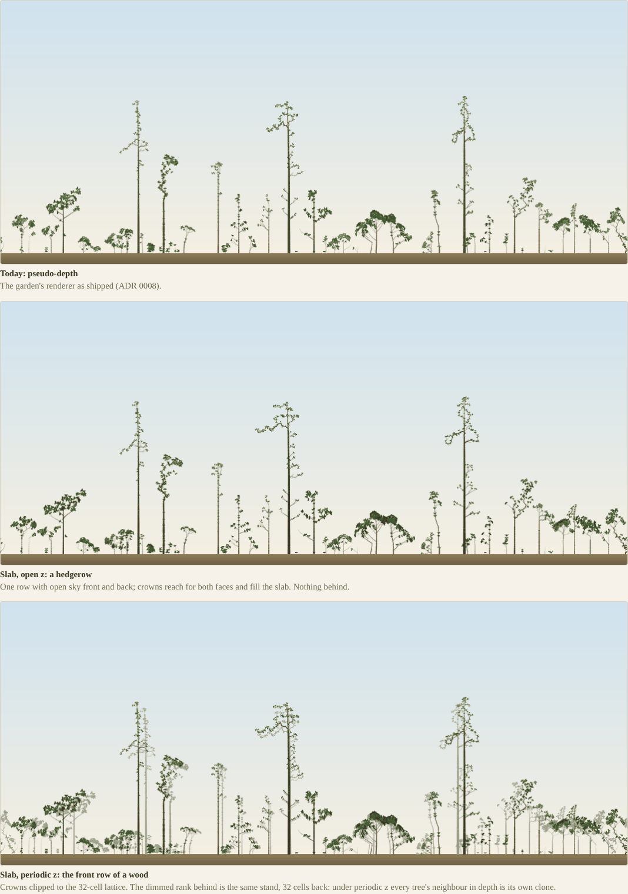
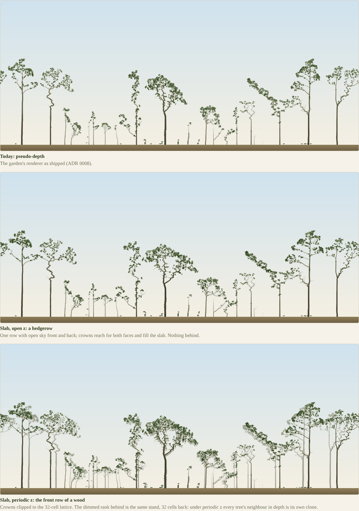

# G0.5: a frontal preview of the slab, against today's pseudo-depth

## Question
Does true depth seen from the front look better than ADR 0008's pseudo-depth? The 3D port exists for that and nothing else ([review](../reviews/2026-10-29-3d-port-review.md) §5), and it was unmeasured. The user decides by eye, on their phone. If the slab is not a clear improvement, the port stops, and the Rust question reopens as a 2D-only port.

The same deploy answers two more questions:
- **Which z boundary is meant:** open z (a hedgerow) or periodic z (the front row of a wood). That is the user's decision, not this note's.
- **The review's "check first":** whether COOP/COEP (`require-corp`) break the site's fonts, images or scripts.

It also carries the G1 page, to run if G0.5 passes.

## Setup
**This is a crude stand-in, and the page says so.** The trees grew in 2D, and the preview spreads them in depth by a rule. Trees grown in a slab would differ, in crown shape most of all. The preview shows what depth does to the look, not how 3D trees would grow.

**Stands:**
- the home wood (`forestParams`) at the portrait-phone ring (66 cells) and at the 520-cell panorama;
- seeds 9, 10 and 12 (the garden's daily seeds), at seasons 60 and 100;
- grown as the garden's worker grows them (dead trees discarded each season);
- baked as checkpoints by `code/2026-10-29-g05-preview/bake.ts`.

The code is garden-v0.14.0's (this branch merges `claude/gallant-brown-5k4g33` at 1afc701), so the species and the renderer are the ones live on edbarker.dev. The stands range from 368 to 671 metamers at 66 cells, and 3123 to 5589 at 520.

**Depth** (`slab-view.ts`, `assignDepth`):
- The trunk stands at z = D/2, D = 32.
- **New axes:** each gets a target from the slab experiment's sequence, z = D·frac(½ + iφ), with i counting the tree's axes in birth order. Higher-order axes aim at half that spread around their parent's depth.
- **Continuity:** a metamer moves 22% of the remaining way from its parent's z toward its axis's target, so a limb is one continuous curve in depth, never scatter. z is clipped to [½, D − ½].
- **Open z (a hedgerow):** targets are pushed toward the slab's faces (f → ½ + ½·sign(2f − 1)·|2f − 1|^0.6), where an edge tree finds its light. Nothing stands behind.
- **Periodic z (the front row of a wood):** targets as the sequence gives them, clipped to the 32-cell lattice. The rank behind is drawn 32 cells back and faded 55% toward the sky. It is the same stand, which is what periodic z means: each tree's neighbour in depth is its own clone.

**Drawing:** the garden's own WebGL2 renderer, untouched in `src/`.
- The page replaces only its draw call, on the instance at run time. Its programs, batches, palettes and theme are used as they are.
- **Geometry:** the x-ray geometry, without the pseudo-depth squeeze, since in the slab the depth is real.
- **Camera:** a fixed frontal pinhole with scale F/(F + z − D/2), so the picture plane is the trunks' line and trunks draw at the garden's scale.
  - F comes from a 40° horizontal field of view: 91 cells on the 66 ring, 714 on the 520.
  - The eye is 8 cells up.
- **Order and shading:** wood and leaves are drawn far to near in one-cell depth slices, darkened by up to 40% at the back of the slab.
- **Leaves:** the pseudo-depth view's clusters (species styles, ramp by light), each with its own z within ±0.6 of its shoot.
- **Ground:** drawn first at the far rank's ground line, so far trees stand on ground, not sky.

**The page** (`code/2026-10-29-g05-preview/index.html`): three panels, today, open z and periodic z, from the same snapshot, with ring, seed and season chosen by buttons. It is built with `npx vite build -c docs/experiments/code/2026-10-29-g05-preview/vite.config.ts` (output in `runs/preview-3d/`, not committed).

**The deploy:**
- the site's branch `preview-3d` (epabarker/edbarker-dev): the build under `public/preview/3d/`;
- `_headers` adds `Cross-Origin-Opener-Policy: same-origin` and `Cross-Origin-Embedder-Policy: require-corp` for every path, marked "do not merge to main";
- by the site's convention the preview is `https://preview-3d-edbarker-dev.edbarker.workers.dev/preview/3d/`, with G1 at `…/preview/3d/kernel.html`.

**This container cannot reach edbarker.dev or workers.dev** (the proxy refuses both), so the deployed headers are not verified here. The checks below ran on the same build, served locally with the same two headers.

## Result

### The three views (light; season 100)

66-cell ring, seeds 9, 10, 12:

Seed 9 in dark mode:

520-cell panorama, seeds 9 and 12:

**What changes between the panels.** This is description only; the judgement is the user's.
- **The narrow ring** is seen from near (F = 91 cells). Foreshortening is strong: limbs toward the viewer draw up to 1.2× and limbs at the back down to 0.85×. The back of a crown is darker, and limbs cross in front of the trunk.
- **The panorama** is seen from far (F = 714), so foreshortening is about 2%. Depth reads only through darkening, occlusion and, under periodic z, the rank behind. **At 520 cells, open z looks much like today's view.**
- **The 2D crowns' widths** carry over unchanged: in the slab they are not squeezed by ADR 0008's MIN_SPREAD. Seen from the front, a crown spread in depth is as wide as it grew, where pseudo-depth narrows limbs that turn toward the viewer.
- **Periodic z's rank behind** repeats the front rank exactly: the same tree, smaller, paler, a little higher on the ground. On the narrow ring that reads as a second row of the same three or four trees. In a real periodic world the clone is also what each tree competes with in depth.

### COOP/COEP on the site (local, same build, same headers)
Chromium (Playwright) loaded `/`, `/cv/`, `/lab/`, `/preview/3d/` and `/preview/3d/kernel.html` at 390 and 1440 px, with and without the headers:

| | With COOP + COEP | Without |
|---|---|---|
| `crossOriginIsolated` | true on every page | false |
| Failed requests, console errors, HTTP ≥ 400 | none | none |
| Fonts (EB Garamond, self-hosted by fontsource) | loaded | loaded |
| Garden and lab canvases | drawn | drawn |
| Origins requested | the page's own only | the page's own only |

The site has no cross-origin subresources, so `require-corp` costs it nothing, and `credentialless` (missing in Safari) is not needed. The deployed check is still owed: Cloudflare could inject something (an analytics beacon, say) that the local server does not. Opening the preview's home page on a phone and seeing the garden grow, with fonts, answers it.

### G1 page, as a reference for the phone run
The same `kernel.html` in headless Chromium 153 on this machine (4 cores, cross-origin isolated, WASM SIMD available). The `forest` field at D = 32, K = 16, Float32:

| Kernel | z | Median ms | Min ms |
|---|---|---|---|
| TypeScript (fused) | open | 335 | 313 |
| WASM scalar | open | 158 | 118 |
| WASM SIMD, 1 lane | open | 70 | 52 |
| **WASM SIMD, 4 lanes** | open | **22** | 18 |
| WASM SIMD, 1 lane | periodic | 51 | 49 |
| WASM SIMD, 4 lanes | periodic | 20 | 18 |

- **The lanes** are 4 Web Workers, each with its own WASM instance computing every fourth direction into its own partial field. Under isolation they read the deposit field from a SharedArrayBuffer.
- **Scaling:** 3.2× from 1 lane to 4, as the native threads measured (2.6–3.0×) in the [light-cost note](2026-10-29-3d-light-cost.md).
- **The G1 rule** is on the page: the port stops if 4-lane SIMD exceeds 150 ms on the user's phone.
- **Periodic z here is not dearer** than open z (20–51 against 22–70 ms). The Rust kernel copies the pads in both cases, so the TypeScript bench's 8–16% is the only like-for-like figure.

## Conclusion
- The preview is deployed for the user to judge on their phone. The figures above are this machine's view of it, not the verdict.
- **The site survives cross-origin isolation** locally, with nothing cross-origin to block. Opening the deployed preview settles it.
- **G1 is ready on the same deploy.** On desktop Chromium the 4-lane kernel takes 22 ms, about 7× inside the stop rule; the phone's figure is the one that counts.
- **Follow-ups:**
  - the user's verdict on G0.5 and their choice of z boundary;
  - then G1 on the phone;
  - the deployed header check.

  All of these are in [ADR 0024](../decisions/0024-3d-slab-port.md) (still proposed) and the review's §5.
