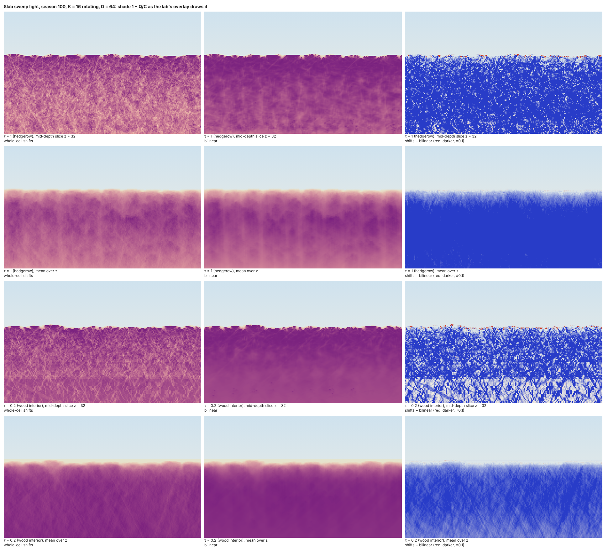

# 3D port, G3: the 3D slab sweep in Rust, its accuracy, its K, its speed

## Question
G3 is the second gate of the Rust core ([ADR 0024](../decisions/0024-3d-slab-port.md)): the 3D slab sweep in Rust, built without parity. The user's brief (2026-10-29) asked for three measurements.
1. **Accuracy:** mean |ΔQ|/C against an exact 3D ray trace, on the prototype's R6 stands at D = 64 with τ ∈ {1, 0.2}. The protocol is M18's: every second foliage cell, steps of 0.01 along each of the same K rays. The stop rule is a mean above 0.08 with a fix that costs more than 2×; the exact segment integral (DDA) is the fallback.
2. **K convergence:** M6e's protocol in 3D, for K ∈ {8, 12, 16, 24, 32}, with and without rotation. Report where Q at the buds stops changing by more than the model's own error.
3. **Timing in the browser** on both of the user's machines, at the chosen K, in one lane and four, from the same preview deploy. These numbers replace G1's.

The slab's correctness against the 2D sweep (d_z = 0, the same ℓ on every z line) stays a unit test in the Rust crate.

## Setup
**Code:** `rust/core/src/light/slab_sweep.rs` on this branch (from 892a525):
- Float32 fields;
- K directions on a spherical Fibonacci set, weights ∝ sin(elevation)^p;
- rotation per season: bands moved by frac(½ + s·φ⁻¹), azimuths turned by frac(s·(√2 − 1)); season 0 is the static sky;
- periodic x, open z, τ per face (a depth of −ln τ / k beyond the face);
- the 2D sweep's row march, with the segment's mean taken over a box from separable prefix sums;
- a polynomial exp with a Cody–Waite split of ln 2;
- scalar and explicit-SIMD kernels written step for step alike;
- lanes: `compute_part(season, lane, lanes)` marches directions k ≡ lane (mod lanes) into a private partial field;
- the exact tracer `exact_q`, which stops at a face and adds its depth there.

**The stands:** the 3D prototype's R6 set, regrown with `DUMP` to record each live bud's tip and leaf area at seasons 40 and 100: `forest`'s 10 trees on the 210 ring, D = 64, τ = 1 (`d64-hard`) and τ = 0.2 (`d64-t020`, the default look). The light params are `forest`'s: k = 0.5, minimum elevation 15°, p = 1, C = 1.

```bash
R6=1 DUMP=runs/g3/deposits node docs/experiments/code/2026-10-29-proto3d/run.ts runs/g3/proto d64-hard   # and d64-t020
CARGO_TARGET_DIR=runs/g3/target cargo run --release --manifest-path docs/experiments/code/2026-10-29-g3/Cargo.toml -- runs/g3/deposits runs/g3/measure.json
CARGO_TARGET_DIR=runs/g3/target cargo run --release --manifest-path docs/experiments/code/2026-10-29-g3/Cargo.toml -- runs/g3/deposits x diag   # per direction
SEED=1 R6=1 node docs/experiments/code/2026-10-29-proto3d/run.ts runs/g3/m6e g3-k8 g3-k8-rot …              # the M6e runs; seeds 1, 2
```

The browser page is `code/2026-10-29-g05-preview/g3.html`, on the site's `preview-3d` deploy at `…/preview/3d/g3.html`. Native runs used this 4-core VM, and headless Chromium 153 ran cross-origin isolated.

## Result

### 1. Accuracy against the exact trace (K = 16, static sky)

Mean |ΔQ|/C (p90), over every second foliage cell below the stand's top:

| Stand | Cells | Bilinear read of G (first build) | Bilinear + exact segments (DDA) | **Integer shifts (adopted)** |
|---|---|---|---|---|
| τ 1, season 40 | 9 576 | 0.056 (0.145) | 0.051 (0.142) | **0.049** (0.112) |
| τ 1, season 100 | 10 629 | **0.095** (0.206) | **0.091** (0.202) | **0.053** (0.127) |
| τ 0.2, season 40 | 6 907 | 0.038 (0.106) | 0.033 | **0.045** (0.105) |
| τ 0.2, season 100 | 5 501 | 0.057 (0.152) | 0.053 (0.148) | **0.048** (0.122) |
| M18, 2D row march (`skyStand`, `forest`, `skyTree`) | | | | 0.035–0.049 |

**By distance to a face** (τ 1, season 100):

| Transport | 0–3 cells | 4–15 cells | 16+ cells |
|---|---|---|---|
| Bilinear | 0.100 | 0.115 | 0.071 |
| Integer shifts | 0.054 | 0.057 | 0.049 |

**Cost natively** (compute at K = 16, scalar, one thread, median of 5; ms):

| Stand | Integer shifts | Bilinear | Bilinear + DDA |
|---|---|---|---|
| τ 1, season 40 | 107 | 131 | 241 |
| τ 1, season 100 | 147 | 205 | 382 |
| τ 0.2, season 40 | 88 | 129 | 245 |
| τ 0.2, season 100 | 128 | 215 | 398 |

**The first build failed the stop rule, and its fallback was the wrong fix:**
- The bilinear sweep gave 0.095 on the mature hedgerow stand. The exact segment integral took it only to 0.091, at 1.8–1.9× the bilinear march's cost, and its error was still above 0.08.
- **The segment was not where the error came from.** One-direction sweeps against one-direction traces (`diag`, τ 1, season 100) showed the bilinear sweep **darker than the exact trace in every direction**: a mean signed error of −0.018 to −0.111 in transmission, with the steepest directions the worst (elevation 52–69°, about −0.11).
  - Those directions' segments barely cross a cell, so the DDA changes nothing for them.
  - The cause is the bilinear read of G from the line above. Each row blends four depths, which smears shadows into gaps, and because e^(−kT) is convex a smeared depth always transmits less (Jensen).
  - In 2D the read blends two depths per row, which is why the 2D march stays at 0.035–0.049.
- **The fix is integer shifts:**
  - G is carried down by whole cells each row, with the cumulative shift round(y·s), so a ray follows its true slope to within half a cell and is never blurred;
  - the per-direction bias falls to −0.008 to −0.067;
  - the error is 0.045–0.053 on every stand, flat across distance to the faces and inside M18's 2D range;
  - it costs 0.6–0.8× the bilinear march, not more.
  - **The price:** the one stand where bilinear was already good (τ 0.2, season 40) gets slightly worse, 0.038 → 0.045. Quantising the path trades bias for half-cell placement noise.
- **The 2D-equivalence test** runs the slab in bilinear mode, which is the 2D sweep's read: with the 2D sweep's directions laid flat and the same ℓ on every z line, every cell matches the 2D field to within 2·10⁻⁵.

### 2. K convergence

**Q at the buds** (every live bud: 51k–95k) against K = 128 static (integer shifts), mean |ΔQ|/C:

| K | τ 1 s40: static / per season rotated / 10-season mean | τ 1 s100 | τ 0.2 s40 | τ 0.2 s100 | Native compute, ms |
|---|---|---|---|---|---|
| 8 | 0.052 / 0.053 / 0.018 | 0.059 / 0.060 / 0.020 | 0.048 / 0.049 / 0.017 | 0.049 / 0.050 / 0.016 | 55–89 |
| 12 | 0.045 / 0.042 / 0.016 | 0.047 / 0.046 / 0.017 | 0.043 / 0.039 / 0.015 | 0.037 / 0.038 / 0.014 | 64–123 |
| **16** | **0.035 / 0.036 / 0.015** | **0.040 / 0.039 / 0.016** | **0.033 / 0.034 / 0.014** | **0.033 / 0.033 / 0.013** | 86–231 |
| 24 | 0.028 / 0.030 / 0.014 | 0.033 / 0.032 / 0.014 | 0.025 / 0.028 / 0.014 | 0.027 / 0.027 / 0.012 | 132–223 |
| 32 | 0.027 / 0.027 / 0.014 | 0.027 / 0.027 / 0.013 | 0.026 / 0.025 / 0.013 | 0.022 / 0.023 / 0.011 | 167–321 |

- **The model's own error** (the transport, §1) is 0.045–0.053.
  - **Static:** K = 8 is at it (0.048–0.059), K = 12 just under (0.037–0.047), and **K = 16 under it with a margin** (0.033–0.040). That is where Q at the buds stops changing by more than the model's error.
  - **Rotated:** a single season is no better than static, but over ten seasons every K ≥ 8 averages to 0.011–0.020. The floor of about 0.012 beyond K = 16 is the K = 128 reference's own streaks, which a static reference keeps.
- **Under the first build's bilinear transport,** the same table runs 0.021–0.030 at K = 8 and 0.010–0.014 at K = 16. Blurred directions are individually smoother, so they need fewer of them. Integer shifts need about twice the K for the same angular smoothness, and K = 16 provides it.

**Patterns, M6e's protocol:** the prototype regrown under the Rust kernel at the default look (τ 0.2, D 64), 100 seasons, seeds 1 and 2:

| Sky | Metamers, season 100 (seeds 1, 2) | Height p50 | Crown depth p50 | Crown width p50 | Leaf area below half height, p50 |
|---|---|---|---|---|---|
| K 8 | 121 524, 115 159 | 83.2 | 49.0 | 26.5 | 2.7% |
| K 12 | 119 886, 114 520 | 82.7 | 49.5 | 25.9 | 2.6% |
| K 16 | 116 035, 112 113 | 81.8 | 49.1 | 26.2 | 1.7% |
| K 24 | 106 956, 111 070 | 82.0 | 48.5 | 26.0 | 2.4% |
| K 32 | 109 185, 115 285 | 82.2 | 48.4 | 25.3 | 2.6% |
| K 8, rotated | 84 450, 80 295 | 83.9 | 45.4 | 25.5 | 0.5% |
| K 12, rotated | 83 917, 84 925 | 83.4 | 45.8 | 25.6 | 0.5% |
| **K 16, rotated** | **87 352, 94 746** | 83.2 | 47.0 | 24.8 | 0.6% |
| K 24, rotated | 98 560, 102 677 | 83.2 | 48.2 | 25.6 | 0.8% |
| K 32, rotated | 93 132, 97 712 | 82.6 | 46.9 | 25.1 | 1.4% |

`code/2026-10-29-g3/m6e_agg.py` prints the table with season 40 as well. At season 40 the static sky gives 76k–81k metamers and the rotated one 70k–76k at every K, with heights 56–57 and crown depths 46–48.

- **Height, crown depth and crown width are converged at every K,** within about a cell.
- **Total metamers:** static, every K agrees within seed noise (107k–122k). Rotated, the count rises from K = 8 to K = 24 (82k to 101k), and **K = 16 rotated is at the edge of converged** (87k–95k against 93k–103k).
- **Rotation matters in 3D more than K does:** it cuts the stand's metamers by 15–30% at season 100, and the lower crown from about 2.5% to under 1.5%. In 2D (M6e) rotation changed no pattern. With integer shifts a static sky's streaks feed the same buds every season, and rotation spreads that light. Since the decision is K = 16 with rotation, the calibration (C1) is made under rotation.

### 3. Timing

**Headless Chromium 153 on this VM** (4 cores, cross-origin isolated), K = 16 rotating, D = 64, median of 15 seasons, ms:

| Stand | WASM "scalar", 1 lane | WASM SIMD, 1 lane | **WASM SIMD, 4 lanes** |
|---|---|---|---|
| Interior τ 0.2, season 40 | 53.8 | 56.9 | **24.8** |
| Interior τ 0.2, season 100 | 79.3 | 85.1 | **34.7** |
| Hedgerow τ 1, season 100 | 76.6 | 82.5 | **34.7** |
| Interior τ 0.2, season 100, **K 12** | — | 63.9 | 33.4 |

- **Against G1's kernel** on the same VM (D = 64, `forest`'s 2D field scattered across z): 105–111 ms in one SIMD lane and 43 in four. The real kernel on real 3D stands is 25–35 ms in four lanes.
- **The hand-written SIMD path is 5–7% slower than the "scalar" one.** The production build sets `simd128` for the whole crate, so LLVM vectorises the scalar formula itself, and does it better. Both gave the same bits (tests/wasm-slab.test.ts). The explicit path was dropped after G3 (§4).
- **K = 12** saves 25% in one lane and almost nothing in four (33 against 35 ms): lanes divide the directions, and 12 do not divide into fours as well.
- **The lanes' partial fields are not summed here** (G1's model): a bud's Q is the sum of the four lanes' values at its cell, read at sampling.
- **On the user's phone and laptop: not yet measured.** The page is deployed for them, and these rows replace G1's once their numbers are in.

### Bits
The 3D light gave the same bits natively, in scalar WASM and in SIMD WASM: the fixture's fingerprint 0xd3060733 matches in `rust/core` and in `tests/wasm-slab.test.ts`. That is Q6's requirement for the 3D core's goldens.

### 4. After G3: symmetry, banding, and the SIMD path (the user's checks)
**Mirror symmetry.** The 2D sweep's test, in 3D (`mirrored_foliage_gives_the_mirrored_field` in `slab_sweep.rs`):
- **Setup:** a sky symmetric in x and z (the K = 16 sky at season 5's rotation, with each direction's mirror images in x and z at a quarter weight), open sides, τ 0.2 on both faces, and an uneven canopy on 31 × 24 × 13 against its mirror image.
- **Largest difference** in Q or any component of V, after mirroring back:

  | Transport | Mirror in x | Mirror in z |
  |---|---|---|
  | Whole-cell shifts | 1.2·10⁻⁷ | 1.2·10⁻⁷ |
  | Bilinear | 1.1·10⁻⁶ | 2.4·10⁻⁷ |

  This is Float32 rounding: the sums run in the other order. The test holds both under 2·10⁻⁶. Rounding half away from zero gives round(−y·s) = −round(y·s), so the shifts lean neither way.

**Heatmaps** (`figures/2026-10-29-g3-heatmaps.png`, made by `code/2026-10-29-g3/heatmaps.ts`):
- **What is drawn:** the shade 1 − Q/C at season 100 (K = 16 rotating, as the buds see it) on both R6 stands. Each stand has the mid-depth slice (z = 32) and the mean over z, with shifts, bilinear, and their difference.
- **Not literally the lab:** the lab is 2D and cannot show the 3D field. The maps go through the lab's own overlay code (`shadeImage` in `src/web/render/colors.ts`, over the lab's sky) instead.



What the maps show:
- **Texture.** Bilinear blurs: smooth, dark interiors with faint diagonal streaks. The shifts keep the canopy's grain: speckled shade, and short streaks along the rays.
- **Banding.** The shifted wood interior (τ 0.2) has horizontal seams in the mid-depth slice: its row means step by 0.04 at rows 44, 28 and 25 (raw: `code/2026-10-29-g3/seam.txt`). Bilinear has none. **The seams are in the light, not in the transport.** The exact trace, run on the same slice (every third column, steps of 0.02), steps at the same rows by as much:

  | Row (top 84) | Shifts | Bilinear | Exact |
  |---|---|---|---|
  | 45 / 44 / 43 | 0.188 / 0.190 / 0.162 | 0.062 / 0.062 / 0.063 | 0.215 / 0.220 / 0.179 |
  | 28 / 27 | 0.227 / 0.189 | 0.100 / 0.100 | 0.241 / 0.199 |
  | 25 / 24 | 0.148 / 0.148 | 0.100 / 0.100 | 0.196 / 0.159 |
  | 60 | 0.161 | 0.033 | 0.191 |
  | 0 (ground) | 0.184 | 0.124 | 0.200 |

  - **Cause:** below a certain depth under the stand's flat top, one of the steep directions starts to come in through a z face instead of the canopy. That depth is 32 cells over the ray's z slope. The stand's top is one row for every column, so the switch falls on one row across the whole slice. Bilinear smears each switch over a row or two. It is also **two to eight times too dark** in the interior (0.02–0.10 against the exact 0.15–0.24), the darkening bias of §1.
  - **Calibration:** rotation moves the switching rows every season, so the seams average out over seasons. They are the face model's: a real stand's uneven top and C1's τ fade would soften them. C1 should look at the floor's light under rotation, not one season's slice.

**The hand-written SIMD path is dropped.** It was 5–7% slower than LLVM's vectorised scalar loops on the VM. The production build still sets `simd128`, so the scalar code vectorises, and the bits are unchanged (fingerprint 0xd3060733, native and WASM). The user's timings did not reach this session, so the phone's verdict is not recorded here. If the phone shows the explicit path faster, it is in commit `77d4105`.

## Conclusion
- **G3 passes, with integer-shift transport in place of the bilinear read:**
  - the 3D light's error against the exact trace is 0.045–0.053, M18's 2D level, at τ 1 and 0.2 and young and mature stands, and flat across the faces;
  - it is cheaper than the build it replaces.
- **K = 16 with rotation stands:**
  - static, Q at the buds stops changing by more than the model's error at K = 16;
  - rotated, ten seasons average every K ≥ 8 below it;
  - the patterns are converged except total metamers, where K = 16 rotated is at the edge;
  - K = 12 is the fallback if the light ever must be cheaper, though it buys little in four lanes.
- **In the browser,** the real kernel at D = 64 is 25–35 ms in four lanes on this VM, under G1's 43. The user's phone and laptop are to run the page.
- **What would have stopped G3:** the rule as written. The bilinear build was 0.095 on the mature hedgerow, and the prescribed fallback (the DDA) neither fixed it (0.091) nor came cheap (1.8–1.9×). Read literally, that meant stop or the pyramid.
  - It did not stop only because the error was found to be the transport's, not the segment's, and integer shifts fix the transport for less.
  - Had they not, the next options were a bias correction (no physical basis) or the pyramid, which is declined on behaviour.
- **Throwaway:** the prototype's stands are uncalibrated (R2–R5 off); one stand set; two seeds for the patterns.
