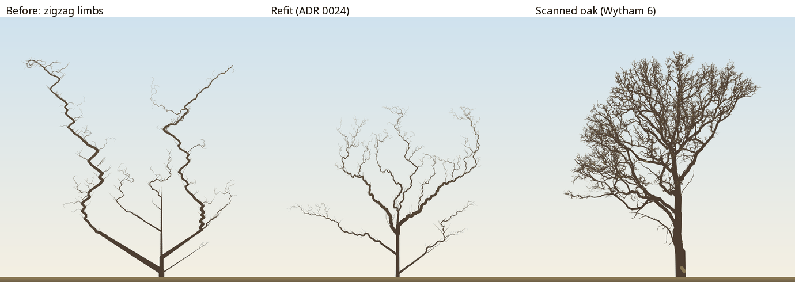

# Oak limbs: the zigzag, posture along the dominant path, and a refit to 35 scanned oaks

## Question
The [structure-vs-drawing note](2026-10-29-structure-vs-drawing.md) found two faults in our oaks that would be wrong even for a 2D slice:
- limbs that zigzag;
- an open-grown oak that splits into a V of straight limbs near the ground.

What makes them, and does a principled fix, fitted to real oaks, remove them? (Spec §R3, §R2.4, §10; ADR 0011, 0020, 0024.)

## Setup
Code: `src/core/principles/r3-mechanics.ts` (`r3.proprioception`), `src/core/form.ts` (`limbCurves`) and `src/core/trials.ts` (the stand's season-100 traits). Scripts are in `analysis/experiments/structure_vs_drawing/`.

```bash
D=analysis/experiments/structure_vs_drawing
node $D/kinks.ts                   # bends > 20° along limbs' thickest paths, by step type
node $D/sweep.ts                   # γ and c with dominant-path proprioception, open oak
node $D/fork.ts                    # trunk fork height and leader dominance over time
python3 $D/fetch_wytham.py <dir> --all-oaks         # 35 live Wytham oaks, ≈ 500 MB by range requests
for f in <dir>/*.mat; do uv run --no-project --with scipy --with numpy python $D/qsm_export.py $f <skel-dir> oak-<id> --skeleton-only; done
uv run --no-project --with numpy python $D/wytham_targets.py <skel-dir>/*.skel.json
uv run --project analysis python analysis/experiments/m27_fit.py --species oak --start round2 --restarts 2,1 --generations 60 --seeds 3
uv run --project analysis python analysis/experiments/m27_adopt.py
uv run --project analysis python analysis/experiments/m27_holdout.py
```

## Result

### Where the zigzag comes from
Along the open oak's limbs (`oakOpen`, seed 3, season 150, wood of radius ≥ 5 cm), following each node's thickest child:

| Step | Count | Mean turn | Turns > 20° |
|---|---|---|---|
| Continues the axis | 191 | 3.4° | 4 |
| Switches to a lateral | 186 | 36.1° | 110 |

Half the limb is relays: laterals that outgrew their axis, each leaving a corner at its branch angle. Posture's proprioception (ADR 0011) senses only "the previous metamer of the same axis", so the corner is never straightened.

Two cures that did not work:
- **The relay inherits its parent's physiological age:** about the same kink count. Oak's set-points for pa 1 and pa 2 differ by only 9°.
- **A larger c alone:** the kinks stay.

**Proprioception along the dominant path** (`r3.proprioception: "dominant"`) works: the thickest child senses its kink to its parent, whatever its slot. With γ = 0.5 and c = 0.5, bends > 20° fall from 114 to 4 (seed 3) and from 84 to 1 (seed 4). But the limbs become rods.

### What real limbs do
I measured the 35 live Wytham oaks (TreeQSM, Calders et al. 2022; 10.8–24.4 m tall) exactly as `form.ts` measures the model:

| Per tree | Mean ± SD |
|---|---|
| Straightness, chord over path in 3 m windows | 0.922 ± 0.040 |
| Median turn between 1 m chords | 20.2 ± 5.5° per m |
| 90th-percentile turn | 48.9 ± 19.4° per m |
| Trunk fork height, relative | 0.45 ± 0.15 |

Turning by chord length (median per tree, mean over trees; our trees from planar skeletons):

| | 0.5 m | 1 m | 2 m |
|---|---|---|---|
| Wytham oaks (n = 35) | 30.8° per m | 20.2° per m | 10.0° per m |
| Our open oak, before | 18.3 | 12.4 | 9.3 |
| Strong straightening (γ 0.5, c 0.5) | 0.3–0.9 | 0.3–0.9 | 0.3–1.0 |
| **Our open oak, refit** | **35.0** | **17.2** | **9.5** |
| Our woodland oaks (`oakWood`, s. 100), before | 1.1 | 1.4 | 1.5 |
| Our woodland oaks, refit | 10.1 | 6.4 | 2.7 |

Real limbs wander steadily and are rough at short scales too; part of the 0.5 m figure is surely scanning and fitting noise. Neither "straight runs with corners" (before) nor "rods" (strong straightening) is what they do.

### The refit
Oak's targets gained the four Wytham traits, measured on the stand at season 100 (about the scanned trees' height) at full weight. The new free parameters were γ, β_g, c4.sigma and a wider r3.c, with `proprioception: "dominant"` fixed. The run: 2 warm restarts from round 2, 1 random, 60 generations, 3 seeds, 2,160 candidates in 18 minutes.

Loss on the final seeds fell from 9.88 to 8.51.

| Trait | Target | Before | Refit |
|---|---|---|---|
| stand.limbStraightness | 0.922 ± 0.04 | 0.933 | 0.908 |
| stand.limbTurn (°/m) | 20.2 ± 5.5 | 5.4 | 11.5 |
| stand.limbTurnP90 (°/m) | 48.9 ± 19.4 | 43.2 | 48.9 |
| stand.forkHeight | 0.446 ± 0.146 | 0.453 | 0.451 |
| stand.floor | 0.084 ± 0.03 | 0.083 | 0.053 |
| lone.limbDroop (°, described) | 5 ± 10 | 0.5 | 18.7 |
| lone.forkHeight (described) | 0.3 ± 0.15 | 0.10 | 0.09 |

The fit chose:
- **Little proprioception** (γ 0.034) and a weaker gravitropic gain (β_g 0.13).
- **About twice the direction noise** (σ 20° → 38°).
- **A lower posture limit** (c 0.187 → 0.074).

It buys wander rather than straightening corners. Across scales, the refit open oak's turning matches the scans (table above).



**By eye:**
- **Open oak:** the regular zigzag is gone, and so is the V of straight limbs. A short trunk carries many wandering, spreading limbs, with 2,979 metamers against 1,776 at season 150.
- **Woodland oak:** taller (20.5 m against 15.9 m) and less pole-like, but its crown is still small.

### Hold-out (never in the fit)

| Check | Result |
|---|---|
| Seedling survival light | 12.7%, inside the 8–14% band |
| Tolerance order over ten species (Spearman) | −0.91, unchanged |
| Mixed wood, raw fits | birch leads early and fades; beech ends with the most canopy trees (1.83 against hornbeam's 1.50 at 400), less dominant than before (3.33) |
| Oak canopy trees per run, raw fits | 0.33 at 200–300 (was 0.17), 0 at 400 (was 0.17) |
| Oak canopy trees per run, adopted set (with other species' hand overrides) | 0.5–0.8 through season 400 |
| Bench | home-page panorama +2% per season; every other case bit-identical |
| Goldens | unchanged (no golden case grows the fitted oak) |

## Conclusion
- **The zigzag was the model's relays leaving uncorrected corners**, and **straight limbs were too little wander**. The refit fixes both looks in the open oak, and its limbs match the scans' turning across scales. It does so mostly through steady direction noise rather than strong straightening, so dominant-path proprioception is in place but weak for oak.
- **Still short of the scans:**
  - woodland limbs turn about a third as much as real ones (6° against 20° per metre at 1 m);
  - the open oak still divides low (fork ≈ 0.09 against a described 0.3);
  - floor light under oak fell to 5.3% (target 8.4 ± 3).
- **Next:** the stacked-slices prototype (B). The remaining woodland gap may be the 2D slice itself, which a 3D-ish composition would test.
- **Other species** stay on "axis" until refitted, which would need targets of their own. Wytham has scans of sycamore (541), ash, hazel and hawthorn, but none of our other species except a few field maples.
