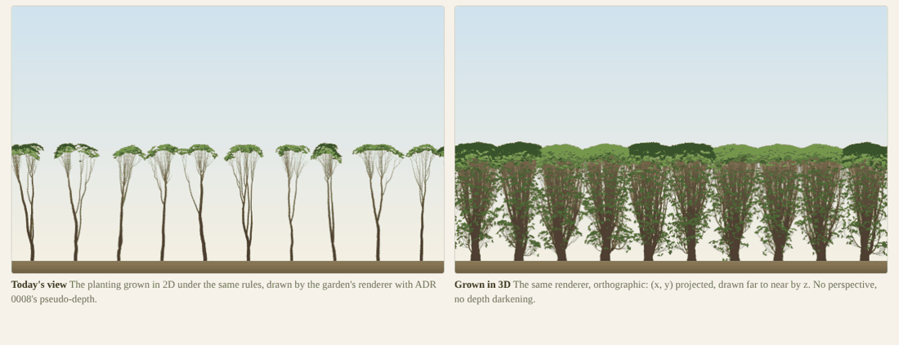
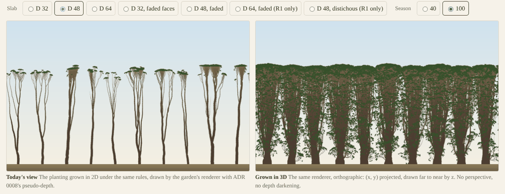
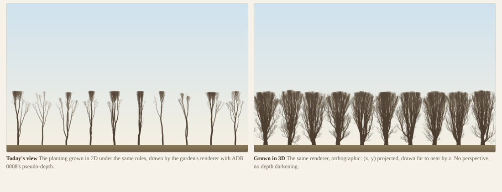

# 3D port: a throwaway prototype of trees that grow in 3D

## Question
After G1, light no longer constrains D, so D depends on how crowns grow and what the tree passes cost. Those were the review's last estimates. This prototype measures them (user, 2026-10-29: "an experiment rather than a picture"):
1. the metamer multiplier m (3D against 2D, same rules) at D = 32, 48 and 64;
2. the tree passes' cost per metamer per season, 3D against 2D, which replaces the review's 1.5–3× estimate;
3. the foliage profile across z at each D: does face clipping stack leaves at the faces, and does fading the light over the last 3 cells fix it?
4. a page that draws the grown stands orthographically with the garden's renderer, beside today's pseudo-depth view of the same planting.

## Setup
**Throwaway, and labelled so** in every file (`code/2026-10-29-proto3d/`):
- no keyed-hash RNG (mulberry32), no goldens, no principle toggles;
- outside `src/`, which is unchanged.

**Nothing is copied from the 2D core.** The prototype runs on the core's own `Tree`, whose metamer and bud tables are the core's schemas widened at run time by 3D columns (z, a direction vector, an axis phase), so the core's compaction carries them. The dimension-free principles are **imported, not copied**:
- C3: `gatherLight`, and `allocate` with Borchert–Honda;
- R1: `carbonBalance`, `starvedToDeath`;
- C5: `crownTopLight`, `shedBranches`, `removeBranches`;
- C6: `updateGirth`;
- C1's `addMetamer`, `addBud`, `shootSize`;
- R6's three functions.

**New, in 3D:**
- **C1:** one lateral per node, azimuth stepping by 137.5° (spiral) or 180° (distichous), at the branch angle β = 45°.
- **C4:** w_d·d_prev + ξ·V + η·t(A_set) + ε·u as a 3-vector sum, with u a σ-turn about a random perpendicular.
- **C2:** the slab sweep (`cli/slab-light.ts`, fused, Float32, K = 16, the ring in x, open in z), with Q = 0 beyond the faces and an optional linear fade of Q over the last 3 cells.
- **Bookkeeping:** the core's `commitBuds` is module-private, so its five lines are repeated.
- The 2D columns stay meaningful for the imported passes: base x and y, true 3D length, and angle = asin(d_y), so the core's tipY is the 3D tip's height.

**The stands:**
- `forest`'s planting (10 trees on the 210-cell ring), every tree at z = D/2, seed 1, 100 seasons.
- **Rules:** C1–C6 and R1 with `forest`'s values; R2–R6, mechanics and stand dynamics off.
- **The 2D reference** is the core's `World` under exactly the same rules, K = 7, timed by phase.

```bash
node docs/experiments/code/2026-10-29-proto3d/run.ts runs/proto3d          # 7 configurations
R6=1 node docs/experiments/code/2026-10-29-proto3d/run.ts runs/proto3d d32-hard d48-hard d64-hard d32-fade d48-fade
```

**One addition the user did not ask for, and why.** Under C1–C6 and R1 alone, both the 2D and the 3D stands stop growing at season 35–40, at height 48: half the garden's trees. A 2D check found the cause: every dormant bud keeps leaf area and its cost.

| 2D, same planting | Season 40 | Season 60 | Season 100 |
|---|---|---|---|
| C1–C6, R1 | h 48, 8632 metamers | h 48, 8632 | h 48, 8632 |
| + R6 | h 56, 4342 | h 71, 4273 | h 84, 17168 |
| + R4 | h 45, 3192 | h 47, 3419 | h 51, 3923 |
| + R4, R6 | h 56, 4499 | h 71, 5174 | h 84, 11232 |
| + R4, R5, R6 | h 62, 2308 | h 76, 2429 | h 94, 2357 |
| `forest` (all, no O2/O4) | h 61, 1972 | h 75, 1946 | h 90, 1902 |

h is the median tree height. R6 (dormant buds leafless; lit resting buds become leafy short shoots) is dimension-free, and its functions were already imported, so **a second set runs with R6 on and no new code**. That set is the one whose trees reach the garden's size (85–90 cells), so the D question is asked of it.

**Machine:** the same 4-core VM as the other notes, Node 24. Per-season costs are the mean over the 10 seasons before each report.

## Result

### 1. The metamer multiplier m (3D over 2D, same rules, the same seed)

| Rules, D | s20 | s30 | s40 | s60 | s100 |
|---|---|---|---|---|---|
| C1–C6, R1: D = 32 | 14.2 | 10.4 | 8.2 | 8.2 | 8.2 |
| D = 48 | 14.3 | 10.3 | 8.3 | 8.3 | 8.3 |
| D = 64 | 14.3 | 10.3 | 8.3 | 8.3 | 8.3 |
| + R6: D = 32 | 13.4 | 15.0 | 19.0 | 23.5 | 8.4 |
| D = 48 | 13.7 | 15.1 | 20.1 | 25.4 | 8.8 |
| D = 64 | 13.7 | 15.2 | 20.5 | 26.3 | 8.7 |

**3D metamers:**
- C1–C6, R1: 70.6k–71.4k from season 40 on;
- with R6: 83k–89k at season 40 and 145k–151k at season 100.

**2D:** 8.6k without R6. With R6, 4.3k at seasons 40–60, then 17.2k at season 100, when a flush of short shoots grew out, so m at season 100 is that flush, not a trend.

**Growth-phase m is 13–26; the plateau's is 8.** D barely matters to m (within 2–8%), because a 3D crown in the slab is mainly closed in x by its neighbours, every 21 cells.

### 2. The tree passes, μs per metamer per season (3D over 2D)

| Season window | 2D, same rules | 3D, D = 32 / 48 / 64 (C1–C6, R1) | 3D with R6, D = 32 / 48 / 64 | Ratio |
|---|---|---|---|---|
| 11–20 | 0.77 (R6: 0.68) | 2.04 / 1.10 / 1.04 | 1.05 / 1.85 / 1.06 | 1.4–2.7 |
| 31–40 | 0.35 (R6: 0.49) | 0.60 / 0.52 / 0.52 | 0.83 / 0.81 / 0.87 | 1.5–1.8 |
| 51–60 | 0.35 (R6: 0.40) | 0.39 / 0.46 / 0.40 | 0.65 / 0.75 / 0.83 | 1.1–2.1 |
| 91–100 | 0.32 (R6: 0.35) | 0.39 / 0.42 / 0.42 | 0.60 / 0.46 / 0.39 | 1.1–1.7 |

- The passes are sampling, light gathering, carbon, allocation, growth, shedding, girth and bookkeeping, timed in both models the same way, light excluded.
- **A 3D metamer costs 1.1–1.8× a 2D one** on a growing or mature stand (1.65–1.8 at season 40 with R6), and up to 2.7× in the first seasons' fastest growth. This replaces the review's 1.5–3× estimate.
- Most of the 3D passes are the core's own code, so the ratio is the dimension's, not the prototype's.
- **Light** in the prototype (TypeScript, deposits and sweep, R6, season 40): 217 / 286 / 404 ms at D = 32 / 48 / 64; 424 / 475 / 607 at season 100, when the crowns are taller.

### 3. The foliage profile across z
Share of the live buds in each 4-cell band across the slab, front face first (%). "Beyond" counts buds outside the slab, the overshoot that gets Q = 0. "Faces" is the share in the outermost 2 cells on both sides, against an even spread's 4/D.

**C1–C6, R1** (season 40 = season 100):

| D, faces | 4-cell bands across z | Faces (even) | Beyond | Crown depth |
|---|---|---|---|---|
| 32, hard | 9.4 12.8 14.0 12.6 13.5 14.4 14.2 8.7 | 7.0% (12.5) | 252 | 32.8 |
| 32, fade 3 | 6.7 15.0 14.2 13.3 14.0 14.7 15.8 6.4 | 0.8% (12.5) | 0 | 28.8 |
| 48, hard | 0.0 1.9 8.7 12.1 13.0 12.3 13.8 14.3 13.5 8.4 1.8 0.1 | 0 (8.3) | 0 | 38.8 |
| 64, hard | free crown, as at 48, centred | 0 (6.3) | 0 | 38.8 |
| 48, distichous | 0.0 0.9 6.8 14.1 14.0 14.7 15.2 14.5 13.5 5.6 0.7 0.0 | 0 (8.3) | 0 | 36.7 |

**With R6**, at season 40 and 100:

| D, faces | Season | 4-cell bands across z | Faces (even) | Beyond | Crown depth |
|---|---|---|---|---|---|
| 32, hard | 40 | 16.3 11.0 10.6 10.5 10.5 10.6 10.7 16.4 | 18.7% (12.5) | 1902 | 33.7 |
| | 100 | 21.6 9.7 8.5 10.4 8.2 8.7 8.1 20.7 | 29.5% | 3494 | 33.6 |
| 32, fade 3 | 40 | 14.1 12.9 11.0 11.5 11.6 10.9 13.2 14.8 | 7.0% | 0 | 30.4 |
| | 100 | 18.9 11.9 9.8 10.0 9.4 8.7 12.4 18.9 | 6.7% | 0 | 30.4 |
| 48, hard | 40 | 5.8 8.2 7.8 8.6 9.1 9.7 9.2 9.2 8.8 8.7 8.5 5.6 | 4.7% (8.3) | 430 | 49.4 |
| | 100 | 11.3 7.4 6.2 7.2 7.6 9.9 9.8 7.4 7.2 6.4 8.0 10.3 | 11.1% | 1162 | 49.3 |
| 48, fade 3 | 40 | 4.3 8.7 8.4 8.9 9.2 10.3 9.6 9.5 9.1 8.9 9.0 4.0 | 1.3% | 0 | 45.5 |
| | 100 | 8.6 10.2 6.7 7.4 7.8 9.4 9.7 7.7 7.4 7.0 10.1 8.0 | 1.6% | 0 | 45.3 |
| 64, hard | 40 | 0.1 2.0 5.4 7.8 7.9 8.5 8.9 9.4 9.2 8.9 8.7 8.6 8.1 5.1 1.4 0.2 | 0.1% (6.3) | 0 | 55.6 |
| | 100 | 2.8 5.7 6.1 6.4 6.3 6.5 7.6 8.5 9.3 7.1 6.5 6.7 7.2 6.4 5.0 1.9 | 1.7% | 128 | 64.7 |

- **Without R6, crowns are small** (38.8 cells deep at height 48) and nothing piles up. At D = 32 the crown is cut flat at both faces, with foliage running evenly to them; the fade only trims it.
- **With R6, clipping stacks leaves at the faces,** as the review predicted. Buds at a face are the best lit (side light through open sky), cannot extend past it, and become leafy short shoots.
  - **D = 32:** the outer bands hold twice the interior's foliage by season 100, with 3.5k leaves beyond the faces. **The fade removes the overshoot but not the pile:** it moves 3 cells inward.
  - **D = 48:** the pile is mild (outer bands 10–11% against 6–10% inside). **The fade fixes it** (8–10%, no overshoot), at 4 cells of crown depth.
  - **D = 64:** the crowns taper to 2–3% at the faces, with 128 leaves beyond by season 100. The crown is just reaching the faces.
- **Free crowns are about 0.8 × height deep:** 38.8 at height 48, about 49 at height 57, 64.7 at 71–89. The full model's trees reach 90–96 cells by season 100 (table above), so they would want about 70–85 cells of depth.
- **Distichous laterals** make slightly shallower crowns (36.7 against 38.8) with a fuller middle.

### 4. The page
`code/2026-10-29-g05-preview/proto.html`, on the site's `preview-3d` deploy at `…/preview/3d/proto.html`. It draws the 2D stand with the garden's renderer as shipped (pseudo-depth) beside the 3D stand drawn by the same renderer orthographically: (x, y) projected, far to near by z, with no perspective, darkening or rank.

The stands are trimmed for the deploy: 16 files, 44 MB, R6 set at seasons 40 and 100, the R1-only set at season 100.





**What the pictures show,** for the user to judge, not this note:
- **Today's 2D stand under these rules** is tall poles with small crowns, since nothing calibrated it for this subset.
- **The 3D stand** is a continuous wall of crowns, leafy to the ground with R6: side light through the open faces keeps the lower crowns lit, so they never self-prune.
- **Without R6** both are nearly bare: the renderer draws leaves on young growth and short shoots, and these stands stopped growing at season 40.

Neither panel is the garden. The comparison is of form under the same rules, uncalibrated.

## Conclusion
- **m is 13–26 while the stand grows and about 8 once it plateaus,** nearly independent of D. Per metamer, the 3D passes cost 1.1–1.8× the 2D ones (up to 2.7× in the fastest growth). Both replace the review's estimates (m 22–92, 1.5–3×), labelled measured-in-prototype.
- **Face clipping matters with R6, and D decides how much:**
  - D = 32 piles foliage at the faces, and the fade does not cure it;
  - D = 48 piles a little, and the fade cures it;
  - D = 64 hardly piles at all until crowns near full height.
- **Free crowns want about 0.8 × height of depth,** 70–85 cells for the full model's mature trees.
- **What the prototype cannot say:**
  - how R2–R5 change m and the crowns (R4 pruning and R5 shade avoidance cut the 2D count 2–9×);
  - calibration;
  - whether the hedge-like walls are a 3D property or an uncalibrated one. Open-z side light suggests some of each.
- **Next:** the review's re-projection and ADR 0024.
- **Followed by** the [face-transmission note](2026-10-29-face-transmission.md): the sky beyond each face seen through τ, and what makes these stands read as hedges.
