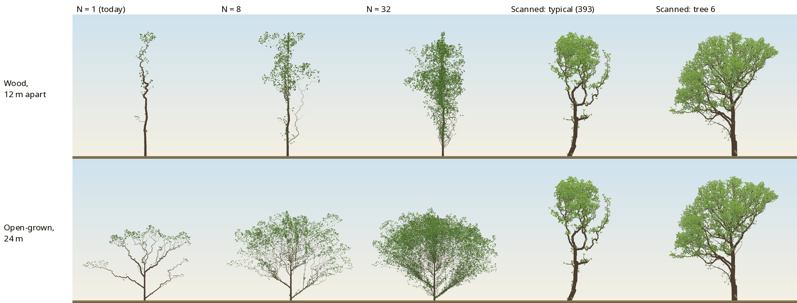
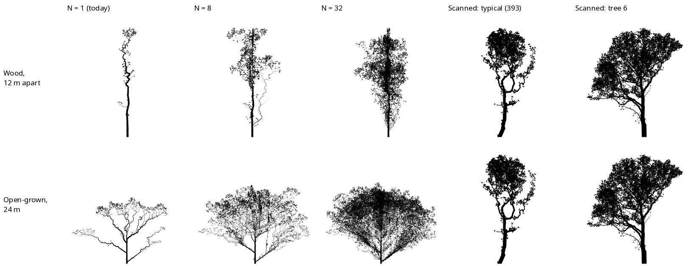
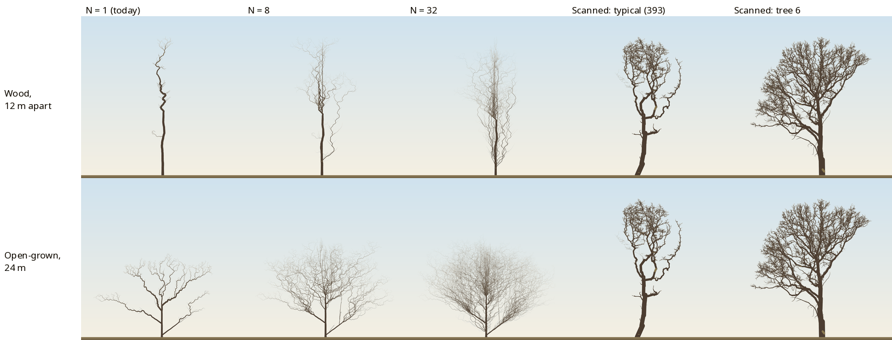
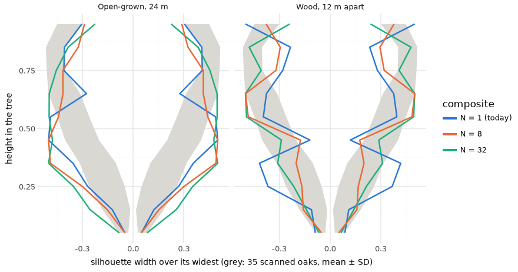

# Prototype B: stacked slices around one trunk, drawn flat

## Question
The 2×2 ([note](2026-10-29-structure-vs-drawing.md)) found that our planar oak holds about what a 1 m slab of a real oak holds, and the page draws that slice as a whole tree.

If we grow N independent planar oaks and compose them around one trunk, drawn flat by the page's own renderer:
- how close does the side profile get to the scanned oaks'?
- at what N, and at what cost?

The user's goals:
- the scanned oak's side profile;
- flat, ink-drawing rendering;
- species likeness;
- sim/render separation and performance.

No change to `src/`.

## Setup
The harness is in `analysis/experiments/structure_vs_drawing/`.
- **Slices:** the adopted (refit, ADR 0024) oak, seeds s₀ … s₀+31:
  - **open-grown**, at the season its height first reaches 24 m (scanned tree 6's height): season 94, seed 3 onward;
  - **open-grown at season 150;**
  - **`oakWood` at season 150**, trees 5 m apart;
  - **"wood12"**, oakWood's rules with five oaks 12 m apart on a ring, giving room for crowns about Wytham's width (≈ 16 m), at season 150.

  Woodland slices are the tallest interior oak.
- **Composition (`compose_slices.ts`):** slice 0 is kept whole. Other slices are grafted, each turned about the vertical through its attach point, so sag and upturn stay vertical:
  - **level 1 ("slices"):** each other slice's limbs graft onto slice 0's trunk, the nearest trunk node by height, at azimuth kπ/N ± π/(2N);
  - **level 2 ("limbs"):** slice 0's limbs take the page's own ADR 0008 turn, and each other slice's branches (order 2) graft onto the slice-0 limb nearest them in the plane, fanned ±0.4π around that limb's own plane.
- **Girth by the pipe model:** all slice wood is scaled by 1/√N. Slice 0's wood then carries every graft above it, and the trunk is never thinner than its fitted radius.
- **N = 1** is today's page exactly: the slice's own snapshot.
- **Checks** (the script throws on a fault):
  - parent before child;
  - every graft's base on its parent's tip;
  - tips equal the sum over slices.
- **Drawing:** `a.html`, the page's own Scene and WebGL2 renderer, in the oak leaf style, 1000 px. `?mask=1` overrides the scene's colour tokens to draw a black-on-white silhouette with the same renderer.
- **Target:** all 35 live Wytham oaks (Calders et al. 2022), drawn through the same page renderer (leaves on the scanned tips) and measured the same way.
- **Measures (`profile.py`, self-tested on a disc, a triangle and a ring):**
  - width in 10 height bands, over the widest;
  - spread (W/H);
  - crown base: the lowest height at which the silhouette is a quarter of its widest;
  - fill inside the outline;
  - big-gap share: interior sky in gaps wider than 3% of height both ways.

```bash
D=analysis/experiments/structure_vs_drawing
for f in <qsm-dir>/*.mat; do uv run --no-project --with scipy --with numpy python $D/qsm_export.py $f runs/structure-vs-drawing/data wy-<id>; done
node $D/compose_slices.ts runs/structure-vs-drawing/data          # 4 settings × 2 levels × N ∈ {1, 4, 8, 16, 32}, ≈ 2 min
PUPPETEER=<scratch>/node_modules/puppeteer-core/lib/esm/puppeteer/puppeteer-core.js \
  node $D/capture_flat.mjs http://localhost:5173/$D/a.html <out> --bench slices-… limbs-… wy-…
uv run --no-project --with numpy --with pillow --with scipy python $D/profile.py <out>/*-mask.png > <out>/profiles.jsonl
uv run --project analysis python $D/slices_figures.py <out> <out>/profiles.jsonl docs/experiments/figures
```

## Result









### Silhouettes against the 35 scanned oaks (summer)
Z-scores are against the scans' mean and SD. Profile RMS is the distance from the scans' mean width profile; the scans themselves lie 0.15 ± 0.06 from it.

| | Spread | Crown base | Fill | Big-gap share | Profile RMS |
|---|---|---|---|---|---|
| **Scanned oaks (n = 35)** | 0.49 ± 0.16 | 0.29 ± 0.10 | 0.60 ± 0.12 | 0.64 ± 0.15 | 0.15 ± 0.06 |
| Open, 24 m: N = 1 (today) | 1.30 (+5.2) | 0.20 (−0.8) | 0.13 (−4.0) | 0.97 (+2.2) | 0.22 |
| Open, 24 m, limbs: N = 8 | 1.39 (+5.8) | 0.17 (−1.1) | 0.26 (−2.9) | 0.92 (+1.9) | 0.27 |
| Open, 24 m, limbs: N = 32 | 1.33 (+5.4) | 0.13 (−1.5) | 0.56 (−0.4) | 0.72 (+0.6) | 0.31 |
| Wood 12 m: N = 1 (today) | 0.13 (−2.4) | 0.27 (−0.1) | 0.39 (−1.8) | 0.56 (−0.5) | 0.30 |
| Wood 12 m, limbs: N = 8 | 0.46 (−0.2) | 0.16 (−1.2) | 0.30 (−2.6) | 0.84 (+1.4) | 0.19 |
| **Wood 12 m, limbs: N = 32** | **0.48 (−0.1)** | **0.18 (−1.1)** | **0.53 (−0.7)** | **0.75 (+0.7)** | **0.16** |
| Scanned tree 6 | 0.67 (+1.1) | 0.25 (−0.4) | 0.73 (+1.0) | 0.51 (−0.8) | 0.16 |

**Winter** (wood only; scans 0.39 ± 0.08), fill:

| Case | Winter fill |
|---|---|
| Today's open oak | 0.09 |
| Limb composites | 0.14–0.20 (z −2.2 to −2.9) |

TreeQSM fits twigs too thick, which inflates the scans' figure, but not by this much.

### What the numbers and pictures say
1. **Composition fixes fullness.** Fill and gap texture rise steadily with N and reach the scans' band at N ≈ 32. At N = 1 the crown is a sketch (fill 0.13); at N = 32 it is a crown.
2. **At Wytham's spacing, a 32-slice limb-level composite of the woodland oak matches the scanned oaks' silhouette.** It is within their natural spread on spread, crown base, fill, gaps and width profile. It is the first simulated oak in this project to do so.
3. **Composition does not fix architecture.** The silhouettes show the remaining difference:
   - **Scanned oaks:** crowns carried by a few heavy, sinuous limbs.
   - **Our woodland oak:** a pole wrapped in foliage. Even at 12 m spacing a slice is a pole with a small crown (95 tips); the fitted species grows that way in any stand.
   - **Our open oak:** a fan from near the ground, nearly three times too wide (open-grown habit; the scans are woodland trees).
   - **Bare wood:** thin and wiry everywhere (winter fill 2–3 SD low).
4. **Trunk-level stacking multiplies the wrong thing.** Each slice brings its own 6–11 primary limbs: at N = 8, about 64 thin limbs, a broom in winter. Limb-level stacking keeps slice 0's few heavy limbs and multiplies branches and twigs, as real trees do. Its pipe sum at the trunk base comes to 0.95–1.0 of the fitted trunk, against 1.2–1.4 for trunk level.
5. **Density per crown area is what counts.** The open composite's 1 m slab already holds a real slab's tips at N = 8 (773, against 450–560), but its crown is about 2.7 times too large in area for them.

### Cost

Size-matched open oak, limb level, with the woodland oak at 12 m:

| N | Metamers (open) | Draw (open)\* | Metamers (wood) | Draw (wood)\* | Growth (open, per tree) |
|---|---|---|---|---|---|
| 1 | 2,368 | 1.7 ms | 303 | 1.7 ms | 0.17 s |
| 8 | 16,612 | 3.3 ms | 2,602 | 1.9 ms | 1.3 s |
| 32 | 65,986 | 5.4 ms | 12,853 | 3.1 ms | 5.3 s |

\* Mean draw time in headless Firefox; indicative only.

Growth time is for the whole run (94 seasons open, 150 wood).

- **Live simulation of 32 slices for every garden tree is out of budget.** The home forest now costs 9.6 ms a season for all its trees.
- **Drawing 13,000 metamers per woodland oak is within reach** of the phone figure (M15: about 10,000 metamers at 60 fps), especially with level of detail for depth slices.

## Conclusion
- **The 2D framing's visual cost can be paid on the drawing side.** Composing independently grown slices around a tree's own limbs gives a flat profile with the scanned oaks' fullness and outline, with no change to the simulation.
  - The independent seeds here are exactly a **donor library**: slices pre-grown offline per species and size (like the first-paint checkpoints), grafted onto the live tree's limbs at draw time.
  - Simulation cost stays at one slice per tree, and drawing cost is about N times the instances, which level of detail or per-season baking can cap.
- **What it cannot supply is the skeleton.** The composite inherits slice 0's limbs, and ours are not yet oak limbs:
  - poles in the woodland;
  - a low fan in the open;
  - thin wood everywhere.

  That is a growth problem, and it needs solving on any path. The silhouette measures here, together with winter fill and limb shape (ADR 0024), are ready-made fit targets from the 35 scans.

**Paths, for the user to choose:**
- **(B) Depth from a donor library**, as a milestone. It needs an ADR revising spec §2's drawing (ADR 0008 replaced): a slice library per species, limb-level grafting at draw time, and level of detail. Then fit the slice architecture to the scanned profiles (crown on a bole, few heavy limbs).
  - **Cost:** weeks.
  - **Keeps:** the fitted 2D core, the goldens, the garden budget.
- **(C) A 3D core** (TypeScript or Rust/WASM), drawn flat in the same ink style through an orthographic view. It grows the crown's depth and architecture natively, and limbs compete in 3D.
  - **Cost:** months: a new light model, every species refitted, and draw and simulation budgets of 10⁴–10⁵ metamers per tree.
  - **Not tested here:** the optional three.js flat demonstration was not built.
- **The skeleton fit comes first on either path.** Fitting the slice's architecture to the scanned profiles is needed for both, and it tells us whether 2D growth can make oak limbs at all.

## Limits
- **No competition between slices:** each slice grew alone in its own plane, so this is an upper bound on what B looks like.
- **One species, one seed range:** independent seeds of one preset can repeat. None was obvious at these N.
- **The open oak is compared with woodland scans,** so its spread and crown base are expected to differ.
- **Draw times are headless.**
