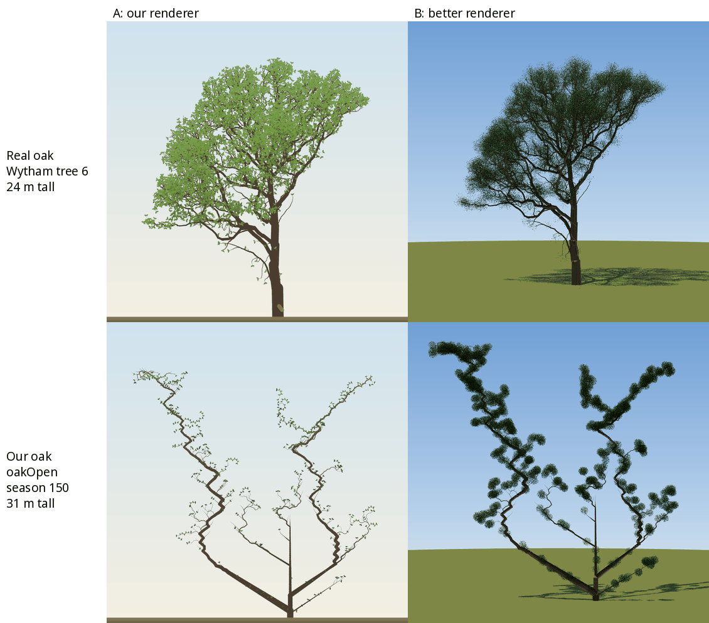
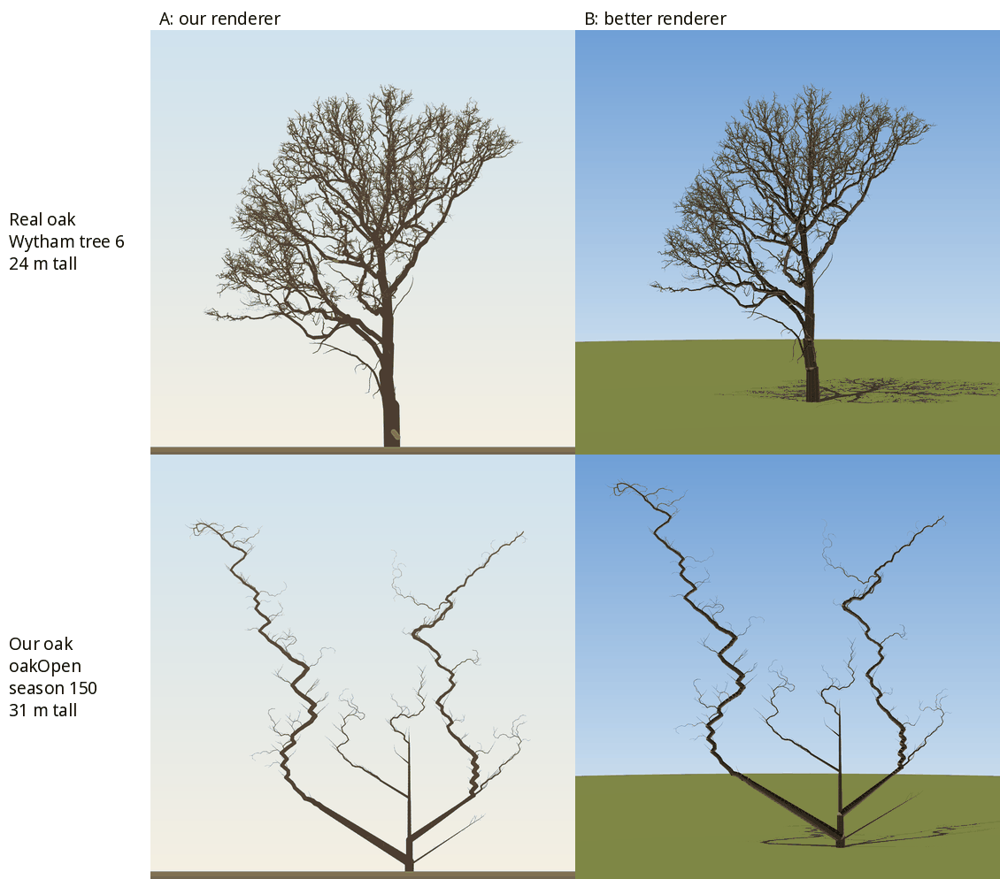
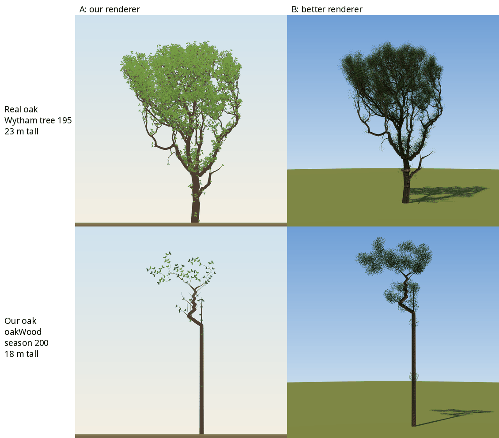

# Structure vs drawing: why the trees don't look real

## Question
The trees still don't look the way trees should. Is the problem the **structure** the simulation grows, or the **drawing** of it? A 2×2 test separates the two: draw a laser-scanned real oak with our page's renderer, and draw our oak with a much better renderer.

| | A: our renderer | B: better renderer |
|---|---|---|
| **Real structure** | does our drawing make a real tree look real? | reference |
| **Our structure** | what the site shows | does better drawing rescue our tree? |

If the real tree looks fake through A, the drawing is the bottleneck. If our oak still looks wrong through B, the structure is. This was the first step proposed for the realism moonshot (session of 2026-10-29).

## Setup
Code at `1afc701`, harness in `analysis/experiments/structure_vs_drawing/`. A cell is 0.25 m (`leaf-styles.ts`, M23).

**Trees**
- **Real:** the two *Quercus robur* with the largest crowns in the Wytham Woods TLS plot (Calders et al. 2022, *Ecological Solutions and Evidence*; data on [Zenodo 7307956](https://zenodo.org/records/7307956), CC BY 4.0). These are TreeQSM v2.0 cylinder models from leaf-off scans:
  - tree 6: 24.4 m tall, 25,654 cylinders;
  - tree 195: 23.4 m tall, 26,227 cylinders.

  Both are woodland-grown. `fetch_wytham.py` reads only the two members out of the 39 GB archive, about 90 MB, using HTTP range requests.
- **Ours:** the largest oak by height × crown width:
  - `oakOpen`, seed 3, season 150: open-grown, 30.9 m tall, 1,776 metamers;
  - `oakWood`, seed 9, season 200: stand-grown, 17.7 m tall, 222 metamers.

  The mixed wood had no live oak at season 300 (seed 9).

**Renderer A** is the page's own Scene + WebGL2 code in the natural view, as `a.html` serves it: pseudo-depth on, oak leaf style, leaf age 5, 1000 px.
- **Real trees:** projected to a side view (east–west, height), with every row given one order, so ADR 0008's limb squeeze doesn't turn an already-3D tree a second time.
- **Leaves on real trees:** these go on terminal cylinders. A scan gives no Q, so leaf shading uses a light proxy: openness to the sky through a 0.5 m grid of tip counts.

**Renderer B** is three.js 0.170.0 (`b.html`). It is not photoreal, but it is clearly better at light and depth. It applies the same rules to every tree:
- **Wood:** tapered tubes with joint spheres, a procedural bark texture with bump mapping.
- **Light:** sun with 4096² soft shadows, and a hemisphere sky occluded per vertex and per leaf through a 0.4 m voxel grid of leaf and wood area. This occlusion is what gives the crown its depth.
- **Foliage:**
  - **Amount:** LAI 3 over a round crown whose diameter is the leaf sites' wider horizontal extent, capped at 400k leaves.
  - **Leaves:** 10 cm, alpha-tested, at near-spherical angles.
  - **Clumps:** centred on the structure's own leaf sites, with radius 0.75 × the sites' median nearest-neighbour distance, clamped to 0.5–1.2 m.
- **Output:** drawn at 2000 px and downscaled with Lanczos.
- **Our oaks in 3D:** read with the page's own rule. Each first-order limb is turned rigidly about its parent axis by the page's stable azimuth, through acos(0.55 + 0.45|sin φ|), so B's front view keeps the silhouette the page draws.

```bash
D=analysis/experiments/structure_vs_drawing; mkdir -p runs/structure-vs-drawing/{data,png} <qsm-dir>
python3 $D/fetch_wytham.py <qsm-dir>
for t in 6:wytham_winter_6-0.2-0.22-3-0.055-0.0605-2-5-1-3 195:wytham_winter_195-0.2-0.22-4-0.045-0.0495-3-5-1-2; do
  uv run --no-project --with scipy --with numpy python $D/qsm_export.py <qsm-dir>/${t#*:}.mat runs/structure-vs-drawing/data real-${t%%:*}
done
node $D/export_ours.ts runs/structure-vs-drawing/data
# npm run dev; puppeteer-core installed in a scratch folder (not a project dependency); system Firefox
PUPPETEER=<scratch>/node_modules/puppeteer-core/lib/esm/puppeteer/puppeteer-core.js node $D/capture.mjs \
  http://localhost:5173/$D/a.html http://localhost:5173/$D/b.html runs/structure-vs-drawing/png real-6 real-195 ours-open ours-wood
uv run --no-project --with pillow python $D/figure.py runs/structure-vs-drawing/png docs/experiments/figures/2026-10-29-structure-vs-drawing-summer.png summer real-6 ours-open "Real oak|Wytham tree 6|24 m tall" "Our oak|oakOpen|season 150|31 m tall"
uv run --no-project --with numpy python $D/structure_stats.py runs/structure-vs-drawing/data/*.skel.json
```

A second run from the committed scripts (Firefox 158, headless) reproduced every export byte for byte and every image pixel for pixel.

## Result







| | Height | Leaf sites | Tips | Forks | Wood length | Strahler order | Straightness, last 2 m |
|---|---|---|---|---|---|---|---|
| Wytham tree 6 | 24.4 m | 5,873 | 5,873 | 4,538 | 4,242 m | 8 | 0.61 |
| Wytham tree 195 | 23.4 m | 6,351 | 6,351 | 4,680 | 4,135 m | 8 | 0.60 |
| Ours, `oakOpen` s. 150 | 30.9 m | 758 | 452 | 451 | 515 m | 5 | 0.88 |
| Ours, `oakWood` s. 200 | 17.7 m | 113 | 51 | 50 | 65 m | 3 | 0.88 |

Our leaf sites include R6 short-shoot rosettes. That is why they outnumber tips.

**Observations**
- **Real structure, our renderer (top left):** it reads at once as an oak, a pleasant illustrated one. The crown is full, the limbs are sinuous, and the light-green sprays lie on a believable shell. The page's drawing is not what makes our trees look wrong.
- **Our structure, better renderer (bottom right):** it still reads as wrong, and the lighting makes the faults plainer. The crown is a few separate puffs strung along a few zigzag limbs, with sky through the middle. The woodland oak is a long pole topped by a small, puffy crown (6.8 m wide on 17.7 m).
- **Winter shows it most clearly.** The real oak is a fractal of thousands of twigs over eight Strahler orders. Ours is a few limbs and a few hundred twigs, about an eighth of the forks and wood length despite being taller.
- **Specific faults in our structure,** visible in both renderers:
  1. **Detail:** too few branching orders and forks (Strahler 5 against 8), so there is no fine twig layer.
  2. **Zigzag limbs:** a regular kink every one or two metamers along every oak limb, at the 1–3 m scale. Real limbs wander over metres, not by alternating kinks.
  3. **Shape:** the open oak forks into long, nearly straight V-limbs from near the ground, instead of a trunk carrying a dome.
  4. **Empty interior:** foliage sits only on the outer axes.

  Our twigs are straighter over their last 2 m than the scans' (0.88 against 0.60). The scans' figure is inflated by cylinder-fitting noise in fine twigs, so treat that difference as indicative only.
- **Renderer B on the real tree** is the most realistic image of the eight. Better drawing adds real value, but only on top of real structure.

**Fairness and limits**
- B is a few hundred lines of three.js, not a photoreal renderer. It does not have translucency, a scanned leaf or proper multiple scattering.
- **Leaves are placed by rule.** The scans are leaf-off, so foliage is placed by rule on the scanned tips in both renderers, and our trees get the same rule.
- **Size and setting differ.** Wytham's oaks are woodland trees of unknown age. Ours are matched roughly in size, not in age or setting. The question is "does it read as a real oak", not "does it match this oak".
- **Judgement.** The verdict is the author's and the user's judgement of the images, not a blind panel. A forced-choice panel (real or simulated?) is the proper test once structure improves.
- **QSM detail.** TreeQSM extrapolates twigs below about 1 cm radius, and a tip is the finest twig the scan resolved.

## Conclusion
**Structure is the bottleneck, by a wide margin.**
- Our renderer makes a real oak look real. A better renderer makes our oak look like a well-lit wrong tree.
- This supports the moonshot's bet that most of the realism gap lies in structure: detail, branching orders and the shape of limbs.
- It argues for weighting structure even more heavily than the bet's 70% and rendering less than its 20%.

**Follow-ups**
- **The zigzag** is a concrete, local fault in every oak limb, and the cheapest to chase. Find which rule makes it: the distichous side alternation, C4 direction weights, or R3 sag and posture.
- **Detail budget:** tips and forks are an order of magnitude below a real oak's. Smaller internodes, more orders and a twig layer, or the moonshot's two-level detail, are the levers.
- **A quantitative realism target:** the structural statistics above (tips, forks, wood length, Strahler order, straightness) can serve as fitting targets alongside the §10 ones. The Wytham plot has QSMs for 835 trees: 37 oaks, 541 sycamores, and ash, hazel, hawthorn and field maple.
