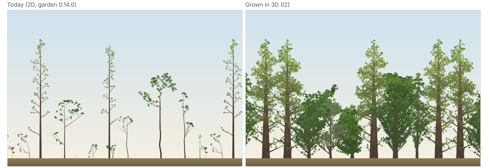

# I2: the trees grow in 3D (ADR 0024, 0025)

## Question
I2 is the first behaviour change: 3D topology and directions, the slab light, vector mechanics, τ as a world parameter, new formats and the first 3D goldens (the design: ADR 0025). The brief asked for:
1. a grown forest planting at D = 64 in the three looks, drawn orthographically on the preview beside today's garden (the visual check V);
2. m and the cost per metamer, against the prototype's;
3. the season's time on the phone, in one lane and in four;
4. what in the prototype's conclusions the full model contradicts.

## Setup
**The model:** this commit, every principle on (`forest`'s and the woodland's), D = 64, K = 16 rotating, the looks' τ: wood interior [0.2, 0.2] (the default), wood edge [1, 0.2], hedgerow [1, 1]; with and without a 3-cell fade at the interior. Uncalibrated: every parameter is the 2D model's, except E (wood's own, 4·10⁶) and the species' phyllotaxis (their own; ADR 0025).

**m and cost** (`code/2026-10-30-i2/runs.sh`, `analyze.py`; output `analyze.txt`):
- the `forest` preset (10 trees on a 210-cell ring, all principles, O4 recruiting), 100 seasons, natively, one thread, on this VM (4 cores, idle);
- the 2D reference is the 2D core at the tag `golden-2d-ts`, built with the same per-season series (`2d-bench-series.patch`), so it is Rust 2D against Rust 3D;
- two rule sets: **the prototype's** (C1–C6, R1, R6; R2–R5, mechanics and stand dynamics off) and **the full model**;
- m = live metamers 3D / 2D at seasons 20, 30, 40, 60 and 100; the passes' cost in μs per metamer per season, every phase but light, averaged over the 10 seasons before each report (the prototype note's measure).

**Crowns** (`crowns.py`, output `crowns.txt`): the full model's `forest` in each look, the 10 planted trees' height and crown depth (the z extent of their tips), and every tip's share of each 4-cell band across the slab.

**V** (`bake.ts`, `trim.ts`, `bake-2d.sh`, `preview/`): the garden's planting (`forestParams`) at a phone's plate (66 cells) and a laptop's (160), seed 10, grown 40 and 100 seasons in each look. Each is grown twice: as the model grows it (O4's recruits) and as the planting alone (O4 off). The 3D stands are drawn orthographically with the garden's own WebGL2 renderer through the prototype's slab view: (x, y) projected, far to near in one-cell z slices, with no perspective. Beside them is today's garden (0.14.0, served by the site), opening on the same planting's 2D forest at the same season (grown by the tag's 2D core, the TypeScript core's bytes). On the site's `preview-3d` deploy: `https://preview-3d-edbarker-dev.edbarker.workers.dev/preview/i2/i2.html`.

**Device timing** (the same page, "Season time on this device"): from each stand at season 40, ten seasons through the WASM world's `step_timed`, one lane, every phase timed. Each season's light is then computed again in four workers, each with its own instance and sweep marching every fourth sky direction on a copy of the season's leaf area (G3's lane model). The four-lane season is the one-lane season with its light replaced by the slowest lane plus the lanes' sum, timed in JavaScript. The stands: `forest` in each look, and the garden's planting at 160 and 66 cells, interior look. Medians of ten seasons. Headless Chromium on this VM: `browser-vm.json`. The phone's and laptop's are the user's to take.

## Result

### 1. m (3D over 2D, the same rules and seed)

| Rules, look | s20 | s30 | s40 | s60 | s100 | 3D metamers at s40 |
|---|---|---|---|---|---|---|
| Prototype's rules: interior | 13.1 | 13.1 | 16.8 | 18.6 | 5.3 | 73k |
| edge | 13.9 | 15.0 | 19.9 | 23.2 | 6.7 | 86k |
| hedgerow | 14.5 | 17.5 | 23.0 | 27.7 | 8.9 | 100k |
| *the prototype (R6, D 64, τ 1)* | *13.7* | *15.2* | *20.5* | *26.3* | *8.7* | *≈ 89k* |
| **Full model: interior** | **25.2** | **30.0** | **41.1** | **39.1** | **31.3** | **72k** |
| edge | 27.9 | 43.0 | 60.2 | 60.0 | 57.1 | 105k |
| hedgerow | 30.0 | 55.5 | 78.6 | 81.2 | 83.0 | 138k |

The 2D model under the prototype's rules carries 4.3–5.7k metamers (17k at season 100, a flush of short shoots); with every principle, 1.7–2.0k.

- **The full core reproduces the prototype.** Under its rules, the hedgerow's m is within 1–3 of every figure the prototype measured, in a different language, light kernel and RNG.
- **With every principle, m is two to four times the prototype's:** 25–41 in the interior, 28–60 at the edge, 30–83 in the hedgerow, and it does not fall back at the plateau (31–83 at season 100, where the prototype's fell to 8). R2–R5 cut 2D's metamers 2.5–9× (4.3k → 1.75k at season 40); in 3D they barely cut them (73k → 72k in the interior) and the edge and hedgerow grow more.

### 2. The passes' cost, μs per metamer per season (3D over 2D)

| Window | 2D, prototype's rules | 3D, prototype's rules (interior / edge / hedgerow) | 2D, full | 3D, full (interior / edge / hedgerow) | Ratio |
|---|---|---|---|---|---|
| 11–20 | 0.31 | 0.55 / 0.59 / 0.54 | 0.56 | 0.93 / 0.96 / 0.93 | 1.6–1.9 |
| 31–40 | 0.24 | 0.38 / 0.39 / 0.39 | 0.52 | 0.76 / 0.86 / 0.84 | 1.5–1.7 |
| 51–60 | 0.20 | 0.38 / 0.35 / 0.35 | 0.46 | 0.84 / 0.82 / 0.84 | 1.8–1.9 |
| 91–100 | 0.12 | 0.24 / 0.27 / 0.27 | 0.46 | 0.77 / 0.73 / 0.79 | 1.6–2.2 |

**A 3D metamer's passes cost 1.5–2.2× a 2D one**, Rust against Rust, against the prototype's 1.1–1.8× (TypeScript against TypeScript). The frames and rotations cost a little more than the prototype's vectors did.

**Light natively, one thread** (the same windows): 70–80 ms a season at seasons 11–20, 112–140 at 31–40, 134–197 at 51–60, 167–244 at 91–100. **The whole season** averages 189 (interior), 221 (edge) and 256 ms (hedgerow) over 100 seasons, against 2D's 2.3 ms.

### 3. The crowns (full model, the 10 planted trees)

| Look | Height p50, s40 / s100 | Crown depth p50, s40 / s100 | Depth / height | Tips in the outer 2 cells of each face, s40 / s100 (even 6.2%) | Tips beyond a face |
|---|---|---|---|---|---|
| Interior | 70 / 114 | 31 / 28 | 0.44 / 0.25 | 2.3 / 3.4% | 93 / 54 |
| Edge | 71 / 115 | 36 / 32 | 0.51 / 0.28 | 7.2 / 14.5% (the front band 23%) | 714 / 834 |
| Hedgerow | 71 / 116 | 41 / 33 | 0.57 / 0.29 | 11.6 / 22.0% | 1563 / 2062 |

- **The fade does nothing at the interior's τ** under the prototype's rules (the same metamers to the last), and takes 2–3% off the full model's. No crown comes within 3 cells of a face there.
- **Recruits:** with O4 on, every plate fills to its cap of 300 live trees, the phone's 66-cell ring included (it holds 3–4 trees in 2D). Seeds land over the whole ground plane, W × D cells where 2D had W, and the floor is lighter than the 2D calibration's target (15% of open sky against 2–10%). The planted trees grow among a carpet of seedlings.

### 4. The season on devices (from season 40, ms)

**Headless Chromium on this VM** (WASM SIMD, 4 cores):

| Stand | Metamers | Season, 1 lane | Light, 1 lane | Passes | Light, 4 lanes | Season, 4 lanes |
|---|---|---|---|---|---|---|
| `forest`, interior | 73k | 191 | 115 | 76 | 55 | **130** |
| `forest`, edge | 107k | 201 | 110 | 91 | 64 | **154** |
| `forest`, hedgerow | 139k | 235 | 115 | 120 | 65 | **185** |
| garden at 160 cells, interior | 38k | 181 | 116 | 65 | 64 | **129** |
| garden at 66 cells, interior | 15k | 74 | 53 | 20 | 30 | **50** |

The review projected `forest` at D = 64 on the phone at 133 ms in one lane (91–292) and 75 ms in four (47–182). The VM's interior stand comes in at 191 and 130. Single-threaded, the VM is within 10% of the user's phone and laptop (G1, G3). **The phone's and laptop's numbers:** to come from the page.

### 5. V
On the page, for the user to judge. In headless Chromium:
- **The planting alone:** the trees read as crowns with depth: rounded, overlapping volumes where today's are fans.
- **The hedgerow at season 100:** walls of foliage to the world's top.
- **With O4's recruits:** the carpet of seedlings fills the lower picture.

## What the full model contradicts in the prototype's conclusions
1. **"m is 13–26 while the stand grows and about 8 once it plateaus."** With every principle it is 25–83 and does not fall back (31–83 at season 100). The review's projections took the prototype's m and expected R2–R5 to lower it, as they do in 2D. In 3D they do not: inner buds see side light through the gaps in depth, so R4's dormancy and R5's shade avoidance suppress far less, and the edge and hedgerow grow more than the prototype's rules do.
2. **"A 3D metamer's passes cost 1.1–1.8× a 2D one."** In the full model they cost 1.5–2.2×. Together with m that makes the passes, not the light, the larger share of a stand's season at the edge and in the hedgerow (91–120 ms of the VM's 201–235).
3. **"Free crowns want about 0.8 × height of depth, 70–85 cells for the full model's mature trees."** The planted trees' crowns are 0.25–0.57 × height deep (28–41 cells): the full model's shedding, R2's axes and the neighbours keep them narrow. D = 64 has room to spare for them.
4. **"D = 64 hardly piles at all until crowns near full height."** With the open faces of the edge and the hedgerow, the full model piles foliage at them: by season 100 the outer bands hold 14.5% (the edge's front) and 22% (the hedgerow) of the tips, against an even 6.2%, and up to 2000 tips overshoot a face. At the interior's τ nothing piles, as the τ note found.
5. **"Trees reach 90–96 cells by season 100."** In 3D they reach 114–116, near the 130-cell world's top, so height levels off at the ceiling rather than below it (one of the 2D tests that fails, `carbon.test.ts`).

## The 2D evidence in 3D
The milestone tests calibrated on the 2D model (`tests/evidence-2d/`) were run once against the 3D core (`code/2026-10-30-i2/evidence-2d-in-3d.md`):
- **47 of 90 pass.**
- **29 miss their thresholds,** mostly as the review's §4 predicted:
  - stand trees' slenderness 12–20 against the 60–80 target (more leaves, thicker pipes);
  - floors at 15% of open sky against the 2–10% target;
  - crown bases that do not lift in a stand;
  - whorls of 4, not 2, and spirals in place of the distichous sides two tests asserted (both by design).
- **14 could not run cleanly:**
  - 9 shared a stand across tests that the per-test cleanup had freed;
  - 4 ran out of WASM's 4 GB building many 3D worlds in one test;
  - 1 timed out.

They are calibration's backlog (C1–C8). Each is re-derived in 3D under the seed rule, then moves back into the default suite.

## Conclusion
- **The 3D core grows:** every principle runs in 3D, natively and in WASM with the same bits, with the same bits on one lane or four, and the structural invariants hold every season.
- **It reproduces the prototype under the prototype's rules.** With every principle it carries two to four times the prototype's metamers. On this VM `forest`'s season at D = 64 is 130–185 ms in four lanes in the browser (191–235 in one), above the review's central projection and within its range. The phone decides (the page).
- **V is the user's,** on the page: the planting alone at a phone's plate is the comparison closest to the garden.
- **For calibration:**
  - O4's establishment over the ground plane fills every plate with seedlings;
  - the trees reach the world's ceiling;
  - the open looks pile foliage at their faces;
  - the 2D evidence's backlog is listed.
