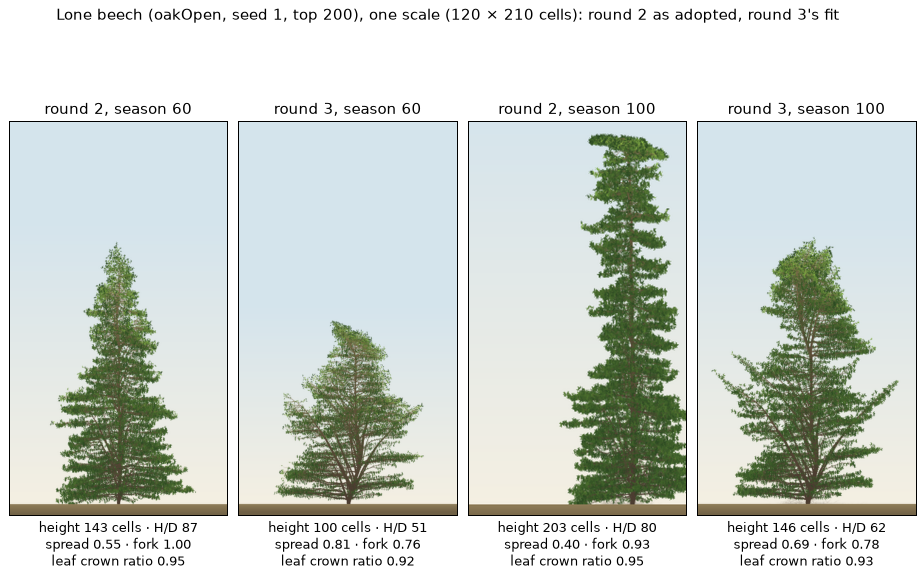

# Species in 3D, steps 0–1: the generator, the trials, least squares, and the beech pilot

The [species plan](../plans/2026-10-30-species.md) steps 0 and 1, on `claude/species-3d` off `3d-port`. **The pilot stopped on both of the plan's stop rules**, so step 2 does not run. What follows is the report the plan asks for.

**Timings are the user's laptop's** (12th-gen i7-1260P: 12 cores, 4 performance and 8 efficiency, 16 threads; 12 workers), the machine the fits are planned to run on. They are not a VM's, unlike the plan's §1 measurements.

## Step 0: the generator reproduces the file
- `m27_adopt.py` writes the 3D overlay itself (ADR 0025's `PHYLLOTAXIS` map, and wood's E = 4·10⁶ wherever a patch sets R3) after the fit's assignments and the overrides. `in3d` has left `flora.ts` (`FLORA = FITTED_FLORA`). Round 2's fits are now in `fits/round2/`, and `--round` picks the folder.
- In the regenerated `flora-fitted.ts`, only the overlay's values changed (17 rows spiral, 3 opposite, 10 E values).
- **`rust/presets.json` is byte-identical** (`git diff --exit-code`). `npm run check` is green and the goldens did not change.

## Step 1: what was built
- **Trials** (`cli/trials.ts`):
  - The lone tree and the stand take the woods' top (200).
  - `runStand(…, 60 | 100)` reports `crownRatio` as the leaf measure, with `boleCrownRatio` beside it.
  - `runShade` reports the seasons the seedling lived (capped at 30).
  - A new `wood` trial reads the floor of the species' own wood (beechWood's planting per area, τ 0) at 100 and 150.
  - Every trial frees its world.
- **The shade house in 3D.** Between the woods' τ 0.2 faces the floor was lit at about 8% under any roof (8.2% at roof 10), so no roof could reach 2%.
  - **The house now has opaque faces.** This was not in the plan's text; it was needed to meet the plan's own 2–30% requirement.
  - `ROOFS` = [1, 1.5, 2, 2.6, 3.3, 4, 4.8, 5.6] gives 30, 21.7, 15.8, 10.9, 7.1, 4.7, 2.9 and 1.8% (`code/2026-10-30-species-3d/roofs.ts`). The light is the same for every seed.
- **`fit-eval.ts`** accepts `standSeasons`, per-trial seed lists and the `wood` trial.
- **Targets** (all ten files):
  - `stand.floor` moves to `[holdout] floor`, with the same target and band.
  - `stand.crownRatio` has a comment saying it is now the leaf measure.
  - **The `c6.r0` bounds are now in ADR 0027's units** (0.015–0.05 ÷ 8 = 0.001875–0.00625): the 2D bounds excluded every 3D r0.
- **`shade.survivalLight` is continuous** (`fit.py`'s `survival_light`):
  - On a log-light axis, each roof owns the interval from its own light up to the next brighter roof's. Each interval is weighted by the share of the 30 seasons the seedling lived under that roof.
  - A clean step gives the step statistic exactly. A late death under a darker roof moves the value toward that roof's light.
  - The step statistic is still reported, as `shade.survivalLightStep`.
- **`fit_lm.py`** follows §2 as written, with three implementation choices:
  1. **A hand-written Levenberg–Marquardt loop instead of `scipy.optimize.least_squares`.** Its trust region evaluates trial points one at a time under its own acceptance rule, and r0's update between iterations has no place in it. The loop applies the plan's rule (accept only if the loss drops, halve otherwise) and uses Marquardt-scaled damping in the unit cube, with steps capped at 0.25.
  2. **m_w holds each species' own m_w·r0²** (64·r0_start²), not 64·0.0025². Beech's adopted r0 is 0.0031, so the plan's formula would have cut its sapwood cost by a third at the start, and the start would no longer be round 2 as adopted.
  3. **The active set rule.** A parameter is active if its screening column's norm, or its pull |Jᵀr|, is at least 20% of the largest.
- **`m27_fit.py --method lm`** adds `--start round2` (round 2's assignments, the overrides, r0 ÷ 8) and `--species garden`. Each species after the first starts from the mean shift of the species already fitted, if that start's loss is lower. It writes `fits/round3-hedgerow/<sp>.json`, `<sp>-lm.csv` and `<sp>-jacobian.csv`.
- **`m27_holdout.py`**:
  - `--round`;
  - section 0, the floor in own woods (3 seeds, at 100 and 150);
  - the mixed wood at 3 seeds, with canopy trees every 50 seasons and the tallest tree against the top;
  - LM results files are accepted (no restarts, no progress CSV).

## The beech pilot
`m27_fit.py --method lm --start round2 --species beech --workers 12`, 177 evaluations in 2162 s (36 min). Results: [`fits/round3-hedgerow/beech.json`](fits/round3-hedgerow/beech.json), [`beech-lm.csv`](fits/round3-hedgerow/beech-lm.csv), [`beech-jacobian.csv`](fits/round3-hedgerow/beech-jacobian.csv).

### Wall-clock (this laptop, 12 workers)
| stage | time |
|---|---|
| one evaluation (3 lone, 2 stands to 60, 3 shade houses), alone | 11 s (the stand to 60 is the critical path) |
| screening, 36 evaluations at one seed | 213 s |
| an iteration: 15 Jacobian columns plus the trial point | 194–258 s; each extra halving 17–18 s |
| verification: start and fit, 6 fresh seeds, stand to 100 | ≈ 110 s |

### Screening Jacobian
Central differences at round 2's point, one seed, step 0.08. The table shows the change in each residual (in band units, √w-weighted) for a 0.08 move. A residual is listed only when the change is larger than both 0.3 and the seed-to-seed difference at the centre (seeds 1 and 2).

| parameter | residuals it moves |
|---|---|
| `r2.dLambda` | lone.forkHeight −1.16, lone.crownFullness −0.77, stand.height −0.76, lone.spread +0.62, stand.slenderness −0.52 |
| `r3.c` | lone.slenderness +1.07 |
| `r6.leafArea` | lone.forkHeight −1.00, lone.slenderness +0.62, lone.crownFullness +0.38 |
| `r2.kappa` | stand.slenderness +0.87, stand.height +0.79, lone.slenderness +0.50 |
| `c3.alpha` | lone.slenderness −0.85 |
| `r1.Lh` | lone.slenderness −0.69, stand.height +0.32 |
| `r1.mf` | lone.slenderness +0.58, shade.survivalLight +0.33 |
| `r2.levels.0.lambda` | lone.slenderness +0.53, stand.height +0.52 |
| `r2.hJ` | lone.earlyShare −0.45, lone.slenderness −0.44, stand.height −0.40 |
| `r2.levels.1.lambda` | lone.crownFullness +0.43 |
| `r2.levels.1.setPoint`, `.branchAngle`, `.eta`, `r2.levels.2.setPoint`, `r2.aC`, `c5.Trel`, `r6.qMin` | nothing above the threshold |

- **Ten parameters clear the threshold, but the 20% rule made fifteen active.** The rule is too loose: five columns of noise in every Jacobian, and a third of each iteration's cost.
- **Lone slenderness is moved by almost everything**, while **`lone.forkHeight` (0.014 against 0.7) and `lone.widestAt`** are moved only in the wrong direction. Nothing in the box lifts beech's fork in 3D.
- **The seed noise at the centre is small** (≤ 0.03 band on most traits, 0.24–0.52 on the slenderness traits). The noise that hurt the iterations is something else, described under "why it stopped".

### Loss per iteration (fixed seeds, stand to 60, without `stand.lateShare`)
| iteration | trial steps (∞-norm) → loss | accepted | r0 |
|---|---|---|---|
| start | 65.04 | | 0.003096 |
| 1 | 0.245 → 29.32 | yes | 0.004954 (×1.6, the cap) |
| 2 | 0.167 → 26.57 | yes | 0.003096 |
| 3 | 0.25 → 29.21 ✗, 0.125 → 23.85 | yes | 0.002524 |
| 4 | 0.151 → 26.35 ✗, 0.075 → 23.31 | yes | 0.002175 |
| 5 | 0.25 → 24.33 ✗, 0.125 → 24.19 ✗, 0.0625 → 22.83 | yes | 0.002096 |
| 6 | 0.25 → 23.02 ✗, 0.125 → 23.50 ✗, 0.0625 → 24.54 ✗, 0.031 → 21.88 | yes | 0.002067 |
| 7 | 0.25 → 19.85 | yes | 0.001875 (lower bound) |
| 8 | 0.238 → 22.16 ✗, 0.119 → 22.77 ✗, 0.059 → 22.20 ✗, 0.031 → 21.76 ✗ | **stopped**: four consecutive rejections | 0.001875 |

The run never reached the stand to 100: the switch was due at iteration 8.

### Beech on fresh seeds (1001–1006, stand to 100)
Loss (`fit.py`'s, with the floor out): **start 71.3, fit 33.9**, against **round 2's 7.81** (2D, 10 seeds; 7.1 without its floor term). Margin is the distance to the band's edge (negative: outside).

| trait | target ± band | round 2 in 3D | fit | margin |
|---|---|---|---|---|
| stand.height (60) | 84 ± 18 | 131 | 75.3 | +9.3 ✓ |
| stand.lateShare | 1.43 ± 0.06 | 1.29 | 1.65 (h100 124) | −0.16 ✗ |
| lone.earlyShare | 0.5 ± 0.08 | 0.41 | 0.50 | +0.08 ✓ |
| lone.slenderness | 48 ± 8 | 90.7 | 44.6 | +4.6 ✓ |
| stand.slenderness | 70 ± 10 | 103 | 40.9 | −19.1 ✗ |
| stand.crownRatio (leaf) | 0.55 ± 0.1 | 0.94 | 0.77 | −0.12 ✗ |
| lone.spread | 0.9 ± 0.2 | 0.57 | 1.22 | −0.12 ✗ |
| lone.widestAt | 0.4 ± 0.15 | 0.10 | 0.23 | −0.02 ✗ |
| lone.crownFullness | 0.75 ± 0.1 | 0.66 | 0.81 | +0.04 ✓ |
| lone.forkHeight | 0.7 ± 0.2 | 0.014 | 0.024 | −0.48 ✗ |
| lone.leaderDominance | 2.0 ± 0.8 | 1.86 | 1.21 | +0.005 ✓ |
| lone.branchAngle | 55 ± 10 | 44 | 49.1 | +4.1 ✓ |
| lone.limbDroop | 10 ± 10 | 6.5 | 4.9 | +4.9 ✓ |
| shade.survivalLight | 0.034 ± 0.01 | 0.023 | 0.027 (step: 0.047) | +0.003 ✓ |

The fresh seeds agree with the fixed ones: at the stand to 60 the fit's loss on fresh seeds would be ≈ 20.3 (33.9 less lateShare's 13.6), against 19.85 on the fit's own seeds. **The fit did not overfit its seeds.**

### Why it stopped
1. **One r0 cannot satisfy both slenderness targets.** The rule assumes H/D ∝ 1/r0 at a given shape. The fit made the stand *squatter* than the lone tree (40.9 against 44.6). The targets ask for a stand 1.46× as slender as the lone tree, and round 2's point gave 1.13×. With r0 at its lower bound (m_w therefore 174), the stand still reads 41. At thin r0 the trunk is mostly R3's stress wood (`r3.c` and the stand's crowded crowns), not r0·√tips. The rule's premise (the plan's §2.1, "10–30% stress wood") does not hold here, and r0 swung 0.0031 → 0.0050 → 0.0031 → 0.0019, making every iteration fight the previous one's r0.
2. **The steps' losses are not monotone in step size.** In iteration 6: 23.0, 23.5, 24.5, then 21.9 as the step halved; in iteration 8: 22.2, 22.8, 22.2, 21.8. With common seeds, a parameter change still re-draws each tree's realisation, because draws are keyed by `birthId` and the trees differ. **That realisation noise is about ±1–2 in loss**, and from iteration 4 on it is as large as the improvement a step promises. The seed noise at the centre is much smaller and does not measure it.
3. **Beech's fork cannot be reached.** `lone.forkHeight` 0.014–0.024 against 0.7 (−2.4 band, half weight) is moved by nothing in the box except downward. `stand.lateShare` 1.65 is high because the fit lowered height at 60 (to 75) more than at 100 (124, near the target's implied 120); the iterations never saw it.

### What the plan's rules say next (decisions for the user, not taken)
- §3 step 1, stop rule 1: "the CMA-ES fallback for this species, and the Jacobian goes in the note". The Jacobian is above; the fallback has not been run.
- Possible changes for the user to weigh (none made):
  - the active set by the noise test above (ten parameters, not fifteen);
  - r0 as a Jacobian column, or the update solved against stand slenderness only, with the lone tree's H/D fitted by the shape parameters;
  - more seeds per trial point, to bring the realisation noise below a step's gain;
  - whether `lone.forkHeight`'s target suits Troll's beech in 3D.
- Step 2's command is not given: the pilot did not pass.

## Pilot 2: the closed stand, 3D form metrics, LM then CMA-ES (beech passes)
Branch `claude/species-3d-closed`. These changes follow the first pilot (the user, 2026-10-30; [plan](../plans/2026-10-30-species.md) §0.8–9 and the revised §2). The first pilot's results moved to `fits/round3-hedgerow/`; pilot 2 is `fits/round3/`.

### What changed
- **The stand trial is closed:** three rows of four on an 84-cell periodic ring, spacing 21, faces [0, 0], the woods' top. The middle row's four trees are measured at 60 and 100. It takes ≈ 6 s to season 100, against the hedgerow's 45 s, so the stand runs to 100 throughout. The release trial keeps the one-row stand (`rowParams`, held out).
- **The form metrics read a 3D crown** (`form.rs`, a unit test each):
  - **Crown profile** (`widestAt`, `crownFullness`): each band's width is the larger of its x and z extents, which the slab's depth does not cap. Measured on a lone beech at 60: z extents saturate at 52–66 against a depth of 64, while x runs to 93 (`code/2026-10-30-species-3d/fork-3d.ts`).
  - **`forkHeight`** counts a lateral as a division only if it is at least 0.7 of the trunk's radius **and** climbs at least 0.7 of the height the trunk climbs above the node. Round 2's beech has a basal limb at y = 1 with 0.74 of the trunk's radius and 2000 metamers. It spreads sideways while the leader runs unbroken to the top, yet it read as a fork at 0.014.
  - **`lone.spread`** is max(crownWidth, crownDepth)/height (`cli/trials.ts`).
  - No spec question arose.
- **Beech targets whose reading changed** (round 2's point, 3 seeds, the first pilot's harness → this one):

  | trait | before → after |
  |---|---|
  | lone.forkHeight | 0.014 → 0.98 |
  | lone.crownFullness | 0.66 → 0.68 |
  | lone.widestAt | 0.10 → 0.10 (unchanged) |
  | lone.spread | 0.57 → 0.57 (unchanged: x is the larger extent) |
  | stand.height | 131 → 128 |
  | stand.slenderness | 103 → 121 |
  | stand.crownRatio | 0.94 → 0.40 |
  | stand.lateShare | 1.29 → 1.33 |

  The closed stand changes all four stand traits. Its H/D over the lone tree's is now 1.33, against the targets' 1.46, so one r0 can serve both.
- **The search:**
  - LM's screening and descent as built, with a noise-tested active set;
  - then CMA-ES from the LM point (covariance (JᵀJ)⁻¹ over the active set and r0's log unit; population 10; 4 seeds fresh each generation; 30 generations; patience 15);
  - then selection of the LM point and the 5 best generation-bests on 6 seeds of their own (501–506), by measured targets in band, then loss;
  - then verification on 6 fresh seeds (1001–1006).
  - Acceptance is the measured targets in their bands.

### Wall-clock (the user's laptop, 12 workers)
| stage | seconds |
|---|---|
| screening: 34 perturbed points at one seed, and the centre at 4 seeds | 203 |
| LM: 4 accepted iterations, then 4 rejected halvings | 1167 (201–248 an attempt) |
| CMA-ES: 30 generations, 10 candidates × 4 seeds | 5029 (164–171 a generation) |
| selection and verification | 207 |
| **the whole pipeline** | **6605 (1 h 50 min), 449 evaluations** |

### Screening (central differences, step 0.08, one seed; noise = sd over seeds 1–4)
- **Seed noise at the centre**, in band units, √w-weighted: crownFullness 0.36, leaderDominance 0.20, stand.slenderness 0.18, stand.crownRatio 0.18, spread 0.17, lone.slenderness 0.16, lateShare 0.13, forkHeight 0.11. Every other trait sits at the 0.05 floor.
- **The noise test made all 17 active.** Each parameter moves some residual by more than its noise; the second column counts the residuals it moves that way.
- **`lone.widestAt` is a band index** (steps of 0.1, or 0.47 in band units). One band's jump clears its floor noise for ten parameters, so it alone keeps several of them active.

| parameter | residuals moved beyond noise | the largest (move, × noise) |
|---|---|---|
| `r2.kappa` | 9 | stand.height +1.76 (27×), stand.slenderness +3.02 (17×), lone.earlyShare −0.56 (11×) |
| `r2.dLambda` | 10 | lone.widestAt −1.41 (28×), stand.height −1.25 (19×), lone.earlyShare +0.53 (11×), stand.slenderness −1.39 (8×) |
| `r2.levels.0.lambda` | 12 | stand.height +1.14 (18×), stand.slenderness +1.71 (10×), lone.earlyShare −0.38 (8×) |
| `r2.hJ` | 9 | lone.earlyShare −0.91 (18×), stand.height −0.71 (11×), lone.slenderness −0.88 (5×) |
| `r3.c` | 8 | lone.slenderness +2.14 (13×), stand.slenderness +1.93 (11×), lone.earlyShare +0.45 (9×) |
| `r1.Lh` | 6 | stand.height +0.86 (13×), lone.slenderness −1.38 (9×), stand.slenderness +0.89 (5×) |
| `r1.mf` | 6 | shade.survivalLight +0.67 (13×), lone.slenderness +1.15 (7×) |
| `c3.alpha` | 9 | shade.survivalLight −0.57 (11×), lone.slenderness −1.70 (11×), stand.height +0.66 (10×) |
| `r6.leafArea` | 10 | lone.slenderness +1.24 (8×), stand.lateShare +0.62 (5×), lone.forkHeight +0.30 (3×) |
| `r2.levels.1.lambda` | 8 | stand.lateShare −0.76 (6×), lone.forkHeight −0.41 (4×), lone.crownFullness +1.12 (3×) |
| `r2.aC` | 8 | stand.lateShare −0.46 (3×), lone.slenderness −0.51 (3×), lone.forkHeight +0.29 (3×) |
| `r2.levels.2.setPoint` | 5 | stand.lateShare +0.61 (5×), lone.crownFullness +0.42 (1×) |
| `r2.levels.1.setPoint` | 4 | lone.branchAngle +0.34 (7×), stand.lateShare +0.24 (2×) |
| `r2.levels.1.branchAngle` | 7 | lone.branchAngle +0.25 (5×), stand.slenderness +0.38 (2×), stand.crownRatio +0.33 (2×) |
| `r2.levels.1.eta` | 7 | lone.widestAt +0.47 (9×), lone.branchAngle −0.16 (3×) |
| `c5.Trel` | 5 | lone.slenderness −0.42 (3×), stand.crownRatio +0.27 (2×) |
| `r6.qMin` | 4 | stand.lateShare −0.49 (4×), stand.crownRatio −0.43 (2×) |

### Loss (progress only)
- **LM, on the fixed seeds:** start 67.3, then 17.6, 9.4, 7.2 (at a quarter step), 4.20 (at a quarter step, and 6 of 6 measured in band). Then four rejected halvings: 22.3, 12.0, 13.7, 12.6. Even a 0.024 step scored 12.6, so the 4.20 was a favourable realisation, and the LM point read 9.4 on the selection seeds.
- **CMA-ES, each generation's best on its fresh seeds:**

  | generations | bests |
  |---|---|
  | 0–9 | 7.63, 3.97, 6.27, 5.27, 6.65, 4.20, 3.98, 4.67, 4.08, 3.65 |
  | 10–19 | 4.19, 3.93, 4.33, 4.36, 3.44, 4.79, 5.48, 3.82, 5.01, 3.66 |
  | 20–29 | 5.42, 4.89, 4.84, 3.71, 2.85, 6.26, 5.93, 5.21, 4.16, 4.67 |

  The medians fell from 17.7 to 6–7. Measured targets in band among the generation bests: 6 of 6 in 9 of the 30 generations, the first at generation 11. The patience rule never fired: the best improved at generations 9, 14 and 24.
- **Selection (6 seeds):** LM point 4 of 6 in band (loss 9.40); CMA bests 4, 6, 4, 6, 5 of 6. The winner, CMA candidate 4, had loss 3.00.

### Beech on fresh seeds (1001–1006): accepted
All 6 measured targets are in band. Loss: start 72.5, fit 4.8.

| trait | kind | target ± band | round 2 in 3D | fit | margin |
|---|---|---|---|---|---|
| stand.height (60) | measured | 84 ± 18 | 128 | 85.4 | +16.6 |
| stand.lateShare | measured | 1.43 ± 0.06 | 1.33 | 1.45 | +0.037 |
| lone.earlyShare | measured | 0.5 ± 0.08 | 0.41 | 0.506 | +0.074 |
| lone.slenderness | measured | 48 ± 8 | 90.7 | 52.1 | +3.9 |
| stand.slenderness | measured | 70 ± 10 | 121 | 63.7 | +3.7 |
| shade.survivalLight | measured | 0.034 ± 0.01 | 0.023 | 0.026 | +0.002 |
| lone.spread | described | 0.9 ± 0.2 | 0.57 | 0.95 | +0.15 |
| stand.crownRatio (leaf) | described | 0.55 ± 0.1 | 0.40 | 0.315 | **−0.135** |
| lone.widestAt | described | 0.4 ± 0.15 | 0.10 | 0.30 | +0.05 |
| lone.crownFullness | described | 0.75 ± 0.1 | 0.68 | 0.71 | +0.06 |
| lone.forkHeight | described | 0.7 ± 0.2 | 0.98 | 0.785 | +0.12 |
| lone.leaderDominance | described | 2.0 ± 0.8 | 1.86 | 1.68 | +0.48 |
| lone.branchAngle | described | 55 ± 10 | 44 | 51.2 | +6.2 |
| lone.limbDroop | described | 10 ± 10 | 6.5 | 8.4 | +8.4 |

- **Margins:**
  - `shade.survivalLight` is in band by 0.2 points of light;
  - the slenderness pair and `lateShare` are in by 0.4–0.6 of a band;
  - the only trait outside is a described one, the stand's leaf crown ratio (0.315 against 0.55): the closed stand lifts beech's crown further than the description.
- **The fitted parameters** (round 2 as adopted → fit):

  | parameter | change |
  |---|---|
  | `c6.r0` | 0.0031 → 0.00396 (m_w 64 → 39) |
  | `r1.Lh` | 109 → 86 |
  | `r1.mf` | 0.077 → 0.102 |
  | `r2.aC` | 14.4 → 0.60 (**at its lower bound, 0**: by ADR 0020 a finding, not a bound to tighten) |
  | `c5.Trel` | 0.045 → 0.25 |
  | `r2.kappa` | 0.43 → 0.12 |
  | `r2.levels.1.eta` | 0.57 → 1.18 |
  | `r2.levels.1.branchAngle` | 50 → 57.5 |
  | `r3.c` | 0.049 → 0.036 |
  | everything else | within 10% |

### Step 2's cost, estimated from this pilot
- Beech took 1 h 50 min, 76% of it CMA-ES.
- The other seven run cheaper or similar trials: by §1 their lone and stand trials cost 0.5–0.9 of beech's, and only birch, oak and hornbeam run the shade house.
- **≈ 1.2–1.8 h a species, ≈ 10–12 h for the seven** on this laptop at 12 workers: an overnight run.

### The lone beech, before and after (for the user's look before step 2)
The lone trial's world: `oakOpen`, one beech at x 80 in the open, 160 wide, the woods' top (200), seed 1. Round 2's patch is as adopted (`FLORA`); round 3's is the fit's. Screenshots are the lab's plate at seasons 60 and 100 (`?bench&seasons=N`, headless Firefox), each cut to the same 120 × 210-cell window and scale. Traits under each are from the same world headless (`lone-traits.ts`, `lone-traits.json`); the lab's height chart agrees (round 2 reaches the top at ≈ 85).

| | round 2, 60 | round 3, 60 | round 2, 100 | round 3, 100 |
|---|---|---|---|---|
| height (cells) | 143 | 100 | 203 (the top) | 146 |
| H/D | 87 | 51 | 80 | 62 |
| spread (max(W, D)/H) | 0.55 | 0.81 | 0.40 | 0.69 |
| fork height | 1.00 | 0.76 | 0.93 | 0.78 |
| leaf crown ratio | 0.95 | 0.92 | 0.95 | 0.93 |

- **Round 2's** beech is a narrow spire that reaches the top by season ≈ 85 and is pinned there by 100.
- **Round 3's** is broader and shorter, a dome over low spreading limbs, still growing at 100 (146).

**Lab links:** `node docs/experiments/code/2026-10-30-species-3d/lone-links.ts http://<host>:<port>/` prints both for a running `npm run dev -- --host`. Figure: `lone-figure.py` from the four screenshots.

### Accepted, and carried to the hold-out (the user, 2026-10-30)
The user looked at the lone beech and **accepted beech's fit** (not adopted: adoption is step 5). Carried to step 3:
- the stand's leaf crown ratio, 0.315 against 0.55 (described), to be judged on the phone at adoption;
- `r2.aC` at its lower bound, a finding under ADR 0020; whether other species land there too;
- the noise test activating all 17 parameters (`widestAt` moves in whole-band steps).

Step 2, the other seven, started 2026-10-30 at about 23:55 on the user's laptop.

## Step 2: the seven garden species (overnight, 2026-10-30/31)
`m27_fit.py --method lm --start round2 --species garden --skip-done --workers 12` under `systemd-inhibit`, on the user's laptop: 23:53 to 07:46, **7 h 53 min**, no species failed. Beech was skipped as done and its shift carried: every species started from its round-2 point moved by the earlier fits' mean shift where that start's loss was lower (birch: 120.6 own, 32.3 shifted). Log: [`garden.log`](code/2026-10-30-species-3d/garden.log); results in `fits/round3/`. **Nothing adopted.**

Fresh seeds 1001–1006; a margin is the distance to the band's edge (negative: outside by that much). Loss is the fresh-seed loss from the start point to the fit, a progress indicator only.

| species | accepted | measured in band | loss | wall-clock | fit from |
|---|---|---|---|---|---|
| beech (pilot 2) | yes | 6 of 6 | 72.5 → 4.8 | 1 h 50 | CMA |
| birch | **no** | 3 of 5 | 34.2 → 15.9 | 1 h 05 | LM (stop rule: CMA-ES 15 generations without improving) |
| oak | **no** | 5 of 6 | 16.3 → 13.9 | 1 h 27 | CMA |
| willow | yes | 5 of 5 | 4.6 → 2.6 | 1 h 03 | CMA |
| hornbeam | **no** | 5 of 6 | 18.9 → 14.5 | 1 h 19 | CMA |
| rowan | yes | 2 of 2 | 7.5 → 4.8 | 1 h 04 | CMA |
| holly | yes | 2 of 2 | 41.0 → 4.5 | 53 min | CMA |
| maple | yes | 3 of 3 | 10.4 → 7.1 | 1 h 01 | CMA |

Measured traits, fitted (margin):

| trait | birch | oak | willow | hornbeam | rowan | holly | maple |
|---|---|---|---|---|---|---|---|
| stand height | 92.9 (+17.9) | 72 (+7.0) | 50 (+12) | 89 (+8.0) | | | 64.7 (+10.3) |
| lone earlyShare | 0.754 (+0.046) | 0.607 (+0.037) | 0.713 (+0.043) | 0.663 (+0.043) | | | |
| lone H/D | 51.2 (+4.8) | 44.9 (+5.0) | 42.2 (+2.2) | 49.8 (+6.2) | 50.1 (+5.9) | 47.6 (+7.6) | 48.4 (+7.6) |
| stand H/D | **86.9 (−6.9)** | 79.3 (+0.7) | 65.5 (+5.5) | 73.4 (+6.6) | 63.9 (+3.9) | 70.6 (+9.4) | 75.9 (+4.1) |
| stand lateShare | | **1.49 (−0.12)** | 1.07 (+0.049) | **1.37 (−0.085)** | | | |
| survival light | **0.156 (−0.004)** | 0.119 (+0.025) | | 0.0249 (+0.002) | | | |

- **Birch** ended with `c6.r0` on its upper bound (0.00625): its round-2 start was already above it (0.00707), so ÷ 8 could never hold it. Its stand H/D (86.9 against 70 ± 10) is the girth it could not reach.
- **Oak and hornbeam** miss only on the stand's late share, both high (1.49 against 1.31 ± 0.06; 1.37 against 1.23 ± 0.05); both starts were already at or past the band's top. They go to the hold-out as fitted (the user, 2026-10-31); `r1.hydraulic` is not changed.

### Parameters at bounds (within 2% of the range)
| species | at a bound |
|---|---|
| beech | `r2.aC` lo (0.60; 0), `r6.qMin` lo |
| birch | `r2.levels.1.eta` lo, `r2.kappa` lo (0), `c6.r0` hi, `r6.qMin` hi |
| oak | none |
| willow | `r2.levels.1.eta` lo, `r1.Lh` lo |
| hornbeam | `r2.kappa` lo |
| rowan | `c3.alpha` hi |
| holly | `r2.levels.1.eta` lo, `r2.kappa` lo |
| maple | `r1.Lh` lo |

- **`r2.kappa` and `r2.levels.1.eta` low for three species each:** a finding about 3D crowns, not bounds to tighten (ADR 0020; the user, 2026-10-31).
- **`r2.aC` at its bound: beech only.** Oak, willow and hornbeam started at 0 and moved up (1.9–3.0 of 0–40); the others sit at 5.8–14.3.
- The noise test made all 17 parameters active for every species, as for beech.

## Step 3a: birch re-fitted with r0's top doubled (2026-10-31)
The user widened `c6.r0`'s upper bound for birch alone, 0.00625 → 0.0125 (its 2D fit was already near the old top, so ÷ 8 could never hold it), and birch was re-run alone from the same start as overnight (beech's shift; start loss 35.9). Log: [`birch-r0.log`](code/2026-10-30-species-3d/birch-r0.log). 1 h 07 min (screening 109 s, LM 908 s, CMA-ES 2839 s, verification 161 s); CMA-ES stopped by the patience rule at generation 20 (best 2.29 from generation 5).

| | overnight (top 0.00625) | re-fit (top 0.0125) |
|---|---|---|
| r0 (m_w) | 0.00625, at the top (82) | **0.00997** (32) |
| LM's end loss (fixed seeds) | 11.9 | 2.9 |
| loss on fresh seeds | 34.2 → 15.9 | 34.2 → **3.58** |
| measured in band on fresh seeds | 3 of 5 | **4 of 5** |
| stand H/D | 86.9 (−6.9) | **70.2 (+9.8)** |
| stand height | 92.9 (+17.9) | 91.6 (+16.6) |
| lone H/D | 51.2 (+4.8) | 50.7 (+5.3) |
| lone earlyShare | 0.754 (+0.046) | 0.687 (+0.047) |
| survival light | 0.156 (−0.004) | 0.156 (−0.004) |
| at a bound | η lo, κ lo, r0 hi, `r6.qMin` hi | `r6.qMin` hi only |

- **Stand H/D is on its target** once the pipes may be thick enough: the overnight miss was the bound.
- **Survival light is a step the shade house cannot resolve.** Under every roof darker than 1.5 (light ≤ 0.158) the fitted birch's seedlings die at season 4, on all six fresh seeds, whatever the light; under roofs 1 and 1.5 (0.30, 0.217) they live all 30. The continuous measure reads 0.156 whenever the cut falls between 0.158 and 0.217, which straddles the band's bottom (0.16). The fit could not move it (death at season 4 does not depend on the light below the cut), and `r6.qMin` sits at its top. Not accepted by the rule; the user's to judge.
- With birch re-fitted, **κ is low for two species (hornbeam, holly) and η for two (willow, holly)**, not three each: overnight birch's were the r0 bound's.

## Step 3b: the hold-out (stopped after the floors, 2026-10-31)
`m27_holdout.py --round round3 --workers 12` on all eight fits (birch's re-fit). Changes for this round: the pool's requests are batched across species (it had run 3 seeds at a time), survival is ranked by the fit's continuous survival light as well as the step, the tallest tree is read per species with oak, hornbeam and beech at ≥ 190 (95% of the top) as the stop, and lab links take `--origin` (the dev server). Its native mixed-wood runs need `~/.cargo/bin` on PATH (the first attempt failed there).

**The user stopped it at 09:46 to review how the targets are defined**, during the six 400-season mixed woods. Shade order, allometry and release had run but print only at the end, so only section 0 survives:

**The floor of each species' own wood** (`woodParams`: beechWood's planting per area, faces [0, 0], 150 seasons, seeds 1–3; relative light at the ground at 100, at 150 in brackets):

| wood | target | round 2 (FLORA) | round 3 (fitted) |
|---|---|---|---|
| birch | 15 ± 5% (measured) | 17.9% (16.6) in | 20.4% (19.3) **out** |
| oak | 8.4 ± 3% (measured) | 11.3% (12.5) in | 12.2% (12.7) **out** |
| willow | 12 ± 5% | 15.1% (15.7) in | 16.0% (17.2) in |
| rowan | 7.5 ± 3% | 15.1% (14.5) out | 11.4% (12.7) out |
| maple | 4.5 ± 2% | 7.8% (10.1) out | 6.7% (8.9) out |
| holly | 2 ± 1% | 11.8% (12.3) out | 17.2% (15.3) out |
| beech | 1.5 ± 0.8% (measured) | 8.1% (10.2) out | 7.3% (9.2) out |
| hornbeam | 1.5 ± 0.8% (measured) | 7.2% (11.7) out | 8.2% (8.9) out |

- **The floor barely depends on the species.** It spans 7–20% across eight species whose measured floors span 1.3–15%; the shade-tolerant woods are 5–9× too bright, round 2 and round 3 alike. No fitted trait constrains it (the fit sees no wood).
- The mixed woods, shade order, allometry and release were not completed here; they ran on 2026-10-31 (below).

**The rest of the hold-out (step A of the round-4 plan, 2026-10-31):** `m27_holdout.py --round round3 --skip floor --workers 12` on this laptop, 13:11–13:24 (13 min; log `runs/m27-holdout-round3-stepA.log`, summary `fits/round3/holdout.json`). It ran with round 4's harness: 10 roofs, and the survival light credited past the starvation timer.

*1. Shade tolerance* (the lowest roof light every seedling lives under, 5 seeds; the continuous measure in brackets for the fits):

| species | band | hand (round 2) | fitted (round 3) |
|---|---|---|---|
| birch | 15–25% | 15.8% | 18.5% (18.5) in |
| oak | 8–14% | 10.9% | 15.8% (15.8) **out**, too intolerant |
| willow | 12–20% | 10.9% | 10.9% (10.9) **out**, too tolerant |
| rowan | 8–14% | 7.1% | 4.7% (4.7) **out**, too tolerant |
| maple | 5–10% | 7.1% | 7.1% (7.1) in |
| holly | 2–5% | 1.8% | 15.8% (15.8) **out**, far too intolerant |
| hornbeam | 2.5–4.5% | 2.9% | 2.9% (2.6) in |
| beech | 2.5–4.5% | 2.9% | 2.9% (2.7) in |

Spearman ρ against Niinemets & Valladares's scores: hand −0.91, fitted −0.86 (continuous −0.88, −0.82). The fit sees survival light only for birch, oak, beech and hornbeam. Holly's fitted seedling needs 15.8%, the order's one large break: its fit (`r2.levels.1.eta` and κ at their floors, `r2.levels.1.branchAngle` 77°) bought form at the seedling's expense.

*2–3. Allometry and release* (medians and means over 5 seeds):
- **Δ** (junction exponent): 1.59–1.84, hand and fitted alike. Oak (1.59), beech and holly (1.68–1.70) sit below §10's 1.8–2.3.
- **The l–d slope:** 0.83–1.04, except fitted hornbeam at 0.45 (hand 0.92).
- **The leaf–section slope:** 0.64–0.86. The fitted birch, oak and holly are lowest (0.64).
- **Release:** epicormic shoots and lean into the gap for every species but holly and willow (none or 0.2 shoots). Fitted oak puts out the most shoots (14.4); beech and hornbeam lean furthest (2.1–2.4 cells).

*4. The mixed wood* (`mixedWood`, 400 seasons, seeds 1–3; canopy trees per run, means):
- **Pioneers:** birch leads at 50 (5.3, both patch sets) and is gone by 200. Willow and rowan fade by 200–300.
- **The late canopy is hornbeam's,** not beech's: at 400 the fits give hornbeam 17.0, maple 1.3, beech 1.7, oak 1.0 canopy trees per run. The hand patches give hornbeam 12.3, beech 3.3, maple 2.3, oak 1.7. M25's "beech ends with the most canopy trees" fails with both patch sets.
- **Holly:** the fitted holly never reaches the canopy (0 throughout); the hand one holds about 1.
- **The tallest tree** (max over seeds; the top is 200):

  | species | fitted (round 3) | hand (round 2) |
  |---|---|---|
  | hornbeam | 176 at 350 | 184 at 300 |
  | oak | 134 at 400 | **195–202 from 200 to 400** |
  | beech | 109 at 400, still climbing | 121 at 400 |
  | birch | 97 at 100 | — |
  | others | under 65 | — |

  The tallest tree in any run: fitted 176, hand 202.
- **The plan's stop rule** (oak, hornbeam or beech at ≥ 190, the fits): **not met.** The fitted hornbeam's 176 is the closest. Round 2's hand-tuned oak, the patch the garden grows now and round 4's start, reaches the top in the mixed wood (202). The user (2026-10-31): that is the start point, not a fit's outcome, so R1 stays as it is, and step E runs. **Hornbeam's 176 is within 8% of the stop: re-read it on round 4's hold-out.**

*5. The lab woods:* not run (fir and pine are not fitted in 3D).

*6. Plausibility:* parameters at a bound in round 3's fits:
- beech: η 1.18 (above round 4's new top of 1.0), `r2.aC` and `r6.qMin` at their floors;
- birch: `r6.qMin` at its top;
- hornbeam: κ;
- holly: η and κ;
- rowan: `c3.alpha` at its top;
- willow and maple: `r1.Lh` at its floor.

**Lab links** (the mixed wood, every fitted patch, at τ 0.2 and τ 0.1, seed 1): `node docs/experiments/code/2026-10-30-species-3d/mixed-links.ts http://<host>:<port>/` against `npm run dev -- --host`. Each link is ≈ 12 kB; both load and apply their patches (headless Firefox, to season 10).

## Round 4: the harness, the targets and round 3 re-scored (2026-10-31)

The [round-4 plan](../plans/2026-10-31-species-round4.md), steps B–D, after the [targets audit](../reviews/2026-10-31-species-target-audit.md); decisions in ADR 0028; the targets' sources in the [traits note](../research/2026-10-28-species-traits.md), "Round 4". Code and outputs in `code/2026-10-31-species-round4/`.

### The harness
- **Stand LAI** (`metrics::lai`, `RustWorld.lai`): the closed stand's leaf area per cell of ground, at 60 (`stand.lai`) and 100 (`lai100`).
- **The limb crown base** (`limbBase`, `limbCrownRatio`; metrics.csv 39 → 41 columns): first-order limbs in order of where they leave the trunk, the base of the limb at which those from the bottom up first hold 5% of the leaf. The plan's per-limb form (the lowest limb holding 5% on its own) read 0 on the round-2 lone beech at 100, whose 126 leafy limbs hold at most 4.4% each; the user chose the cumulative form from the panel. `stand.crownRatio` reads it; `leafCrownRatio` and the branch measure stand beside it.
- **Three crown bases** in round 3's closed stands at 60 (`crown-base.txt`, seeds 1001–1003): limb / leaf / branch. Beech 0.27–0.40 / 0.25–0.46 / 0.71–0.73; hornbeam 0.45–0.48 / 0.24–0.32 / 0.48–0.60; holly 0.83–0.85 / 0.78–0.79 / 0.94–0.98. In two of beech's trees the lowest leafy limb leaves the trunk at 49–62 cells of 80–85, and the reading barely moves between a 1%, 2% and 5% threshold: **beech's short stand crown is the model, not the definition.** The branch measure no longer reads 0.99 (0.43–0.98).
- **The profile trait kind** (`fit.py`, `fit_lm.py`): ten residuals of √(w/10), in band when every band is, the worst band's margin reported.
- **The shade house:** roofs 1.2 and 1.75 measured at 26.3% and 18.5% (`roofs.ts`, every seed the same).
- **Birch's season-4 death** (`birch-starve.txt`, roof 2, seed 1001): production 1.1 in season 1, then 0 (the bud is under R6's Q_ss, 0.1995, at its top), the reserve gone by season 3, `starved` 1, 2, 3, dead at 5. It is R6's light threshold, timed by R1's starvation, not a timer acting alone. Under the ten roofs it lives at 18.5% and dies at 15.8%: the cut is in (15.8, 18.5]%.
- **The survival light past the starvation timer** (the user): a seedling lives 4 seasons in the dark whatever the species or candidate (`starve-s0.txt`; `tests/trials.test.ts` asserts it with the fitted R1 and R6 parameters at their bounds), and crediting those 4/30 under every roof below the cut read birch 0.136 against the step's 0.185. `survival_light` now credits max(0, s − 4)/26 (`analysis/tests/test_fit.py`). **Survival lights quoted for round 3 above this section used the old measure.**
- **`m27_rescore.py`:** a round's fits and their starts on the verification's seeds against the targets as they stand, no search. **`m27_fit.py --method lm --smoke`** now exists (it had run a full fit into `round3/`): one LM iteration, two CMA-ES generations, one seed a trial, under `runs/m27-fit-smoke/lm/`; beech ran end to end with the profile and LAI in the residuals (356 s).
- **`m27_holdout.py --skip floor`** runs every section but the floors (smoke checked).
- **No golden moves:** `npm run bench -- --compare` gave the same hash for all seven cases.

### Round 3 re-scored against the round-4 targets (fresh seeds 1001–1006)
Margins in bands: +1 on target, 0 at the band's edge, negative outside (bold). "Measured in band" counts the measured targets only; the profile is described and every species misses it.

{table}
- **Who moves out:** beech (its stand H/D 64 against beech's 82, and its stand crown 0.35 against 0.57), birch (70 against birch's 95: round 3 fitted it to the generic 70), hornbeam (H/D at the band's edge), oak (LAI 3.5 against 5.5, survival light 0.158 against 0.114 now the measure is corrected). Rowan and holly have no measured target left; maple's LAI is 12.4 against a sycamore proxy's 4.0 (described).
- **The profile catches the audit's shape errors both ways:** oak, hornbeam and maple widest at bands 7–8 (vases; the audit's §1.5), beech, birch, rowan and holly at the base (round 3's beech is the tiered cone). Worst bands 1.6–5.5 bands out.
- **LAI is in band for beech and hornbeam with floors of 4–7%** (the closed stand at 60): matching LAI will not deliver the floor (ADR 0028, 2).
- **Late share** stays high for oak and hornbeam (1.49, 1.37): step A's stop rule decides whether R1 is the question first.

### The line-up panels (route A)
`figures/2026-10-31-species-panel-<species>.png`: the lone tree (seed 1) at 60 and 100 and the closed stand at 100 (all three rows), round 2 as adopted above round 3's fit, one scale (160 × 215 cells), the traits under each (`panel-links.ts` → `panel-shots.mjs` → `panel-figure.py`; headless Firefox against `npm run dev`). The lone tree's W/H at 100 is the parkland check (unfitted): round 3 reads beech 0.69, oak 1.21, hornbeam 1.21, maple 1.11. For the user to judge beech, oak and hornbeam; reference photographs are linked, not stored, when the user picks them.

**Judged by the user (2026-10-31), round 3's fits:**
- **Beech: not accepted.**
  - At 60 it is still the tiered cone: widest at the base, pointed, with an overhanging top.
  - At 100 it is a dome over low spreading limbs, but one reached through tiers.
  - The stand's crown ratio of 0.30 is visibly too short. The fit can reach 0.57, since `c5.Trel` (0.25 in round 3) is free.
- **Oak and hornbeam: not accepted.**
  - Both lone trees at 60 are parasols: widest at the top, fanning out from a short trunk.
  - At 100, oak is nearly right (a broad mound). Hornbeam is still an umbrella where it should be a dense egg.
  - Hornbeam's stand has a thin lid of leaf, like beech's.
- **Rowan: accepted on the panel.** A narrow, slightly asymmetric oval crown on a slender stem reads as a young rowan.
- **Holly: accepted on the panel.** A sparse cone. The sparseness is the evergreen leaf style, not the fit.
- **A figure bug, fixed:** rowan's round-3 stand was mis-cropped. The screenshot was right; `panel-figure.py` read the sky and the ground line from the plate's edge column, where that stand put a trunk, so the crop zoomed into the foliage. It now reads a row's sky as its brightest pixel, and the ground as the first row that is brown nearly all the way across.
- **To watch in round 4, not to act on:** every broadleaf round 3 produced is a cone or a vase, never a dome. Suppose round 4 reaches the profile for oak and hornbeam but not for beech, with η capped at 1.0. That would be a finding about what makes a dome in this model (the lower limbs staying longest), for R2's set points or C4, not for the targets.
