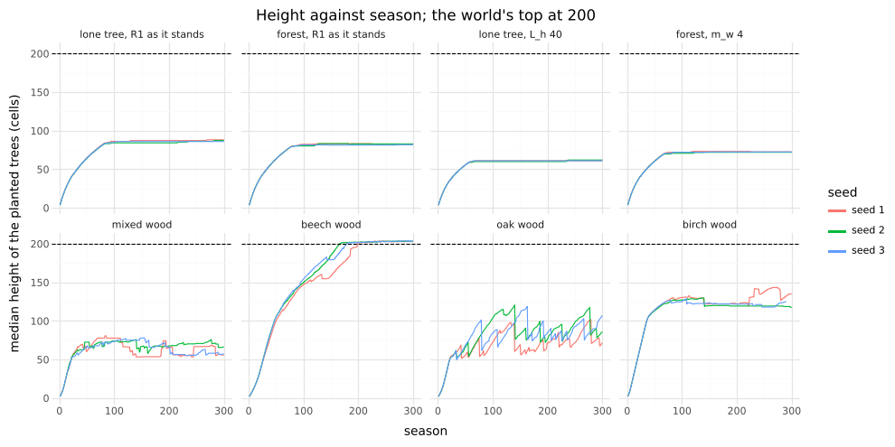

# C1, round 2: height first, R5 on neighbours, the stand in depth

## Question
The user's decisions on round 1 (2026-10-31):
1. **Height first.** Find the R1 setting (L_h, m_w, m_f, or the pipe-area cost) at which a lone tree and `forest` level off on their own in a 200-cell world. Report height against season to 300, three seeds. No floor, crown or H/D number from a stand that is still growing counts toward C1.
2. **R5 senses neighbours' shade in every preset.** Q_ss stays at 0.1 until height levels off.
3. **The interior's stand fills the slab's depth** (planting per area), and the floor is measured under the crowns. The lone tree and the hedgerow stay one row. Re-run the floor table under that planting.
4. **The crown base:** once (1) and (3) hold, check whether it lifts before adding anything. If it doesn't, say which of C5's thresholds holds it.

The round reports round 1's tables under these conditions, with height against season, and proposes `forest`'s and the sky presets' settings with their golden change.

## Setup
This branch, natively, `code/2026-11-01-c1-round2/`:
```bash
cargo build --release -p treesim --manifest-path rust/Cargo.toml
bash docs/experiments/code/2026-11-01-c1-round2/height.sh runs/c1r2           # (1): R1, 300 seasons
bash docs/experiments/code/2026-11-01-c1-round2/woods.sh runs/c1r2-woods      # (1): the species' woods
MODE=beech bash docs/experiments/code/2026-11-01-c1-round2/woods.sh runs/c1r2-woods
SEASONS=300 bash docs/experiments/code/2026-11-01-c1-round2/stand.sh runs/c1r2-stand base lone
bash docs/experiments/code/2026-11-01-c1-round2/stand.sh runs/c1r2-stand      # (2–4), 200 seasons
python3 docs/experiments/code/2026-11-01-c1-round2/height.py runs/c1r2        # → height.txt
SEASONS=150,200,300 python3 docs/experiments/code/2026-10-31-c1/c1.py runs/c1r2-stand  # → stand.txt
uv run --project analysis python docs/experiments/code/2026-11-01-c1-round2/height_plot.py \
  runs/c1r2 runs/c1r2-woods docs/experiments/figures/2026-11-01-c1r2-height.png
```

**Height (1)** (`height.sh`): the lone tree (one tree, 210-cell world, open sides, O4 off) and `forest` (the ring), both with R5 on neighbours, the top at 200, D 64, the interior's τ.
- R1 as it stands, then L_h 40, 30 and 20, m_w 2, 4 and 8 (the pipe-area cost: each tip's live pipe of radius r₀ costs m_w a cell), m_f 0.12 and 0.2.
- Seeds 1–3, 300 seasons.
- These runs predate the depth planting (`forest` in its one row). `forest` planted in depth levels off the same way (the stand table, `base`).
- **"Levels off":** under 2 cells gained over seasons 250–300 in every seed, and under 180 cells.

**The woods (1):** `mixedWood`, `beechWood`, `oakWood` and `birchWood` as presets now stand (R5 on neighbours, planted in depth, the species' own R1), seeds 1–3, 300 seasons. Then the beech wood with beech's L_h at 40 and 30 (`--species-patch`).

**The stand table (2–4)** (`stand.sh`), after this round's preset changes:
- `forest` with R5 on neighbours, planted in depth: 30 trees, three staggered rows across the depth (`perArea`);
- the round 1 knobs that could still matter: Q_ss 0.2, 0.05 and 0.03, T_rel 0.2, R4 off, k_ext 1, τ 0.1;
- the lone tree and the hedgerow (one row, both faces open, τ 1); the edge (front face open);
- seeds 1–3, 200 seasons (`base` and `lone` 300), snapshots at 150 and the last season. Height is flat from season 150 (below).

**New measures:**
- the CLI's `--light` also writes `ground.csv` (the ground's light and the leaf area above it, per x and z);
- **floor under** is the floor over ground columns with LAI ≥ 1 above them, and **crown cover** the share of the ground they make up;
- `metamers.csv` gains `pSum` and `mSum`, each branch's R1 production and maintenance, from R1's pass on a copy of the tree at the snapshot. A diagnostic run (`base`, seed 1, season 160) gives them for the crown base.

## Result

### 1. Height



**Median height of the planted trees, mean of three seeds** (`height.txt`, `woods.txt`):

| Case | s50 / 100 / 150 / 200 / 300 | Gain, s250–300, per seed | Metamers, s300 |
|---|---|---|---|
| **lone tree, R1 as it stands** | 65 / 85 / 86 / 86 / 87 | 1, 1, 0 | 20k |
| lone, L_h 40 | 56 / 61 / 61 / 61 / 61 | 0, 0, 0 | 11k |
| lone, L_h 30 | 46 / 47 / 47 / 48 / 48 | 0, 0, 0 | 7k |
| lone, m_w 2 | 64 / 82 / 83 / 83 / 83 | 0, 0, 0 | 18k |
| lone, m_w 4 | 61 / 74 / 75 / 75 / 75 | 0, 0, 0 | 16k |
| lone, m_f 0.12 | 61 / 75 / 76 / 76 / 76 | 1, 0, 0 | 15k |
| **`forest`, R1 as it stands** | 64 / 81 / 83 / 82 / 82 | 0, 0, 0 | 92k |
| `forest`, L_h 40 | 54 / 57 / 57 / 57 / 57 | 0, 0, 0 | 80k |
| `forest`, L_h 30 | 45 / 45 / 45 / 45 / 45 | 0, 0, 0 | 68k |
| `forest`, m_w 2 | 62 / 78 / 79 / 80 / 80 | 0, 0, 0 | 92k |
| `forest`, m_w 4 | 61 / 72 / 72 / 72 / 72 | 0, 0, 0 | 88k |
| `forest`, m_f 0.12 | 60 / 73 / 74 / 74 / 74 | 0, 0, 0 | 83k |
| `forest` in depth (`base`) | 63 / 81 / 82 / 82 / 83 | 0, 0, 1 | 105k |
| mixed wood (median) | 67 / 75 / 66 / 66 / 60 | −11, −4, 1 | 85k |
| beech wood | 104 / 151 / 174 / 202 / 204 | at the top | **1.3–2.6M** |
| beech wood, beech's L_h 40 | 68 / 113 / 140 / 160 / 201 | 19, 8, 19 | 78k |
| beech wood, beech's L_h 30 | 65 / 102 / 128 / 139 / 148 | 19, 0, −4 | 57k |
| oak wood | 63 / 87 / 88 / 78 / 88 | 0, −13, 14 | 90k |
| birch wood | 114 / 128 / 122 / 121 / – | the planted birches die by 300 | 41k |

Also run: lone and `forest` at L_h 20, m_w 8 and m_f 0.2, all levelled lower still.

- **With R5 on neighbours, R1 as it stands levels both off on their own:**
  - the lone tree at 86–87 and `forest` at 82–83, from season ≈ 120 to 300, in every seed;
  - 2D's plateau was 78 for the stand;
  - every R1 variant levels off too, lower (L_h moves the plateau most: 57 at 40, 45 at 30).

  **R1 needs no change for `forest` and the sky presets.** Round 1's climb to 113–122 was R5's own-shade signal, not R1.
- **The species' woods do not all level off:**
  - **the beech wood runs to the top:** its planted beech sit at 203–205 from season 200, with 1.3–2.6M metamers, the mechanism the user named;
  - **beech's own L_h:** 40 still reaches the top by 300; 30 slows it to 148, but one seed still gains 19 cells in the last 50 seasons;
  - **in the mixed wood** the beech and hornbeam reach 196–206 by season 300 (the median hides them: oak, maple and holly sit at 39–67);
  - the oak wood swings between 78 and 88 as storms throw its tallest;
  - the planted birches die by season 300.

  These are the species' own R1 settings (beech's m_f 0.035 and no L_h of its own, so 60; hornbeam's fitted L_h 92). That is C7 and C8's calibration (§4), and the garden's mixed wood depends on it.

### 2–3. The stand in depth: the table
`forest` as now preset, at season 200 (300 for `base` and `lone`; `base` at 150 in brackets); means of three seeds (`stand.txt`):

| Case | Floor % | Under crowns % | Crown cover | Height | Crown ratio | Width / H | Depth / H | H/D | Upper cover | Own tops | Metamers |
|---|---|---|---|---|---|---|---|---|---|---|---|
| **`base`** | 16.7 (16.4) | 16.7 | 0.54 (0.65) | 83 | 0.99 | 0.26 | 0.25 | 9 | 0.40 | 0.77 | 105k |
| Q_ss 0.2 | 21.0 | 20.7 | 0.51 | 80 | 0.99 | 0.26 | 0.25 | 10 | 0.52 | 0.74 | 103k |
| Q_ss 0.05 | 12.2 | 11.9 | 0.71 | 84 | 0.99 | 0.26 | 0.26 | 15 | 0.08 | 0.76 | 110k |
| Q_ss 0.03 | 11.3 | 10.8 | 0.72 | 84 | 0.99 | 0.26 | 0.27 | 16 | 0.02 | 0.71 | 112k |
| T_rel 0.2 | 17.2 | 16.8 | 0.56 | 82 | 0.99 | 0.25 | 0.24 | 11 | 0.44 | 0.71 | 97k |
| R4 off | 18.7 | 18.5 | 0.63 | 85 | 0.98 | 0.26 | 0.25 | 18 | 0.00 | 0.05 | 102k |
| k_ext 1 | 16.9 | 16.5 | 0.52 | 81 | 0.99 | 0.26 | 0.25 | 12 | 0.41 | 0.77 | 85k |
| τ 0.1 | 14.2 | 13.9 | 0.52 | 82 | 0.99 | 0.27 | 0.25 | 11 | 0.46 | 0.76 | 100k |
| edge (front open) | 18.8 | 19.3 | 0.63 | 83 | 0.99 | 0.27 | 0.28 | 10 | 0.53 | 0.24 | 162k |
| hedgerow (one row) | 24.1 | 26.4 | 0.66 | 82 | 0.99 | 0.28 | 0.48 | 8 | 0.52 | 0.17 | 203k |
| lone tree | 48.2 | 35.6 | 0.07 | 87 | 0.99 | 0.46 | 0.41 | 6 | 0.33 | 1.0 | 20k |

- **The floor is the same under the crowns as everywhere.**
  - In `base` at season 300, the ground under no leaf area gets 0.168 of the sky, and under 12+ units of LAI 0.167; the bands between are 0.169–0.174.
  - Light by height falls only from 0.31 at row 60 to 0.17 at the ground.
  - The slab's sky is all oblique: K = 16 directions, the lowest band at 15°, none at the zenith. Every ray to the ground crosses several crowns, so at that scale the canopy is a well-mixed medium. "Under the crowns" reads the same light as the gaps.
- **Q_ss still sets the floor, and does not reach the band:** 21% at 0.2, 17% at 0.1, 12% at 0.05, 11% at 0.03. Below 0.1 it empties the upper canopy of young leaves (upper cover 0.40 → 0.02): long shoots give way to short ones. The 1.7× metamer cost round 1 saw is gone in depth (105k → 112k).
- **Planting in depth** added leaf (105k metamers for 30 trees against 59k for 10). Crown cover is 0.54–0.65, and the floor did not fall: 16.7% against round 1's 15.5%.
- **The looks:**
  - **edge:** crowns lean 0.85–0.93 cells toward the open face;
  - **hedgerow:** one row between open faces, deep crowns (0.48 × height) that merge into a wall (own tops 0.17), floor 24%;
  - **the interior:** keeps tops of its own (0.77).
- **H/D is 6–18:** the trunks are 4–10 times too thick for the 60–80 target. That is C6's r₀ (C2's milestone), and it also sets the sapwood cost R1 pays.

### 4. The crown base
**It does not lift:** crown ratio 0.98–0.99 in every case, `base` at season 300 included.

**Neither of C5's thresholds holds it.** `forest` sheds by carbon: a branch goes when P_b < M_b, or when its light per metamer is below T_rel·Q_top (≈ 0.12 at a crown top in open sky). In the diagnostic run (seed 1, season 160), the 187 first-order branches in the lower 30% of their trees:

| | Light per metamer, p10 / p50 / p90 | P_b / M_b, p10 / p50 / p90 | Share under T_rel·Q_top | Share with P_b < M_b |
|---|---|---|---|---|
| Lower 30% | 0.00 / **0.37** / 0.61 | 0.0 / **3.9** / 6.4 | 0.14 | 0.26 |
| All first-order | 0.02 / 0.48 / 1.24 | 0.0 / 4.9 / 10.2 | 0.14 | 0.23 |

- **The median lower branch** gets three times T_rel·Q_top a metamer and produces 3.9 times its maintenance.
- **The quarter below either test** produce nothing (P = 0, their buds new this season or dormant), and are shed as they come.
- **Raising T_rel to 0.2 changes nothing,** and could not: it would need ≈ 0.4 to reach the median.

The lower crown is lit at 17–24% of the sky, by the same oblique light that sets the floor. **The base will lift only when the stand is several times darker below its crowns.** Neither threshold is wrong; the canopy is thin.

## What this round proposes (the golden change)
**Applied:**
- **R5 senses neighbours by default** (`r5.signal`, `"light"` kept as the ablation): every preset with R5 on, the sky presets included.
- **`forest`, `clearing`, the woods and the garden's planting** (`forestParams`) are planted per area: `perArea` repeats a row of trees every ≈ 21 cells across the depth, staggered, each row's species turned by three. Not changed:
  - the lone tree (`oakOpen`);
  - `thinning` (sixty seedlings in a row: a density test, re-derived at C5);
  - the older milestone presets (`stand`, `grove`, `skyStand`, …), each re-planted at its own calibration milestone. The lab's τ switch does not re-plant; a hedgerow needs one row.

**Unchanged:**
- **R1**, which levels `forest` and the lone tree off with R5 on neighbours;
- **Q_ss**, 0.1: lower values do not reach the band, and they empty the upper canopy;
- **T_rel, k_ext and τ.**

**Goldens:**
- **changed:** every case with R5 on (skyTree, skyStand, obliqueSun, weeping, troll, thinning), plus `forest` and `mixedWood` for their planting;
- **unchanged:** explosion, bh, wall, pair, conifer, and oakOpen (already on neighbours).

**The R5 unit test** `lengthens_a_shaded_buds_internodes` tests the shade rule itself, so it now asks for the `light` signal.

## What would have stopped it
- **The R5 conclusion:** if `forest` had kept climbing with R5 on neighbours, R1 would have needed a new setting (the user's premise). It levelled off at every R1 setting tried, the current one included.
- **The planting:** if the floor had fallen under the crowns or with three rows, the gaps would have been the cause. It did not move.
- **The crown base:** if the lower branches had sat near either C5 threshold, retuning it would have been the fix. They sit 3–4× above both.

## Disagreement, in writing
1. **R1 was not the lever for `forest`; R5 was.** Changing L_h or m_w would lower the plateau (57 at L_h 40), but nothing in the measurements asks for a lower one: 82–87 cells is 2D's 78 plus the 3D crowns' extra light. I leave R1 as it is for `forest` and the sky presets.
2. **The species' heights are not C1's, but the garden needs them.** The beech wood runs away and the mixed wood's beech and hornbeam reach the top: the user's rule ("a tree that keeps growing until it hits a box is not calibrated") fails for them today. I propose bringing the species' R1 forward, beech and hornbeam first (C7–C8's height part), before the garden ships 3D. Beech's L_h alone does not do it (30 still gains).
3. **The 2–10% floor may not be reachable with this sky, whatever the canopy does.** With every direction oblique (15° and up, none at the zenith), the floor is the canopy's mean transmission over long slanted paths. It cannot be darker under a crown than in a gap.

   Round 3 should ask what limits the stand's leaf area while its lowest leaves still earn four times their keep, measuring first:
   - the light the leaves actually get, against the leaf area they carry;
   - bud break: R4 off does not darken it, but empties the upper canopy;
   - C6's thick trunks, which raise R1's sapwood cost.

   It should also say whether the sky needs its zenith band (a measurement choice, §C2.4) before more knobs.
4. **Cost:** planting in depth puts 105k metamers in `forest` (59k before; m ≈ 55). The garden's planting triples too (9 trees on the phone's plate, from 3). The phone's season needs timing again before I3.

## Conclusion
- **Height:** with R5 on neighbours, `forest` levels off at ≈ 82 and the lone tree at ≈ 87, on their own, under a 200 top, flat from season 120 to 300 in every seed. R1 stays.
- **Applied:** R5 on neighbours everywhere, and planting per area for the interior's stands; the goldens change with them.
- **Not met:**
  - **floor:** 17% even under the crowns, 11% at the lowest Q_ss;
  - **crown base:** never lifts, though no C5 threshold holds it: the lower crown earns its keep in the oblique light;
  - **H/D:** 6–18.
- **The species' woods:** beech and hornbeam still run to the top.
- **For the user:**
  - bring the species' R1 forward (beech, hornbeam)?
  - round 3 on the stand's leaf area and the sky's zenith band, before any floor knob?
