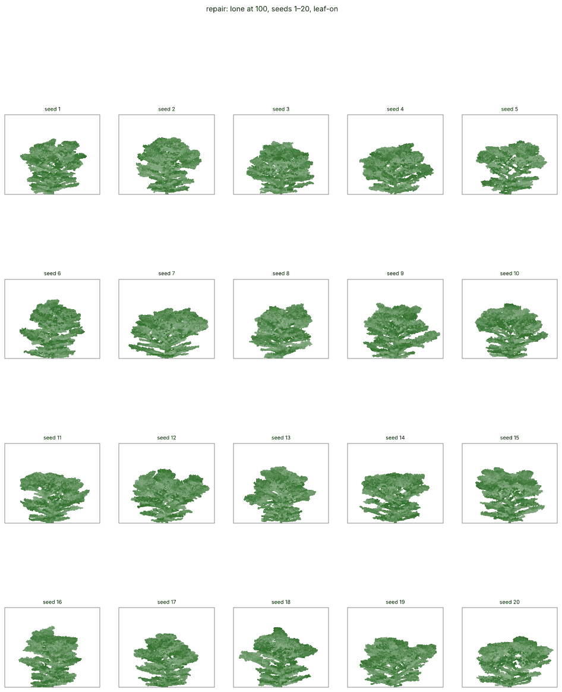

# The fresh-look beech round: a review (2026-11-01)

A review of the round on `claude/fresh-look-beech` (head 83f15cb before this review), by a session that did not do the work. It checks the round's claims against the code and the ledger, fixes what breaks an invariant, writes the ADRs, adds goldens that exercise the rules, runs 20-seed evidence, and looks at the garden. It does not change the round's direction: no rule is re-tuned, no species but beech is touched, and nothing is adopted. Code and outputs: `code/2026-11-01-fresh-look-beech/` (the round's folder; this review's files are named below).

## 1. Reproduced

- **The repair's sheet and metrics:** the brief's command (`render.py --species beech --seeds 1,2,3 --lone-width 240`) gives all 63 numbers of `repair-round1/metrics.json` exactly.
- **The stand is the solver's:** the repair's stand entries equal `solve-round1/metrics.json`'s.
- **Only beech moved in the presets:** every one of the 136 changed entries in `rust/presets.json` is under a `species.beech` key.
- **"Today" matches the round-5 panel:** stand H/D 108, crown ratio 0.36, floor 4.5%, LAI 6.9 on seed 1.
- **The blind tests' tallies** match their keys: round 2, the repair's lone panels oak 7, Scots pine 2; its stands birch 3; the hornbeam decoy beech 8, hornbeam 1 on the lone panels.

## 2. Where the brief or the ledger is wrong

1. **"Stand v_base ≤ 2,000" (Proposal B, the solver).** Over 20 seeds the closed stand's largest v_base, any tree and any season, is 2,409–3,020, median 2,623, both before and after the round. The gate opens (v_base > 3,000) in 1 of 20 stands. In `beechWood`, the lab's per-area beech wood, it opens by season 30: switching the vigour drop or light orthotropy off changes that world's hash (§6).
2. **"The stand is untouched."** True against the solver's stand. Against today's beech it is not: stand H/D 112 → 98.5, height 182 → 164, LAI 7.45 → 7.9, limb crown ratio 0.345 → 0.27 (medians, 20 seeds), and one seed keeps 9 of 12 (§7). The relay gate and the fork act in the stand by design.
3. **"Today" passes the guard's H/D.** At 3 seeds it read 107–109. At 20 seeds today's beech has median H/D 112 and is inside 70–110 on 6 of 20. The guard's H/D band was already failing before the round.
4. **Round 1's hornbeam decoy "drew beech as the second guess on every lone panel".** It did on 3 of 9 (the lone panels at 100); field maple was second on the other 6.
5. **Round 2's decoy B is hornbeam** only by the ledger and `blind.py`'s usage example. The key names it `decoyB` and the runs are not committed, so the mapping cannot be checked from the repository.
6. **The repair's "lowest leaf rises from 0.01–0.05 H to 0.06–0.10 H".** By the lowest leafy bud, the repair's lowest leaf stays at 0.7–1.2% of the height on all 20 seeds at 60 and 100 (0 of 20 at 0.06 H or above). What does fall is the share of leaf below H/6: 23.5% → 5.6% (median). The lower trunk is much less clothed but not bare. The repair did not say how it measured the lowest leaf.
7. **"Light orthotropy is bit-identical where the gate is shut."** With `lightSetPoint` present and its effect zero, R3 still converts the posture set point to degrees and back, which can move its last bit: beech's lone tree with the rule present and inactive diverges from the rule absent (its stand happened not to). Absent stays bit-identical, which is the invariant. Recorded in ADR 0042.

## 3. The code against AGENTS.md

| invariant | finding |
|---|---|
| Off by default, bit-identical | Each rule is gated by its field's absence (or 0) before any arithmetic; the 14 existing goldens are unchanged natively and in WASM. |
| Randomness only through `rng.rs` | No new draws. The relay gate scales the existing `terminates` probability. |
| Maths only through `rust/core/src/math` | **Broken in two places:** `to_degrees` from std in `arm_set_point` (r2.rs) and in `grow_buds` (season.rs). Fixed (§4). |
| Hooks in the §6 phase order | Each reads state set earlier in the same season: s̄ in phase 2 (sample), the drop in allocation, the fork and light orthotropy in growth, own-crown pruning in shedding (with this season's v_base), light orthotropy's posture in mechanics. |
| Unit tests of the local rule | The predicates were tested; the fork's action in growth and the relay gate's signal were not. Added (§4). R3's use of light orthotropy has no test of its own. |
| Nothing for beech alone in disguise | No species is named in code. But the vigour gate is in absolute resource units set to beech's numbers, and one gate (`r2.vigourTreeLo/Hi`) drives three rules, one of them in C5. Generic in form, tuned for one tree in effect. |
| Parent-before-child, stable ids | `arm_set_point` relies on `birth_id` ascending in row order, which the invariant guarantees. |

## 4. Fixes (on the branch)

- `5aa6bb5`: `to_degrees` replaced by the core's own multiply (form.rs's), bit-identical: the repair's seed-1 lone and stand hashes are unchanged (abcef14c, 7ed997b5).
- `e6c5524`: two tests. A leader grown at full vigour ends and its top laterals leave at `forkAngle`, and below the threshold it grows on; the relay gate's s̄ is 0 for a tree alone and positive for the middle of three.
- `cddca9b`: ADRs 0039–0043, proposed, one per rule; the code comments point at them and mark the two unread citations.
- `f0ed127`: the `beechOpen` preset and two golden cases (§6).

## 5. Botany

| rule | ADR | basis as read | what is inference |
|---|---|---|---|
| relay gate | 0039 | Nicolini & Caraglio 1994 [r]: forks at both extremes of growth, hierarchy in between; Pfisterer [r]: "young trees may develop a leader, aged crowns usually are polyarchic" | that neighbours keep the leader (shade avoidance, not on the card) |
| vigour fork, arm hold | 0040 | Nicolini & Caraglio 1994 [r]: forks at the highest growth rates, polycyclism in light; Troll [r]: all axes plagiotropic | the threshold, 1.3 × the full shoot |
| vigour drop | 0041 | Troll [r]: aged crowns polyarchic; forks at the extremes [r] | that it works through weaker λ in wood carrying a small share of the flow |
| light orthotropy | 0042 | Nicolini & Caraglio 1994 [r]: vertical laterals more frequent in full light; Nicolini 2000 [s]: vigorous trees orthotropic | extending the trunk's secondary straightening to every lit limb |
| own-crown pruning | 0043 | C5's relative shedding (ADR 0007) exists already | the vigour-gated second threshold; neither citation read |

**The two citations from memory.** Both exist [s]: Sprugel, Hinckley & Schaap 1991, *The theory and practice of branch autonomy*, Annu. Rev. Ecol. Syst. 22: 309–334; Takenaka 1994, *A simulation model of tree architecture development based on growth response to local light environment*, J. Plant Res. 107: 321–330. Neither text could be read from this container (publisher, JSTOR, Crossref and Semantic Scholar refused). By search summaries, the first is about branches' autonomy in carbon, water and nutrients; whether either says the shedding threshold is relative to the crown is **unverified**. Neither supports shedding more on a *vigorous* tree, which is what `c5.Tvig` adds.

## 6. Goldens that exercise the rules

The round's beech goldens (`mixedWood:s15`, `oakOpen:s15`) stop before any rule acts. Two cases are added: `beechOpen:seed1:s40` (a new preset, oakOpen's lone specimen with a beech, 240 wide) and `beechWood:seed1:s30`. `golden-coverage.py` switches each rule off in turn:

| rule switched off | beechOpen s40 | beechWood s30 |
|---|---|---|
| relay gate (0039) | not exercised (s̄ = 0 alone: nil by construction) | exercised |
| fork + arm hold (0040) | exercised | exercised |
| vigour drop (0041) | exercised | exercised |
| light orthotropy (0042) | exercised | exercised |
| own-crown pruning (0043) | exercised | not exercised |

Native 5 s and 13 s; WASM agrees. The 14 existing hashes are unchanged.

## 7. 20-seed evidence

`evidence20.py`, seeds 1–20 (never 1001–1006), the round's own trials: the lone tree in a 240 world and the closed stand (84 wide, 12 trees), to 100. "Today" is beech with the round's rules absent, checked against the baseline's seed-1 numbers. Criteria fixed before the runs (in the script). Tables: `review-evidence20/`.

| test | today | repair |
|---|---|---|
| guard: alive ≥ 10 of 12 | 20 of 20 | 19 of 20 |
| guard: floor 3–5% | 19 of 20 | 16 of 20 |
| guard: LAI 6–8 | 20 of 20 | 11 of 20 |
| guard: LAI 5.5–8.5 | 20 of 20 | 19 of 20 |
| guard: H/D 70–110 | 6 of 20 | 20 of 20 |
| guard: all four (LAI 6–8) | 6 of 20 | 8 of 20 |
| the gate shut in the stand (v_base < 3,000 throughout) | 20 of 20 | 19 of 20 |
| lone 60 / 100: W/H 0.6–1.0 (the checklist) | 9 / 1 of 20 | 0 / 0 of 20 |
| lone 60 / 100: W/H 1.3–1.5 (the photograph) | 0 / 0 of 20 | 8 / 9 of 20 |
| lone 60 / 100: forkHeight ≤ 0.5 | 0 / 0 of 20 | 17 / 20 of 20 |
| lone 60 / 100: leaf below H/6 ≤ 7% | 0 / 0 of 20 | 17 / 16 of 20 |
| lone 60 / 100: lowest leaf ≥ 0.06 H | 0 / 0 of 20 | 0 / 0 of 20 |

| median (range), 20 seeds | today | repair |
|---|---|---|
| lone height at 100, cells | 203 (188–208), at the world's top | 137 (125–154) |
| lone W/H at 100 | 0.43 (0.39–0.67) | 1.31 (1.02–1.55) |
| lone forkHeight at 100 | 0.95 | 0.30 (0.15–0.50) |
| lone leaf below H/6 at 100 | 23.5% | 5.6% (3.6–9.3%) |
| stand H/D | 112 (104–123) | 98.5 (78–110) |
| stand LAI | 7.45 (6.8–8.0) | 7.9 (6.8–8.8) |
| stand floor | 4.3% (3.2–5.4%) | 4.0% (2.8–5.5%) |
| stand limb crown ratio | 0.345 | 0.27 (0.21–0.35) |
| stand height | 182 | 164 (128–179) |

- **The lone tree's change of kind holds on 20 seeds:** every seed is a broad rounded mass on a short trunk that divides low; no seed is a spire. Level layers remain in the lower crown on most seeds ([today, for comparison](figures/2026-11-01-fresh-look-beech-review-lone100-today.png)).
- **It is too tall and too broad for the checklist:** 34 m at 100 against an open-grown beech's ≈ 20 m (80 cells), and W/H inside the checklist's 0.6–1.0 on no seed. Inside the photograph's 1.3–1.5 on 8–9 of 20.
- **The guard as a whole is no better:** H/D comes into the band, LAI leaves "6–8" on 9 of 20. The stand's numbers move ([the stand at 100](figures/2026-11-01-fresh-look-beech-review-stand100-repair.png)).

## 8. The garden and the mixed wood

`garden-params.ts` writes the garden's own worlds (`forestParams`: one row, spacing 28) at the phone's plate (54 cells, two trees) and a laptop's (146 cells, five trees), for the seeds that plant a beech, and the lab's `mixedWood` at seeds 1–3. `garden-gate.py` grows them natively to 100, rules on and off, and reads each beech's v_base and gate g. `garden-figure.py` draws them.

| world | planted beeches | gate never opens | partial (0 < g < 1) | fully open |
|---|---|---|---|---|
| garden, phone and laptop plates (9 seeds) | 7 that reach 5 cells (2 die in their first seasons, rules on or off) | 0 | 5 | 2 |
| lab mixedWood (3 seeds) | 9 | 9 (v_base 740–1,730) | 0 | 0 |
| recruits, all worlds | 163 | 163 | 0 | 0 |

- **In the garden the round's rules act, mostly in part.** The garden's one row lets its beeches grow as vigorous as near-lone trees (v_base 4,600–10,100 with the rules off), so the gate opens partly on 5 and fully on 2. In the lab's mixed wood it never opens: those beeches are as before.
- **Deaths are not the round's.** 3 of the 7 die (at 53, 78 and 78) on the same seasons with the rules off; 2 more die before reaching 5 cells either way. In 5 of the 9 garden seeds no beech stands at 100.
- **One partial gate goes wrong.** On the phone's plate at seed 13 the beech stands at the plate's edge with g 0.39–0.77. Without the rules it is a tall full column (171 cells at 100); with them, a bare pole with a flat cap (114 cells). It reads as neither the old beech nor a dome. ([phone plate](figures/2026-11-01-fresh-look-beech-review-garden-phone.png), last row; [laptop plate](figures/2026-11-01-fresh-look-beech-review-garden-laptop.png).)
- **Pictures:** drawn by the round's harness from the native runs (frontal, leaves as dots), not by the garden's renderer. The garden page and the lab under this container's software GL could not reach season 100 in 15–20 minutes a shot; the garden's own 40-season intro was attempted separately.

## 9. Where I think the round went wrong (argued, not undone)

1. **One absolute-unit gate drives three rules, one of them in C5.** It is beech's v_base range at 1 cell = 0.25 m under today's α and R1. The garden shows what a partial gate does at an edge (§8). A relative signal (the tree's v_base against the stand's, or R5's s̄ as the relay gate already uses) would be harder to break; R5's s̄ in particular already separates lone from stand without units.
2. **Own-crown pruning overrides a measurement.** Tvig 0.25 is 31 times beech's measured T_rel (0.008, ADR 0032) and has no source for its vigour gating. It buys the cleared lower trunk, but by contradicting the one number the project measured for beech's shade leaves.
3. **Light orthotropy traded flatness for height.** It removed the cedar plates and made the lone tree 34 m tall. The card's open-grown beech is ≈ 20 m and "much shorter … broader". The checklist's W/H passes on no seed.
4. **The hornbeam lead rests on one namer.** Round 1's namer called the hornbeam hornbeam on all 9 lone panels; round 2's called the same species beech on 8. The decoy did not change; the namer did. The beech stands read as birch on all 9 stand panels across both tests (today's, the candidate's and the repair's), which is the more stable signal: thin, wavy, leaning boles with small high crowns.
5. **The blind test judged form drawn in uniform dots.** Bark (pale grey, smooth) and level sprays are half of beech's identity at 20 m (the card). Track C's bark is on `claude/foliage`; a namer shown the garden's renderer would be testing what visitors see.

## 10. For the user

1. **Adopting any rule.** Not yet. Merging this branch as it stands adopts all five for the garden's beech: the round put beech's values into `flora-fitted.ts`, and §8 shows the garden changes. Recommendation: keep the code, the ADRs, the goldens and `beechOpen`, but hold beech's patch back from `FLORA` (the `[beech]` block of `hand-overrides.toml`) until a rule is accepted; the goldens can carry the values in `beechOpen`'s own species patch instead.
2. **The C5 boundary (ADR 0043).** Recommendation: reject `c5.Tvig` as it stands. If the cleared lower trunk is wanted, look first at why R1's carbon shedding keeps those limbs under ADR 0032's acclimated leaf cost, which keeps the measured T_rel.
3. **Round 2.** Recommendation: not from the hornbeam. Start from what is stable across namers and seeds: the stand reads as birch every time, and the lone tree is too tall. Judge with the garden's renderer (track C's bark) and several namers, at 20 seeds.
4. **The stand's ecology moves** (§7): H/D into the band, LAI out of 6–8 on 9 of 20, a lower crown base, one stand of 9. Today's beech already failed H/D on 14 of 20. Recommendation: decide the guard's bands at 20 seeds before the next round, since 3 seeds put today inside them.
5. **Merging into `3d-port`:** yours, after item 1.
