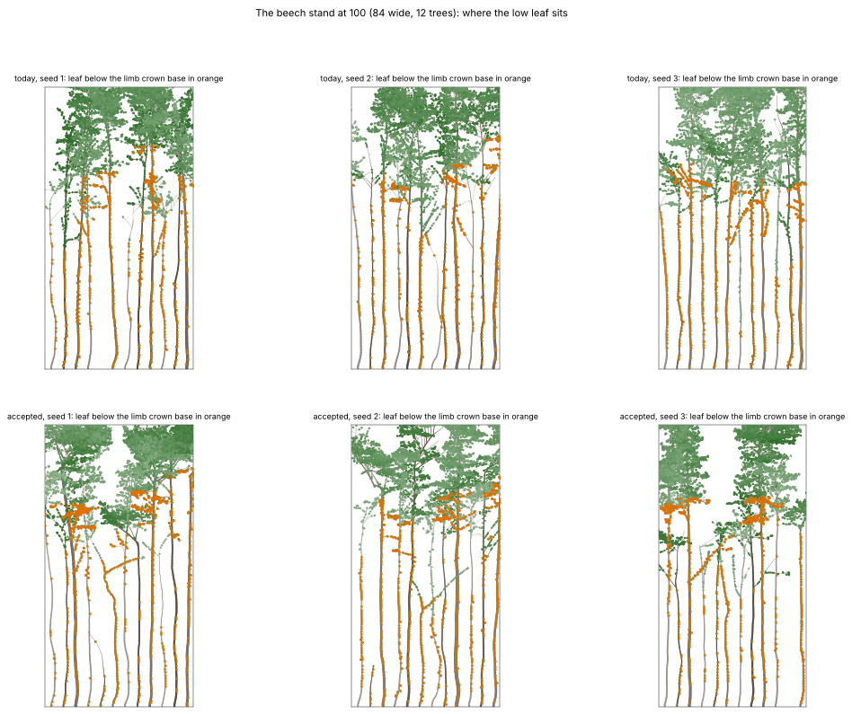
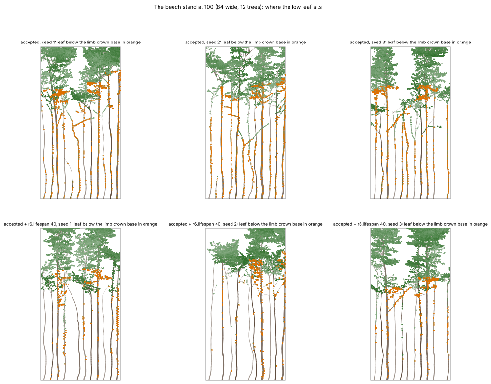

# Beech round 2, Part 2, step 1: why the stand's boles look leafy (2026-11-02)

Part 2's first step in [the round-2 brief](../plans/2026-11-02-beech-round2.md): diagnose before any change. The question comes from the real-renderer blind test. Its namers read the beech stand at 100 seasons as:
- lime: "pale grey stems with leafy sprouts carry rounded upper crowns";
- aspen: "pale, slightly wavy stems with lumpy, irregular crowns".

Both builds failed alike: today's beech and the accepted build (ADR 0039–0042, without own-crown pruning).

**In one line:** the "leafy sprouts" are R6 short shoots that live on the trunk for ever. A short shoot is shed only with its branch (spec §R6.4, ADR 0006), and one on the trunk has no branch. Unlike a dormant bud, it never ages toward R4's abortion. So every trunk node that rested as a short shoot while young keeps 2.47 leaf units each year as long as its light stays above beech's Q_ss (0.0126). The round's rules neither cause this nor change it.



_The closed stand at 100 (84 wide, 12 trees), seeds 1–3, today's beech (top) and the accepted build (bottom), drawn by the fresh-look harness. Orange: leaf below each tree's limb crown base._

## Numbers (20 seeds, the stand at 100, every live tree)

These are the existing 20-seed runs of the review (`runs/fresh-look/evidence20-{today,repair-notvig}`, `evidence20.py`). Per-tree medians unless stated.

| | today | accepted |
|---|---|---|
| trees | 236 | 232 |
| leaf below the limb crown base, share of the tree's leaf | 6.5% (p90 21%) | 6.9% (p90 31%) |
| of it, on R6 short shoots | 97% | 97% |
| of it, on buds of the trunk's own metamers | 55% | 63% |
| of it, on branches born ≥ 10 seasons after their trunk node (released, R4) | 17% | 10% |
| that low leaf's light, q / Q_top (pooled over all trees) | 0.175 | 0.140 |
| limb crown ratio | 0.33 | 0.26 |
| bole: largest offset from straight over the clear length | 2.0% (p90 3.9%) | 2.1% (p90 4.9%) |

- **R4's epicormics are not the cause.** Released branches carry 10–17% of the low leaf. The rest sits on short shoots left from the sapling: on the trunk itself, and on lower branches that are still alive.
- **Their light is well above any shedding threshold.** They get 14–17% of the tree's top light against T_rel 0.008, so C5 would keep them even if it could reach them. They are lit because a closed stand's boles are lit from the side, through the 3–5% floor's column.
- **The boles are nearly straight in the model.** The offset is about 2% of the clear length, with no sharp turns (no step over 15° between metamers on the median tree). On a 100-cell bole that is a sweep of about 2 cells, which the frontal drawing shows as a gentle wave. Its cause is not traced yet.
- **The lone tree's lower trunk differs.** Its leaf below H/6 (accepted build 8.4%, today 23.5%) is also all short shoots, but on lower limbs, not on the trunk (0% on order-0 nodes).

## What it suggests (no change made)

1. **A lifespan for short shoots** would be one candidate rule for the brief's step 2, switchable and default-off.
   - **The rule:** a short shoot older than `r6.lifespan` seasons ends (it becomes a leafless dormant bud, which R4 then aborts after L_dorm), unless it grows a long shoot first.
   - **Why it might help:** it would clear the boles. It might also thin the leaf on the lone tree's lower limbs, which C5 could then shed by their light.
   - **Botany:** spur shoots have finite lives and the bark buries those on the bole. Track A must source a beech number before any value is set; none is assumed here.
   - **Ecology:** it removes leaf low in the stand (up to the 4% of all leaf that sits on the trunk), so the floor and LAI will move. That goes to the user with 20-seed evidence before adoption.
2. **The renderer draws them, checked.** `src/web/render/scene.ts` (the short-shoot loop after the leafy shoots) draws a pair of rosettes for every short shoot on wood older than the leafy shoots, trunk included. A renderer rule would hide the sprouts without moving any ecology number, but it would draw leaf the model still counts in its light. That is track C's, and it is a drawing choice, not growth. The rule's wording is for the user: "no rosettes on order-0 wood below the crown base".
3. **The wavy boles** need their own trace: when in the tree's life the sweep forms (sapling phototropism toward gaps, or later posture). That waits until the leafy boles are settled, because the namers named both.

## Reproduce

```
uv run --project analysis python docs/experiments/code/2026-11-02-beech-round2/stand-diagnosis.py \
    runs/fresh-look/evidence20-today runs/fresh-look/evidence20-repair-notvig
uv run --project analysis python docs/experiments/code/2026-11-02-beech-round2/stand-figure.py \
    runs/fresh-look/evidence20-today runs/fresh-look/evidence20-repair-notvig \
    docs/experiments/figures/2026-11-02-beech-round2-stand-low-leaf.png
```

The runs come from `evidence20.py --label today --off` and `--label repair-notvig --assign '{"c5.Tvig": 0}'` on the review's build (`docs/experiments/code/2026-11-01-fresh-look-beech/`). The accepted build in `3d-port` has the same beech without `c5.Tvig`.

## Step 2: the lifespan rule at 20 seeds (ADR 0044, proposed)

The user chose to build both fixes: the growth rule (here) and the renderer's `clearBole` (track C, [blind test v3](https://github.com/epabarker/tree-simulation/blob/claude/foliage/docs/experiments/2026-11-02-blind-test-v3.md)). The runs are `r6.lifespan` L on the accepted build's beech, using `evidence20.py --assign '{"c5.Tvig": 0, "r6.lifespan": L}'` on seeds 1–20 (outputs `runs/round2/life{10,20,40}`). The criteria are the review's, fixed before its runs.

| 20 seeds | today | accepted | L 40 | L 20 | L 10 |
|---|---|---|---|---|---|
| guard: all four (alive, floor, LAI 6–8, H/D) | 6 | 8 | **12** | **11** | 0 |
| guard: alive ≥ 10 of 12 | 20 | 19 | 17 | 18 | 14 |
| guard: floor 3–5% | 19 | 16 | 17 | 14 | 1 |
| guard: LAI 6–8 | 20 | 11 | 16 | 18 | 2 |
| guard: H/D 70–110 | 6 | 20 | 20 | 20 | 19 |
| stand floor, median | 4.3% | 4.0% | 4.1% | 4.8% | 5.7% |
| stand LAI, median | 7.45 | 7.9 | 7.7 | 7.0 | 5.35 |
| stand limb crown ratio, median | 0.345 | 0.27 | 0.30 | 0.30 | 0.375 |
| leaf below the limb crown base, per-tree median (p90) | 6.5% (21%) | 6.9% (31%) | 3.3% (4.8%) | 2.9% (4.4%) | 3.0% (4.4%) |
| of it, on the trunk's own nodes | 55% | 63% | 0% | 0% | 0% |
| of it, on branches R4 released later | 17% | 10% | 80% | 47% | 70% |
| lone 100: leaf below H/6 ≤ 7% | 0 | 5 | 10 | 13 | 6 |
| lone 100: leaf below H/6, median | 23.5% | 8.4% | 6.7% | 6.7% | 7.8% |
| lone 100: W/H 1.3–1.5 (photograph) | 0 | 9 | 9 | 9 | 7 |
| lone 100: H, median | 203 | 120 | 121 | 120 | 122 |

- **L 20–40 clears the trunks and helps the guard.** The trunk's own leaf goes to zero, and the leaf below the crown base halves, with its tail gone (p90 31% → about 5%). The guard passes on 11–12 seeds against the accepted build's 8, mostly because LAI comes down into its band (7.9 → 7.0–7.7). Survival drops a little (alive ≥ 10 of 12 on 17–18 seeds against 19).
- **L 10 is too short.** It thins the crowns themselves: LAI 5.35, floor 5.7%, and the guard passes on no seed.
- **The lone tree's skirt thins too.** Its leaf below H/6 falls from 8.4% to 6.7%, and passes the 7% line on 10–13 seeds against 5, with the shape unchanged (H 120, W/H 1.5).
- **What is left low in the stand is R4's.** At L 40, 80% of the remaining low leaf is on branches released from dormant buds after their node formed: the orange strings in the figure below. These are epicormics, which beech does make when a gap opens. The lifespan also makes more dormant buds on old wood for R4 to release.
- **It moves the stand's ecology numbers,** so adopting it is the user's decision (ADR 0044). The blind test v3 suggests it will not change the stand's name by itself: hiding the same short shoots in the drawing (`clearBole`) left the stand named birch, from its pale, thin, wavy stems under small crowns.



_The stand at 100, seeds 1–3: the accepted build (top) and with `r6.lifespan` 40 (bottom). Orange is leaf below the limb crown base._
