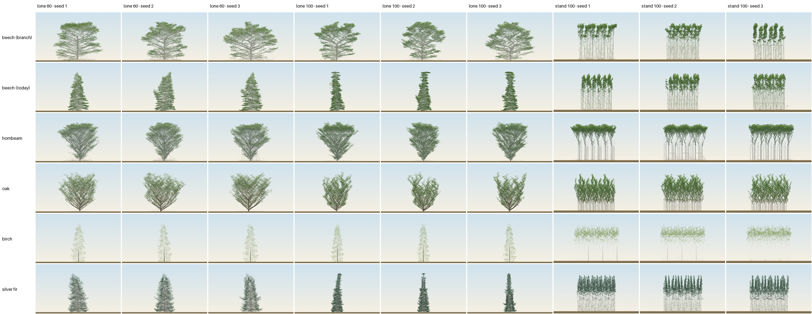

# The blind naming test, v2: three namers, the real renderer, named decoys (2026-11-02)

A measurement only: it decides nothing. It answers the review's objections to the earlier blind tests
([review](2026-11-01-fresh-look-beech-review.md) §2.4–5, §9.4–5): one namer, form drawn in uniform
dots, decoys not named in the key. The protocol and pass rule are
[`blind-test.md`](code/2026-11-01-fresh-look-beech/blind-test.md)'s, with the changes listed
under Method.

**In one line:** the branch's lone beech is named beech by all three namers on every seed at 60 and
100 (18 of 18), and today's lone beech is not (9 of 18). The beech stand at 100 is named beech by one
namer of three, for both builds. Birch passes for every namer. Hornbeam's lone tree is named
hornbeam 18 of 18, but its stand only by one namer. Oak is "hawthorn" and silver fir "holly" or
"yew" on every plate.



_Rows: source; columns: lone 60, lone 100, stand 100, seeds 1–3. Each panel is the plate as the namers
saw it, at reduced size. The lab fits each scene to the plate, so the scale differs between panels._

## Method

- **Build:** `claude/blind-v2` = `origin/claude/fresh-look-beech` (8ec0e62) merged with
  `origin/claude/foliage` (track C's per-species bark and leaf clumping; renderer and docs only, no
  `rust/` or `src/core` change). No core, species or preset change.
- **Renders** ([`shots.mjs`](code/2026-11-02-blind-test-v2/shots.mjs)): the lab
  (`npm run dev`) in headless Chromium 1248 on the laptop's GPU (ANGLE on Vulkan, Intel Iris Xe),
  `?preset=oakOpen&seed=S&p=<patch>&bench&seasons=N`, 1440 × 900 viewport, screenshot of the
  `#view` canvas (1120 × 654) with the HUD, title and hint hidden. Leaf-on (the bench ends in
  summer), no labels. Each render took 24–71 s; none timed out. The patch carries the source's full
  species entry from `rust/presets.json` (the lab's `mergeParams` replaces a species entry whole).
- **Sources:** beech as on the branch; beech "today" (the branch's entry with `r2.relay 0`,
  `r2.forkAt 0`, `r2.vigourShare 0`, `r2.lightSetPoint null`, `c5.Tvig 0`,
  `r2.levels.0.curve 0`); decoys hornbeam, oak, birch, silver fir (`fir`), each with its own
  species entry. Beech and today differ in every run (metamer counts in the render logs).
- **Trials:** the lone tree in beechOpen's world (240 wide, tree at x 120, no storms, no recruits)
  at 60 and at 100; the closed stand at 100 (84 wide, periodic sides, faces [0, 0], 12 trees in
  three rows as `render.py`'s `stand_trees`). Seeds 1, 2, 3. 6 × 3 × 3 = 54 plates.
- **Blinding** ([`shuffle.py`](code/2026-11-02-blind-test-v2/shuffle.py)): one folder
  per namer outside the repo (`~/blind-plates/namer-N/plate-01.png` …), each its own shuffle;
  the key with species named is [`key.json`](code/2026-11-02-blind-test-v2/key.json).
- **Namers:** three fresh general-purpose sub-agents (the same model as this session, Opus 5.5),
  run in parallel. Each was given only its folder, told to read the images and nothing else, and
  blind-test.md's question verbatim, with a fixed reply format (a table: plate, first guess, second
  guess, deciding feature) and the sentence "Some images show several trees of the same kind side
  by side; name the kind." No species list, no repo context. Their replies are committed verbatim:
  [`namer-1.md`](code/2026-11-02-blind-test-v2/namer-1.md),
  [`namer-2.md`](code/2026-11-02-blind-test-v2/namer-2.md),
  [`namer-3.md`](code/2026-11-02-blind-test-v2/namer-3.md).
- **Scoring** ([`tally.py`](code/2026-11-02-blind-test-v2/tally.py), output
  [`tally.md`](code/2026-11-02-blind-test-v2/tally.md)): first guesses, normalised
  (any "oak" is oak, any "birch" birch; "fir" only as silver fir or a bare "fir"). The pass rule per
  namer: named on ≥ 2 of 3 seeds in lone 60, lone 100 and stand 100. Pooled: a seed counts when
  ≥ 2 of 3 namers named it, then the same rule.
- **Not done, against blind-test.md:** leaf-off plates (the brief asked for leaf-on only); the
  user's own look on the phone, which stays the final gate.

## Results

### Per namer: seeds named (of 3), first guess

| source | n1 lone60 | n1 lone100 | n1 stand | n2 lone60 | n2 lone100 | n2 stand | n3 lone60 | n3 lone100 | n3 stand | pass (n1, n2, n3) |
|---|---|---|---|---|---|---|---|---|---|---|
| beech (branch) | 3 | 3 | 0 | 3 | 3 | 3 | 3 | 3 | 0 | fail, **pass**, fail |
| beech (today) | 0 | 3 | 0 | 3 | 3 | 3 | 0 | 0 | 0 | fail, **pass**, fail |
| hornbeam | 3 | 3 | 0 | 3 | 3 | 0 | 3 | 3 | 3 | fail, fail, **pass** |
| oak | 0 | 0 | 0 | 0 | 0 | 0 | 0 | 0 | 0 | fail, fail, fail |
| birch | 3 | 3 | 3 | 3 | 3 | 3 | 3 | 3 | 3 | **pass**, **pass**, **pass** |
| silver fir | 0 | 0 | 0 | 0 | 0 | 0 | 0 | 0 | 0 | fail, fail, fail |

### Pooled

| source | lone 60 /9 | lone 100 /9 | stand 100 /9 | seeds with ≥ 2 namers (lone 60, lone 100, stand) | pooled pass | first or second guess /27 |
|---|---|---|---|---|---|---|
| beech (branch) | 9 | 9 | 3 | 3, 3, 0 | fail (stand) | 22 |
| beech (today) | 3 | 6 | 3 | 0, 3, 0 | fail | 15 |
| hornbeam | 9 | 9 | 3 | 3, 3, 0 | fail (stand) | 24 |
| oak | 0 | 0 | 0 | 0, 0, 0 | fail | 9 |
| birch | 9 | 9 | 9 | 3, 3, 3 | pass | 27 |
| silver fir | 0 | 0 | 0 | 0, 0, 0 | fail | 0 |

### What each was called (first guesses, 9 per cell)

| source | lone 60 | lone 100 | stand 100 |
|---|---|---|---|
| beech (branch) | beech 9 | beech 9 | lime 3 (n1), beech 3 (n2), aspen 2 / alder 1 (n3) |
| beech (today) | lime 3 (n1), beech 3 (n2), alder 3 (n3) | beech 6 (n1, n2), poplar 3 (n3) | lime 3 (n1), beech 3 (n2), alder 3 (n3) |
| hornbeam | hornbeam 9 | hornbeam 9 | beech 3 (n1), oak 3 (n2), hornbeam 3 (n3) |
| oak | hawthorn 9 | hawthorn 9 | hawthorn 9 |
| birch | birch 9 | birch 9 | birch 9 |
| silver fir | holly 6, alder 3 | holly 6, yew 3 | alder 3, yew 3, holly 3 |

The deciding features the namers gave (verbatim in `namer-N.md`): for the branch's lone beech,
"smooth grey trunk", "tiered horizontal limbs", "broad dome"; for today's lone beech, "a narrow
column of flat, horizontal leaf sprays stacked in tiers" (n1, n2) or a "Lombardy-type fastigiate"
column (n3); for both beech stands, "leafy sprouts along grey stems" (n1's lime), "tall pale stems
with leafy heads only at the top" (n2), "pale stems, narrow crowns at the top" (n3's alder, aspen).
Oak's "dark brown zigzag limbs" and V-shaped crown made it hawthorn for all three. The fir's dense
dark spire made it holly or yew; none said fir or any conifer first.

### Agreement between namers

- Each pair agrees on 33 of 54 plates (61%); all three agree on 30 of 54.
- Fleiss' kappa 0.55 (observed 0.61, chance 0.14; 11 distinct names used).
- The 21 plates on which all three agree and are right: the branch's lone beech (6), hornbeam's
  lone tree (6), birch (9), and none of today's beech. They agree and are wrong on oak (9).

### False "beech" calls

Of the 108 first guesses on the four decoys, 3 were beech (n1 on hornbeam's stand). By namer, the
share of their "beech" first guesses that were beech sources: n1 9 of 12, n2 18 of 18, n3 6 of 6.
n2 named beech for every beech plate, both builds, including stands that n1 and n3 called lime,
alder and aspen: n2 alone carries both beech passes.

## Reading (measurement, not a decision)

1. **The seeds carried no information.** Every namer gave the same first guess on all three seeds of
   every source and trial (54 of 54 namer × cell combinations). The plates of one cell look alike at
   this size, and a namer that names one names all three. So "2 of 3 seeds" in the pass rule acts
   as "named or not", and each cell is effectively one judgment per namer: 3 judgments per cell, not 9.
2. **The lone tree separates the builds.** The branch's lone beech at 60 and 100 is beech for every
   namer (6 of 6 judgments); today's is beech in 3 of 6 (n2 at 60 and 100, n1 at 100), and the rest
   are lime, alder and poplar for its narrow tiered column. Beech's lone form is the only beech
   result on which the namers agree.
3. **The stand does not.** Both beech stands read the same: beech to n2, lime to n1, alder or aspen to
   n3. The previous tests' stable signal, beech stands read as birch (review §9.4), is gone in the
   real renderer: real birch is now named birch 9 of 9, and no beech stand is called birch first.
   What the namers describe is the same as before: tall clean pale stems and a small crown at the
   top.
4. **Hornbeam vs beech, lone:** no confusion in either direction (18 of 18 each). The review's worry
   that a hornbeam lead rested on one namer (§9.4) does not recur here: all three name the lone
   hornbeam, and n1 names its stand beech.
5. **Oak and silver fir are not recognised at all.** Oak reads as hawthorn on all 27 first guesses
   (oak is the second guess on 9); the fir never reads as fir or any conifer (holly, yew, alder). Both
   are failures of identity for those species, separate from the beech question.
6. **Caveats.** The namers are three runs of one model, not three people, and they answered in one
   batch each, which may make a namer name similar-looking plates the same. The lab fits each scene
   to the plate, so the scale (and so height, an identity cue) is not comparable between plates. The
   question asks for a *British* species, which may have kept the fir from being named. Leaf-off was
   not tested. The user's look on the phone is still the final gate.

## Reproduce

```
git worktree add ../tree-simulation-blind claude/blind-v2 && cd ../tree-simulation-blind
npm ci && npm run build:wasm && npm run dev -- --port 5180
# playwright-core in any scratch folder; PW_FROM points node's require at it
PW_FROM=<scratch>/pw/x.js node docs/experiments/code/2026-11-02-blind-test-v2/shots.mjs http://localhost:5180/ <renders> 3
python3 docs/experiments/code/2026-11-02-blind-test-v2/shuffle.py <renders> ~/blind-plates
uv run --project analysis python docs/experiments/code/2026-11-02-blind-test-v2/sheet.py <renders> docs/experiments/figures/2026-11-02-blind-test-v2-sheet.jpg
python3 docs/experiments/code/2026-11-02-blind-test-v2/tally.py
```

The renders are deterministic in the core (the seeds and patches fix the trees); the plates'
pixels depend on the GPU and tweening. The namers' replies are not reproducible.
