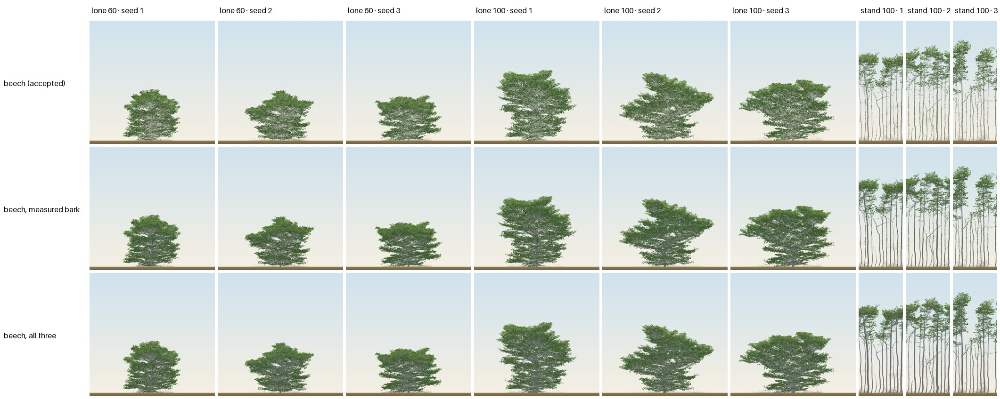
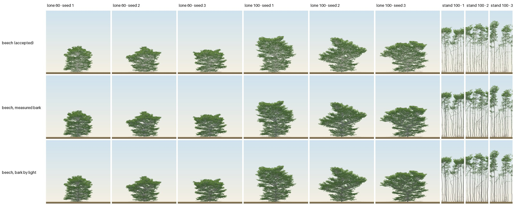
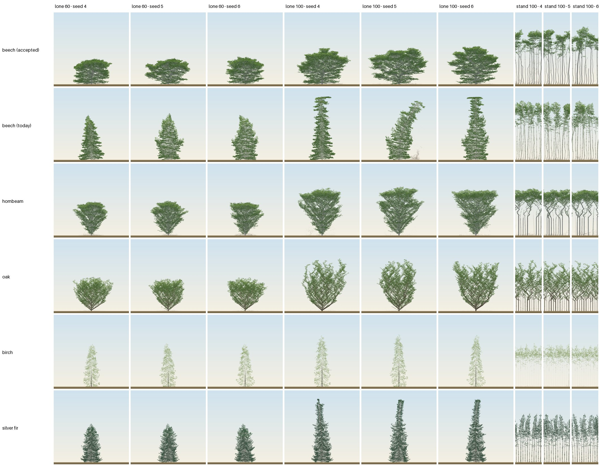

# The blind naming test, v3: one scale (round 2's baseline, 2026-11-02)

Round 2's measure ([brief](../plans/2026-11-02-beech-round2.md), "The measure" and Part 1's
baseline): [v2](https://github.com/epabarker/tree-simulation/blob/claude/blind-v2/docs/experiments/2026-11-02-blind-test-v2.md)'s
protocol, with every plate drawn at one scale. A measurement only: no species, preset or core
change. Seeds 1–3 are development seeds; any claim waits for fresh namers at seeds 4–6.

**In one line:** at one scale, the accepted beech's lone tree still passes without own-crown pruning
(17 of 18), but both beech stands are now named silver birch on all 18 plates. Oak leaves hawthorn
(27 → 3 first guesses), but the lone oak becomes hazel or goat willow for its "many brown stems
fanning from ground level", while the oak stand is named oak 6 of 9. Silver fir is now a conifer
(Norway spruce, 12 of 27) but never fir. Hornbeam and birch pass. The addendum's `clearBole` (no
rosettes on a trunk below its limb crown base) removes the "dark bands" the namers named, but the
stand stays silver birch (8 of 9) for its pale, slender, wavy stems with small high crowns. In track
E's sets 3 and 4, beech's measured bark (about 15% reflectance) moves the stand to beech: 6 of 9
alone, 9 of 9 with stems drawn at a real girth. But it turns the lone beech into oak (1 of 18 alone,
8 of 18 with all three), so nothing passes yet. On the judging seeds 4–6 with five namers, the sourced
candidate (measured bark with `clearBole`) passes the stand pooled (9 of 15) but not the lone tree (5
and 7 of 15, oak and field maple). Birch holds; hornbeam's unchanged stand reads oak on those seeds.


_Rows: source; columns: lone 60, lone 100, stand 100, seeds 1–3. Each panel is the plate the namers
saw, every one shrunk by the same factor, so the sheet keeps the one scale: a lone plate is the
240-cell field, a stand plate one lap of the 84-cell ring, and the plate's height is the world's 200
cells (50 m)._

## Method

- **Build:** `claude/foliage` with `origin/3d-port` merged in (fae02a4: PR #40's accepted beech),
  plus the lab's `&frame=height` (add5db6). Against v2's build (`claude/blind-v2`, 2b6e6a4) the core
  differs in comments only, the hornbeam, oak, birch and fir entries are identical, and beech's entry
  differs only in `c5.Tvig` (0.25 in v2, absent now: own-crown pruning is rejected, ADR 0043). So
  today's beech and the four decoys are the same trees as in v2, seed for seed, and for them the
  scale is the only change.
- **One scale** (`&frame=height`, `Scene.frame = "height"`): the camera is fixed by the world's
  height and centred on the world, never fitted to the trees. It is the garden's world frame with
  its tallest crown at the world's top: 200 × 1.05 cells and a leaf fill the plate between the
  ground margin and the headroom, as on the garden's phone plate once the woods reach their top.
  Every trial's world is 200 cells high, so every plate is drawn at 2.7704 px a cell (a cell is
  0.25 m: 0.090 m a pixel). Off by default; goldens unchanged.
- **Renders** ([`shots.mjs`](code/2026-11-02-blind-test-v3/shots.mjs)): v2's, with the option on,
  and two changes to make the scale hold:
  - The lab's chart row is pinned so every trial's canvas is 1120 × 654. The charts grow with a
    stand's 12 trees, and they shrank the stand's canvas to 415 px and its scale to 1.64 px a cell
    in a first try.
  - Each shot is cropped to the world's width: the lone tree's field is 666 × 654 px, the stand's lap
    234 × 654.

  Headless Chromium 1248 on the laptop's GPU, 23–66 s a render, none timed out. All 54 plates logged
  2.7704 px a cell.
- **Sources and trials:** v2's. The accepted beech (rust/presets.json's entry, no `c5.Tvig`);
  today's beech (that entry with `r2.relay 0`, `forkAt 0`, `vigourShare 0`, `lightSetPoint null`,
  `c5.Tvig 0`, `levels.0.curve 0`); hornbeam, oak, birch, silver fir. The lone tree in a 240-wide
  world at 60 and 100; the closed stand at 100 (84 wide, periodic, 12 trees in three rows). Seeds 1–3.
- **Blinding** ([`shuffle.py`](code/2026-11-02-blind-test-v3/shuffle.py)): one folder per namer
  outside the repo (`~/blind-plates-v3/namer-N`), each its own shuffle, seeded apart from v2's. The
  key, species named: [`key.json`](code/2026-11-02-blind-test-v3/key.json).
- **Namers:** three fresh general-purpose sub-agents of this session, run in parallel. Each was
  given only its folder and [the prompt](code/2026-11-02-blind-test-v3/prompt.md): blind-test.md's
  question verbatim, v2's reply format and its sentence about several trees, and one added sentence,
  "All the images are drawn at the same scale." Without it a namer has no reason to compare sizes
  across plates; on v2's fitted plates it would have been false. Replies verbatim:
  [`namer-1.md`](code/2026-11-02-blind-test-v3/namer-1.md),
  [`namer-2.md`](code/2026-11-02-blind-test-v3/namer-2.md),
  [`namer-3.md`](code/2026-11-02-blind-test-v3/namer-3.md).
- **Scoring** ([`tally.py`](code/2026-11-02-blind-test-v3/tally.py), output
  [`tally.md`](code/2026-11-02-blind-test-v3/tally.md)): v2's normalisation and pass rule,
  unchanged, on first guesses. Per namer, a source passes when it is named on ≥ 2 of 3 seeds in lone
  60, lone 100 and stand 100. Pooled, a seed counts when ≥ 2 of 3 namers name it. tally.py reads v2's
  key and replies (from `claude/blind-v2`) for the tables beside v2.

## Results

### Beside v2: first guesses naming the source, of 9 per trial (v2 → v3)

| source | lone 60 | lone 100 | stand 100 | namers passing, v2 → v3 | pooled, v2 → v3 |
|---|---|---|---|---|---|
| beech (v2: with `Tvig`; v3: accepted) | 9 → 9 | 9 → 8 | 3 → 0 | 1 → 0 of 3 | fail → fail (stand) |
| beech (today) | 3 → 1 | 6 → 0 | 3 → 0 | 1 → 0 of 3 | fail → fail |
| hornbeam | 9 → 8 | 9 → 9 | 3 → 6 | 1 → 2 of 3 | fail → **pass** |
| oak | 0 → 0 | 0 → 0 | 0 → 6 | 0 → 0 of 3 | fail → fail |
| birch | 9 → 9 | 9 → 9 | 9 → 9 | 3 → 3 of 3 | pass → pass |
| silver fir | 0 → 0 | 0 → 0 | 0 → 0 | 0 → 0 of 3 | fail → fail |

### Per namer: seeds named (of 3), first guess (v3)

| source | n1 lone60 | n1 lone100 | n1 stand | n2 lone60 | n2 lone100 | n2 stand | n3 lone60 | n3 lone100 | n3 stand | pass (n1, n2, n3) |
|---|---|---|---|---|---|---|---|---|---|---|
| beech (accepted) | 3 | 2 | 0 | 3 | 3 | 0 | 3 | 3 | 0 | fail, fail, fail |
| beech (today) | 0 | 0 | 0 | 1 | 0 | 0 | 0 | 0 | 0 | fail, fail, fail |
| hornbeam | 2 | 3 | 3 | 3 | 3 | 0 | 3 | 3 | 3 | **pass**, fail, **pass** |
| oak | 0 | 0 | 3 | 0 | 0 | 0 | 0 | 0 | 3 | fail, fail, fail |
| birch | 3 | 3 | 3 | 3 | 3 | 3 | 3 | 3 | 3 | **pass**, **pass**, **pass** |
| silver fir | 0 | 0 | 0 | 0 | 0 | 0 | 0 | 0 | 0 | fail, fail, fail |

### What each was called, first guesses of 9 (v2 | v3)

| source | trial | v2 | v3 |
|---|---|---|---|
| beech | lone 60 | beech 9 | beech 9 |
| beech | lone 100 | beech 9 | beech 8, goat willow 1 |
| beech | stand 100 | lime 3, beech 3, aspen 2, alder 1 | **silver birch 9** |
| beech (today) | lone 60 | lime 3, beech 3, alder 3 | alder 6, larch 2, beech 1 |
| beech (today) | lone 100 | beech 6, poplar 3 | Norway spruce 3, larch 3, "no close match (nearest alder)" 3 |
| beech (today) | stand 100 | lime 3, beech 3, alder 3 | **silver birch 9** |
| hornbeam | lone 60 | hornbeam 9 | hornbeam 8, field maple 1 |
| hornbeam | lone 100 | hornbeam 9 | hornbeam 9 |
| hornbeam | stand 100 | beech 3, oak 3, hornbeam 3 | hornbeam 6, oak 3 |
| oak | lone 60 | hawthorn 9 | hazel 6, goat willow 3 |
| oak | lone 100 | hawthorn 9 | goat willow 5, hazel 3, beech 1 |
| oak | stand 100 | hawthorn 9 | oak 6, hawthorn 3 |
| birch | all three | birch 27 | birch 27 |
| silver fir | lone 60 | holly 6, alder 3 | holly 9 |
| silver fir | lone 100 | holly 6, yew 3 | Norway spruce 6, holly 3 |
| silver fir | stand 100 | alder 3, yew 3, holly 3 | Norway spruce 6, alder 3 |

### Agreement

- Pairs agree on 34, 39 and 33 of 54 plates; all three agree on 28. Fleiss' kappa 0.60 (observed
  0.65, chance 0.14; 13 names), against v2's 0.55.
- A namer gave the same first guess on all three seeds of a cell in 50 of 54 namer × cell
  combinations (v2: 53 of 54; v2's note says 54, but n3 called the branch beech's stand aspen twice
  and alder once). The seeds still carry little information: each cell is close to one judgment per
  namer.
- **A probable transposition:** namer 1's rows 29 (oak, lone 100, seed 1: "beech … a wide, spreading,
  domed crown … on smooth grey limbs") and 30 (accepted beech, lone 100, seed 3: "goat willow … an
  open vase of dark-brown limbs from a short stem") each describe the other plate. They are scored as
  given. Swapped, the beech's lone 100 would be 9 of 9 and oak's single "beech" would be goat willow.
  No pass changes either way.

## Reading (measurement, not a decision)

1. **The accepted beech's lone tree still passes without own-crown pruning.** It is named beech on
   9 of 9 plates at 60 and 8 of 9 at 100 (9 of 9 with namer 1's likely swap undone). Every namer names
   it on ≥ 2 of 3 seeds in both lone trials: "a broad, dense dome of horizontal foliage tiers sits on
   smooth grey limbs that start low" (n3). The full pass fails on the stand alone. One scale also
   separates the builds more sharply than v2 did: today's narrow, tiered column is now a conifer
   (Norway spruce, larch) or alder, beech on 1 of 18.
2. **The beech stand reads as silver birch at one scale, both builds, all 18 plates.** That is the
   earlier tests' signal (review §9.4), back now that the stand is drawn at its true size. The
   namers name the marks on the boles:
   - "Whitish slender stems with dark lenticel-like marks hold small high crowns" (n1);
   - "Pale, slender, scarred trunks hold pointed light-green crowns high above a bare understorey" (n2);
   - "Slender white stems ringed with dark bands carry small, light crowns only at the top" (n3).

   At 2.77 px a cell the trunk's R6 rosettes draw as short dark dashes on a pale stem: v2's "leafy
   sprouts" (lime) have become birch's dark bands. The addendum below tests that directly.
3. **One scale alone moves oak off hawthorn, but not onto oak where it stands alone.** Hawthorn falls
   from 27 first guesses to 3 (all namer 2's, on the stand). The lone oak is now a multi-stemmed shrub:
   - "Many straight brown stems fan from ground level into a rounded bush" (n3, hazel);
   - "A rounded clump of brown stems radiating from a single base" (n2, hazel);
   - "Dark-brown limbs splay upward from a very short base into a rounded, bushy vase" (n1, goat
     willow).

   These trees are drawn 27–28 m tall at 60 and 43–44 m at 100, taller than the lone beech (22–25 m,
   then 29–34 m; crown tops measured on the plates), yet they are named hazel and goat willow, shrubs
   and small trees of about 10 m at most. The namers decide on the scaffold, the low vase from the ground, not on the
   size. The stand, whose trees have clear dark boles under the zigzag crowns, is named oak 6 of 9:
   "dark brown, crooked, zigzagging limbs make dense ascending crowns in a stand" (n1). So the bark's
   darkness and the zigzag read as oak once the scale is true and the scaffold sits on a bole. The
   lone tree's failure is its form, which the brief says goes to the user as a finding, not a fit.
   Oak's bark, leaf and twig changes (Part 1, step 1) have not been made, so this is not yet the
   brief's stop condition.
4. **Silver fir becomes a conifer, but not fir.** At 100 years, lone or in the stand, it is Norway
   spruce on 12 of 18 plates ("a very tall, narrow, dark-green spire with a tufted tip on a single
   leader"); at 60 it is still holly, 9 of 9 ("a dense, dark blue-green cone that looks evergreen").
   None names fir. The height of the spire is a cue the fitted plates hid.
5. **Hornbeam does not regress:** lone 17 of 18, and the stand rises from 3 to 6 of 9 ("smooth grey
   clear stems twist into sinuous limbs under a flat, parasol-like shared canopy", n1). It now
   passes pooled. **Birch** is named on all 27 plates, as in v2.

## The addendum: `clearBole` (no rosettes on a trunk below its limb crown base)

Track E relayed the user's choice of "both" for the stand's leafy boles: the growth-side fix
(`r6.lifespan`, ADR 0044, proposed; measured in the cloud, not used here) and a renderer rule.
The rule is drawn here with the same protocol, after the baseline.

- **The rule** (07de9dd; `ViewOptions.clearBole`, the lab's `&clearBole`, `garden.html?clearBole`):
  the leaf layout draws no short-shoot rosette on an order-0 metamer whose base is below its tree's
  `limbBase`. The snapshot already carries each metamer's `order` and `y0` and each tree's `limbBase`
  (`metrics`), so there is no core change. It is a drawing choice: the model still counts that leaf
  in its light ([stand diagnosis](https://github.com/epabarker/tree-simulation/blob/claude/c1-calibration-ustbkz/docs/experiments/2026-11-02-beech-round2-stand-diagnosis.md):
  97% of the leaf below the stand's limb crown base is on short shoots, 55–63% on the trunk's own
  nodes). It is a global view knob beside I3's `leafOpacity` and `leafMinPx`, not a species style,
  because a style field would turn it on by default for beech. Off by default; goldens unchanged;
  a unit test checks that exactly two cards go per such short shoot and nothing else changes.
- **Plates:** the accepted beech's nine (lone 60, lone 100, stand 100, seeds 1–3) re-drawn with
  `&clearBole`, at the same one scale. The stand's boles lose their dark dashes (3.0–3.8% of a
  stand plate's pixels change). The lone trees show no visible change at this size: their trunks
  carry no rosettes below the crown base, as the diagnosis found (0% on order-0 nodes). Their
  0.2–5% of changed pixels is the sway between frames.


- **Naming:** a second full set of 54 plates, the baseline's 45 non-beech plates with the nine
  `clearBole` beech plates in place of the accepted beech's. Three fresh namers, each with its own
  shuffle (`~/blind-plates-v3b/namer-N`), the same prompt. Key and replies in
  [`clearbole/`](code/2026-11-02-blind-test-v3/clearbole/).

### Addendum results: the clearBole set beside the baseline (first guesses of 9)

| source | lone 60 | lone 100 | stand 100 | namers passing | pooled |
|---|---|---|---|---|---|
| **beech, accepted → with `clearBole`** | 9 → 9 | 8 → 9 | 0 → 1 | 0 → 0 of 3 | fail → fail (stand) |
| beech (today), same plates | 1 → 3 | 0 → 6 | 0 → 0 | 0 → 0 | fail → fail |
| hornbeam, same plates | 8 → 9 | 9 → 9 | 6 → 6 | 2 → 2 | pass → pass |
| oak, same plates | 0 → 0 | 0 → 0 | 6 → 6 | 0 → 0 | fail → fail |
| birch, same plates | 9 → 9 | 9 → 9 | 9 → 9 | 3 → 3 | pass → pass |
| silver fir, same plates | 0 → 0 | 0 → 0 | 0 → 0 | 0 → 0 | fail → fail |

Agreement: Fleiss' kappa 0.60 (observed 0.67, chance 0.16); a namer named all three seeds of a cell
alike in 52 of 54 namer × cell combinations.

**The bands go, the birch stays.** With `clearBole` the stand is silver birch on 8 of 9 plates and
beech on 1. The dark marks drop out of the descriptions:
- "Thin, smooth, pale, wavy stems carry compact light-green crowns at the very top" (n1, birch);
- "Slender, wavy, pale trunks bare to small high crowns, though with fewer dark bands than a typical
  birch" (n2, birch);
- "Smooth pale grey poles whose forked grey branches spread into broad tops" (n3, beech, seed 2).

So the trunk's rosettes were the cue the baseline's namers named first, but not the whole of it.
What is left is the stems' pale tone, their slenderness and waviness, and a small crown held only at
the top. The diagnosis measured a limb crown ratio of 0.26 and bole sweeps of about 2%. Those cues
belong to bark colour and to form. Beech's bark token is `#a9a8a0`, a light grey, and the stand's
drawn stems measure about (165, 164, 156) against a lower sky near luminance 234, so they read pale
(track C). The form side is Part 2's wavy boles and crown base. They are leads, not findings.

**The other 45 plates replicate the baseline with fresh namers.**
- Hornbeam, oak, birch and fir are named nearly as before. The oak stand is oak 6 of 9 again. The lone
  oak is goat willow and hazel, with hawthorn 3 from one namer at 100. The fir is holly or Norway
  spruce, never fir.
- Today's beech is the exception: beech 3 of 9 at 60 and 6 of 9 at 100, against 1 and 0. Its narrow,
  tiered column is ambiguous, beech to one namer and a conifer to another.

The spread between sets of namers on one source is as large as some of the effects measured here.
That is a reason for fresh namers on the judging seeds, and a sign that three namers is a thin
sample.

## Sets 3 and 4: the beech stand's renderer cues (track E)

Track E's next step was to:
- diagnose the stand's renderer cues on the dev seeds;
- make at most two renderer changes, each switchable and off by default;
- name all six sources with fresh namers.

No species or core change. The beech is the accepted build, as in the baseline. ADR 0044's
`r6.lifespan`, adopted on `claude/c1-calibration-ustbkz`, is not merged here, so the trunk's spur
tufts are still in the model.

### Diagnosis

[`diagnose.mjs`](code/2026-11-02-blind-test-v3/diagnose.mjs) grows each stand as the shots do
(`&frame=height&clearBole`) and reads the scene, per tree. The table gives medians per plate.

| stand at 100 | trees | height | limb crown ratio | DBH (model) | drawn width | H/D | clear-bole offset | with the wind |
|---|---|---|---|---|---|---|---|---|
| beech, seed 1 | 12 | 37 m | 0.32 | 28.6 cm | 3.2 px | 106 | 2.5% (7.4 px), 3 waves | 7.2 px, 3 waves |
| beech, seed 2 | 12 | 37 m | 0.33 | 30.7 cm | 3.4 px | 110 | 1.7% (3.1 px), 3 waves | 3.1 px, 3 waves |
| beech, seed 3 | 11 | 31 m | 0.33 | 28.6 cm | 3.2 px | 101 | 1.7% (3.2 px), 2 waves | 3.2 px, 2 waves |
| hornbeam, seed 1 | 8 | 25 m | 0.18 | 35.9 cm | 4.0 px | 72 | 2.1% (5.0 px) | 5.5 px |
| birch, seed 1 | 12 | 32 m | 0.40 | 19.8 cm | 2.2 px | 162 | 0.3% (0.6 px) | 0.6 px |

- **Width:** stems are drawn at their pipe-model radius. There is only a half-pixel floor, with no
  minimum width and no taper of the renderer's own. So the beech boles are exactly as slender as
  the model's: H/D 101–110.
  - The reference's crop trees are 32.4–34.0 m tall at about 92 years, with DBH ≥ 45 cm, so H/D ≈ 73
    (Štefančík 2017, track A's card).
  - ADR 0027's radii give a stand's trunks about half a real girth (`bark-styles.ts`).
- **Tone:** beech's bark `#a9a8a0` contrasts 2.0:1 with the sky behind the boles. Birch's white is
  1.06:1 and reads by its black marks; hornbeam's `#8e9090` is 2.7:1.
  - Track A's card says "Bark pale grey" (TSO).
  - Track E's source measured beech trunks at about 15% visible reflectance (Pilarski et al. 2008),
    sRGB `#6b6e6e`–`#777a79`, where `#a9a8a0` is near 40%.
- **Waviness is the core's, not the drawing's.** The clear bole sweeps 1.7–2.5% of its length in
  two or three waves. Turning the page's wind off changes it by less than half a pixel, because
  the sway's compliance falls as the radius squared. Straightening it in the drawing would hide a
  model trait, so it stays with Part 2.

### The two changes (both off by default; goldens unchanged; `npm run check` passes)

1. **`girth`** (d0e98b4; `ViewOptions.girth`, the lab's `&girth=`, `garden.html?girth=`):
   - every stem is drawn at k times its pipe-model radius;
   - k = 1.45 ≈ 105 / 73, taking the beech stand to the reference's H/D;
   - global, because the girth deficit is the pipe model's, not beech's;
   - the model's girth, its bark ramp and its light are unchanged.
2. **Beech's measured bark** (30e56c4; `data-bark="measured"`, the lab's `&bark=measured`):
   - a token override in `scene.css`, inside the garden's layer, so a host page still wins;
   - `--beech-bark` `#777a79` and `--beech-bark-old` `#6b6e6e`, the two ends of the measured range;
   - dark mode keeps its usual lift.

### Sets

- **Set 3, the bark alone**, as track E asked: the baseline's 45 non-beech plates, with beech's nine
  drawn under `&bark=measured`.
- **Set 4, all three changes:** every source under `&clearBole&girth=1.45`, with beech also under
  `&bark=measured`. Girth changes every species, so this is the regression check.

Each set had three fresh namers with their own shuffles (`~/blind-plates-v3c`, `~/blind-plates-v3d`)
and the same prompt. Keys and replies are in [`bark/`](code/2026-11-02-blind-test-v3/bark/) and
[`candidate/`](code/2026-11-02-blind-test-v3/candidate/).



_Rows: the accepted beech in the baseline, under the measured bark (set 3), and under all three
changes (set 4). Columns as the main sheet. Set 4's full sheet:
[`2026-11-02-blind-test-v3-set4.jpg`](figures/2026-11-02-blind-test-v3-set4.jpg) (its row labels
name the source only)._

### Results: first guesses naming the source, of 9

| beech (accepted build) | lone 60 | lone 100 | stand 100 | namers passing | pooled |
|---|---|---|---|---|---|
| baseline | 9 | 8 | 0 (birch 9) | 0 | fail |
| set 2: `clearBole` | 9 | 9 | 1 (birch 8) | 0 | fail |
| set 3: measured bark | **0** (oak 7) | **1** (oak 8) | **6** | 0 | fail |
| set 4: all three | 4 (oak 4) | 4 (oak 5) | **9** | 1 (n1) | fail (lone) |

| the other sources: lone 60, lone 100, stand 100 | baseline | set 3 (same plates) | set 4 (`clearBole`, girth) |
|---|---|---|---|
| hornbeam | 8, 9, 6 | 9, 9, 6 | 8, 8, **3** (oak 6) |
| birch | 9, 9, 9 | 9, 9, 9 | 9, 9, 9 |
| oak | 0, 0, 6 | 0, 0, **0** | 0, 0, 3 |
| beech (today) | 1, 0, 0 | 3, 3, 3 | 5, 6, 0 |
| silver fir | 0, 0, 0 | 0, 0, 0 | 0, 0, 0 |

Agreement: Fleiss' kappa 0.45 (set 3) and 0.46 (set 4), against 0.60 in the baseline and set 2.

### Reading (measurement, not a decision)

1. **The measured bark is what moves the stand.** It takes the stand from 0 to 6 of 9 on its own,
   and to 9 of 9 with `clearBole` and girth. The namers now name the boles the earlier ones read as
   birch:
   - "Tall, smooth, mid-grey boles, clear of branches, with crowns only at the top" (set 4, n3);
   - "In this stand, smooth grey clean boles carry flattish domed crowns" (set 3, n3).
2. **The same bark turns the lone beech into oak.** On its own it falls from 9 to 0 at 60 and from
   8 to 1 at 100; oak takes 15 of 18. The namers say:
   - "An irregular, lumpy crown of separate layered clumps sits on stout spreading limbs from a
     short grey trunk" (set 3, n3, oak);
   - "A broad, lumpy crown with an uneven top is held on big horizontal grey limbs" (set 3, n1, oak).

   With girth and `clearBole` as well it is 4 and 4, and namer 3 still says oak. A lone tree shows
   its limbs through the crown, while a stand shows its boles. Drawn mid grey, the limbs read as
   oak's heavy ones; drawn pale, they read as beech's smooth ones.
3. **Nothing passes yet.** Set 4 passes for namer 1 only, and pooled it fails on the lone tree. Seeds
   4–6 are not run (track E's rule: not until something passes on 1–3).
4. **Girth's side effects:**
   - the hornbeam stand falls from 6 to 3 (oak 6: "crooked grey stems with angular forks beneath a
     flat, dense canopy");
   - birch is unchanged (27 of 27);
   - the oak stand falls from 6 to 3.

   Given the noise below, hornbeam's drop is not clearly the girth's.
5. **The noise is large.** Identical plates named by different sets of namers differ by up to 6 of 9:
   - the oak stand was oak 6, 6 and 0 in the baseline, set 2 and set 3, on the same plates;
   - today's beech at lone 100 was 0, 6 and 3.

   Three namers per set cannot resolve a difference smaller than about a third of a cell. Birch
   (27 of 27 in every set) and hornbeam's lone tree (17–18 of 18) are the stable results.
6. **Leads, not done:**
   - a bark tone by part (the measured grey on the bole, lighter on the limbs) is not sourced;
   - the lone tree's limb mass is form, track B's or the user's.

   Either is a decision for track E and the user.

## A model finding: the beech stand's stems are too slender

The stand's H/D at 100 is 101–110: DBH 29–31 cm at 31–37 m, by the diagnosis above. A real pure
stand's crop trees reach about 73 (Štefančík 2017: 32.4–34.0 m at about 92 years, DBH ≥ 45 cm). The
renderer draws stems at the model's own radius, so this is the pipe model's girth (ADR 0027:
about half a real stand's), not the drawing's. The `girth` option corrects it in the picture only.
Track E has taken it out of later sets: it moved hornbeam's stand the wrong way, and the deficit is
a model question for the user.

## Set 5: bark by light (a pilot; not named)

Track E's set 5 asked for one view option:
- beech's bark base at a middle tone (about 27% reflectance, `#8f918e`);
- every stem's tone darkened by the shade on its metamer, on every species, with `clearBole` on and
  girth off.

The physical reading is that a bole under a closed canopy is in shade and reads mid grey, while a
sunlit limb on an open-grown tree reads pale.

- **The option** (83b39db; `ViewOptions.barkLight`, the lab's `&barkLight=0.5`, off by default):
  - beech's base tone is `data-bark="lit"` (`#8f918e`, old bark `#838582`);
  - each stem's luminance is scaled in linear light by 1 − 0.5 × shade;
  - shade is the snapshot's light field at the cell of the metamer's base (C2: 1 − mean Q/C over the
    slab's depth).

  Strength 0.5 is set so that full shade halves a stem's luminance, taking the 27% base to about
  14%, Pilarski's measured range. It is WebGL2 only, and only where the snapshot carries the field:
  the lab's does, the garden asks for none.
- **Why the field and not `s.light`:** the snapshot's `light` is the subtree's mean
  (`q_sum / n_sum`, snapshot.rs). For old wood that is the crown above it, not the shade on the stem.
- **Neither measure separates the two cases the rule needs.** The factor is 1 − 0.5 × shade, so
  0.5 is full shade and 1 is open sky. Medians on seed 1 at 100:

  | plate | clear bole (order 0, below the limb crown base) | limbs (orders 1–2, older than 5) | shoots (age ≤ 1) |
  |---|---|---|---|
  | beech stand, the field | 0.53 | 0.60 | 0.78 |
  | beech lone, the field | 0.53 | **0.52** | 0.81 |
  | beech stand, `s.light` instead | 0.64 | 0.64 | 0.50 |
  | beech lone, `s.light` instead | 0.62 | **0.56** | 0.50 |

  - The field gives the lone tree's limbs the same deep shade as the stand's boles. An open-grown
    crown this dense is dark inside, and an average over the slab's depth cannot tell the sunlit
    outer limbs from the inner ones.
  - `s.light` points the wrong way: the lone tree's limbs come out darker than the stand's boles.

  So the rule would draw the lone beech's limbs at about `#5f615e`. That is darker than set 3's
  measured bark, which already turned the lone tree into oak for 15 of 18 first guesses.
- **Not named.** The beech's nine plates were drawn under `&clearBole&barkLight=0.5` as a pilot
  (below, bottom row). The lone tree's limbs come out as dark as under the measured bark (middle row).
  Five fresh namers were not spent on a set whose lone tree this measurement already predicts. The
  option is committed and the set can be run as specified if track E wants the names. Setting a
  stem's shade by the light reaching it from the side, the open-grown tree's case, would need a field
  resolved in depth, a core change, and is not proposed here.



## The judging set: the sourced candidate at seeds 4–6

**The user's choice, in one line:**
- with the measured bark, the stand reads beech, and the lone tree reads oak or field maple until its
  form is fixed;
- with the pale bark, the lone tree reads beech, and the stand reads birch (seeds 1–3; the pale bark
  was not judged at 4–6).

**The user's decision (2026-11-02, relayed by track E):** beech ships with the measured mid-grey bark.
- Its tokens (`#777a79`, `#6b6e6e`) are beech's default in `scene.css`; the pale grey stays as
  `&bark=pale`.
- `clearBole` and `&frame=height` stay as options, off by default. ADR 0044's `r6.lifespan` removes the
  trunk tufts in the model, so `clearBole` has little left to hide once it is merged.
- `girth` and `barkLight` stay off, recorded here as tried.
- The lone beech's form is a question for after shipping.

- **Candidate:** beech's measured bark (set 3's tokens, `&bark=measured`) with `clearBole`, girth
  off. Every other source is drawn as in the baseline (`&frame=height` only).
- **Seeds 4–6,** the judging seeds; never 1001–1006.
- **Five fresh namers,** each with their own shuffle (`~/blind-plates-v3e`), the same prompt.
- **Pooled rule:** a seed counts when ≥ 3 of 5 namers name it. Keys and replies are in
  [`judge/`](code/2026-11-02-blind-test-v3/judge/), with the sheet below.



_Rows as the main sheet. The top row is the candidate beech (measured bark, `clearBole`); its label
says "accepted" because the build is._

| beech | lone 60 | lone 100 | stand 100 | namers passing | pooled |
|---|---|---|---|---|---|
| baseline, pale bark (seeds 1–3, 3 namers) | 9/9 | 8/9 | 0/9 (birch 9) | 0 of 3 | fail (stand) |
| set 3, measured bark (seeds 1–3, 3 namers) | 0/9 (oak 7) | 1/9 (oak 8) | 6/9 | 0 of 3 | fail (lone) |
| set 4, measured bark, `clearBole`, girth (seeds 1–3, 3 namers) | 4/9 | 4/9 | 9/9 | 1 of 3 | fail (lone) |
| **judging: measured bark, `clearBole` (seeds 4–6, 5 namers)** | **5/15** (field maple 6, oak 4) | **7/15** (oak 8) | **9/15** (hornbeam 6) | **0 of 5** | **fail**: stand 3 of 3 seeds, lone 0 and 1 |

| other sources, judging set (seeds 4–6, of 15): lone 60, lone 100, stand 100 | first guesses | pooled |
|---|---|---|
| birch | 15, 15, 15 | pass |
| hornbeam | 15, 12, **3** (oak 12) | fail (stand) |
| oak | 0, 0, 0 (hazel, hawthorn) | fail |
| beech (today) | 7, 6, 0 (birch 12) | fail |
| silver fir | 0, 0, 0 (holly 39 of 45) | fail |

Agreement: Fleiss' kappa 0.56 (observed 0.61, chance 0.12). A namer named all three seeds of a cell
alike in 72 of 90 namer × cell combinations.

**Reading (measurement, not a decision):**
1. **The stand passes pooled under the measured bark**, on all three judging seeds: 9 of 15, and
   hornbeam takes the other 6.
   - Beech: "a stand of tall grey clean boles, slightly wavy, with spreading crowns only at the top"
     (n2).
   - Hornbeam: "smooth grey, wavy poles with rounded crowns only at the top" (n4).
2. **The lone tree fails** (5 and 7 of 15). It is oak at 100 ("a very broad crown, much wider than
   tall, on crooked horizontal limbs", n4, seed 5), and field maple or oak at 60 ("a compact, dense, low dome on
   grey limbs with foliage to the ground", n1, field maple). The lone tree reads beech for some
   namers on some seeds ("a broad, tiered dome on a smooth grey trunk, with layered sprays reaching
   almost to the ground", n3), but not by the rule. As track E expected, this is the form's,
   Part 2's: level, stout limbs in layered plates, and on these seeds a dome wider than tall.
3. **Birch holds** (45 of 45). **Hornbeam does not:** its lone tree holds (27 of 30), but its stand,
   drawn exactly as in the baseline, reads oak 12 of 15 at seeds 4–6 ("clear grey trunks split into
   crooked, twisting limbs under a flat shared canopy", n4), against 6 of 9 hornbeam at seeds 1–3.
   That is seeds and namers, not a renderer change. The hornbeam stand's pass at 1–3 does not carry
   to the judging seeds.
4. **No set 7,** as track E asked. Track C's blind-test work stops here.

## Caveats

- **The namers are three runs of one model,** not three people, and each answers all 54 plates in
  one pass, which may make it name similar plates alike. They are sub-agents of this session. The
  harness may give sub-agents the repo's CLAUDE.md, which names the project's species; v2 had the
  same exposure. Their answers range well outside that list (hazel, Norway spruce, larch, alder, field
  maple), but the exposure cannot be ruled out.
- **The prompt's added sentence** ("All the images are drawn at the same scale") is the one change
  to what the namers were told. Scale and that sentence are not separated here.
- **The scale is the garden's once the woods reach their top.** A young garden whose tallest crown
  is under about 60 cells is drawn larger on the phone (its frame's least height is half the
  130-cell plate). The world's height is 200 for every trial, so the plates share one scale exactly.
- **The question asks for a British species,** which may still keep the fir from being named.
- **Not done:** leaf-off plates, the judging seeds 4–6, and the user's look on the phone, which stays
  the final gate. Oak's and fir's leaf styles are untouched, as the brief asks.

## Reproduce

```
git worktree add ../tree-simulation-foliage claude/foliage && cd ../tree-simulation-foliage
npm ci && npm run build:wasm && npm run dev -- --port 5181
# playwright-core 1.64.1 in any scratch folder; PW_FROM points node's require at it
PW_FROM=<scratch>/pw/x.js node docs/experiments/code/2026-11-02-blind-test-v3/shots.mjs http://localhost:5181/ <renders> 3
python3 docs/experiments/code/2026-11-02-blind-test-v3/shuffle.py <renders> ~/blind-plates-v3
# v2's key.json and namer-N.md: git show origin/claude/blind-v2:docs/experiments/code/2026-11-02-blind-test-v2/<file>
python3 docs/experiments/code/2026-11-02-blind-test-v3/tally.py docs/experiments/code/2026-11-02-blind-test-v3 <v2-dir>
uv run --project analysis python docs/experiments/code/2026-11-02-blind-test-v3/sheet.py <renders> docs/experiments/figures/2026-11-02-blind-test-v3-sheet.jpg
# the addendum (set 2)
SOURCES=beech VIEW='&clearBole' PW_FROM=<scratch>/pw/x.js node docs/experiments/code/2026-11-02-blind-test-v3/shots.mjs http://localhost:5181/ <renders-clearbole> 3
# <set2> = <renders>/*.png with <renders-clearbole>/beech-*.png copied over them
python3 docs/experiments/code/2026-11-02-blind-test-v3/shuffle.py <set2> ~/blind-plates-v3b clearbole "beech (accepted build, clearBole)"
python3 docs/experiments/code/2026-11-02-blind-test-v3/tally.py docs/experiments/code/2026-11-02-blind-test-v3/clearbole docs/experiments/code/2026-11-02-blind-test-v3
# sets 3 and 4: the diagnosis, then the renders (set 4's other sources: VIEW='&clearBole&girth=1.45', all sources)
PW_FROM=<scratch>/pw/x.js node docs/experiments/code/2026-11-02-blind-test-v3/diagnose.mjs http://localhost:5181/ beech:stand100:1 beech:stand100:2 beech:stand100:3 hornbeam:stand100:1 birch:stand100:1
SOURCES=beech VIEW='&bark=measured' PW_FROM=<scratch>/pw/x.js node docs/experiments/code/2026-11-02-blind-test-v3/shots.mjs http://localhost:5181/ <renders-bark> 3
SOURCES=beech VIEW='&clearBole&girth=1.45&bark=measured' PW_FROM=<scratch>/pw/x.js node docs/experiments/code/2026-11-02-blind-test-v3/shots.mjs http://localhost:5181/ <renders-candidate-beech> 3
# <set3> = <renders> with <renders-bark>/beech-*; <set4> = the all-source girth renders with <renders-candidate-beech>/beech-*
python3 docs/experiments/code/2026-11-02-blind-test-v3/shuffle.py <set3> ~/blind-plates-v3c bark "beech (accepted build, measured bark)"
python3 docs/experiments/code/2026-11-02-blind-test-v3/shuffle.py <set4> ~/blind-plates-v3d candidate "beech (accepted build, clearBole, girth 1.45, measured bark)" "clearBole, girth 1.45"
python3 docs/experiments/code/2026-11-02-blind-test-v3/tally.py docs/experiments/code/2026-11-02-blind-test-v3/bark docs/experiments/code/2026-11-02-blind-test-v3
python3 docs/experiments/code/2026-11-02-blind-test-v3/tally.py docs/experiments/code/2026-11-02-blind-test-v3/candidate docs/experiments/code/2026-11-02-blind-test-v3
# the judging set: seeds 4–6, five namers
SEEDS=4,5,6 SOURCES=beech VIEW='&bark=measured&clearBole' PW_FROM=<scratch>/pw/x.js node docs/experiments/code/2026-11-02-blind-test-v3/shots.mjs http://localhost:5181/ <renders-judge> 3
SEEDS=4,5,6 SOURCES=today,hornbeam,oak,birch,fir PW_FROM=<scratch>/pw/x.js node docs/experiments/code/2026-11-02-blind-test-v3/shots.mjs http://localhost:5181/ <renders-judge> 3
NAMERS=5 python3 docs/experiments/code/2026-11-02-blind-test-v3/shuffle.py <renders-judge> ~/blind-plates-v3e judge "beech (accepted build, measured bark, clearBole)"
python3 docs/experiments/code/2026-11-02-blind-test-v3/tally.py docs/experiments/code/2026-11-02-blind-test-v3/judge docs/experiments/code/2026-11-02-blind-test-v3
SEEDS=4,5,6 uv run --project analysis python docs/experiments/code/2026-11-02-blind-test-v3/sheet.py <renders-judge> docs/experiments/figures/2026-11-02-blind-test-v3-judge.jpg
# set 5's pilot: the light factors by part, then beech's nine plates under bark by light
PW_FROM=<scratch>/pw/x.js node docs/experiments/code/2026-11-02-blind-test-v3/barklight.mjs http://localhost:5181/
SOURCES=beech VIEW='&clearBole&barkLight=0.5' PW_FROM=<scratch>/pw/x.js node docs/experiments/code/2026-11-02-blind-test-v3/shots.mjs http://localhost:5181/ <renders-light> 3
```

Stop the dev server before `npm run check`: on this laptop two slow tests time out at 30 s while it
runs.

The measured bark has been beech's default since the user's decision. `&bark=measured` no longer
exists and now draws the default, so the calls above still draw sets 3, 4 and the judging set as
they were. The baseline's and set 2's beech plates need `&bark=pale` added to their `VIEW`, or a
checkout at 22d0d6e.

The trees are deterministic in the core (the seeds and patches fix them); the plates' pixels depend
on the GPU and the moment of the shot. The namers' replies are not reproducible.
