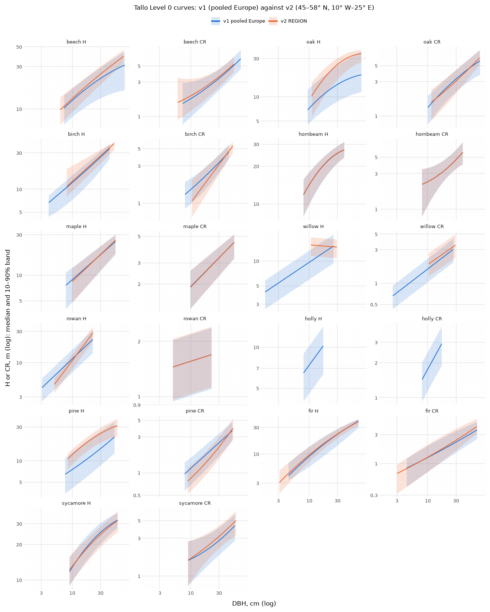

# Level 0 targets (2026-11-03)

Real data only: no simulated tree's z was read for anything in this note. The plan's §k has the method; v1 is 9b1f4c0 and
06915ac. Scripts: `analysis/treesim/tallo.py` (the registration), `analysis/experiments/level0_v2_audit.py` (the audit,
the side-by-side table and the figure), `analysis/experiments/nwfva_extract.py` (the yield tables).

## Level 0 targets v2

### Why
- **The gate on v1** (the night-1 fits, seeds 1–20): beech passed 2 of 20 and oak 0 of 20. The shipped species both
  passed 0 of 20.
- **The oak audit:** one Spanish inventory, Lines et al. 2012 (ref 35, median 43.0° N, 4.9° W), supplies 2,743 of oak's
  3,749 European height rows (73%) and sets its curve. Its oaks are 12.0 m at 22–34 cm. In the same window, the British
  and central European sources' oaks are 16.3–21.6 m.
- The same inventory supplies 28% of beech's rows (15.0 m in the window, against 19.1–24.6 m elsewhere).

### What v2 is (the user's specification; the readings taken where it left a choice are marked *reading*)
1. **A geographic subset, the same for every species:** 45–58° N, 10° W–25° E (`tallo.REGION`; the eastern edge takes in
   Białowieża).
   - **When and why:** the box was chosen after the oak audit above. Its criterion is geographic: climatic comparability
     with Britain. It never selects by source or by outcome, and it is applied to every species identically.
   - The pooled-Europe (v1) and subset (v2) curves are side by side below, per species.
2. **The registered method, refitted on the subset:**
   - quadratic in ln D at n ≥ 300, linear below;
   - τ 0.1/0.5/0.9;
   - support DBH p2.5–p97.5;
   - rearranged where the curves cross.
3. **Thin species, by the subset's n_H** (*reading*: decided from the counts alone; no species is named in the code):
   - n_H < 100: the borrowed band, re-pooled on the subset's well-sampled broadleaves (*reading*: the six broadleaves of
     v1, beech, oak, birch, hornbeam, maple and sycamore, each with n_H ≥ 100 in the subset). Borrowed T is re-pooled the
     same way.
   - n_H < 30: curves reported, the species not gated at Level 0.
4. **The control matches the gate.** A pseudo-seed is 3 pseudo-seasons, each 4 real trees with both H and CR drawn across
   the support. Its statistic is max |median z| over both traits and all three seasons; T is its 90th percentile over
   2,000 pseudo-seeds.
   - *Reading:* the three seasons are independent draws. A simulated seed's three seasons are the same four trees
     growing, so they are correlated: under a perfect model a seed passes with p ≥ 0.9. This is the lenient side.
   - **Where the gate is still more lenient than the control** (the advisor's check; none blocks):
     - The gate drops a tree per trait by that trait's support, so a median can rest on fewer than four trees. Beech's
       CR support ends at 53.8 cm, and the shipped beech reaches 55–75 cm at 150.
     - A dead tree leaves a median of three.
     - A season with no comparable tree leaves the max.
     The control draws four trees inside both supports, every time.
5. **Time anchors from the NW-FVA yield tables:** height at 100 and at 150, scored at Level 0 only, in the band form of
   each species' `stand.height`.
   - The form: the target is the midpoint of classes 1–2 in cells. The band is the same share of the target as height at
     60's: a sixth for oak (78 ± 13) and pine (84 ± 14), and 18/84 for beech (the advisor's reading, applied before the
     commit; a flat sixth would have given beech ± 20).
   - *Reading:* NW-FVA species only (beech, oak, pine); hornbeam's Lockow table is measured too, but it is not NW-FVA.
   - *Reading:* an age is scored only where classes 1–2 both reach it; nothing is extrapolated.
   - **Birch's lateShare** (described: an estimate from a site-index curve's shape) is reported, not scored.
6. **Nothing in `src/`, `rust/`, `cli/` or `tests/` changed.** The stand trial already measures every tree at 150
   (`cli/trials.ts:346–350`). `stand.height150` is read in Python as the live measured trees' mean allometry height,
   in cells.

### The registration (`analysis/fit/sources/tallo-level0.json` v2)

| species | trait | n | sources | DBH support cm | form | band | coverage by tercile |
|---|---|---|---|---|---|---|---|
| beech | H | 5149 | 9 | 6.3–73.8 | quadratic | own | 0.83, 0.77, 0.81 |
| beech | CR | 3522 | 8 | 6.0–53.8 | quadratic | own | 0.82, 0.78, 0.81 |
| oak | H | 613 (robur 495, petraea 118) | 6 | 11.0–75.2 | quadratic | own | 0.79, 0.78, 0.84 |
| oak | CR | 542 | 6 | 11.5–75.0 | quadratic | own | 0.78, 0.84, 0.76 |
| birch | H | 275 (*pendula* only) | 5 | 8.1–51.1 | linear | own | 0.75, 0.82, 0.91 |
| birch | CR | 261 | 5 | 10.5–51.5 | linear | own | 0.81, 0.88, 0.78 |
| hornbeam | H | 1038 | 2 | 8.0–39.0 | quadratic | own | 0.80, 0.80, 0.81 |
| hornbeam | CR | 1034 | 2 | 8.0–39.0 | quadratic | own | 0.78, 0.84, 0.76 |
| maple | H | 160 | 4 | 10.0–54.0 | linear | own | 0.82, 0.76, 0.86 |
| maple | CR | 154 | 4 | 10.0–54.3 | linear | own | 0.84, 0.78, 0.82 |
| pine | H | 2765 | 8 | 8.4–57.9 | quadratic | own | 0.80, 0.84, 0.75 |
| pine | CR | 2090 | 8 | 8.9–52.0 | quadratic | own | 0.74, 0.85, 0.80 |
| fir | H | 585 | 5 | 3.1–67.1 | quadratic | own | 0.77, 0.83, 0.81 |
| fir | CR | 573 | 5 | 3.0–67.5 | quadratic | own | 0.76, 0.82, 0.83 |
| sycamore (reference) | H | 447 | 6 | 9.0–59.0 | quadratic | own | 0.80, 0.81, 0.80 |
| sycamore (reference) | CR | 440 | 5 | 9.0–58.0 | quadratic | own | 0.79, 0.83, 0.76 |
| rowan | H | 38 | 3 | 5.0–22.5 | linear | borrowed | **0.54, 0.46, 0.50** |
| rowan | CR | 36 | 3 | 5.0–22.5 | linear | borrowed | 0.67, 0.67, 0.83 |
| willow (**not gated**) | H | 6 | 2 | 10.6–29.2 | linear | borrowed, reported | — |
| willow (**not gated**) | CR | 4 | 2 | 10.4–29.3 | linear | borrowed, reported | — |
| holly (**not gated**) | H, CR | 0 | 0 | — | no curve: no rows in the subset | — | — |

Borrowed band (pooled ln residuals of the six broadleaves): H r10 −0.308, r90 +0.212 (7,682 rows); CR r10 −0.412,
r90 +0.350 (5,953 rows).

**T, v2 beside v1:**

| species | T v2 | T v2, first 20 | T by v1's statistic on v2's trees | T v1 (registered, pooled Europe) | control trees | self-consistency |
|---|---|---|---|---|---|---|
| beech | 1.00 | 1.14 | 0.85 | 0.87 | 3060 | 19/20 |
| oak | 1.04 | 0.97 | 0.85 | 0.84 | 508 | 17/20 |
| birch | 1.00 | 0.99 | 0.82 | 0.84 | 246 | 20/20 |
| hornbeam | 1.01 | 0.85 | 0.83 | 0.83 | 1009 | 16/20 |
| maple | 0.99 | 0.81 | 0.82 | 0.81 | 146 | 18/20 |
| pine | 1.09 | 1.10 | 0.88 | 0.86 | 1863 | 18/20 |
| fir | 1.00 | 0.79 | 0.83 | 0.83 | 543 | 19/20 |
| sycamore (reference) | 1.03 | 0.87 | 0.81 | 0.85 | 418 | 18/20 |
| rowan (borrowed T) | 1.01 (own 1.61) | 1.91 | 1.38 | 0.84 | 36 | **9/20, below 15** |
| willow, holly | not gated | | | 0.84 (borrowed) | | |

Pooled (borrowed) T v2: 1.01, from 12,000 pseudo-seeds of 5,387 trees. Moving from v1 to v2, T rises by about 0.15–0.2.
That rise is the statistic's (a maximum over six medians rather than two), not the subset's: v1's statistic on v2's
trees gives 0.81–0.88, as v1 did.

### Flags (none tuned on; for the user)
- **Rowan fails its control under borrowed T** (9 of 20 real pseudo-seeds pass; height coverage about 0.5 per tercile).
  Only about half the subset's 38 rowans fall inside the broadleaves' band, and its own T is 1.61. Under v2's rule
  rowan is gated, but a perfect rowan would fail. Rowan is night 3: a ruling is needed before its gate is read.
- **Willow (6 rows) and holly (0) are not gated at Level 0.** Night 3 shrinks to rowan.
- **Birch is *B. pendula* only** in the subset; *pubescens* is all northern (Finland, Russia).
- **Hornbeam rests on 2 sources** (Jucker et al. 2015's Białowieża plots, 95%), as in v1.
- **Oak's Jucker et al. 2015 rows (ref 30) split three ways:** 322 in Italy (≈ 43° N, 11° E), 100 in Germany (≈ 51° N,
  10° E) and 219 in Poland (≈ 53° N, 24° E). The subset keeps the German and Polish plots, 319 rows, and drops the
  Italian ones.
- **lateShare stays scored for maple, rowan and holly**, though theirs is "described" too. So is `stand.height` for
  holly and rowan. The user's ruling named birch only; the same reason would cover these.
- **No height at 150 for beech or pine:** beech's class 1 table ends at 145 years, pine's at 120.

### Time anchors (`analysis/fit/sources/nwfva_h100.csv`, from CRAN et.nwfva 0.2.0's `sysdata.rda`)

| species | trait | classes 1–2, m | file:line | target ± band, cells | weight |
|---|---|---|---|---|---|
| oak | `stand.height100` | 27.0 / 24.0 | nwfva_h100.csv:83, :114 | 102 ± 17 | 1 |
| oak | `stand.height150` | 31.3 / 28.3 | nwfva_h100.csv:93, :124 | 119 ± 20 | 1 |
| beech | `stand.height100` | 32.5 / 28.5 | nwfva_h100.csv:212, :234 | 122 ± 26 | 1 |
| beech | height at 150 | class 1 ends at 145 (38.2, :221); class 2 34.1 (:244) | | not scored | |
| pine | `stand.height100` | 29.0 / 25.0 | nwfva_h100.csv:318, :337 | 108 ± 18 | 1 |
| pine | height at 150 | the tables end at 120 (:322, :341) | | not scored | |

The targets sit in `[[level0.trait]]` of `analysis/fit/targets/{oak,beech,pine}.toml`, which only Level 0 reads. Birch's
`[level0] reported = ["stand.lateShare"]`. For a cross-check: lateShare's classes 1–2 at 60 are oak 21.0/18.1 (:75, :106)
and beech 23.1/19.6 (:204, :226), which give 1.29–1.33 and 1.41–1.45 as registered.

**A measurement check, read from simulated heights only** (shipped params, seed 1, the stand to 150; no z computed).
The stand metric's mean height at 60 and 100 equals the allometry's mean height to 0.01 cell for beech, oak, birch and
pine. So `stand.height150` (the allometry at 150) is the same reading as `stand.height` and `stand.height100`.

**The pipeline check, after the registration was final** (shipped params, seed 7, one candidate through the fitter's
`evaluate`, `summary` and `contributions` with the v2 spec, to prove the new traits pass through before the night). It
gave beech, oak and birch a loss of 27.5, 28.6 and 14.1. Those were the first v2 z values read from a simulated tree;
nothing registered changed after them.

### Hashes
- `analysis/fit/sources/tallo-level0.json` v2: sha256 `0ddfe0bc8bad6170700767d5afd8dc6646b85eb4566a869d8c16ad8b3bb33404`.
- `tallo-level0-curves.csv` v2: `2b1bcb9f1661bf150e2d180761945852b6309ac1c6c449c2b1b3e2712030e172`.
- `nwfva_h100.csv`: `d128b85623d9cb18fd4458ff5a11e5cfcc705ba565636cf1976e92b74e303986`. The et.nwfva 0.2.0 tarball:
  `fc72949b5628b5b718bd39a8689b0162144b64975d6a646f62c5dde7b853460f`.
- Tallo.csv: `bcd908a65634a07f1a5cac79affc91e10c80ac832d0243efc2b83c8c4c1668cd` (unchanged).
- Targets files (`analysis/fit/targets/`): beech.toml `3b5df9c47b66546d12489c7f1c5f9f0d7593c20f69f270b898886771cdb8135b`; oak.toml `2e2d0f1addacf3987fdbfbc6aa25745e331cd0a5b92c9b67e70621d69867317e`; birch.toml `ab94d31cd8885ebe16180f88b377ff4fd8752b9cfc03285d7f8af7d792fa5b52`; pine.toml `01e684fbf84d43ede70a1d132ac8c9c1a7b23e9392ceddcf56137b887cd59b76`.
- v1, archived as `docs/experiments/fits/level0-v1/tallo-level0-v1.json`:
  `94def21776a2db7af6bd029e50b5d9610da279b8296f45a19e140bc78b777897`.

### v1, archived
- `runs/level0/` is now `runs/level0-v1/` (git-ignored; birch's checkpoint at gen 4 is there).
- `docs/experiments/fits/level0/` is now `docs/experiments/fits/level0-v1/`: the night-1 fits against pooled Europe
  (beech and oak complete, birch's best at gen 4), with the v1 targets beside them.
- They are cited, never deleted. The trunk diagnosis's scripts now read them, and v1's targets, from there
  (`tallo.TARGETS_V1`).

### Curves: pooled Europe against the subset

| species | trait | version | n | form | band | 10 cm | 20 cm | 30 cm | 40 cm | 50 cm | 60 cm |
|---|---|---|---|---|---|---|---|---|---|---|---|
| beech | H | v1 pooled Europe | 8931 | quadratic in ln D | own | 8.1 / 12.5 / 16.9 | 11.3 / 18.2 / 24.0 | 13.2 / 22.0 / 29.1 | 14.3 / 24.9 / 33.2 | 15.1 / 27.0 / 36.7 | 15.7 / 28.8 / 39.6 |
| beech | H | v2 REGION | 5149 | quadratic in ln D | own | 9.2 / 13.1 / 17.3 | 14.4 / 19.7 / 24.5 | 18.7 / 24.6 / 30.0 | 22.4 / 28.7 / 34.5 | 25.7 / 32.2 / 38.4 | 28.7 / 35.2 / 41.9 |
| beech | CR | v1 pooled Europe | 7082 | quadratic in ln D | own | 1.0 / 1.8 / 3.0 | 1.7 / 2.6 / 3.7 | 2.3 / 3.4 / 4.5 | 2.9 / 4.1 / 5.4 | 3.4 / 4.9 / 6.3 | 4.0 / 5.6 / 7.3 |
| beech | CR | v2 REGION | 3522 | quadratic in ln D | own | 1.2 / 1.9 / 3.3 | 1.9 / 2.8 / 3.8 | 2.5 / 3.5 / 4.5 | 3.2 / 4.3 / 5.4 | 3.9 / 5.0 / 6.4 | — |
| oak | H | v1 pooled Europe | 3749 | quadratic in ln D | own | 4.7 / 7.2 / 12.7 | 7.2 / 11.6 / 19.6 | 8.8 / 14.3 / 24.4 | 9.8 / 16.0 / 28.1 | 10.4 / 17.2 / 31.0 | 10.9 / 18.0 / 33.4 |
| oak | H | v2 REGION | 613 | quadratic in ln D | own | — | 11.4 / 18.8 / 24.0 | 16.4 / 25.3 / 30.2 | 20.2 / 29.4 / 33.9 | 22.9 / 31.9 / 36.2 | 24.9 / 33.4 / 37.5 |
| oak | CR | v1 pooled Europe | 3617 | quadratic in ln D | own | 0.8 / 1.3 / 1.9 | 1.5 / 2.4 / 3.2 | 2.2 / 3.3 / 4.3 | 2.7 / 4.0 / 5.3 | 3.0 / 4.6 / 6.2 | 3.3 / 5.1 / 7.0 |
| oak | CR | v2 REGION | 542 | quadratic in ln D | own | — | 1.4 / 2.3 / 3.3 | 2.1 / 3.1 / 4.3 | 2.7 / 3.8 / 5.3 | 3.4 / 4.6 / 6.2 | 4.1 / 5.3 / 7.0 |
| birch | H | v1 pooled Europe | 1250 | quadratic in ln D | own | 7.2 / 12.2 / 15.2 | 12.2 / 19.7 / 23.9 | 17.6 / 26.4 / 31.1 | 23.3 / 32.5 / 37.5 | — | — |
| birch | H | v2 REGION | 275 | linear in ln D | own | 9.4 / 12.6 / 20.2 | 16.0 / 20.6 / 27.5 | 21.8 / 27.4 / 32.8 | 27.1 / 33.6 / 37.3 | 32.2 / 39.3 / 41.1 | — |
| birch | CR | v1 pooled Europe | 1126 | quadratic in ln D | own | 1.0 / 1.5 / 2.1 | 1.7 / 2.4 / 3.1 | 2.5 / 3.3 / 4.2 | 3.3 / 4.2 / 5.2 | — | — |
| birch | CR | v2 REGION | 261 | linear in ln D | own | — | 1.4 / 2.1 / 3.1 | 2.3 / 3.1 / 4.1 | 3.3 / 4.2 / 5.1 | 4.2 / 5.3 / 5.9 | — |
| hornbeam | H | v1 pooled Europe | 1075 | quadratic in ln D | own | 9.9 / 14.3 / 17.8 | 17.0 / 21.8 / 25.0 | 21.1 / 25.4 / 28.9 | — | — | — |
| hornbeam | H | v2 REGION | 1038 | quadratic in ln D | own | 10.0 / 14.2 / 18.0 | 17.0 / 21.9 / 25.0 | 21.1 / 25.5 / 28.9 | — | — | — |
| hornbeam | CR | v1 pooled Europe | 1070 | quadratic in ln D | own | 1.1 / 2.3 / 3.6 | 2.5 / 3.4 / 4.7 | 3.5 / 4.6 / 6.3 | — | — | — |
| hornbeam | CR | v2 REGION | 1034 | quadratic in ln D | own | 1.1 / 2.3 / 3.6 | 2.6 / 3.4 / 4.7 | 3.5 / 4.6 / 6.3 | — | — | — |
| maple | H | v1 pooled Europe | 166 | linear in ln D | own | 4.8 / 8.8 / 12.3 | 8.2 / 13.6 / 17.7 | 11.1 / 17.4 / 21.9 | 13.9 / 20.8 / 25.4 | 16.5 / 23.9 / 28.6 | — |
| maple | H | v2 REGION | 160 | linear in ln D | own | 4.6 / 8.4 / 12.0 | 8.1 / 13.4 / 17.5 | 11.3 / 17.5 / 21.9 | 14.2 / 21.2 / 25.6 | 17.1 / 24.6 / 29.0 | — |
| maple | CR | v1 pooled Europe | 155 | linear in ln D | own | 1.2 / 1.9 / 2.6 | 1.8 / 2.7 / 3.4 | 2.3 / 3.3 / 4.1 | 2.7 / 3.8 / 4.6 | 3.1 / 4.3 / 5.0 | — |
| maple | CR | v2 REGION | 154 | linear in ln D | own | 1.2 / 1.9 / 2.6 | 1.8 / 2.7 / 3.4 | 2.3 / 3.3 / 4.1 | 2.7 / 3.8 / 4.6 | 3.1 / 4.3 / 5.0 | — |
| willow | H | v1 pooled Europe | 33 | linear in ln D | borrowed | 6.0 / 9.6 / 13.3 | 8.3 / 13.5 / 18.6 | — | — | — | — |
| willow | H | v2 REGION | 6 | linear in ln D | borrowed | — | 11.1 / 15.1 / 18.6 | — | — | — | — |
| willow | CR | v1 pooled Europe | 19 | linear in ln D | borrowed | 1.0 / 1.6 / 2.2 | 1.6 / 2.5 / 3.5 | — | — | — | — |
| willow | CR | v2 REGION | 4 | linear in ln D | borrowed | — | 1.8 / 2.8 / 4.0 | — | — | — | — |
| rowan | H | v1 pooled Europe | 44 | linear in ln D | borrowed | 7.0 / 11.4 / 15.7 | 12.8 / 20.6 / 28.5 | — | — | — | — |
| rowan | H | v2 REGION | 38 | linear in ln D | borrowed | 7.9 / 10.7 / 13.3 | 18.2 / 24.7 / 30.6 | — | — | — | — |
| rowan | CR | v1 pooled Europe | 36 | linear in ln D | borrowed | 1.0 / 1.6 / 2.2 | 1.1 / 1.7 / 2.3 | — | — | — | — |
| rowan | CR | v2 REGION | 36 | linear in ln D | borrowed | 1.0 / 1.6 / 2.2 | 1.1 / 1.7 / 2.4 | — | — | — | — |
| holly | H | v1 pooled Europe | 25 | linear in ln D | borrowed | 4.6 / 7.4 / 10.2 | — | — | — | — | — |
| holly | H | v2 REGION | 0 | no curve: fewer than 3 rows in REGION | none | — | — | — | — | — | — |
| holly | CR | v1 pooled Europe | 25 | linear in ln D | borrowed | 1.1 / 1.8 / 2.5 | — | — | — | — | — |
| holly | CR | v2 REGION | 0 | no curve: fewer than 3 rows in REGION | none | — | — | — | — | — | — |
| pine | H | v1 pooled Europe | 15088 | quadratic in ln D | own | 4.1 / 7.5 / 13.1 | 6.5 / 11.4 / 20.4 | 8.6 / 14.8 / 25.9 | 10.6 / 18.1 / 30.4 | 12.4 / 21.2 / 34.3 | — |
| pine | H | v2 REGION | 2765 | quadratic in ln D | own | 8.8 / 12.2 / 14.5 | 14.6 / 19.6 / 23.2 | 17.9 / 24.3 / 29.1 | 20.0 / 27.6 / 33.4 | 21.3 / 30.0 / 36.7 | — |
| pine | CR | v1 pooled Europe | 13340 | quadratic in ln D | own | 0.7 / 1.1 / 1.6 | 1.2 / 1.9 / 2.5 | 1.7 / 2.5 / 3.3 | 2.2 / 3.1 / 4.1 | 2.6 / 3.6 / 4.7 | — |
| pine | CR | v2 REGION | 2090 | quadratic in ln D | own | 0.6 / 0.8 / 1.2 | 1.0 / 1.5 / 2.1 | 1.5 / 2.2 / 3.0 | 2.1 / 3.0 / 3.9 | 2.7 / 3.8 / 5.0 | — |
| fir | H | v1 pooled Europe | 1070 | quadratic in ln D | own | 5.9 / 9.1 / 13.5 | 10.1 / 16.6 / 22.0 | 14.2 / 22.7 / 28.1 | 18.3 / 27.8 / 32.9 | 22.4 / 32.3 / 36.7 | 26.5 / 36.2 / 39.9 |
| fir | H | v2 REGION | 585 | quadratic in ln D | own | 7.2 / 9.6 / 13.4 | 13.7 / 17.1 / 21.8 | 19.0 / 22.9 / 28.0 | 23.4 / 27.8 / 32.9 | 27.2 / 32.0 / 36.9 | 30.5 / 35.7 / 40.4 |
| fir | CR | v1 pooled Europe | 1044 | quadratic in ln D | own | 0.7 / 1.3 / 2.0 | 1.2 / 1.8 / 2.8 | 1.5 / 2.3 / 3.4 | 1.8 / 2.7 / 3.9 | 2.1 / 3.0 / 4.3 | 2.4 / 3.3 / 4.6 |
| fir | CR | v2 REGION | 573 | quadratic in ln D | own | 0.7 / 1.3 / 2.0 | 1.2 / 1.9 / 3.0 | 1.6 / 2.4 / 3.7 | 2.1 / 2.9 / 4.3 | 2.5 / 3.4 / 4.8 | 2.8 / 3.8 / 5.2 |
| sycamore | H | v1 pooled Europe | 686 | quadratic in ln D | own | 9.7 / 12.8 / 16.5 | 15.9 / 20.5 / 25.2 | 20.2 / 25.3 / 30.2 | 23.4 / 28.5 / 33.4 | 25.9 / 30.8 / 35.5 | — |
| sycamore | H | v2 REGION | 447 | quadratic in ln D | own | 9.7 / 13.1 / 16.8 | 15.2 / 19.8 / 23.5 | 18.9 / 24.3 / 28.3 | 21.7 / 27.6 / 32.3 | 23.9 / 30.1 / 35.6 | — |
| sycamore | CR | v1 pooled Europe | 668 | quadratic in ln D | own | 0.8 / 1.6 / 2.8 | 1.4 / 2.2 / 3.4 | 1.8 / 2.8 / 4.1 | 2.2 / 3.4 / 4.8 | 2.6 / 4.0 / 5.6 | — |
| sycamore | CR | v2 REGION | 440 | quadratic in ln D | own | 0.8 / 1.7 / 2.8 | 1.6 / 2.4 / 3.5 | 2.2 / 3.2 / 4.3 | 2.7 / 3.8 / 5.1 | 3.0 / 4.5 / 5.9 | — |

### Source audit (Europe box; every reference_id)

DBH window per species: the pooled-Europe median DBH of its height rows, ÷/× 1.25, fixed before any source was read; the window median H only where ≥ 20 trees fall in it. "in REGION" counts the source's rows inside v2's box.

#### beech

Europe box: n_H 8931, n_CR 7082; REGION: n_H 5149, n_CR 3522. DBH window 19.6–30.6 cm (pooled median 24.5 cm ÷/× 1.25).

| ref | source | lat | lon | in REGION | n_H (share) | n_CR | median DBH cm | median H m | n in window | median H in window m |
|---|---|---|---|---|---|---|---|---|---|---|
| 27 | Heym et al. (2017) EuMIXFOR empirical forest mensuration and ring widt | 50.0 | 13.2 | 2640/3402 | 3402 (38%) | 2260 | 22.9 | 20.9 | 1089 | 22.8 |
| 35 | Lines et al. (2012) Predictable changes in aboveground allometry of tr | 43.0 | -2.7 | 0/2486 | 2486 (28%) | 2486 | 30.6 | 15.5 | 689 | 15.0 |
| 30 | Jucker et al. (2015) Crown plasticity enables trees to optimize canopy | 51.1 | 10.5 | 631/1122 | 1122 (13%) | 1110 | 21.5 | 22.2 | 262 | 24.6 |
| 15 | Dalponte & Coomes (2016) Tree-centric mapping of forest carbon density | 46.0 | 11.4 | 803/803 | 803 (9%) | 803 | 18.5 | 16.7 | 288 | 19.1 |
| 33 | Jucker et al. (2022) Tallo � a global tree allometry and crown archite | 49.5 | 11.5 | 252/252 | 252 (3%) | 250 | 34.2 | 24.2 | 52 | 21.2 |
| 54 | Stillhard et al. (2019) Stand inventory data from the 10ha forest rese | 48.3 | 23.6 | 437/437 | 437 (5%) | 0 | 37.5 | 32.3 | 47 | 21.5 |
| 57 | Wirth et al. (2004) Generic biomass functions for Norway spruce in Cen | 51.0 | 8.0 | 302/330 | 330 (4%) | 100 | 16.9 | 17.2 | 69 | 20.9 |
| 47 | Schepaschenko et al. (2017) A dataset of forest biomass structure for  | 48.7 | 10.0 | 48/56 | 56 (1%) | 33 | 18.2 | 18.8 | 11 | — |
| 16 | Evans et al. (2015) Allometry and growth of eight tree taxa in United  | 51.8 | -1.3 | 20/20 | 20 (0%) | 19 | 32.5 | 23.8 | 2 | — |
| 67 | Sanasilva forest health inventory. Available from: https://www.wsl.ch/ | 47.3 | 7.4 | 16/16 | 16 (0%) | 21 | 35.8 | 21.1 | 4 | — |
| 17 | Falster et al. (2015) BAAD: a biomass and allometry database for woody | 42.3 | -3.2 | 0/7 | 7 (0%) | 0 | 17.6 | 17.0 | 2 | — |

#### oak

Europe box: n_H 3749, n_CR 3617; REGION: n_H 613, n_CR 542. DBH window 21.6–33.8 cm (pooled median 27.0 cm ÷/× 1.25).

| ref | source | lat | lon | in REGION | n_H (share) | n_CR | median DBH cm | median H m | n in window | median H in window m |
|---|---|---|---|---|---|---|---|---|---|---|
| 35 | Lines et al. (2012) Predictable changes in aboveground allometry of tr | 43.0 | -4.9 | 0/2743 | 2743 (73%) | 2744 | 27.6 | 12.0 | 804 | 12.0 |
| 30 | Jucker et al. (2015) Crown plasticity enables trees to optimize canopy | 43.1 | 11.2 | 319/641 | 641 (17%) | 640 | 28.0 | 21.7 | 184 | 21.6 |
| 33 | Jucker et al. (2022) Tallo � a global tree allometry and crown archite | 49.5 | 11.5 | 106/106 | 106 (3%) | 96 | 22.6 | 13.6 | 43 | 16.3 |
| 16 | Evans et al. (2015) Allometry and growth of eight tree taxa in United  | 51.8 | -1.3 | 111/111 | 111 (3%) | 57 | 24.9 | 18.6 | 30 | 20.1 |
| 27 | Heym et al. (2017) EuMIXFOR empirical forest mensuration and ring widt | 49.3 | 19.6 | 52/91 | 91 (2%) | 51 | 15.8 | 15.1 | 17 | — |
| 47 | Schepaschenko et al. (2017) A dataset of forest biomass structure for  | 51.7 | 36.7 | 7/39 | 39 (1%) | 11 | 9.5 | 8.4 | 9 | — |
| 15 | Dalponte & Coomes (2016) Tree-centric mapping of forest carbon density | 46.0 | 11.4 | 18/18 | 18 (0%) | 18 | 23.0 | 19.0 | 7 | — |

#### birch

Europe box: n_H 1250, n_CR 1126; REGION: n_H 275, n_CR 261. DBH window 14.1–22.0 cm (pooled median 17.6 cm ÷/× 1.25).

| ref | source | lat | lon | in REGION | n_H (share) | n_CR | median DBH cm | median H m | n in window | median H in window m |
|---|---|---|---|---|---|---|---|---|---|---|
| 30 | Jucker et al. (2015) Crown plasticity enables trees to optimize canopy | 62.5 | 29.2 | 208/736 | 736 (59%) | 732 | 19.0 | 20.8 | 295 | 20.1 |
| 1 | Aakala et al. (2016) Crown asymmetry in high latitude forests: disenta | 67.4 | 28.7 | 0/254 | 254 (20%) | 259 | 16.4 | 11.0 | 134 | 11.9 |
| 47 | Schepaschenko et al. (2017) A dataset of forest biomass structure for  | 60.0 | 36.7 | 10/167 | 167 (13%) | 76 | 9.3 | 12.4 | 36 | 18.6 |
| 15 | Dalponte & Coomes (2016) Tree-centric mapping of forest carbon density | 46.3 | 10.8 | 39/39 | 39 (3%) | 38 | 19.0 | 16.8 | 23 | 17.5 |
| 17 | Falster et al. (2015) BAAD: a biomass and allometry database for woody | 62.3 | 27.9 | 0/29 | 29 (2%) | 11 | 9.6 | 15.6 | 6 | — |
| 27 | Heym et al. (2017) EuMIXFOR empirical forest mensuration and ring widt | 51.6 | 16.6 | 17/24 | 24 (2%) | 9 | 17.5 | 14.5 | 9 | — |
| 67 | Sanasilva forest health inventory. Available from: https://www.wsl.ch/ | 46.5 | 8.9 | 1/1 | 1 (0%) | 1 | 13.0 | 12.6 | 0 | — |

#### hornbeam

Europe box: n_H 1075, n_CR 1070; REGION: n_H 1038, n_CR 1034. DBH window 13.6–21.2 cm (pooled median 17.0 cm ÷/× 1.25).

| ref | source | lat | lon | in REGION | n_H (share) | n_CR | median DBH cm | median H m | n in window | median H in window m |
|---|---|---|---|---|---|---|---|---|---|---|
| 30 | Jucker et al. (2015) Crown plasticity enables trees to optimize canopy | 52.9 | 23.6 | 986/1023 | 1023 (95%) | 1019 | 17.0 | 20.1 | 441 | 20.3 |
| 33 | Jucker et al. (2022) Tallo � a global tree allometry and crown archite | 49.5 | 11.5 | 52/52 | 52 (5%) | 51 | 17.3 | 11.8 | 22 | 10.6 |

#### maple

Europe box: n_H 166, n_CR 155; REGION: n_H 160, n_CR 154. DBH window 16.8–26.3 cm (pooled median 21.1 cm ÷/× 1.25).

| ref | source | lat | lon | in REGION | n_H (share) | n_CR | median DBH cm | median H m | n in window | median H in window m |
|---|---|---|---|---|---|---|---|---|---|---|
| 33 | Jucker et al. (2022) Tallo � a global tree allometry and crown archite | 49.5 | 11.5 | 134/134 | 134 (81%) | 130 | 22.3 | 14.9 | 36 | 15.1 |
| 16 | Evans et al. (2015) Allometry and growth of eight tree taxa in United  | 51.8 | -1.3 | 15/15 | 15 (9%) | 13 | 19.5 | 14.5 | 8 | — |
| 30 | Jucker et al. (2015) Crown plasticity enables trees to optimize canopy | 51.1 | 10.5 | 7/8 | 8 (5%) | 8 | 18.5 | 15.5 | 4 | — |
| 15 | Dalponte & Coomes (2016) Tree-centric mapping of forest carbon density | 46.1 | 11.0 | 4/4 | 4 (2%) | 4 | 6.5 | 7.7 | 0 | — |
| 47 | Schepaschenko et al. (2017) A dataset of forest biomass structure for  | 51.4 | 42.0 | 0/3 | 3 (2%) | 0 | 3.0 | 6.5 | 0 | — |
| 27 | Heym et al. (2017) EuMIXFOR empirical forest mensuration and ring widt | 42.2 | 2.3 | 0/2 | 2 (1%) | 0 | 23.2 | 17.6 | 2 | — |

#### willow

Europe box: n_H 33, n_CR 19; REGION: n_H 6, n_CR 4. DBH window 6.9–10.8 cm (pooled median 8.6 cm ÷/× 1.25).

| ref | source | lat | lon | in REGION | n_H (share) | n_CR | median DBH cm | median H m | n in window | median H in window m |
|---|---|---|---|---|---|---|---|---|---|---|
| 47 | Schepaschenko et al. (2017) A dataset of forest biomass structure for  | 60.0 | 40.0 | 0/22 | 22 (67%) | 10 | 5.9 | 7.2 | 5 | — |
| 1 | Aakala et al. (2016) Crown asymmetry in high latitude forests: disenta | 67.7 | 29.6 | 0/5 | 5 (15%) | 5 | 15.2 | 8.7 | 0 | — |
| 30 | Jucker et al. (2015) Crown plasticity enables trees to optimize canopy | 51.1 | 10.5 | 3/3 | 3 (9%) | 3 | 15.0 | 16.3 | 1 | — |
| 33 | Jucker et al. (2022) Tallo � a global tree allometry and crown archite | 49.5 | 11.5 | 3/3 | 3 (9%) | 1 | 24.6 | 11.5 | 0 | — |

#### rowan

Europe box: n_H 44, n_CR 36; REGION: n_H 38, n_CR 36. DBH window 7.6–11.9 cm (pooled median 9.5 cm ÷/× 1.25).

| ref | source | lat | lon | in REGION | n_H (share) | n_CR | median DBH cm | median H m | n in window | median H in window m |
|---|---|---|---|---|---|---|---|---|---|---|
| 15 | Dalponte & Coomes (2016) Tree-centric mapping of forest carbon density | 46.3 | 11.4 | 35/35 | 35 (80%) | 33 | 11.0 | 10.7 | 10 | — |
| 47 | Schepaschenko et al. (2017) A dataset of forest biomass structure for  | 58.0 | 33.0 | 0/6 | 6 (14%) | 0 | 4.5 | 5.8 | 2 | — |
| 30 | Jucker et al. (2015) Crown plasticity enables trees to optimize canopy | 52.9 | 23.6 | 2/2 | 2 (5%) | 2 | 9.5 | 10.0 | 2 | — |
| 67 | Sanasilva forest health inventory. Available from: https://www.wsl.ch/ | 47.0 | 8.6 | 1/1 | 1 (2%) | 1 | 12.0 | 5.7 | 0 | — |

#### holly

Europe box: n_H 25, n_CR 25; REGION: n_H 0, n_CR 0. DBH window 8.0–12.5 cm (pooled median 10.0 cm ÷/× 1.25).

| ref | source | lat | lon | in REGION | n_H (share) | n_CR | median DBH cm | median H m | n in window | median H in window m |
|---|---|---|---|---|---|---|---|---|---|---|
| 30 | Jucker et al. (2015) Crown plasticity enables trees to optimize canopy | 43.1 | 11.2 | 0/25 | 25 (100%) | 25 | 10.0 | 7.5 | 21 | 7.5 |

#### pine

Europe box: n_H 15088, n_CR 13340; REGION: n_H 2765, n_CR 2090. DBH window 17.1–26.8 cm (pooled median 21.4 cm ÷/× 1.25).

| ref | source | lat | lon | in REGION | n_H (share) | n_CR | median DBH cm | median H m | n in window | median H in window m |
|---|---|---|---|---|---|---|---|---|---|---|
| 35 | Lines et al. (2012) Predictable changes in aboveground allometry of tr | 42.1 | -1.7 | 0/7916 | 7916 (52%) | 7910 | 22.0 | 9.0 | 2702 | 9.5 |
| 27 | Heym et al. (2017) EuMIXFOR empirical forest mensuration and ring widt | 49.9 | 13.6 | 2024/2572 | 2572 (17%) | 1774 | 25.4 | 20.4 | 846 | 19.8 |
| 47 | Schepaschenko et al. (2017) A dataset of forest biomass structure for  | 51.0 | 30.3 | 81/1714 | 1714 (11%) | 930 | 12.7 | 12.2 | 329 | 20.7 |
| 30 | Jucker et al. (2015) Crown plasticity enables trees to optimize canopy | 62.5 | 29.2 | 236/1284 | 1284 (9%) | 1272 | 22.0 | 17.4 | 512 | 17.8 |
| 1 | Aakala et al. (2016) Crown asymmetry in high latitude forests: disenta | 67.7 | 29.6 | 0/829 | 829 (5%) | 839 | 26.6 | 15.9 | 214 | 15.6 |
| 17 | Falster et al. (2015) BAAD: a biomass and allometry database for woody | 60.0 | 16.0 | 0/315 | 315 (2%) | 192 | 12.1 | 10.6 | 59 | 17.4 |
| 15 | Dalponte & Coomes (2016) Tree-centric mapping of forest carbon density | 46.0 | 11.4 | 190/190 | 190 (1%) | 190 | 26.0 | 17.4 | 59 | 17.3 |
| 57 | Wirth et al. (2004) Generic biomass functions for Norway spruce in Cen | 51.6 | 13.9 | 133/151 | 151 (1%) | 114 | 19.3 | 17.3 | 37 | 18.8 |
| 67 | Sanasilva forest health inventory. Available from: https://www.wsl.ch/ | 47.0 | 7.3 | 81/81 | 81 (1%) | 83 | 38.0 | 17.8 | 13 | — |
| 66 | Sample tree biomass data for Eurasian forests. Available from: https:/ | 63.5 | 41.8 | 15/31 | 31 (0%) | 31 | 7.8 | 9.5 | 1 | — |
| 33 | Jucker et al. (2022) Tallo � a global tree allometry and crown archite | 49.5 | 11.5 | 5/5 | 5 (0%) | 5 | 39.7 | 10.8 | 1 | — |

#### fir

Europe box: n_H 1070, n_CR 1044; REGION: n_H 585, n_CR 573. DBH window 22.4–35.0 cm (pooled median 28.0 cm ÷/× 1.25).

| ref | source | lat | lon | in REGION | n_H (share) | n_CR | median DBH cm | median H m | n in window | median H in window m |
|---|---|---|---|---|---|---|---|---|---|---|
| 30 | Jucker et al. (2015) Crown plasticity enables trees to optimize canopy | 47.3 | 26.0 | 0/321 | 321 (30%) | 307 | 33.0 | 29.0 | 66 | 26.4 |
| 47 | Schepaschenko et al. (2017) A dataset of forest biomass structure for  | 48.5 | 24.6 | 198/219 | 219 (20%) | 207 | 13.9 | 14.4 | 55 | 22.8 |
| 15 | Dalponte & Coomes (2016) Tree-centric mapping of forest carbon density | 46.0 | 11.4 | 212/212 | 212 (20%) | 212 | 24.5 | 21.2 | 31 | 25.6 |
| 67 | Sanasilva forest health inventory. Available from: https://www.wsl.ch/ | 47.1 | 7.8 | 161/161 | 161 (15%) | 161 | 37.5 | 28.0 | 28 | 24.9 |
| 35 | Lines et al. (2012) Predictable changes in aboveground allometry of tr | 42.7 | 0.8 | 0/141 | 141 (13%) | 141 | 33.8 | 16.5 | 37 | 14.5 |
| 27 | Heym et al. (2017) EuMIXFOR empirical forest mensuration and ring widt | 47.4 | 18.5 | 12/14 | 14 (1%) | 14 | 16.4 | 13.3 | 3 | — |
| 33 | Jucker et al. (2022) Tallo � a global tree allometry and crown archite | 49.5 | 11.5 | 2/2 | 2 (0%) | 2 | 27.2 | 23.6 | 0 | — |

#### sycamore

Europe box: n_H 686, n_CR 668; REGION: n_H 447, n_CR 440. DBH window 20.8–32.5 cm (pooled median 26.0 cm ÷/× 1.25).

| ref | source | lat | lon | in REGION | n_H (share) | n_CR | median DBH cm | median H m | n in window | median H in window m |
|---|---|---|---|---|---|---|---|---|---|---|
| 30 | Jucker et al. (2015) Crown plasticity enables trees to optimize canopy | 47.3 | 26.0 | 224/463 | 463 (67%) | 452 | 26.0 | 23.9 | 151 | 24.5 |
| 33 | Jucker et al. (2022) Tallo � a global tree allometry and crown archite | 49.5 | 11.5 | 110/110 | 110 (16%) | 107 | 30.9 | 24.0 | 37 | 23.2 |
| 15 | Dalponte & Coomes (2016) Tree-centric mapping of forest carbon density | 46.0 | 11.4 | 63/63 | 63 (9%) | 63 | 21.0 | 21.5 | 27 | 23.7 |
| 16 | Evans et al. (2015) Allometry and growth of eight tree taxa in United  | 51.8 | -1.3 | 38/38 | 38 (6%) | 40 | 17.3 | 16.2 | 8 | — |
| 67 | Sanasilva forest health inventory. Available from: https://www.wsl.ch/ | 47.5 | 8.0 | 6/6 | 6 (1%) | 6 | 14.0 | 14.5 | 0 | — |
| 54 | Stillhard et al. (2019) Stand inventory data from the 10ha forest rese | 48.3 | 23.6 | 6/6 | 6 (1%) | 0 | 50.4 | 36.1 | 0 | — |

