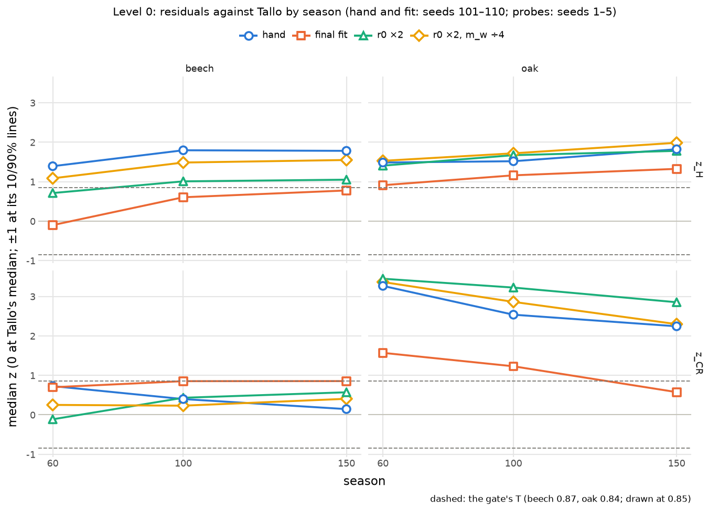

# Level 0: why the fit cannot thicken the trunk (2026-11-03)

Diagnosis session, read-only on the core. Proposed decision: [ADR 0050](../decisions/0050-level0-height-not-girth.md).
Probe outputs: `docs/experiments/fits/level0-trunk/*.json`; scripts `analysis/experiments/level0_trunk_*.py`.
Hand params and probes are measured as the fitter measures them (`treesim.fit.measure`, Level 0's trials). Probes use seeds 1–5;
the fits' hand and final traits use seeds 101–110. Bounds are lifted for the probes only. Nothing here is a candidate for
adoption. No gate, gallery or `shapeFlag` was run.

## The observation
Every out-of-band Tallo residual in the beech and oak fits is positive: H too tall for its DBH, CR too wide for its DBH.
z_H rises with age in every candidate and in the r0 probe ([figure](figures/2026-11-03-level0-trunk-z.png)). The hypothesis
tested here: trunks are too thin, and c6.r0 cannot thicken them because maintenance is charged on π·r²·l including scar
sums, so a thicker trunk starves late growth.

## Verdict
**Refuted at its premise.** Maintenance is already charged on live pipe area only. r0's apparent z_H gain is lost height,
not girth. What survives is **absolute height**: the simulated stands are taller than Tallo's median tree reaches at any DBH in
its support. For oak two further causes are the targets' and CR's definition, both the user's to rule on.

## 1. r0 probes (hand params, r0 ×1/×1.5/×2, seeds 1–5)
Beech (the earlier probe, re-run identically as `beech-r0mw.json`'s r0x1, loss 12.98 both times):

| r0 | loss | lateShare (contrib.) | DBH cm 60/100/150 | H m 60/100/150 | z_H | z_CR |
|---|---|---|---|---|---|---|
| ×1 | 12.98 | 1.322 (3.23) | 29.0/42.6/54.9 | 32.6/41.3/46.1 | +1.40/+1.63/+1.60 | +0.61/+0.39/+0.69 |
| ×1.5 | 20.39 | 1.218 (12.52) | 30.0/37.1/43.3 | 30.7/37.7/40.3 | +1.16/+1.52/+1.61 | +0.13/+0.43/+0.56 |
| ×2 | 21.22 | 1.178 (17.64) | 31.1/37.5/43.6 | 27.3/32.3/34.3 | +0.71/+1.01/+1.05 | −0.11/+0.43/+0.57 |

Oak:

| r0 | loss | lateShare (contrib.) | DBH cm 60/100/150 | H m 60/100/150 | z_H | z_CR |
|---|---|---|---|---|---|---|
| ×1 | 17.30 | 1.220 (2.26) | 23.7/33.4/34.5 | 26.8/32.9/39.6 | +1.42/+1.45/+1.74 | +3.13/+2.39/+2.13 |
| ×1.5 | 18.71 | 1.234 (1.61) | 20.4/26.7/29.0 | 25.9/32.0/37.7 | +1.51/+1.64/+1.85 | +3.35/+2.90/+2.60 |
| ×2 | 18.54 | 1.227 (1.90) | 20.3/22.7/24.6 | 24.4/30.0/33.2 | +1.41/+1.67/+1.78 | +3.45/+3.23/+2.85 |

Birch:

| r0 | loss | lateShare (contrib.) | DBH cm 60/100/150 | H m 60/100/150 | z_H | z_CR |
|---|---|---|---|---|---|---|
| ×1 | 20.13 | 1.126 (0.00) | 17.3/29.2/30.7 | 32.1/36.5/40.0 | +2.98/+2.09/+2.48 | +2.71/+2.32/+3.26 |
| ×1.5 | 20.20 | 1.081 (0.12) | 17.2/18.7/21.9 | 28.8/31.1/33.7 | +2.42/+2.54/+2.52 | +2.61/+3.36/+3.41 |
| ×2 | 10.89 | 1.070 (0.20) | 19.4/20.8/22.1 | 24.6/26.2/27.2 | +1.27/+1.36/+1.37 | +2.37/+2.41/+2.44 |

**In all three species a larger r0 gives a thinner trunk at 100 and 150, and a shorter tree.** Where z_H falls, H fell.
lateShare collapses in beech only (oak's is flat).

## 2. lateShare
`stand.lateShare` = stand height at 100 over height at 60 (`analysis/treesim/fit.py:299`).
- **Beech:** 1.43 ± 0.06, `analysis/fit/targets/beech.toml:116–122`, kind "measured": NW-FVA yield tables, classes 1–2,
  1.41–1.45 (Albert et al. 2021, the et.nwfva data).
- **Oak:** 1.31 ± 0.06, `oak.toml:116–122`, "measured", the same tables, classes 1–2.
- **Birch:** 1.12 ± 0.08 at weight 0.5, `birch.toml:116–122`, kind **"described"**: "an estimate" from the shape of a
  site-index curve (Zeoli et al. 2025). Not measured data.

Beech and oak are yield-table data: measured stand means, not single trees.

## 3. The code
- **Maintenance is charged on live pipe area only.** `rust/core/src/principles/r1.rs:69–90` computes
  `M_w = m_w·π·r_live²·l`. `r_live = (Σ tip_n)^(1/n)` comes from the childless metamers above (`tip_n = r0^n`, `r1.rs:70`,
  `:78–79`). Neither `scar_sum_n` nor `radius` (C6's memory) nor `stress_wood` enters it. The test
  `heartwood_costs_nothing` (`r1.rs:281–289`) pins this. The live pipe area is already what maintenance reads, so there is
  nothing to switch it to. **What r0 does to cost:** `M_w = m_w·π·r0²·Σ(path length to each live tip)` at n = 2
  (`src/core/params.ts:194–213`, ADR 0027 §2). r0 ×2 at fixed m_w is ×4 sapwood cost.
- **How C6 sets the radius.** `c6.rs:19–36`: basipetally, `r = (Σ_children (r_c − sw_c)^n + scar_sum_n)^(1/n) + stress_wood`
  with `r_c` the child's *stored* radius, and `radius = max(radius, r)` (never shrinks). A shed branch's scar is exactly the
  pipe area it was passing up (`c5.rs:117–122`), so shedding is area-neutral. Bud death removes no metamer, so a childless
  metamer keeps counting as a tip. **Pipe area at breast height rises only when a new shoot end is created above it**
  (each adds r0ⁿ). It never falls. R3 adds stress wood wherever σ > σ_target (`r3.rs:162–172`), toward the radius that
  holds the bending moment at σ_target, `r_mech = ∛(4M/πσ_target)`.
- **Can DBH keep growing after closure?** Only through new shoot ends above 1.3 m and through a rising moment at 1.3 m.
  Production does not enter. Decomposition of the DBH cylinder (`level0_trunk_decompose.py`, the parity dump
  `runs/level0-parity/trees.json`: shipped params, seeds 1–2, medians):

  | species | season | DBH cm | H m | live tips above | stress / r | live / pipe area | (memory + scars) / pipe area |
  |---|---|---|---|---|---|---|---|
  | beech | 60 / 100 / 150 | 29.8 / 41.1 / 58.4 | 33.0 / 42.5 / 50.2 | 1262 / 2649 / 2997 | 0.43 / 0.49 / 0.49 | 0.11 / 0.14 / 0.11 | 0.89 / 0.87 / 0.89 |
  | oak | 60 / 100 / 150 | 20.3 / 35.5 / 36.6 | 27.3 / 33.5 / 40.8 | 790 / 640 / 457 | 0.49 / 0.66 / 0.64 | 0.15 / 0.09 / 0.05 | 0.85 / 0.91 / 0.95 |
  | birch | 60 / 100 / 150 | 17.1 / 28.2 / 29.5 | 32.2 / 36.2 / 40.0 | 364 / 291 / 239 | 0.21 / 0.50 / 0.50 | 0.15 / 0.11 / 0.08 | 0.85 / 0.89 / 0.92 |

  R3's stress wood is 43–66% of the DBH radius. Oak's and birch's live crowns above breast height shrink after 60, and
  their DBH all but stops (oak +1.1 cm over 100–150 while H gains 7 m). This is an inference from the code and the
  decomposition, not a probe. DBH ≈ max(pipe radius, r_mech) explains the cost-neutral cells below.

## 4. Rivals, each with its probe
| # | rival | probe | verdict |
|---|---|---|---|
| a | **Absolute height**: the trees are too tall at any DBH | D*: the DBH at which Tallo's median line reaches the simulated H and CR (`level0_trunk_dstar.py`, no simulation) | **Survives.** Tallo's median H peaks at 38.9 m (beech) and 19.5 m (oak) within 1–300 cm. Hand beech at 100/150 (43/48 m) and every oak row, hand and fit, exceed it at every DBH in Tallo's support: no trunk can bring them in. The beech fit reached z_H +0.6/+0.8 by lowering H (r1.Lh 109 → 68; H at 150 48 → 29 m), with a *thinner* trunk than the hand params' (33.6 against 55.0 cm). |
| b | **One cause (DBH) for both residuals** | D*_H/DBH against D*_CR/DBH | Holds for the **beech fit** only: 1.58/1.85 against 1.48/1.45 at 100/150. For oak, D*_CR/DBH is 1.3–4.6 while H has no D*. The two residuals have different causes there. |
| c | **Target conflict** (yield-table heights against Tallo's H\|D) | Score the yield-table trees implied by the targets files' own H at 60, lateShare and H/D (`level0_trunk_conflict.py`) | **Survives for oak.** A tree on the oak yield table scores z_H +0.64 to +0.80 at 60 and +0.70 to +0.98 at 100 against T 0.84. Beech's yield-table trees sit at −0.05 to +0.19 at 60 and +0.22 to +0.87 at 100. Part of "rises with age" is the reference's: yield-table trees drift up Tallo's band as they age. |
| d | **CR's definition** (extremal reach of interpenetrating crowns) | Measured CR against the stand's spacing (parity dump; planting 12 trees in 21 × 16 m, 357 /ha, `cli/trials.ts:78–87`) | **Survives for oak.** CR 6.5–7.2 m (beech 3.9–6.8) against a 5.25 m neighbour distance, so crowns reach past neighbours' trunks. No probe moved oak's z_CR below +1.6. z_CR falls with age, while z_H rises. A ruling the user made (§k), flagged, not changed. |
| e | **Pipe exponent n** | n 1.8, 2.5 (hand) | **Not the cause.** n acts mostly through the sapwood cost (π·r_live² with r_live = r0·N^(1/n)). z_H stays +1.1 to +1.9 in both species at 60 and 100. |
| f | **Mechanics sets the trunk** (R3's stress wood) | Stress wood off (`r3.girthGain` 0); σ_target ×0.7 | Stress off is **degenerate**: the beech stand dies, oak's trunks fold (H 0.2 m). R3 is load-bearing. σ_target ×0.7 is the strongest girth lever found (beech DBH at 150 54.9 → 73.6 cm, oak at 100 33.4 → 38.4), and z_H still sits at +1.3 to +1.5: H does not move. |
| g | **DBH rule reads a buttress or the first cell** | Code: `cli/allometry.ts:97–114` reads the trunk cylinder holding 1.3 m of stem length. Pipe sums only grow basipetally. | **Excluded.** A reading too low would make DBH *larger*, and the residual says it is too small. |
| h | **Stand density** | Geometry: 357 stems/ha planted, fixed but for deaths | **Not run as a probe** (the planting lives in `cli/trials.ts`, read-only here). A denser stand makes trees more slender, but 357/ha is not dense for a 60-year stand. It cannot explain height above Tallo's ceiling. |
| i | **A height rule that keeps growing after closure** | lateShare against its target | **Excluded for 60 → 100.** Hand lateShare 1.32 (beech) and 1.22 (oak) is *below* the yield tables' 1.43 and 1.31. The excess height is already there at 60 (hand beech 127 cells against 84). |

## 5. The direct test: r0 × m_w (hand, seeds 1–5)
Beech:

| condition | lateShare | DBH cm 60/100/150 | H m 60/100/150 | z_H | stand alive at 100 |
|---|---|---|---|---|---|
| r0 ×1 | 1.322 | 29.0/42.6/54.9 | 32.6/41.3/46.1 | +1.40/+1.63/+1.60 | 0.80 |
| r0 ×1, m_w ÷2 | 1.430 | 29.9/48.5/73.3 | 30.3/42.3/48.4 | +1.05/+1.51/+1.59 | **0.55** (death 31.25) |
| r0 ×2 | 1.178 | 31.1/37.5/43.6 | 27.3/32.3/34.3 | +0.71/+1.01/+1.05 | 0.95 |
| r0 ×2, m_w ÷2 | 1.230 | 34.0/42.6/49.9 | 31.4/38.8/41.7 | +1.03/+1.44/+1.44 | 0.95 |
| r0 ×2, m_w ÷4 (cost held) | 1.327 | 36.0/47.6/61.1 | 32.4/42.5/47.5 | +1.09/+1.49/+1.55 | 0.80 |
| r0 ×3 | 1.097 | 38.3/45.2/48.1 | 22.0/24.1/25.7 | −0.20/−0.14/−0.08 | 0.95 |
| r0 ×3, m_w ÷2 | 1.176 | 41.8/51.3/58.3 | 26.7/30.8/32.7 | +0.16/+0.38/+0.42 | 0.95 |
| r0 ×3, m_w ÷9 (cost held) | 1.281 | 49.7/61.3/74.8 | 33.5/42.3/47.8 | +0.71/+1.17/+1.24 | 0.90 |

Oak:

| condition | lateShare | DBH cm 60/100/150 | H m 60/100/150 | z_H |
|---|---|---|---|---|
| r0 ×1 | 1.220 | 23.7/33.4/34.5 | 26.8/32.9/39.6 | +1.42/+1.45/+1.74 |
| r0 ×1, m_w ÷2 | 1.229 | 23.8/33.1/35.4 | 27.3/33.3/39.0 | +1.47/+1.47/+1.68 |
| r0 ×2 | 1.227 | 20.3/22.7/24.6 | 24.4/30.0/33.2 | +1.41/+1.67/+1.78 |
| r0 ×2, m_w ÷2 | 1.241 | 21.6/25.6/27.7 | 26.3/32.6/38.5 | +1.47/+1.71/+1.94 |
| r0 ×2, m_w ÷4 (cost held) | 1.235 | 22.5/27.8/30.2 | 27.7/34.3/41.3 | +1.53/+1.72/+1.99 |
| r0 ×3 | 1.158 | 25.4/28.7/31.7 | 22.0/25.4/26.2 | +0.96/+1.12/+1.08 |
| r0 ×3, m_w ÷2 | 1.222 | 28.2/31.8/34.7 | 24.1/29.4/31.8 | +1.03/+1.29/+1.36 |
| r0 ×3, m_w ÷9 (cost held) | 1.235 | 31.6/36.0/39.4 | 27.5/34.1/41.1 | +1.17/+1.44/+1.70 |

The stated criterion was: lateShare recovers under m_w ÷2 while talloH keeps falling. **It fails.** In beech, lateShare
recovers (1.178 → 1.230 → 1.327 as the cost is relieved), and z_H rises back with it (+1.05 → +1.44 → +1.55 at 150),
because the height returns. With cost held, r0 ×2 adds +24/+12/+11% DBH (DBH ≈ max(pipe, r_mech): beech's pipe part is
≈ 57% of r, ×2 is ×1.14). r0 ×3 adds +71/+44/+36%. z_H stays out of band at 100 and 150. In oak, cost-neutral r0 ×2 gives a
**thinner** trunk (30.2 against 34.5 cm at 150). This is unexplained here: plausibly heavier twigs need less stress wood
while the moment at 1.3 m does not grow. Open. m_w ÷2 alone kills 45% of the beech stand by 100.

**What the probes support:** r0 is a cost knob more than a girth knob, because the trunk is sized by mechanics. Every girth
lever (r0 at held cost, n, σ_target) leaves z_H above T while H stays where it is. The binding trait is height.

## 6. Figure

`analysis/experiments/level0_trunk_figure.py`: hand and fit (seeds 101–110), r0 ×2 and r0 ×2 m_w ÷4 (seeds 1–5). The ±T
band is dashed.

## 7. The advisor's objections, and the answers
- *The premise is false in the code; the ADR cannot propose "maintenance on live area".* Agreed: §3, and ADR 0050 says so first.
- *r0's z_H gain is lost height.* Agreed: §1 and §5. DBH fell at 100/150 in all three species.
- *Absolute height survives, phrased as "at no DBH within the support".* Adopted (§4a).
- *Oak's target conflict and CR are the user's rulings.* Flagged in the ADR, not changed.
- *"DBH grows only while tips exceed the past max" (C6's memory).* Refined: memory is per node and a parent sums its
  children's stored radii, so pipe area rises whenever a new shoot end appears above. The conclusion is unchanged:
  girth tracks shoot initiation, not production.
- *The C6 seasonal-increment rule is inside ADR 0049's line only with a measured parameter.* Agreed. It is listed as a
  candidate needing its own probe session.
- *Stress-off is degenerate; σ_target ×0.7 discriminates R3's share.* Run (§4f).

## Not done
- No rule change, no params accepted, no gate, gallery or `shapeFlag`.
- No density probe (the planting is in `cli/`).
- Oak's cost-neutral thinning is unexplained.
