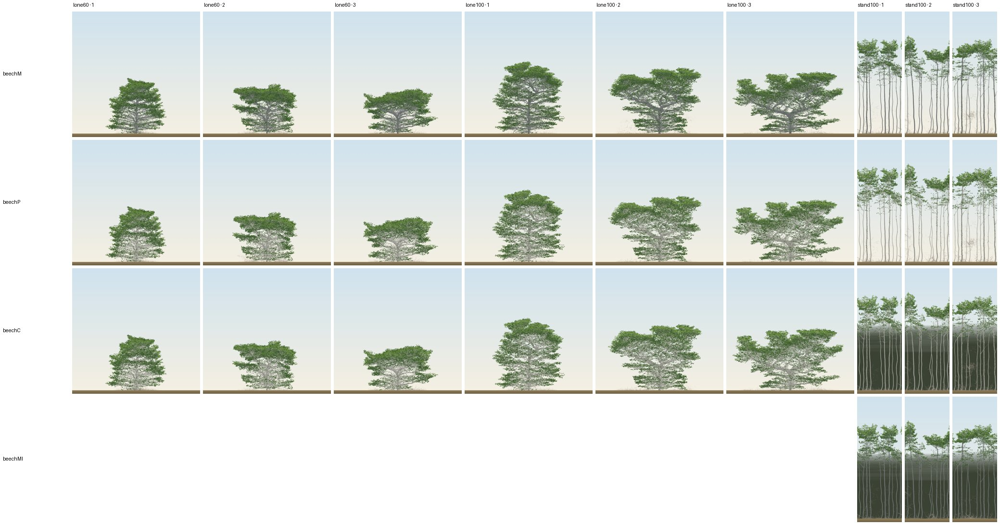
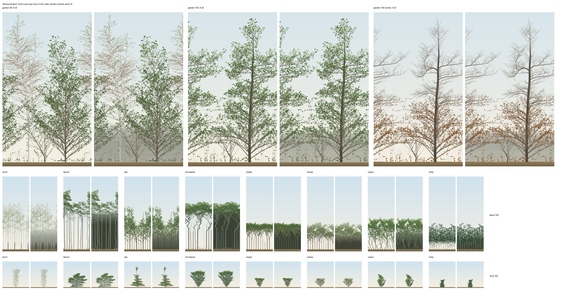

# Stems and bark: the beech stand at one scale (2026-11-03)

The question ([plan](../plans/2026-11-03-stems-bark.md)) was whether a general renderer rule, one
grounded in light or stem form, could make the beech stand read beech, keep the lone beech's
pale-bark read, and cost birch, hornbeam and oak nothing. It is a measurement, not a decision, on
the [blind test v3](2026-11-02-blind-test-v3.md)'s protocol. It is renderer only: no core, species
or preset change, and the goldens are untouched.

**In one line:** nothing passes. Two of the three planned levers were ruled out before any namer
saw them:
- bark by light was ruled out by set 5's measurement;
- bark by girth was ruled out by Pilarski et al. 2008, where limbs are no paler than the trunk;
- root flare was dropped because no source gives its numbers.

The third lever, a closed wood's dim interior drawn between the boles (`&interior`), passed its
gate. On the dev seeds three Sonnet namers still named the beech stand silver birch or aspen on 9
of 9 plates under every condition:
- the measured bark;
- the pale bark;
- either bark with the backdrop;
- girth 1.2 and 1.45.

They name the form ("pale, slender, wavy stems with small crowns"). By track E's rule the judging
seeds 4–6 were not run.



_Rows: beech under HEAD's measured bark (M), the pale grey (P), the pale grey with the backdrop
(C, the candidate), and the measured bark with the backdrop (MI, stands only). Columns: lone 60,
lone 100 and stand 100 at seeds 1–3. Every plate is shrunk by one factor, so the one scale holds._

## Method

- **Build:** `claude/stems-bark` from `3d-port` (3b92271), with the backdrop (9293678).
  - HEAD differs from v3's build: ADR 0044's `r6.lifespan` and the 2026-11-02 hand overrides
    (oak's posture, birch's twigs and others) are in.
  - The default bark is the measured grey (`#777a79`/`#6b6e6e`); `&bark=pale` is the former
    `#a9a8a0`.
- **Plates:** v3's `shots.mjs` with one change: TAG names the condition in the file. One scale
  (`&frame=height`, 2.77 px a cell); lone trees in a 240-wide world at 60 and 100; the closed stand
  at 100 (84 wide, periodic, faces [0, 0], 12 trees).
- **Namers:** general-purpose sub-agents spawned with an explicit `model: "sonnet"`, given v3's
  prompt verbatim ([`prompt-v3.md`](code/2026-11-03-stems-bark/prompt-v3.md)). Each has its own
  shuffle (`shuffle.py`). Baseline and candidates are named **in one set** by the same namers, so
  the set-to-set noise v3 measured (up to 6 of 9) does not enter a comparison.
- **Scoring:** [`tally.py`](code/2026-11-03-stems-bark/tally.py), v3's rule on first guesses. Per
  namer, a source passes at ≥ 2 of 3 seeds in each trial it has; pooled, a seed counts at ≥ 2 of 3
  namers.

## Step 0: what the sources and the gate ruled out

1. **Bark by light** (the brief's (a)) was already tried: set 5, `barklight.mjs`, 83b39db.
   - The field gives the stand's clear boles 0.53 and the lone tree's limbs 0.52, so it cannot tell
     them apart, and `s.light` points the wrong way.
   - An open-grown dome is dark inside, so no light on the stem makes its limbs pale. Not re-run.
2. **Bark by girth** (pale limbs, a darker trunk) was ruled out by the only measurement.
   - Pilarski, Tokarz & Kocurek 2008 (abstract, PJOES) measured 400–700 nm reflectance of 18% on
     1-year stems, 10% on 10-year stems and 15% on trunks.
   - Limbs are not paler than the trunk, so the rule has no support. Not implemented.
3. **Root flare** has no sourced numbers, so it is dropped.
   - Two lookups found stump-to-DBH regressions only for oriental beech (no coefficients in the
     fetched text) and *Quercus frainetto*.
   - They found no butt-swell height.
4. **The backdrop** (`&interior`) passed its gate after one revision.
   - **The rule:** at each height the sky is mixed toward the `--interior` token by how closed that
     row of the wood is. Closure is read from the light on the row's brightest tenth (the field's
     Q/C at the 10th percentile of shade). The row is fully closed at ≤ 10% of open light (the top of
     a closed stand's floor light, spec §10) and open from 20%.
   - **The first form failed:** shade relative to the top row gave the lone plates 0.41–0.50,
     because a lone crown shades the 240-cell field around it.
   - **The §10 thresholds** ([`gate.jsonl`](code/2026-11-03-stems-bark/gate.jsonl)):

| plates | light on the brightest tenth, below the limb crown base | backdrop's alpha there | largest alpha at any height |
|---|---|---|---|
| beech stand 100, seeds 1–3 | 8.2–8.6% | 1.00 | 1.00 |
| hornbeam, oak, birch stands 100, seed 1 | 3.4%, 10.6%, 13.8% | 1.00, 0.94, 0.62 | 1.00, 1.00, 0.90 |
| every lone plate (beech 60 and 100, seeds 1–3; hornbeam, oak, birch 100, seed 1) | 50–60% | 0 | 0 |

## Results

### Dev set D: seeds 1–3, three namers, 66 plates (first guesses naming the source, of 9)

| source | lone 60 | lone 100 | stand 100 | namers passing | pooled |
|---|---|---|---|---|---|
| beech, measured (HEAD's default) | 4 (oak 3) | 2 (oak 7) | **0** (birch 6, aspen 3) | 0 of 3 | fail |
| beech, pale | 6 | 2 (oak 7) | **0** (birch 6, aspen 3) | 0 of 3 | fail |
| beech, pale + backdrop (candidate) | 6 | 2 (oak 7) | **0** (birch 6, aspen 3) | 0 of 3 | fail |
| beech, measured + backdrop | – | – | **0** (birch 6, aspen 3) | 0 of 3 | fail |
| hornbeam / + backdrop | 9 | 6 (wych elm 3) | 6 / 6 (beech 3) | 1 / 2 of 3 | pass / pass |
| oak / + backdrop | 0 (wild cherry 8) | 0 (wild cherry 9) | 0 / 0 (wild cherry 6, alder 3) | 0 | fail |
| birch / + backdrop | 9 | 9 | 9 / 9 | 3 of 3 | pass |

Fleiss' kappa 0.53 (observed 0.61, chance 0.17).
[Decoys' sheet](figures/2026-11-03-stems-bark-decoys.jpg); key and replies in
[`dev/`](code/2026-11-03-stems-bark/dev/).

### Girth set G: stand 100, seeds 1–3, three namers, 36 plates, all under the backdrop

| stand (beech pale) | k 1 | k 1.2 | k 1.45 |
|---|---|---|---|
| beech | 0 (birch 8) | 0 (birch 9) | 0 (birch 8) |
| hornbeam | **0** (beech 8) | 4 (beech 5) | 1 (beech 7) |
| oak | 0 (alder, aspen) | 0 (aspen 4, alder 3) | 0 (alder, aspen) |
| birch | 9 | 9 | 8 |

Fleiss' kappa 0.42 (observed 0.60, chance 0.32). [Sheet](figures/2026-11-03-stems-bark-girth.jpg);
key and replies in [`girth/`](code/2026-11-03-stems-bark/girth/).

**H/D at HEAD** (`diagnose.mjs`, seed 1, k 1):

| stand | H/D | trunk DBH | height |
|---|---|---|---|
| beech | 117 | 30.9 cm | 34.7 m |
| hornbeam | 72 | | |
| oak | 145 | | |
| birch | 199 | | |

At k 1.2 and 1.45 the beech's drawn H/D is 97 and 81, against a real stand's ≈ 73 (Štefančík 2017).
Its limb crown base is at 109 of 139 cells, a crown ratio of 0.21, against 0.47–0.50.

## Reading (measurement, not a decision)

1. **The backdrop does what it was built to do, and the namers don't use it.**
   - Pale boles now stand against a dark interior (the sheet's C row). The lone plates are untouched,
     differing only by sway (1.3% of pixels).
   - The stand's names don't move: birch 6 and aspen 3 under all four conditions. The deciding
     features stay with the form: "slender pale grey stems with small crowns held high on clean
     boles" (D, n3, under the backdrop); "grey wavy trunks with crowns at the top only" (D, n2).
2. **Bark tone moves the lone tree at 60, not at 100.**
   - At 60: pale 6 of 9 against measured 4 (oak 3).
   - At 100: oak 7 of 9 under every bark: "very wide spreading crown with massive horizontal limbs
     and a flat-topped, cloud-like outline" (n3).
   - At 100 the lone beech's failure is its form (W/H 1.5, level limbs), as v3's judging set found.
3. **Girth does not rescue the stand, and the hornbeam stand is noise-bound.**
   - Thicker stems leave the beech stand birch at both k.
   - Hornbeam's own k = 1 plates read hornbeam 6 of 9 in D and 0 of 9 in G. Same plates, other
     namers, and in G no other grey stand to tell it from, so it took the beech name. Its k series
     (0, 4, 1) does not follow k.
   - So nothing here says girth costs hornbeam, or that it helps it.
4. **Oak reads wild cherry**: 0 of 27 lone and stand, wild cherry 23. "Conical tiered form on a
   thin, dark brown trunk" (n1); its stand H/D is 145. Not seen in v3. It is either the hand
   overrides' oak or this namer model; this set cannot tell which.
5. **The namer model:**
   - These namers are Sonnet; v3's inherited its session's model.
   - Under v3's namers the measured bark's stand was beech 9 of 15 at seeds 4–6. Here it is 0 of 9
     at 1–3.
   - The model, the build (`r6.lifespan`, the overrides) and the seeds all changed, so the
     difference cannot be attributed. Within this note every comparison is in-set.
6. **What is left is the core's**, outside this brief: the stand's crown ratio (0.21 against
   0.47–0.50), its slenderness (H/D 117 against ≈ 73) and its wavy boles (Part 2).

## The judging sheet

[`2026-11-03-stems-bark-judging.jpg`](figures/2026-11-03-stems-bark-judging.jpg): the garden at
phone scale (390 × 844, DPR 3, seed 10, 100 seasons) and the eight species' stands at 100, A beside
B. The key: A is HEAD's default; B is `&bark=pale&interior`.



- **The overlay text is cropped off.** `2026-11-02-judging/shots.mjs` puts the overlay text back
  wrongly under a TAG ("undefined"), which would have shown which column is B.
- **The mixed wood is not closed**, so B draws only a light grey haze low down, not the stand's dark
  interior.
- **In winter the haze stays under bare crowns.** The light field is the model's (leaf-on all year),
  and the page's visual season does not reach it. That is wrong for a leafless wood, and the rule
  would need to fade with the deciduous leaf-fall before it could be a default.

## Caveats

- **Three namers per set are one model run three times.** Each saw a whole set in one pass and named
  similar plates alike: the pale and candidate stands, 46% of pixels apart, got identical names.
  That makes in-set comparisons conservative.
- **The namers may receive the repo's CLAUDE.md**, as in v3.
- **The backdrop needs the field.** The garden asks for it only with `?interior`. Its cost on the
  phone (one W × H float array per snapshot) has not been measured.
- **Not done:** seeds 4–6 (track E's rule); leaf-off plates; the phone.

## Reproduce

```
npm run dev                 # here: http://localhost:5174/
S=<scratch>; export PW_FROM=$S/pw/x.js   # playwright-core 1.64.1
node docs/experiments/code/2026-11-03-stems-bark/gate.mjs http://localhost:5174/ > gate.jsonl
docs/experiments/code/2026-11-03-stems-bark/render-set.sh http://localhost:5174/ $S/D
NAMERS=3 python3 docs/experiments/code/2026-11-03-stems-bark/shuffle.py $S/D ~/blind-plates-stems-D docs/experiments/code/2026-11-03-stems-bark/dev
docs/experiments/code/2026-11-03-stems-bark/render-girth.sh http://localhost:5174/ $S/G   # k 1 plates copied from $S/D
NAMERS=3 python3 docs/experiments/code/2026-11-03-stems-bark/shuffle.py $S/G ~/blind-plates-stems-G docs/experiments/code/2026-11-03-stems-bark/girth
python3 docs/experiments/code/2026-11-03-stems-bark/tally.py docs/experiments/code/2026-11-03-stems-bark/dev
node docs/experiments/code/2026-11-02-blind-test-v3/diagnose.mjs http://localhost:5174/ beech:stand100:1 hornbeam:stand100:1 oak:stand100:1 birch:stand100:1
uv run --project analysis python docs/experiments/code/2026-11-03-stems-bark/sheet.py $S/D docs/experiments/figures/2026-11-03-stems-bark-beech.jpg beechM,beechP,beechC,beechMI
SEEDS=10 node docs/experiments/code/2026-11-02-judging/shots.mjs http://localhost:5174 $S/sheet/A garden   # and lab; B with TAG=B VIEW='&bark=pale&interior'
```
