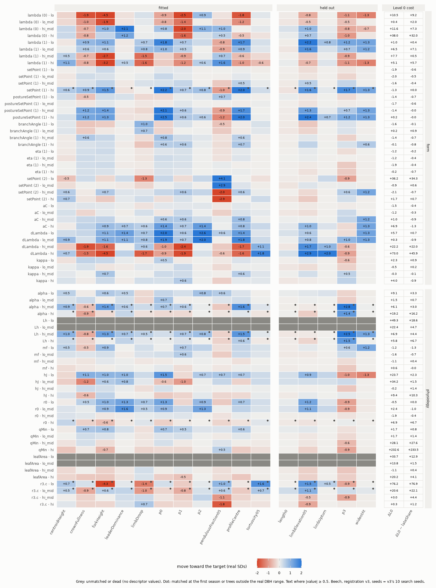

# Level 1 sensitivity: what the knobs can reach (beech, 2026-11-04)

_Reference-fidelity plan §g, phase 3, after pilot v2 (the user, 2026-11-04). A reachability experiment, not a fit:
provisional, and nothing from it is accepted into species params. No core change: nothing under `src/`, `rust/`,
`cli/`, `tests/`._

**The question.** For each Level 1 descriptor, how far can any single knob move it toward the real target, and at
what Level 0 cost? CMA-ES answers this only by failing. A one-at-a-time sweep answers it directly.

**Why now.** The user stopped [pilot v2](2026-11-04-level1-beech-pilot-v2.md) (registration v3, 81b157a) early, with
the checkpoint kept and resumable. The call came on generation 7's status, after 8 of 32 generations: the median had
fallen from 15 to 9 while the best had not moved since generation 0's candidate. That candidate's gain was lateShare
on frozen seeds, and its Level 1 location stood at 2.47 against the hand's 2.60.

## Reproduce
```
uv run --project analysis python -I analysis/experiments/level1_sensitivity.py register   # before any run (committed)
uv run --project analysis python -I analysis/experiments/level1_sensitivity.py run        # 73 conditions → runs/level1-sensitivity/main.jsonl
uv run --project analysis python -I analysis/experiments/level1_sensitivity.py pairs      # the interaction check, by the registered rule
uv run --project analysis python -I analysis/experiments/level1_sensitivity.py envelope   # pilot v2's checkpoint, read-only
uv run --project analysis python -I analysis/experiments/level1_sensitivity.py report     # tables, reach.json, heat maps
```
- **Code:** `analysis/experiments/level1_sensitivity.py`. It measures with the fit's own `Measure`
  (`treesim/fit_level1.py`) and scores with `level1.py`.
- **Tests:** `analysis/tests/test_level1_sensitivity.py`.
- **Registration:** `docs/experiments/fits/level1-sensitivity/registration.json`, committed before any simulated tree
  (hashes of the measurement files, v3's registration, the targets file, the Level 0 fit and the script).

## The registration (written before the run)
**Targets.** v3's real distributions (`analysis/fit/sources/level1-beech.json`), real data only, unchanged. All 16 tier
A/B descriptors are measured, the five held out among them.
- **Why the held-out ones are measured:** this is a reachability experiment, not a fit.
- **What does not change:** the v3 hold-out rule, and any future fit's hold-outs. The only other script that writes
  held-out values is the gate.

**Knobs: 18, in two families,** each swept alone with the others at the hand:
- **form (10):** ADR 0029's form knobs, at the bounds of `[[formRange]]`; eta is on a log scale.
- **physiology (8):** Level 0's seven, at the bounds of `[[param]]` (Lh, hJ and qMin on a log scale), and r3.c
  (0.01–0.3, log). Level 0 froze r3.c, so it counts here as an eighth physiology knob (the user).

**The hand:** the v3 registration's `start` plus `fixed`, verbatim. That is Level 0's v2 fit, with postureSetPoint
explicit at 34.32 as in v3's knob space.

**Five points per knob** on its registered scale, in the unit coordinate u of `fit.encode`: 0, u_h/2, u_h,
(u_h+1)/2 and 1, where u_h is the hand's position. Each is decoded by `fit.decode`, which rounds to 4 significant
figures. That makes 18 × 4 + 1 = 73 conditions.
- **The grid is lopsided where the hand sits near a bound** (u_h in brackets): kappa (0.108), dLambda (0.115),
  setPoint and postureSetPoint (0.205), c3.alpha (0.232), leafArea (0.708), eta (0.812), hJ (0.847).
  - **What that means:** two close points on one side, two far ones on the other.
  - **A response that turns over between the far points** is invisible (below).

**Seeds:** v3's 10 search seeds (7191, 2325, 9999, 2831, 4712, 8068, 9165, 2863, 2488, 5615), the same for every
condition. Pilot v2 grew every candidate on them, so the hand's baseline is `hand-search-seeds.json` (6.676).

**Measured per condition:** the stand at its size-matched season, by the coarsened-simulation rule. Recorded:
- the matched season, the median DBH, the tree count and the flags;
- each descriptor's z (the median of the detrended trees against the real median, in real SDs) and its spread s
  (log2 of the simulated SD over the real SD);
- every Level 0 term (the lone, stand150 and shade trials).

**The rules.** Reporting conventions, not gates, fixed in `registration.json` before the run.
- **The unit:** Δz = z_cond − z_hand, in real between-tree SDs.
  - **Its SE:** a paired bootstrap over the 10 seeds, 2,000 resamples at numpy seed 20261109, with the same draw for
    every condition.
  - **What the bootstrap recomputes:** the medians and the Level 0 sum. The matched season is held.
- **The move toward the target:** m = −sign(z_hand)·Δz, and the fraction of the gap closed is f = m/|z_hand|.
  - **f ≥ 1 is reported as a bracket:** the target is crossed between two adjacent grid points, with ΔL0 given as the
    range at those two points.
  - **Why a bracket:** a bound may be a regime change, so continuity is not assumed.
  - **Beside f:** its bootstrap 5th percentile.
- **The cost:** ΔL0 = the condition's Level 0 sum minus the hand's. The sum is the loss less the fitted location
  terms: the scored traits and the death penalties, at Level 0's weights.
  - **Beside it:** ΔL0 without lateShare, and the bootstrap SE of each.
- **Reachability per descriptor:** the largest single-knob f and the ΔL0 of that move. The verdicts:
  - **"at target within noise"** if |z_hand| < 2·SE(z_hand);
  - **"unreachable by single-knob moves"** if no condition has f > 0.5;
  - **"reachable at cost"** if the closing move raises Level 0 by more than 2. The closing move is the cheapest
    condition with f > 0.5; the largest move's cost is reported beside it.
- **Unmatched or dead conditions** contribute no descriptor values; they are counted and greyed in the heat map.
  Cells of a condition flagged "matched at the first season" or "trees outside the real DBH range" are marked.
- **Spread:** for each descriptor, the largest single-knob rise of s toward 0, and whether any condition brings it
  within ×2 (|s| ≤ 1).
- **The interaction check.** A one-at-a-time sweep misses interactions, so one check follows the main sweep:
  - **Which descriptors:** the three with the largest remaining gap, max(0, |z_hand| − m_best), held out included,
    excluding any at target within noise.
  - **Which knobs:** each descriptor's top three single-knob movers. v* is a knob's best grid value; v½ is halfway
    from the hand to v* on its scale.
  - **The conditions:** for each of the three pairs, (v*_A, v*_B), (v*_A, v½_B) and (v½_A, v*_B). That is up to 9
    per descriptor, at the same 10 seeds.
  - **Reported:** the best pair's f and ΔL0, and its departure from additivity where both singles were grid points.
- **The joint-move envelope:** a free lower bound on joint reachability. Pilot v2's 120 candidates grew on the same
  10 seeds with joint moves of the ten form knobs.
  - **Reported per fitted descriptor:** the best f, that candidate's ΔL0, and its spread, flagged when s < −1.
  - **Held-out descriptors have no pilot data.**
- **The three-source verdict:** "needs a rule rather than a knob" only where the single-knob sweep, the pair check
  (where run) and the envelope (fitted only) all fall short of f = 0.5. Otherwise:
  - "reached by a single knob";
  - "reached jointly", naming the source;
  - "not reached by the knobs tested; joint moves untested", where no joint evidence exists.
- **What is not covered:**
  - interactions outside the top-three pairs;
  - compensated reach across the physiology × form families: a move stopped by a regime boundary that a second knob
    lifts;
  - a response that turns over between the far grid points of a lopsided knob.

**ADR → evidence (fixed before the run):**

| ADR item | its evidence |
|---|---|
| 0052, limb loss / crown retreat | centroidHeight, p0, p1, profileCentre, crownFullness, widestAt (held out); Level 0's talloCR and lai beside them |
| tip upturn and tortuosity | limbUpturn (held out), tortuosity05, limbElevation05 (held out), pendulousFraction05, limbDroop |
| individual variation | the spread of all 16, chiefly leaderDominance, centroidHeight, limbDroop, tortuosity05 and limbUpturn |
| the trunk increment (ADR 0050 option C) | the matched season and DBH per condition; leaderDominance, forkHeight and length0; talloH, height, height100 |

An item ranks higher the more of its evidence is "needs a rule", the larger the gap that remains, and the more a
partial reach costs Level 0.

**The advisor's check of the design (once, at the plan; the user's two questions):**
1. **Is the five-point sweep on each knob's scale the right design?** Yes, for a reachability screen, since the
   bounds are what answer "how far". It is weak as a slope estimate, and it is lopsided for the knobs listed above.
   Applied: the bracket rule in place of continuity, u_h recorded, and unmatched and flagged cells registered.
2. **Can the rule call a descriptor unreachable when only an interaction reaches it?** The label "by single-knob
   moves" is safe by construction; the inference "needs a rule" is not. Applied: the pilot v2 envelope, the
   three-source verdict, and the statement of what the pair check does not cover.
3. **Also applied:** ΔL0 without lateShare, with bootstrap SEs, since lateShare's noise is of the order of the
   2-point threshold; the ADR → evidence table fixed now; a test that the hand round-trips through the encoding.

**Before the registration:** a smoke run (the hand at one seed) and a mini run (4 conditions × 3 seeds, in a
scratch folder) exercised every subcommand. Neither is kept.

## The run
- **Main sweep:** 73 conditions, 730 evaluations, 21:25–22:41 UTC from 9e304db, on 12 workers, ≈ 750 s per batch
  of 12. The log is `runs/level1-sensitivity/main.log`.
- **Determinism:** the hand reproduces `hand-search-seeds.json` exactly: 6.676, Level 1 location 2.604, Level 0
  4.072, every term identical.
- **Unmatched (4):** Lh at lo and lo_mid, and leafArea at lo and lo_mid (lo_mid matches at season 110, outside
  the dump window).
- **Matched at the first season (flagged, 8):** setPoint (1) at hi; c3.alpha at hi_mid and hi; Lh at hi_mid and
  hi; r0 at hi; r3.c at lo and lo_mid.
- **The matched season** runs 50–110 across conditions; the hand's is 70.
- **The pair checks:** the registered one (27 conditions, 22:42–23:15) and the cost-aware supplement (18 conditions,
  23:15–23:34).

**Changed after the registration (reported only; no registered rule or threshold changed):**
1. **The cost-aware pair check** (the user's call, mid-run). The registered remaining gap, max(0, |z_hand| −
   m_best), reads the largest move at any cost. Some knob crosses every target at some cost, often by wrecking the
   tree (dLambda at 0.12 costs ΔL0 +73). So only centroidHeight kept a gap (0.06), and crownFullness and
   leaderDominance filled the other two slots on a name-order tie at 0.
   - **The supplement:** the same rule, with the gap and the top movers taken over moves with ΔL0 ≤ 2. It picked
     tortuosity05 (gap 0.80), limbUpturn (0.49) and centroidHeight (0.24). `pairs --cost` →
     `fits/level1-sensitivity/pairs-cost.csv`.
2. **The pair dedupe made order-free,** to match the registered text ("identical conditions are measured once").
   The registered run had no order duplicates.
3. **Columns added beside the registered ones:**
   - the envelope's cheapest closing candidate;
   - the cheapest closing spread move at ΔL0 ≤ 2;
   - an "affordable" verdict, with every source held to ΔL0 ≤ 2.
4. **A faster bootstrap:** the per-seed dicts are filtered to the keys `fit.contributions` reads. The sums are
   identical, checked on the hand (4.0717).

**The cost is noisy, as the advisor warned.** ΔL0's bootstrap SE is 2–4 on most conditions, mostly lateShare
(below). The registered cost of 2 therefore sits within about one SE. Where a verdict turns on it, ΔL0 without
lateShare is given beside it.

## The heat map


How to read it:
- **Cells:** blue moves a descriptor toward its target, red away from it, in real between-tree SDs, clipped at ±2.
- **Grey:** unmatched.
- **Dots:** flagged ("matched at the first season").
- **Right-hand columns:** ΔL0, and ΔL0 without lateShare.
- **The data:** `fits/level1-sensitivity/conditions.csv` (long: condition × descriptor, with Δz, its SE, m, f, f's
  5th percentile, s and ΔL0 with SEs) and `conditions-level0.csv` (every Level 0 term).

The spread panel (`figures/2026-11-04-level1-sensitivity-spread.png`) shows the rise of s toward 0 in the same layout.

## Reachability, per descriptor (the registered rule)
| descriptor | z_hand (SE) | the best single move: f, ΔL0 | the cheapest move with f > 0.5 (ΔL0 ≤ 2) | verdict |
|---|---|---|---|---|
| p0 | −1.44 (0.20) | postureSetPoint (1) 90: 1.72, +0.2 (crosses between 34 and 62) | the same | reachable |
| limbUpturn (h) | −1.26 (0.01) | dLambda 0.12: 1.56, +73 | λ (1) 0.48: 0.61 (5% 0.47), +1.0 | reachable, partly (below) |
| tortuosity05 | −1.16 (0.05) | dLambda 0.12: 1.60, +73 (crosses between 0.067 and 0.12, ΔL0 +22 to +73) | none: the best is setPoint (2) 160, 0.31, +1.7 | **reachable at cost** |
| centroidHeight | +1.14 (0.12) | λ (1) 0.58: 0.95, +5.1 | dLambda 0.0069: 0.79 (5% 0.50), +0.3 | reachable |
| profileCentre | +0.95 (0.22) | setPoint (1) 90: 2.12, −1.3 (flagged) | the same | reachable |
| limbElevation05 (h) | +0.88 (0.03) | dLambda 0.12: 3.32, +73 | postureSetPoint (1) 90: 2.73, +0.2 | reachable |
| crownFullness | −0.68 (0.18) | postureSetPoint (1) 90: 1.81, +0.2 | the same | reachable |
| pendulousFraction05 | +0.60 (0.08) | setPoint (2) 40: 6.80, +36 | setPoint (2) 67: 4.75, −0.9 | reachable |
| p1 | −0.43 (0.20) | setPoint (1) 90: 1.54, −1.3 (flagged) | the same | reachable |
| leaderDominance | −0.40 (0.05) | λ (0) 0.565: 5.31, +11.6 | r0 0.001875: 3.25, −0.5 | reachable |
| length0 (h) | −0.30 (0.04) | r3.c 0.022: 1.06, +20.6 (flagged) | none at ΔL0 ≤ 2; r0 0.0033: 0.64, +2.4 ± 3.8 (−1.0 without lateShare) | reachable at cost (a lateShare reading) |
| p2 | +0.27 (0.12) | dLambda 0: 9.67, +5.7 | dLambda 0.0069: 7.45, +0.3 | reachable |
| p3 (h) | +0.23 (0.24) | — | — | at target within noise |
| forkHeight | −0.18 (0.33) | — | — | at target within noise |
| widestAt (h) | +0.21 (0.17) | — | — | at target within noise |
| limbDroop | −0.13 (0.07) | — | — | at target within noise |

**No descriptor is unreachable by single-knob moves.** At some cost, some single knob closes more than half of
every gap. The rule's other verdict is the informative one:
- **tortuosity05** is reached only by dLambda at 0.067–0.12 (ΔL0 +22 to +73) and r3.c at 0.01–0.022 (+21 to +76).
  Those are trees that fail Level 0. The best affordable move closes 31%.
- **length0** is "at cost" only through lateShare: without it, r0 at 0.0033 closes 64% at ΔL0 −1.0.

**The crown's outline is cheap to reach, by posture.** postureSetPoint (1) at its upper bound overshoots on p0,
crownFullness, limbElevation05 and widestAt at ΔL0 +0.2; the target lies between 34° and 62°. setPoint (1) does the
same for profileCentre and p1, but matches at season 50.

**The direction of the outline gap:** the simulated crown is narrow at its base (p0 −1.44, crownFullness −0.68) and
carries its wood high (centroidHeight +1.14, profileCentre +0.95). Raising the crown base would not close that.

## Spread (s = log2 of the simulated SD over the real SD; ×2 is |s| ≤ 1)
| descriptor | the hand | conditions within ×2 (any cost / ΔL0 ≤ 2) | the best affordable move |
|---|---|---|---|
| leaderDominance | 0.26× | 13 / 5 | **r0 0.001875: 1.00×, ΔL0 −0.5** |
| limbUpturn (h) | 0.32× | **2 / 0** | mf 0.106: 0.46× (only dLambda at ΔL0 ≥ +22 reaches ×2) |
| centroidHeight | 0.45× | 40 / 22 | mf 0.02: 0.80× |
| limbDroop | 0.49× | 32 / 18 | r3.c 0.30: 0.97×, +0.3 |
| tortuosity05 | 0.51× | 11 / 4 | mf 0.02: 0.66× |
| the other 11 | 0.67–1.24× | 28–68 / 16–39 | — |

- **limbUpturn's spread is the one that no affordable single knob reaches.** It is also the descriptor whose median
  sits pinned near 0°.
- **leaderDominance's spread was a knob, not a rule.** The pipe radius r0 at its lower bound restores it at no
  Level 0 cost. That is a Level 0 knob, frozen in v3.

## The interaction check
**Registered: degenerate** (above).
- **centroidHeight:** the best pair, λ (1) 0.546 + dLambda 0.0069, closes 109% at ΔL0 +3.5 (additivity +0.19). The
  single move dLambda 0.0069 is cheaper.
- **crownFullness and leaderDominance** were already reachable. Their best pairs (f 1.49 at −0.9; f 6.11 at +12.7)
  add nothing.

**The cost-aware supplement (added after the registration):**

| descriptor | its top three affordable movers | the best pair at ΔL0 ≤ 2: f, ΔL0, additivity | the best pair at any cost |
|---|---|---|---|
| tortuosity05 | setPoint (2), dLambda, setPoint (1) | setPoint (2) 160 + setPoint (1) 90: **0.33**, −1.6, −0.30 | dLambda 0.0069 + setPoint (1) 62: 0.38, +15 |
| limbUpturn (h) | λ (1), postureSetPoint (1), r0 | λ (1) 0.48 + postureSetPoint (1) 90: **0.69**, +1.9, −0.65 | the same |
| centroidHeight | dLambda, setPoint (2) | setPoint (2) 127 + dLambda 0.0069: **1.05**, +1.7, +0.31 | dLambda 0.0069 + setPoint (1) 90: 1.12, +8.1 |

- **The pairs are sub-additive** on tortuosity05 and limbUpturn: two moves together close less than their sum.
- **No affordable pair reaches tortuosity05.**

**The pilot v2 envelope** (joint moves of the ten form knobs, fitted descriptors only; `envelope.json`):
- **Every fitted descriptor reaches f > 0.5 in some candidate.** The cheapest closers are mostly generation 8's best,
  whose spread collapsed (6 of 11 fitted descriptors below 0.5×).
- **For tortuosity05,** the cheapest closer is one candidate (generation 4): f 0.60, ΔL0 +1.0 (+1.7 without
  lateShare), its own spread 0.24× (s −2.08), 5 fitted descriptors below 0.5×, matched at season 50. It is the best
  of 120 on the same seeds, selected from them, so it is not a measurement of reach.

## The verdicts (three sources)
**Registered:**
- 12 descriptors are "reached by a single knob" (2 of them "at cost": tortuosity05 and length0).
- 4 are "at target within noise".
- None "needs a rule".

**The affordable verdict (every source at ΔL0 ≤ 2; reported only):**

| descriptor | affordable verdict |
|---|---|
| **tortuosity05** | **affordable jointly only through the pilot envelope**: one selected candidate at f 0.60 with collapsed spread. No single knob (0.31) and no pair (0.33) reaches it. Read as **a rule's case**. |
| **limbUpturn (h)** | affordable by a single knob, partly: f 0.61, its 5% bound 0.47; the pair 0.69. Its spread is not affordable (0.46× at best). |
| length0 (h) | not affordable by the knobs tested (joint moves untested), but only through lateShare: r0 0.0033, 64%, −1.0 without lateShare |
| the other 9 with a gap | affordable by a single knob |

**Which descriptors need a rule rather than a knob:**
- **tortuosity05**, on its median;
- **limbUpturn**, on its spread, and partly on its median.

Nothing else. The outline, centroidHeight, pendulousFraction05 and leaderDominance (its spread included) are within
the knobs' reach. Their gaps are a search problem, not a model problem: the fit froze r0 and searched noisy
lateShare.

## The ADR list, ordered by this evidence (proposed)
1. **Tip upturn and tortuosity (first).**
   - tortuosity05 is the hand's largest location term (0.95 of 2.60) and the one descriptor no affordable move
     reaches.
   - limbUpturn's median closes at most 61–69% of its gap, and its spread at most 0.46×.
   - Both are about what a shoot does along its length (gravitropic set point, bending, tip reorientation). No knob
     shapes that without wrecking the tree: dLambda at 0.067–0.12 straightens and tilts at ΔL0 +22 to +73.
2. **Individual variation (second, narrowed).**
   - Of the four descriptors below 0.5× real spread, leaderDominance (r0), limbDroop (r3.c) and centroidHeight (mf,
     22 affordable conditions) reach ×2 by a single affordable knob.
   - limbUpturn does not. The rule's case is therefore limb tips varying between trees, so it may fold into item 1.
3. **The trunk increment (ADR 0050 option C; third).**
   - length0 (held out) moves only through the girth knobs, r3.c and r0.
   - Most of the physiology bounds shift the size match: 4 unmatched, 8 flagged at the first season, the matched
     season 50–110.
   - The descriptors are read at a matched DBH, so a trunk increment that matched size at the right age would
     change which season every descriptor is read at.
   - This is evidence that girth confounds Level 1, not that a rule is missing.
4. **0052, limb loss / crown retreat (last, on Level 1's evidence).**
   - The outline gaps are reachable at almost no cost by posture (postureSetPoint (1)) and by dLambda.
   - Their direction (a narrow base, wood carried high) is not one that raising the crown base closes.
   - Its case rests on Level 0 (CR, LAI, Weiser's crown base/H), not on Level 1.

## For the next registration: lateShare is a noisy Level 0 term that a Level 1 fit can exploit on fixed seeds
- **What it is:** stand height at 100 over height at 60; target 1.43, band 0.06 (NW-FVA beech classes 1–2).
- **The hand's ten seeds:** 1.20–1.63, per-seed SD 0.137, more than twice the band. The 10-seed mean's SE (≈ 0.043) is
  0.7 of a band.
- **The hand's lateShare term:** 1.53, with a bootstrap SE over seeds of 1.74.
- **Across the 40 form-knob conditions,** ΔlateShare has a median of −0.64, and 12 of 40 fall below −1, down to
  −1.53: the whole term, on knobs that shape limbs. Pilot v2's generation-0 best (5.14, "unmoved" for seven
  generations) took its gain this way: lateShare 1.53 → 0.00 on the frozen seeds.
- **The same noise sets ΔL0's SE (2–4).** It decides "at cost" for length0, and it decides which condition is
  "cheapest".
- **Options for v4** (the user's to choose): score lateShare with its band widened by the seeds' SE, √(0.06² +
  0.043²) ≈ 0.074; average it over more seeds than the Level 1 terms; or freeze it at the hand's value in a fit
  whose Level 0 knobs are frozen. Its noise floor must be measured with the chosen form before the seed rule is
  applied, as the spread-penalty note already requires.

## Limits
- **One knob at a time,** apart from the pair checks: interactions outside the top-three pairs are untested,
  including physiology × form compensation.
- **The lopsided knobs** (kappa, dLambda, setPoint, postureSetPoint, c3.alpha, leafArea, eta, hJ) have two far
  grid points, so a response that turns over between them is invisible. dLambda's turns over: from 0.0069 to
  0.067 it moves from cheap and helpful to costly.
- **Point estimates on 10 seeds.** Δz's paired SE is in `conditions.csv`. The 50% convention is applied to the
  point estimate, with f's 5th percentile beside it (limbUpturn's single move: 0.47).
- **Held-out descriptors were measured** (a reachability experiment); the v3 hold-out rule is unaffected. Anything
  this note says about length0, limbElevation05, limbUpturn, p3 and widestAt has seen them.
- **Provisional:** nothing here is accepted, and nothing changes species params.
