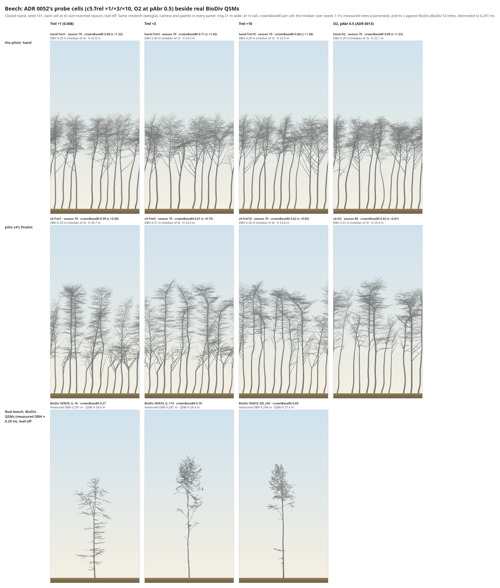

# Crown base and bole: crownBase80 and trunkTortuosity05, the trunk's sinuosity, ADR 0052's probe (2026-11-05)

_Reference-fidelity plan §g, phase 3 (the user, 2026-11-05, after the render in
[pilot v3's note](2026-11-05-level1-beech-pilot-v3.md#what-the-fit-looks-like-render-2026-11-05)). Provisional; nothing
accepted. No core change: nothing under `src/`, `rust/`, `cli/`, `tests/`._

## The expectation, written before any new descriptor was read (sign check)
Written from the render alone (`figures/2026-11-05-beech-hand-vs-fit.png`), before describe() ran on any tree:
- **crownBase80:** real (BioDiv, DBH ≈ 0.29 m) high, a clear bole over the lower ≈ 60–70% (crownBase80 ≈ 0.6–0.7).
  Pilot v3's and v4's fits **lower** than real (crowns start low); the hand **nearer** real, perhaps above it.
- **trunkTortuosity05:** real near 1 (straight boles); every simulated stand trunk **above** real (they snake), the
  hand and both fits alike.
- **Against it, from the existing descriptors:** centroidHeight sits *above* real (hand +1.18, v4 +0.79) and p0
  below (−1.17, −0.48): the simulated wood is carried *higher* than the real. If crownBase80 reads the fits as high,
  the instrument contradicts the picture, and that is the finding (dead stubs on the real boles, or three
  hand-picked QSMs against 53).

**What happened to it** (written after the readings, below): the fits' crowns *are* lower than the hand's, as the
render shows, but every simulated stand's crownBase80 is **above** BioDiv's, the hand's by 1.3 SD. trunkTortuosity05
reads the simulated boles as straight as the real (z ≈ 0). The instrument contradicts the reading of the picture on
both counts; the [contact sheet](#the-contact-sheet-does-crownbase80-agree-with-the-picture) says why.

## Findings
1. **crownBase80 passes gate c at tier A** (v3.2: v3.1's rules, d_min frozen): 19 of 20 seeds within tolerance at
   every point, control neutral at d_min (1.00 of BioDiv's trees). Its 70% and 90% companions pass alike.
   **trunkTortuosity05 is held out (noise):** BioDiv's repeats differ by 0.75 of its between-tree SD, so it cannot be a
   Level 1 descriptor, fitted or held out.
2. **The simulated crown base is too high, not too low.** On 101–110, z of crownBase80 against BioDiv (median 0.50 of
   H detrended to 0.291 m, SD 0.138): **hand +1.31 (spread 0.40×), v3 +0.94 (0.67×), v4 +1.03 (0.65×)**, the shipped
   beech +1.41 (0.37×). The fits are 0.04–0.05 of H lower than the hand: the render's direction, at a third of the gap.
3. **crownBase80 is nearly centroidHeight** on the real trees (r 0.95 detrended; 0.96 raw). It adds little the loss
   does not already read, and centroidHeight already scores the simulated wood as high (+0.74 to +1.18).
4. **The simulated boles do sway more than the real**, which path over chord cannot see (a sine of amplitude A over
   wavelength λ reads 1 + (πA/λ)²). A diagnostic, the trunk's largest distance from its chord up to crownBase80 over
   that stretch's length: **real 0.019** (IQR 0.015–0.024); **hand 0.024, v3 0.031, v4 0.036**.
5. **The sway's largest probed source is beech's trunk set point** (r2.levels.0.setPoint 40°, Troll's model): at ×0 the
   hand's stand sway falls 30% (0.034 → 0.024 on seeds 1–5), at a Level 0 cost (stand deaths; loss 4.45 → 19.9).
   Phototropism straightens the bole rather than bends it (ξ 0: 0.052). The rest is unprobed (C4's direction noise).
6. **ADR 0052's probe: more limb loss raises crownBase80, away from the real.** c5.Trel ×3 and ×10 and O2 at pAbr 0.5
   leave the hand's crownBase80 at z +1.28 to +1.45 and move v4's from +0.58 to +0.75–0.85. LAI stays within one band
   (z +0.39 to +1.17) and z_CR under 1 throughout. **Judged against crownBase80, beech has no case for a limb-loss
   rule.** ADR 0052's case, if any, is oak's CR (ADR 0051), not beech's crown base.
7. **The contact sheet:** crownBase80 agrees with the picture panel by panel. What the eye reads as "real crowns are
   higher" is two of three hand-picked QSMs (0.70, 0.69; the third 0.27) against a stand of wide, dense crowns. The
   difference left is crown **width and density** and the bole's sway, not crown base.

## The descriptors (`analysis/treesim/describe.py`)
- **crownBase80:** the height above the root's base, over H, above which 80% of the non-trunk wood length
  (order ≥ 1) lies; each cylinder's length spread evenly over its z-extent (a level cylinder is a point). **80% is a
  convention**; crownBase70 and crownBase90 are read beside it. On the simulator it is read after coarsening (v5's
  `sim_rule`: inflate, prune at 8.6 mm).
- **trunkTortuosity05:** the trunk's path (its continuation chain) from the root to where it first reaches
  crownBase80's height, resampled at 0.5 m, over its chord; NaN under 2.5 m.
- **Diagnostics** (`DIAGNOSTIC`, not descriptors): trunkTortuosity1 (a 1 m step), trunkStretch (m), stubShareBelow
  (of the non-trunk length below crownBase80, the share on order-1 axes that carry no branch). The sway diagnostic is in
  `crownbase_sim.py`, not describe.py, whose hash v3.2 registered.
- **Tests:** eight on synthetic trees in `analysis/tests/test_describe.py`: the analytic quantile of level limbs and a
  sloping one; one stub moves crownBase80 by its share while `crownBase` jumps 11 → 2 m; eight stubs pull it to the
  computed 5 m; pruned top twigs; straight trunk 1.0; a metres-scale zigzag's exact ratio at 0.5 m and 1 m; a
  shoot-scale zigzag mostly dropped at 0.5 m; the NaN rules.
- **Bit-identity (the user's addition 1):** the 16 registered descriptors on all 465 tables (the 20 gate-c dumps, fine
  and coarsened at d_min, and BioDiv's 265 repeats), before and after the edit: **7,440 values, 0 differ**
  (`analysis/experiments/crownbase_bit_identity.py`, float.hex).

## Robustness to QSM artefacts (the advisor, at the plan)
| check | real (BioDiv, 53) | simulated (101–110) | reading |
|---|---|---|---|
| stub share below crownBase80 | 0.017 (IQR 0.009–0.050) | 0.006–0.009 (shipped 0.023) | the real bole carries more unbranched limbs, but ≤ 5% of the low length: dead stubs bias the real side low by little |
| crownBase80 − crownBase90 (a low tail) | 0.074 | 0.05–0.10 | similar; no long low tail on either side |
| forkHeight below crownBase80 | 13% of trees | 3–19% | the trunk path rarely includes a fork's kink |
| r with forkHeight, centroidHeight, p0 | detrended: under 0.27, **+0.95**, −0.32 (raw −0.37, +0.96, −0.44) | — | crownBase80 joins centroidHeight's cluster |
| resolution (gate c tiers) | — | shift 0.0035 of H at the worst point, tolerance 0.069 | missing twigs move it little, unlike length1–3 |
| trunk stretch | 14.2 m | 13.9–15.6 m (shipped 26.2) | a lower crown reads a shorter stretch; sway is normalised by it |
| trunkTortuosity05 at 1 m against 0.5 m | 1.003 against 1.006 | 1.005–1.007 against 1.006–1.008 | at both steps near 1: the bole's bends are gentle on both sides |
| trunkTortuosity05's floor | repeats' SD / between-tree SD 0.75 | — | segmentation noise exceeds the signal: held out |

## Gate c v3.2 (`analysis/fit/sources/phase1-tolerances-v3.2.json`; `analysis/experiments/gate_c_v32.py`)
**Registered from real QSMs only, before any simulated tree was read; a supplement: `phase1-tolerances.json` (v3.1) is
untouched.**
- **d_min frozen** at v3.1's (BioDiv p2, 8.6 mm; upper end p5, 11.0 mm). A full rerun could re-choose d_min over a
  larger descriptor set (`control.DESCRIPTORS` 0.9 of descriptors neutral); reported instead: d_min's rule holds with
  the new descriptors as without.
- **Self-checks:** all 84 v3.1 table rows reproduce on 8 keys exactly; the control path's shares at d_min reproduce
  `runs/phase1/control-grid.csv` on all 28 beech descriptors.
- **Simulated side:** v3.1's own dumps (beech's Level 0 fit, season 70, seeds 1–20, `runs/gate-c/trees`).

| descriptor | tier | shift | tolerance | floor ratio | control at d_min / upper | seeds within (A: d_min, upper, inflated) | verdict |
|---|---|---|---|---|---|---|---|
| crownBase80 | A | 0.0035 | 0.0688 | 0.080 | 1.00 / 0.91 | 19, 19, 20 | tier A |
| crownBase70 | A | 0.0039 | 0.0638 | 0.089 | 1.00 / 0.92 | 19, 19, 20 | tier A |
| crownBase90 | A | 0.0042 | 0.0838 | 0.053 | 1.00 / 0.96 | 19, 19, 20 | tier A |
| trunkTortuosity05 | – | – | 0.0237 | **0.747** | 0.98 / 0.92 | – | held out (noise) |

**Real distributions** (BioDiv, median over repeats, detrended on ln DBH to 0.291 m; `fits/crown-base/ztable.json`):
crownBase80 0.500 (SD 0.138), crownBase70 0.585 (0.128), crownBase90 0.392 (0.168), trunkTortuosity05 1.009 (0.047).

**z (spread ratio) on 101–110, each set at its size-matched season (70 for all four):**
| descriptor | shipped | hand | v3 finalist | v4 finalist |
|---|---|---|---|---|
| crownBase80 | +1.41 (0.37) | **+1.31 (0.40)** | **+0.94 (0.67)** | **+1.03 (0.65)** |
| crownBase70 | +1.21 (0.34) | +1.03 (0.40) | +0.71 (0.71) | +0.84 (0.64) |
| crownBase90 | +1.44 (0.35) | +1.39 (0.42) | +1.09 (0.58) | +1.04 (0.46) |
| trunkTortuosity05 (reported) | −0.09 (0.86) | −0.08 (0.19) | −0.07 (0.21) | −0.02 (0.64) |
| centroidHeight (v5's, as a check) | +1.42 (0.37) | +1.18 (0.49) | +0.74 (0.67) | +0.79 (0.57) |

The hand's and v4's centroidHeight, p0 and tortuosity05 reproduce pilot v4's note to the second decimal: the pipeline
reads what the pilots read. "Hand" is the pilots' hand (`hand.assign`: Level 0's fit with the hand form); "shipped" is
the shipped beech with no assign, which the earlier render labelled "hand".

**Weiser (reported only; `crownbase_weiser.py`, summary statistics, CC-BY-SA):** 290 beech carry a field inventory
record (FI; the audit's 395 counted every source). In BioDiv's DBH range (34 trees), field crown base over height is
**0.072** (IQR 0.033–0.114); at 0.25–0.35 m (10), 0.062. The green and plain crown bases are equal in this set.
BioDiv's crownBase80 is 0.53 raw (0.58 at 0.25–0.35 m). The two do not measure one thing: Weiser's is a field reading
of the first live branch in two multi-layered mixed stands, not a length quantile of wood.

## The trunk's sinuosity
**The rules that turn the leader** (beech's values):
- **Troll's set point:** for the trunk (pa 0) `direction_params` (`rust/core/src/principles/r2.rs:377–389`) gives each
  new leader shoot `levels[0].setPoint` 40° with η 0.4, and `set_point_direction` (`c4.rs:22–30`) aims it 40° off
  vertical *on the side the leader already leans*: a lean feeds itself. R3's posture (`r3.rs:211–254`, postureSetPoint
  0, c 0.049) straightens the older wood behind it; R5 scales the set point toward vertical under shade
  (`season.rs:488, 535–537`; dA 0.5).
- **Phototropism:** C4's ξ 0.3 × the light direction (`c4.rs:46–54`; world-level).
- **Direction noise:** C4's ε 0.5, σ 20° (`season.rs:506–510`, `rng::DIRECTION_NOISE`).
- **Relay** (`r2.rs:290–305`, from 15) and light orthotropy (`r2.rs:248–276`, exempts pa < 1).

**The probe (registered: the set point at ×1, ×0.5, ×0 at the hand, seeds 1–5; `crownbase_probes.py sinuosity`):**
| setPoint (0) | season | sway / stretch | sway (m) | trunkTortuosity05 | crownBase80 z | Level 0 loss | its largest terms |
|---|---|---|---|---|---|---|---|
| 40° (×1) | 70 | 0.034 | 0.50 | 1.0086 | +1.32 | 4.45 | lateShare 1.41, LAI 1.37 |
| 20° (×0.5) | 70 | 0.029 | 0.45 | 1.0059 | +1.44 | 3.60 | lateShare 1.41, talloCR 0.89 |
| 0° (×0) | 80 | 0.024 | 0.41 | 1.0039 | +1.40 | 19.93 | death.stand 12.5, lateShare 4.17 |

- **Added after the registered probe** (its own run showed lone trunks sway 0.12 m against the stand's 0.50; read
  per metre of stretch that difference mostly goes: 0.026 against 0.034): C4's ξ at ×1, ×0.5, ×0, a world patch.
  Sway/stretch 0.034, 0.033, **0.052**: phototropism straightens the bole. Its season also moves (70, 60, 50).
- **The diagnosis:** no single rule; the set point is the largest probed share (−30% at ×0, to the real's upper
  quartile), phototropism works against the sway, and direction noise (unprobed) is the likely remainder. Seed noise
  is large: the hand reads 0.034 on 1–5 and 0.024 on 101–110.
- **v4's extra sway** (0.036 against the hand's 0.024 on 101–110) comes with its form knobs (kappa 0.43 → 0.22,
  branchAngle (1) 50° → 40°): its trunk relays and kinks more. Not separated here.
- **The route, if the set point were the remedy (the user's addition 2): never a knob.** r2.levels.0.setPoint is not
  among ADR 0029's ten. The question it puts is biological: beech's leader is Troll's model (the shoot grows out
  arching and erects behind; Hallé, Oldeman & Tomlinson 1978, cited from memory, unread), so a sapling's leader aiming off vertical is right, but a stand bole at
  0.29 m sways twice the real. The routes are a fixed change with that reason (the set point by age or by shade, as R5
  already scales it), or a rule change in R3 (the bole's straightening with girth). Not chosen here.

## ADR 0052's probe (`crownbase_probes.py limbloss`; seeds 1–5)
c5.Trel 0.008 is beech's measured value (ADR 0032: Hagemeier & Leuschner's lowest shade leaves), so ×3 and ×10 are
probes, never candidates: a change would be a revision of ADR 0032 with its evidence (the user's addition 2). kShed's
default 1 is already the strictest; the crown session's other proposal (an O2 rule change) needs core code.

| cell | season | crownBase80 (z) | 70 / 90 z | z_CR 60 / 100 / 150 | LAI (z vs 8.4 ± 1.5) | talloH z at 60 | dead of 12 at 150 | Level 0 loss |
|---|---|---|---|---|---|---|---|---|
| hand, Trel ×1 | 70 | 0.676 (+1.32) | +1.07 / +1.33 | +0.73 / +0.62 / +0.62 | 10.15 (+1.17) | −0.82 | 4.0 | 4.45 |
| hand, Trel ×3 | 70 | 0.711 (+1.45) | +1.20 / +1.43 | +0.57 / +0.74 / +0.91 | 10.05 (+1.10) | −0.64 | 3.6 | 2.76 |
| hand, Trel ×10 | 70 | 0.676 (+1.28) | +1.03 / +1.19 | +0.67 / +0.42 / +0.51 | 9.91 (+1.01) | −0.74 | 4.4 | 14.43 (death 6.25, lateShare 5.75) |
| hand, O2 0.5 | 70 | 0.687 (+1.33) | +1.12 / +1.42 | +0.49 / +0.62 / +0.39 | 9.68 (+0.86), dump's at 60 | — | 4.0 | — (dump-only) |
| v4, Trel ×1 | 70 | 0.594 (+0.58) | +0.55 / +0.72 | +0.46 / +0.58 / +0.70 | 9.09 (+0.46) | −0.21 | 4.4 | 3.01 |
| v4, Trel ×3 | 70 | 0.606 (+0.75) | +0.66 / +0.88 | +0.54 / +0.65 / +0.77 | 8.99 (+0.39) | −0.60 | 4.2 | 13.95 (death 12.5) |
| v4, Trel ×10 | 70 | 0.619 (+0.85) | +0.78 / +0.86 | +0.63 / +0.30 / +0.28 | 9.30 (+0.60) | −0.64 | 4.2 | 8.55 (death 6.25) |
| v4, O2 0.5 | 80 | 0.623 (+0.81) | +0.85 / +0.77 | +0.42 / +0.03 / +0.55 | 9.06 (+0.44), dump's at 60 | — | 4.6 | — (dump-only) |

- **The band rule (the audit):** every cell's LAI is within one band of the measured 8.4 (|z| ≤ 1.17); no cell
  collapses. Survival light is 0.038 in every assign cell (unchanged).
- **The death terms** (death.stand: alive at 100) jump in three cells with no trend in the 150 counts (3.6–4.6): read
  as 5-seed noise on a penalty, not as an effect.
- **The reading:** limb loss acts on the crown's lower edge, and the simulated lower edge is already above the real.
  ADR 0052 is updated accordingly ([ADR](../decisions/0052-limb-loss.md)).

## The contact sheet: does crownBase80 agree with the picture?

Script: `code/2026-11-05-limb-loss-render/` (the garden's renderer; seed 101, each cell at its size-matched season,
leaf-off, the stand camera; captions carry seeds 1–5's crownBase80, so a panel and its number can differ by seed).
- **Hand, four cells:** crowns in the top third, the bole clear below; alike across the cells, as their values
  (0.68–0.71) say. Agrees.
- **v4, four cells:** crowns start lower, with thin low limbs and one suppressed short tree per panel; Trel ×10 and O2
  thin the lower limbs a little. Values 0.59–0.62. Agrees.
- **The QSMs:** SEW35_G_18 has limbs from a quarter of its height (0.27); SEW33_G_114 and SEW33_GD_242 carry small
  crowns high (0.70, 0.69), level with the hand. Agrees.
- **So the eye's "real crowns are higher" is not crown base.** The real crowns are narrow, sparse and fine; the
  simulated ones wide, dense and coarse, on boles that sway. Crown width per tree and twig mass are what differ, and
  sway is what the diagnostic shows. Three QSMs are not BioDiv's 53: the median real tree is lower-crowned (0.50) than
  any of the simulated sets.

## The next Level 1 registration (v6): proposed, not registered
- **crownBase80 fitted.** It passes gate c at tier A. With it in, the real correlation matrix reproduces v5's on the 16
  exactly and adds crownBase80's row: r 0.95 with centroidHeight, −0.48 leaderDominance, +0.36 limbDroop, −0.32 p0,
  +0.27 limbElevation05.
  - **Weights (1/Σ|r|, |r| < 0.2706 zeroed):** crownBase80 0.295; centroidHeight 0.363 → 0.270, leaderDominance 0.662
    → 0.501, limbDroop 0.412 → 0.359, limbElevation05 0.272 → 0.253, p0 0.244 → 0.226; the rest unchanged.
    centroidHeight and crownBase80 together weigh 0.565, 1.56× centroidHeight's v5 weight: one feature, counted
    about one and a half times.
  - **Clusters (average linkage, |r| cut 0.5):** crownBase80 joins centroidHeight, and leaderDominance (r −0.51 to
    centroidHeight in v5, at the cut) becomes its own cluster. A redraw under the same seed would hold out
    crownFullness, p0, p1, p3, pendulousFraction05, profileCentre and widestAt instead of v5's five. v5's rule is
    "redrawn once in v3, never again": **keep v5's hold-outs**; crownBase80 is fitted with its cluster mate, which is
    fitted.
- **trunkTortuosity05: not eligible.** The cluster rule would allow it as a hold-out (a cluster of its own, |r| ≤ 0.38),
  but gate c holds it out on the noise floor (0.75), so it is reported only. Sway, if wanted, needs its own descriptor
  through gate c (the diagnostic here is a candidate, not registered).
- **Weiser's crown base** is a field first-live-branch reading, not a length quantile; it stays reported, never a
  target.
- **The spread floor moves from 0.5× to 0.65×**, so a fitted descriptor at the floor is no longer at the gate's edge.
  At 0.65×, crownBase80's spread fails for the hand (0.40×) and sits at the floor for v3 and v4 (0.67×, 0.65×).
- **lateShare's Level 0 band becomes 0.12** (the audit: per-seed SD 0.137 on ten seeds).
- **Everything else as v5:** knobs, seeds, size match, hold-outs, the location loss, Level 0 frozen.
- **What it would ask of the fit:** to lower the crown base by 1 SD while keeping centroidHeight; the probe says limb
  loss moves it the other way. Expect the fit to buy it from form knobs (branch angle, set points), or not at all.
- **Before registering:** `level1_targets.py` refuses at HEAD (describe.py's hash moved, by design). v6's registration
  re-hashes; v5 (pilot v4) reproduces from b4fdbff.

## Reproduce
```
uv run --project analysis python -I analysis/experiments/crownbase_bit_identity.py snap|compare ...
uv run --project analysis python -I analysis/experiments/gate_c_v32.py register    # real QSMs only, ≈ 20 min
uv run --project analysis python -I analysis/experiments/gate_c_v32.py gate
uv run --project analysis python -I analysis/experiments/crownbase_sim.py ztable|realsway
uv run --project analysis python -I analysis/experiments/crownbase_weiser.py
uv run --project analysis python -I analysis/experiments/crownbase_probes.py sinuosity|phototropism|limbloss
node docs/experiments/code/2026-11-05-limb-loss-render/snapshots.ts runs/limb-loss-render 101
uv run --project analysis python -I docs/experiments/code/2026-11-05-limb-loss-render/qsm_export.py runs/limb-loss-render 3
NODE_PATH=<scratch>/node_modules node docs/experiments/code/2026-11-05-limb-loss-render/render.mjs runs/limb-loss-render docs/experiments/figures/2026-11-05-limb-loss-probe.png
```
Results: `docs/experiments/fits/crown-base/`. Dumps and caches: `runs/crown-base/` (not committed).

## Limits
- **Five seeds** for both probes, 18–20 trees a cell; the hand's sway reads 0.034 on 1–5 and 0.024 on 101–110.
- **The sway diagnostic is not gate-c'd.** It is measured the same way on both sides, but its resolution and floor
  are unknown.
- **The size match moves with the condition** (the set point at 0: 80; ξ: 70/60/50), so some cells compare different
  seasons.
- **The extra ξ probe was added after the registered one,** on that probe's evidence, and is labelled so.
- **Provisional:** nothing is accepted; no species param, rule or registration changes.
