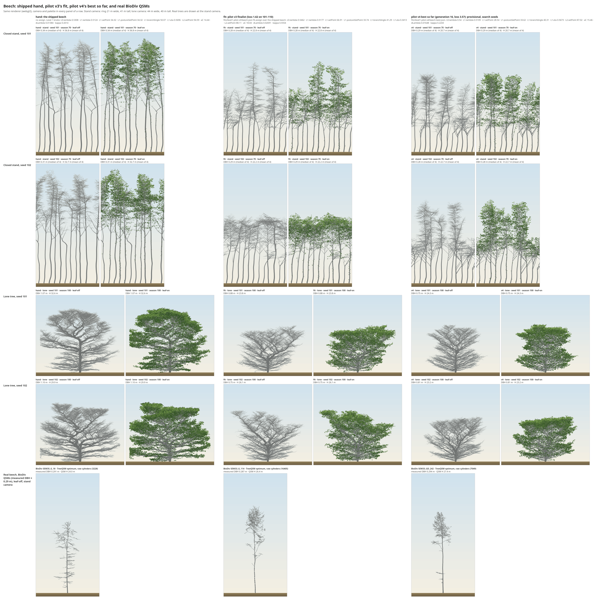

# Level 1 beech pilot v3: registration v4, the first real fit; the gate fails on limb-posture spread (2026-11-05)

_Reference-fidelity plan §g, phase 3, the beech pilot's third run (the user, 2026-11-04: "best achievable with the
current rules"). Provisional: it waits on Level 0's pass and ADR 0052, and nothing from it is accepted into species
params. No core change: nothing under `src/`, `rust/`, `cli/`, `tests/`._

**Naming.** Pilot v3 runs registration **version 4** (8e7594b). Its results are in
`docs/experiments/fits/level1-pilot-v3/`, and the run's own files in `runs/level1-pilot-v3/`.

## Findings
1. **The first real fit.** The hand scores **6.70** on the fresh seeds 101–110 and the finalist **1.62**. The hand's
   10-seed loss has SD 1.38 (the noise check), so the gain is 3.7 SDs. The pilot failed this same test (hand 18.52
   against finalists 19.9–22.6); pilot v2 never reached it.
   - **In band:** all of the fourteen descriptors the sensitivity note found reachable affordably. On the gate's 20
     seeds every descriptor's z is within ±1.04, tortuosity05 included (finding 3).
   - **Held out:** 19 of 20 seeds pass (15 needed).
   - **The spread penalty held:** every fitted descriptor has a spread term of 0 on 101–110. Pilot v2's in-run best
     had six below 0.5×.
2. **The gate fails only on between-tree spread of limb posture:** limbDroop at 0.48× real (fitted) and limbUpturn
   at 0.47× (held out). limbElevation05 clears at 0.54×. Every other descriptor's spread is within ×2 (0.60–1.24×),
   and shapeFlag is clear.
   - **Individual variation of limb posture is beech's single Level 1 blocker** with the current rules.
   - **limbDroop sits at the penalty's floor.** The one-sided penalty is zero from 0.5× up, and the gate's ×2 edge
     is the same 0.5×. A fitted descriptor held there costs nothing in the loss and fails the gate on noise: 0.51× on
     101–110, 0.48× on the gate's seeds.
   - **limbUpturn is held out,** so no term asked for its spread. The sensitivity note found it unreachable by any
     affordable knob (0.46× at best).
3. **tortuosity05 was reached by dLambda 0.027 (hand 0.014), at an unscored lateShare cost of 10.1** (1.24 against
   the target 1.43, band 0.06; the hand 1.39). With the current rules, wandering branches and late height growth are
   coupled through dLambda ([below](#what-dlambda-does-and-why-it-couples-the-two)).
   - **This was found with the term unscored.** v4 reported lateShare and did not score it.
   - **The sensitivity note's sweep missed this value:** it reached tortuosity05 only at dLambda 0.067–0.12 (ΔL0
     +22 to +73). Its grid on dLambda (0, 0.0069, 0.0138, 0.067, 0.12) leaves 0.0069–0.067 unsampled, and 0.027 falls
     in that gap. Its scored Level 0 cost here is 0.37, but only because lateShare left the loss.

## What dLambda does, and why it couples the two
- **The rule** (`rust/core/src/principles/r2.rs:96–108`, the formula at line 107, `lambda_at`): every axis level's Borchert–Honda λ falls by
  `r2.dLambda` once the tree is older than `r2.aC`, ramped over `r2.ramp` seasons:
  `λ(order, age) = levels[order].lambda − dLambda · min(1, max(0, age − aC) / max(1, ramp))`.
  - **Beech's ramp is 1,** so the drop is a step at age ≈ aC: 14.4 for the hand, 18.0 for the fit.
  - **It is one offset, applied to every order:** the trunk (level 0) and the limbs (levels 1, 2) alike.
- **Where λ acts** (`rust/core/src/principles/c3.rs:134`, through `bh_main_share`, `c3.rs:54–61`): at every node the
  resource reaching it splits between the continuing (main) shoot and the laterals as
  `v_main = v λ q_main / (λ q_main + (1 − λ) q_lat)`.
  - **Lower λ moves resource from the main shoot to the laterals,** so apical control weakens.
- **Why lowering λ makes branches wander:** the limbs' own laterals compete with their continuing shoots. Relays and
  kinks then turn an axis from its line, so tortuosity05 rises (hand z −1.11 → fit −0.66 on 101–110), and its spread
  rises too (0.14× → 0.53×).
- **Why it costs late height:** the same offset lowers the trunk's λ after aC. The fit matched it with a higher trunk
  λ before aC (levels[0].lambda 0.531 → 0.546), which left the trunk's late λ near the hand's (0.517 against 0.519).
  The net effect is front-loaded height:
  - at 60: 78.5 → 85.0 cells;
  - at 100: 108.6 → 105.1 cells;
  - so lateShare (H100/H60) falls from 1.39 to 1.24.
- **The coupling:** the rules cannot lower the limbs' late λ without lowering the trunk's. The search's only way to
  keep the trunk is to raise its early λ, which spends late height growth.

Whether a separate dLambda per level would remove the coupling is a rule question, for the ADR list. Pilot v4 (below)
asks first whether a fit can find both with lateShare scored again.

## The run
- **Launch:** registration v4 (8e7594b), 23:49 UTC 2026-11-04; the log's first line names 8e7594b, clean. 12
  workers, under `systemd-inhibit`.
- **Fit:** complete, 32 generations, 3,880 evaluations, 6.65 h wall (≈ 745 s a generation). Fit exit 0 at 06:28 UTC;
  gate exit 0 at 06:30.
- **In-run run best (search seeds; the hand there scores 5.17 under v4):** 4.58 at generation 0, 3.00 at 1, 2.61 at
  10, 2.02 at 12, 1.80 at 28, 1.73 at 29. The median fell from 13.3 to 5.1.
- **Finalists on 101–110:** 1.83, 4.82 and 1.62. The best is the third.
- **The finalist's knobs (the hand in brackets):**
  - λ(0) 0.5462 (0.5308), λ(1) 0.5177 (0.5124);
  - setPoint (1) 66.9 (34.3), postureSetPoint (1) 33.7 (34.3), branchAngle (1) 41.3 (50.1), eta (1) 0.341 (0.570);
  - setPoint (2) 88.1 (94.6), aC 18.0 (14.4), dLambda 0.0269 (0.0138), kappa 0.555 (0.431).
  - All three finalists share dLambda ≈ 0.026 and setPoint (1) ≈ 66.

## The terms on 101–110 (hand → fit)
| term | hand | fit |
|---|---|---|
| **Level 1 location** | **2.25** | **1.25** |
| tortuosity05 | 0.87 | 0.31 |
| centroidHeight | 0.51 | 0.20 |
| p0 | 0.33 | 0.01 |
| pendulousFraction05 | 0.19 | 0.01 |
| forkHeight | 0.08 | 0.42 |
| p2 | 0.02 | 0.09 |
| limbDroop | 0.01 | 0.10 |
| **Level 1 spread penalty** | **3.05** | **0.00** |
| tortuosity05 | 2.31 | 0 |
| leaderDominance | 0.68 | 0 |
| pendulousFraction05 | 0.06 | 0 |
| **Level 0, scored** | **1.40** | **0.37** |
| LAI | 0.56 | 0.02 |
| talloCR | 0.40 | 0.14 |
| talloH | 0.22 | 0.08 |
| survivalLight | 0.13 | 0.13 |
| height at 60 | 0.09 | 0.00 |
| **total** | **6.70** | **1.62** |
| _reported, not scored:_ lateShare | 0.51 | **10.09** |
| _reported, not scored:_ height at 100 | 0.27 | 0.42 |

Per fitted descriptor on 101–110, z (spread ratio): the hand → the fit.

| descriptor | hand | fit |
|---|---|---|
| centroidHeight | +1.18 (0.49) | +0.74 (0.67) |
| crownFullness | −0.50 (0.79) | +0.10 (1.07) |
| forkHeight | +0.40 (0.72) | +0.90 (0.71) |
| leaderDominance | −0.38 (0.25) | −0.31 (0.81) |
| limbDroop | −0.12 (0.51) | +0.49 (0.48) |
| p0 | −1.17 (0.78) | +0.23 (0.95) |
| p1 | +0.01 (0.62) | +0.23 (0.96) |
| p2 | +0.29 (0.66) | −0.58 (0.66) |
| pendulousFraction05 | +0.59 (0.40) | +0.10 (0.82) |
| profileCentre | +0.67 (0.64) | −0.32 (1.15) |
| tortuosity05 | −1.11 (0.14) | −0.66 (0.53) |

## The gate (seeds 1–20; `fits/level1-pilot-v3/beech.gate.txt`, `.json`)
- **The verdict:** **FAIL**. Held out 19/20, spread outside ×2, shapeFlag clear.
- **The stand:** season 60, 80 trees, median DBH 0.290 m; none outside the real DBH range.
- **Pooled z (spread ratio):**
  - fitted:
    - centroidHeight +0.56 (0.78), crownFullness −0.25 (1.11), forkHeight +0.95 (0.86);
    - leaderDominance −0.23 (0.60), limbDroop +0.74 (**0.48**), p0 +0.28 (1.12);
    - p1 +0.24 (0.77), p2 −0.55 (0.81), pendulousFraction05 +0.17 (0.74);
    - profileCentre −0.51 (1.16), tortuosity05 −0.48 (0.60);
  - held out: length0 −0.34 (1.24), limbElevation05 −0.47 (0.54), limbUpturn −0.71 (**0.47**), p3 −0.90 (1.11),
    widestAt −1.04 (0.91).
- **Demol, out of sample:**
  - pendulousFraction05 +2.85 and limbElevation05 −2.11;
  - every other tier A descriptor within ±1.72.
- **shapeFlag:** the candidate's nearest gallery reject is round2-spindle at 0.84, and the hand form sits at 0.38. Not
  flagged.
- **Level 0's statistic on the same runs** (reported, not gated): 10 of 20 seeds within T 1.00. The Level 0 fit's was
  9 of 20.

## Noise check (before the run; `fits/level1-pilot-v3/noise.json`)
- **The draws:** the hand on v3's three 10-seed draws scores 4.53, 7.07 and 6.71. The SD is 1.38 against v3's 0.40,
  mostly leaderDominance's spread term (mean 1.20, SD 0.90).
- **The cross-check:** equal to v3's stored terms re-scored on the same trees, to 9e-16.
- **The rule:** over the user's 0.6, so it was noted; the seeds per candidate stayed at 10 (the user).

## What the fit looks like (render, 2026-11-05)

Script: `code/2026-11-05-render/` (the garden's renderer; hand is the shipped beech with no assign, fit is `fit.assign` over it, the third column is v4's best so far at generation 16, provisional, search seeds). Seeds 101, 102.
- **Hand to fit, in the stand:** the hand's trees are tall (33–38 m at season 70) with long clear boles and small crowns at the top; the fit's are about 22 m, with limbs starting lower and spreading wider, crowns that touch or overlap in seed 102. Alone at 100, the hand is a large broad crown 30 m tall; the fit is a lower, flatter dome, about 24–26 m, with a denser, more even limb fan.
- **Against the three real QSMs (24–27 m, measured DBH 0.29 m):** each is a thin clear trunk with a small, narrow crown of thin twigs at the top, and a few stray low limbs. The fit's stand height is the nearer one and the hand's is far too tall, but the real crowns are narrower and higher than the fit's wide, low ones; the hand's high, narrow crowns look nearer in shape, if not in height. Neither looks like these trees; v4's best so far looks like the fit.
- The QSMs are drawn raw from TreeQSM's optimum model in their file's own azimuth (cylinders cut where branches leave), with a bark age proxy from girth. Leaves-on and lone-tree panels have no real counterpart.

## Limits
- **Point estimates on 10 + 20 seeds.** The finalist was selected from 384 candidates on the search seeds;
  re-measuring it on 101–110 removes that selection, and its 1.62 sits within the finalists' 1.62–4.82.
- **The penalty's floor and the gate's edge coincide** (finding 2). Pilot v4 keeps it (the user: everything else as
  v4).
- **The coupling is read from one fit's knobs and traits.** It is not a controlled test: λ(0), aC and setPoint (1)
  moved together with dLambda.
- **Provisional:** nothing here is accepted, and nothing changes species params.
