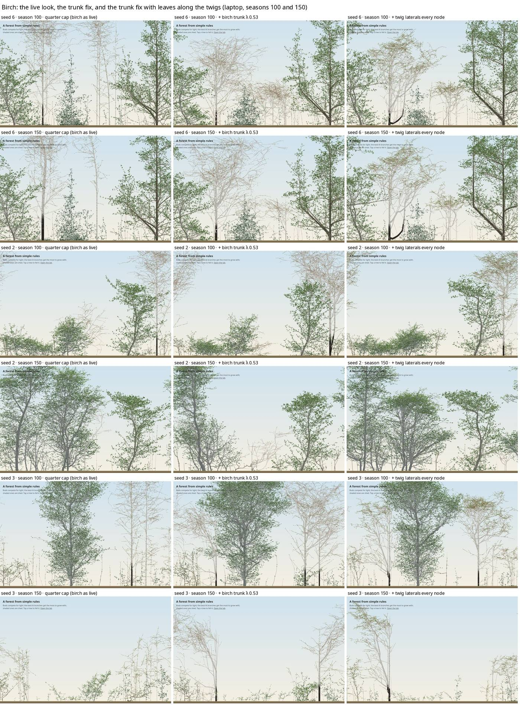

# Birch: the garden's poles and its sparse crowns (2026-11-06, box step A1)

**Question:** after the recruit cap was cut to a quarter ([note](2026-11-06-garden-recruits.md)), the garden's remaining clutter was birch recruits growing as bare 25–30 m poles. Lone birch also grew to 45–49 m. Can existing parameters fix both? Gates follow the [validation policy](../background/validation-policy.md); they were fixed before each run.

**Answer.**
- **Adopted:** birch's trunk λ (`r2.levels.0.lambda`, 0.5882 → 0.53).
  - It fixes the poles in 18 of 20 seeds.
  - It brings lone birch to 39 m at 150, inside its Tallo band.
  - It passes G-forest against B0, with planted H/D and crown base exactly at their limits.
- **Not adopted:** making birch's crowns leafier, by putting twig laterals at more nodes.
  - Every leafier variant fails the crown-base gate (5–6 against a floor of 9).
  - The likely cause is the gate's comparator, not the stand. That question is for the user (below).

## Diagnosis
- **The poles are birch's leader taking its growth.**
  - A 25 m recruit carries about 400 buds and has H/D 150–320.
  - The girth rule is right per leaf: r² per bud is 0.7–0.9 on poles, against 0.5–0.9 on planted birch.
  - Storms are on (5% of seasons), but windthrow kills only about 1% of such poles a season.
  - The poles come from local seed: with seed rain off, they stay.
- **A six-seed screen of levers** (garden, quarter cap):

  | lever | tall recruits at 100 | recruit H/D | planted W/H |
  |---|---|---|---|
  | none | 15 | 194 | 0.62 |
  | trunk λ 0.53 | 4 | 95 | 0.89 |
  | λ 0.5 on trunk and limbs | 2 | 72 | 0.95 (too broad) |
  | girth r0 0.008 | 4 | 196 | 0.54 |
  | no seed rain | 9 | 205 | n/a |
  | reproductive sink (fRep 0.8, maturity 120) | 4 | 158 | n/a |
  | λ 0.53 with limb set point 55° or 45° | n/a | 86–94 | lone W/H 1.03–1.22 (broader, not narrower) |

## Lone birch on the real-tree instrument (seeds 1–5, `describe()` on coarsened trees)
| | real (TreeML and hedgerows, n 17) | 0.16.0 (λ 0.588) | λ 0.53 | λ 0.55 | λ 0.53 + laterals every node |
|---|---|---|---|---|---|
| height at 150 (hard; Tallo band 33–42 m) | — | 48.4 ✗ | **38.6 ✓** | 40.0 ✓ | 34.3 ✓ |
| W/H at 60/100/150 (soft) | 0.52 [0.38–0.66] | 0.36/0.32/0.30 | 0.63/0.68/0.63 | 0.56/0.52/0.51 | 0.79/0.63/0.58 |
| dome D at 100/150 (soft) | 0.37 [0.07–0.61] | 0.22/0.30 | 0.05/0.15 | −0.01/0.24 | −0.03/−0.07 |

Any trunk-λ cut flattens the top a little (D, noisy at n 5); this is the flat cap again (box, night).

## The 20-seed gates (G-forest against B0: floor 2, planted H/D 3, crown base 11, plateau 11; each ≥ base − 2)
**Poles:** for each seed, the median H/D of birch recruits alive at 100 and ≥ 40 cells tall. A seed passes at ≤ 120, or if it has no such recruit. The gate is ≥ 15 of 20. **Leafy:** the median over seeds of birch's leafy buds per metamer at 150; it chooses among variants that pass.

| run | floor | planted H/D | crown base | plateau | poles | leafy | metamers |
|---|---|---|---|---|---|---|---|
| quarter cap (base for A1) | 0 | 3 | 12 | 12 | 13 | 0.42 | 0.94× |
| **λ 0.53 (adopted)** | 0 | **1** | **9** | 11 | **18** | 0.30 | 1.13× |
| λ 0.55 | 0 | 1 | 6 ✗ | 14 | 17 | — | 0.97× |
| λ 0.53, laterals every node (the user's test) | 0 | 2 | 5 ✗ | 12 | 20 | 0.66 | 0.84× |
| v1: λ 0.53, every 2nd node | 0 | 3 | 6 ✗ | 13 | 19 | 0.40 | 1.11× |
| v2: λ 0.588, every node | 0 | 4 | 6 ✗ | 12 | 16 | 0.71 | 0.75× |
| v3: λ 0.55, every node | 0 | 1 | 6 ✗ | 11 | 18 | 0.70 | 0.88× |

**λ 0.53 passes, at its limits.** Planted H/D (1) and crown base (9) sit exactly on their floors (policy rule 6). Native CPU per season rose in that run (1.04 s against 0.84 s on a loaded machine), within the metamer budget.

## Why the leafier birch fails crown base
- **How the check works:** per seed, the median leaf-crown ratio (LCR) of the planted survivors must be below the median of the lone-tree comparators of the planted species, at 150 and at 300. Each comparator is one lone tree on seed 1.
- **What moved:** the lone birch comparator's LCR fell from 0.873 to 0.845 (λ 0.53) and to 0.799 (with every node). A leafier lone birch sheds more of its own lower crown, so the bar fell in every seed with birch planted.
- **The stand did not deepen.** Stand birch's LCR fell too (0.59 → 0.50), and the other species barely moved.
- **The count is not monotonic** in the change (12, 9, 6, 5): the check is noisy here.
- **This is a question about the gate, not a reason to adopt.** It is the user's question (below).

## Look

- **Leafiness:** at laterals every third node birch carries 0.33 leafy buds per metamer, against 0.7–0.9 for the other broadleaves, and its crowns read as bare twigs. At every node it carries 0.70–0.76. The other two levers moved it little: the short-shoot threshold `r6.qMin` 0.05 gave 0.35, and the shedding threshold `c5.T` 0.05 had no effect.
- **Drawing:** birch's leaves are drawn small (0.5 against beech's 0.7, in proportion to real leaf length, M23), in a light palette that turns early. That is page-only, unchanged.

## Side effects
- **Phone seed 3's named regression moved** (#54): canopy trees at 100 went from 2 to 3, and metamers rose at 50, 100 and 150. It still has 1 canopy tree at 150. The baseline is updated.
- **Goldens:** `mixedWood` s15 and `beechWood` s30 change, as birch grows in both.

## For the user
1. **The crown-base gate.** Its lone comparator is one tree on one seed, and the bar is a median over the planted species. A change to one species' lone form moves the bar for every seed that plants it. Should it compare each species' stand trees with that species' own lone runs over several seeds? That would be a new gate version, which is the user's call. Until then, birch stays sparse.
2. **Leafier birch** (laterals every node) waits on that answer.

## Reproduce
- Lever screen: `forestParams(160)` on seeds 2, 3, 6, 9, 10, 12, run natively.
- Gates: the overnight `evidence.py` (with `--patch` for each variant) and this folder's `poles.py`, `leafy.py` and `girth.py`; the summaries are `evidence-*.md`.
- Lone birch: `t/dumpsim.ts` with `LAMBDA0`, then `simdump.py` (overnight targets code).
