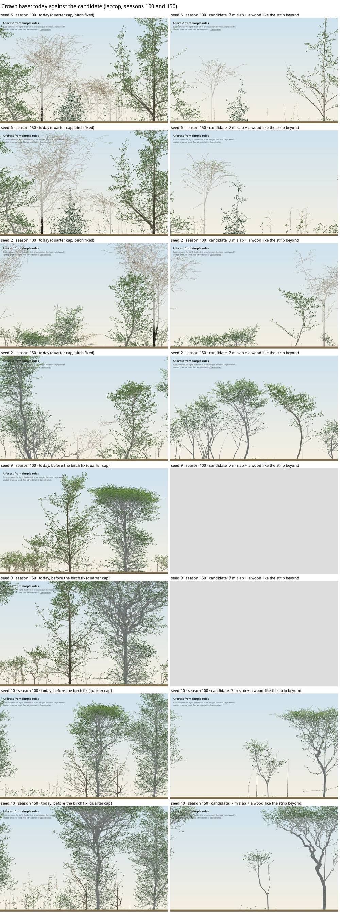

# Young trees' clear trunk: not ADR 0055; a general low crown base (2026-11-06, box step A2)

**Question (#53):** the advisory lone-tree judge said ADR 0055's irregularity costs young hornbeam and beech their clear trunk ("branches to the ground"). Is that real, and is ADR 0055 the cause? The plan said to check before fixing, because the lone references (TreeML) are crown-lifted street trees.

**Answer.**
- **ADR 0055 is not the cause.** With its irregularity switched off, young garden beech and hornbeam keep a *lower* crown base, not a higher one.
- **The garden's crown base is low at every size, in every species.** It predates 0.16.0. Live crowns reach within about 5% of the ground. Real closed stands sit at 22–38% of height, and real hedgerow oaks, a single row like the garden, at 20%.
- **This is a self-pruning gap** (C5's shedding of shaded lower limbs), not a param slip. It is recorded for a later box, not fixed now.

## Measures
- **Simulated:** `limbBase` / height. `limbBase` is the live crown base by limbs: the lowest limb level holding 5% of the leaf area (`metrics.rs`).
- **Real:** `cbH`, the lowest limb at least 2.5 m long, attached at that height over H. Dead limbs count; computed on QSMs (overnight targets).
- **The two differ.** The leaf-weighted simulated measure reads at or above the geometric lowest limb, so the gap below is, if anything, understated.

## Results
Garden (`forestParams(160)`, quarter cap, seeds 2, 3, 6, 9, 10, 12), live trees ≥ 10 m, median `limbBase`/H by 8 m height bin:

| species | 8–16 m, irregularity on / off | 16–24 m | 24–32 m |
|---|---|---|---|
| beech | 0.11 / 0.05 | 0.20 / 0.07 | 0.05 / 0.07 |
| hornbeam | 0.04 / 0.06 | 0.13 / 0.06 | 0.07 / 0.09 |
| oak | 0.05 / 0.06 | 0.04 / 0.05 | 0.05 / 0.07 |

- **Over 20 seeds** (the adopted birch build), planted beech and hornbeam sit at 0.03–0.07 from season 40 to 150. Bare bole (`boleHeight`/H) is 0.01–0.04.
- **Real `cbH`** (overnight targets; summary statistics only):

  | species | stand | lone, as street trees (pruned) |
  |---|---|---|
  | beech | 0.38 [0.10–0.56] (n 66) | 0.14 |
  | hornbeam | 0.22 [0.09–0.34] (n 36) | 0.12 |
  | oak | 0.26 [0.12–0.37] (n 37) | 0.20 [0.06–0.30] (Belgian hedgerows, n 21) |

## Next (not this box)
- **A self-pruning look.** Shaded lower limbs are shed too slowly, or kept by the side light the single-row garden gives.
- **Candidates:** C5's shedding thresholds, against `T_rel`, which is fixed from the literature (ADR 0032); limb death from sustained low vigour.
- **The gate:** the garden's `cbH` against the hedgerow band (the closest regime) and the stand band.
- **Rule:** under the [validation policy](../background/validation-policy.md), a new mechanism needs an ADR.

**Reproduce:** the run script of [the recruits note](2026-11-06-garden-recruits.md), with `code/2026-11-06-crown-base/no_irregularity.py` applied to the params (it zeroes `shootLengthSD`, `betaSD` and `axisSD`, and removes stochastic `budBreak`).

## A4: the crown base through the garden's light boundary (2026-11-06, the user's priority; parked)
Gates: the plan's "A4 and A5's gates", fixed before any result.

**Diagnosis** (`code/2026-11-06-crown-base/limbs.py`): the like-for-like crown base and each tree's lowest three limbs, from geometry snapshots.

| setting | crown base, beech / hornbeam / oak, at 60 → 150 | limb light ÷ crown top | limb P/M |
|---|---|---|---|
| garden (side faces τ 0.2) | 0.01–0.02, every species, every age | 0.05–0.20 | 3–8 |
| garden, opaque sides | beech 0.02 → 0.28, hornbeam 0.04 → 0.33, oak 0.02–0.05 | 0.09–0.21 | 2–7 |
| closed stand (`standParams`, a 5 m grid) | beech 0.21 → 0.56, hornbeam 0.49–0.51, oak 0.03–0.07 | 0.16–0.37 | 3.5–9 |

- **C5 prunes when there is shade.** The garden's lower limbs are lit and profitable, so no honest light rule sheds them (ADR 0043's lesson).
- **Oak keeps its limbs even in a closed stand.** They earn 7–9× their keep, so oak goes to its form work (the user).

**The mechanism tried:** `world.faceWood` (core, committed, off by default and bit-identical).
- Beyond the depth faces is a virtual wood with the strip's own foliage profile: at each height, its density is `faceWood` × the slab's mean leaf area per cell, gaps included.
- A ray leaving through a face crosses that wood's leaf area above it.
- At 1 it is "a wood like the strip": its leaf area index measured 3.6–9.5, against the closed stands' 5–9.
- A first version averaged only occupied cells and was 3–6× too dense; it starved the garden.

**Results:**
- **At today's depth (64),** the virtual wood is 8 m from the row and barely acts: beech 0.02–0.11, hornbeam 0.01–0.04.
- **With the slab narrowed to the recruit band (28 cells, 7 m),** 20 seeds:
  - **G-forest passes:** floor light in band in **18** of 20 seeds (B0: 2), planted H/D **9** (B0: 3), crown 9, plateau 11. CPU per season falls to a third.
  - **The hard crown-base gate fails:** beech 2 of 7 counted seeds in band, hornbeam 4 of 6 (the bar is 75%). Results split: some trees lift to 0.16–0.44, others keep their skirts at 0.02–0.04, probably beside gaps.
  - **The garden carries 0.15× the metamers.**

**Filling it back** (the user's choice), six seeds at 150:

| variant | beech crown base 100 / 150 | metamers | canopy trees |
|---|---|---|---|
| today | 0.01 / 0.04 | 55k | 30 |
| half wood | 0.05 / 0.07 | 11k | 16 |
| full wood, recruits 0.5 | 0.44 / 0.32 | 8k | 17 |
| full wood, spacing 21 | 0.06 / 0.17 | 7k | 11 |
| half wood, spacing 21 | 0.03 / 0.04 | 13k | 11 |

**Reading:** in this model, the shade that lets the garden prune its lower limbs also takes away 75–85% of its foliage. Half the shade prunes nothing, and more recruits or closer planting don't refill it. Today's full garden is largely its skirts. A forest-like garden is a sparser picture: tall clear trunks with crowns at the top, as in seeds 2 and 10 at 150.

**Parked** with this evidence. `faceWood` stays off, and the garden is unchanged.

**What would resolve it** is the user's question for a later box. Either accept a sparser, forest-like garden, or find out why a darker garden carries so much less foliage than the real closed stands it matches on leaf area index. The second may be R1's carbon shedding in shade (ADR 0032's acclimated leaf cost), or the stand's crown depth.

## F: why shade strips the garden's foliage (2026-11-06 afternoon, agent F; plan `plans/2026-11-06-day2.md`)
Scripts and numbers: the tag `archive/claude/day2-f-foliage` (0a4de33; was branch `worktree-agent-a28199a6f8557d21d`), `scratch/2026-11-06-F-foliage/` (`notes.txt`). The core was untouched; temporary instrumentation is kept as a patch, not committed. The instrument's shed totals equal `metrics.csv`'s exactly, and it reproduces A4's 20-seed gate exactly.

| six-seed medians, 0–150 | metamers at 150 | per cell of ground | LAI 100 / 150 | births per cell | cumulative P per cell |
|---|---|---|---|---|---|
| today | 55.2k | 5.39 | 9.5 / 10.3 | 29.8 | 269 |
| 7 m slab, `faceWood` 1 (faces τ 0.2) | 7.6k | 1.70 | 3.6 / 2.5 | 17.1 | 157 |
| 7 m slab, `faceWood` 1, faces τ 1 | 17.9k | 3.99 | 6.2 / 5.7 | 33.2 | 272 |
| closed stands, beech / hornbeam | – | 3.33 / 4.03 | 6.0 / 5.9 and 8.9 / 8.2 | 53 / 31 | 326 / 378 |

- **The shortfall is production, not shedding.** 0.138 = 0.44 (the strip's ground) × 0.32 (density per cell).
  - R1's carbon-deficit test does most of the shedding everywhere: 44% of grown metamers today, 60% narrow, 75–86% in closed stands. C5's light test does 5–13%.
  - Background mortality takes 11% of births in both gardens. Starvation, windthrow and breakage are small.
- **Today's garden is denser than real woods:** LAI 9.5–10.3 against 5–9, with crowns living to the ground (leaf crown ratio 0.83, against the stands' 0.31–0.33).
- **ADR 0056's open question is answered:** the faces' τ 0.2 stacked on the virtual wood makes the strip darker than a closed stand. With faces τ 1, the strip carries the model's closed-stand density per cell.
- **No existing-param candidate reaches the 0.5× foliage bar while the crown-base gate passes.** At a real stand's density a 7 m strip holds about 0.27–0.33× today's foliage; reaching 0.5× needs LAI about 10, above real stands. Every variant near 0.5× keeps its skirts.
- **Faces τ 1 with `faceWood` 1** is the strongest. On 20 seeds:
  - crown base: hornbeam 5/6 (83%, passes); beech 5/7 (71%, fails at the limit by one seed);
  - G-forest's four checks pass (floor 18, H/D 3, crown 13, plateau 12);
  - metamers 0.26× B0; planted survival 0.36 / 0.19 at 150 / 300, against 0.44 / 0.31.
- **For the user:** whether a garden at a real wood's density, with about a third of today's foliage, is the look wanted. That is a look decision, not a gate.

## M: a middle look (2026-11-06 afternoon, the user: "between the two"; gates in `plans/2026-11-06-day2.md`)

| six opening seeds, at 150 | metamers vs today (≥ 0.45×) | seeds with < 2 trees ≥ 10 m | beech and hornbeam crown base (≥ 0.10) |
|---|---|---|---|
| 7 m slab, faces τ 1, `faceWood` 0.6 / 0.7 / 0.8 | 0.41 / 0.27 / 0.30 | 3 / 1 / 2 | 0.18 / 0.14 / 0.25 |
| 10 m slab, `faceWood` 1 | 0.47 | 2 | 0.21 |
| 12 m slab, `faceWood` 1 | 0.61 | 1 (seed 3) | 0.22 |
| today | 1.00 | 0 | 0.02 |

**The 12 m slab on 20 seeds:**
- **G-forest fails planted H/D** (0 against ≥ 1). It passes floor (19 against B0's 2), crown (13) and plateau (13). Metamers are 0.48×; planted survival is 0.43 at 150 and 0.24 at 300.
- **A4's strict crown-base gate fails** (beech 3/8, hornbeam 4/6). Crowns lift late: in band at 150, not yet at 100.

**No middle setting passes; parked.** In this model, forest trunks come only with the loss of the fullness that today's crowns get from being denser than real woods' (LAI about 10 against 5–9) and from living to the ground.

**What might resolve it, for a later box:**
- trees that grow up crowded while young, then thin, as real forests do;
- or a look decision by the user.
