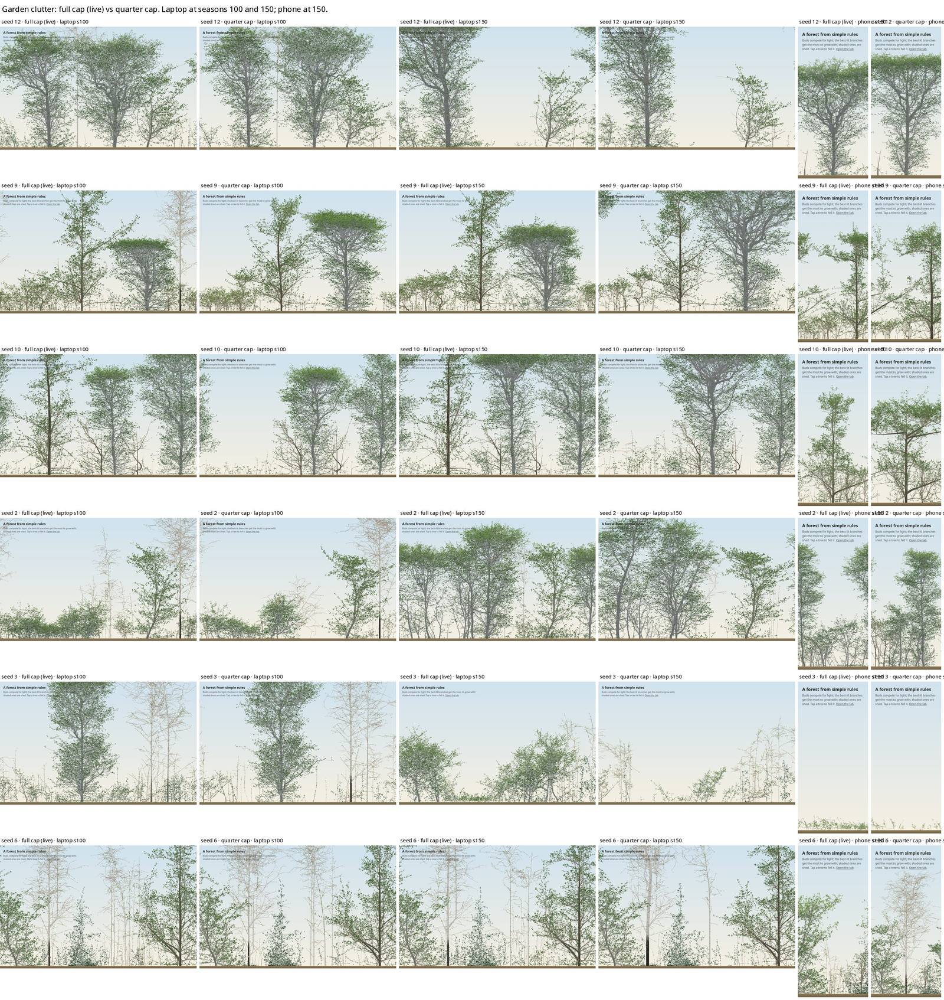

# The garden's clutter: its recruit cap (2026-11-06)

**Question (the user, after the 0.16.0 phone soak):** the forest looks very cluttered on the site. Would fewer
seedlings, or seeding only from a certain age, help?

**Answer:** the garden kept the old wood's cap on recruits. A quarter of it removes the ground-level saplings,
holds the garden's four 20-seed checks, and runs about 10% faster. Adopted: `GARDEN_PLANTING.recruits` 1 → 0.25
(`src/core/presets.ts`). A large part of the clutter is something else, though: tall, thin birch recruits. The
cap doesn't reach them; they belong to the birch work.

## Cause
- **The cap:** `forestParams` caps live trees at `recruits` × 300 per 210 cells of width per row. It was sized
  for round 2's three rows. Since I3 the garden plants one row (6 trees at 160 cells, 2 on the phone's 66), but
  the cap stayed at 229 and 94.
- **What fills it:** in the six opening forests (seeds 12, 9, 10, 2, 3, 6), every forest fills the cap by about
  season 80. Of about 225 recruits, about 200 are under 20 cells (about 5 m). They are suppressed saplings,
  mostly of the planted shade-bearers (beech, hornbeam, maple, oak); 550–1,500 recruits are born per forest
  over 300 seasons.
- **An age delay alone would not help much.**
  - Seeds are already gated by size (R1's maturity height). The first seeds come at seasons 7–8 (willow),
    12–13 (maple), 15–17 (birch) and 28–35 (beech).
  - Seed rain (willow, birch) starts in season 1.
  - Even a tenth of the cap is full by season 20. A delay would only postpone the clutter. The user chose the
    cap.

## The 20-seed checks (G-forest)
Run with `forestParams(160)`, 20 seeds, 300 seasons, against B0 (d2c4f53). Each check must stay ≥ base − 2.
The overnight run's `evidence.py` was used, with `dump.ts` taking a `RECRUITS` variable (both in
`code/2026-11-06-garden-recruits/`).

| check (of 20) | B0 | recruits 1 (0.16.0) | **0.25** | 0.1 |
|---|---|---|---|---|
| floor at 100 in band (out of band by construction) | 2 | 1 | 0 | 0 |
| planted H/D at 300 in 60–80 | 3 | 1 | **3** | 2 |
| crown base | 11 | 12 | 12 | 10 |
| plateau | 11 | 13 | 12 | 10 |
| all-tree H/D (warning, not gated) | 20 | 16 | 12 | 10 |
| live trees | 229 | 229 | 57 | 23 |
| metamers at 200 | 1.00× | 0.96× | 0.94× | 0.91× |
| native CPU per season (loaded machine) | | 0.93 s | 0.84 s | 0.84 s |

**Reading the table:**
- **All three caps pass the four gated checks.** The script's own verdict line also counts the all-tree H/D
  warning, which last night's gate left out.
- **0.25 gives planted H/D its headroom back** (1 → 3), which the height fixes need.
- **0.1 costs crown base and plateau** and is no faster.
- **Floor light rises** (median 0.111 → 0.126), already out of band by construction.
- **Composition at 300 with 0.25:** oak 0.06 → 0.14, holly 0.09 → 0.17, birch 0 → 0.03, hornbeam 0.20 → 0.13.

## The look

- **Fewer ground-level saplings with the quarter cap:** clearest in seed 10 at 100 and seed 2 at 150.
- **The remaining clutter is birch.** Tall, pale, sparsely leafed poles, in seed 6 above all. They are birch
  recruits: 25–30 m at season 100, W/H 0.1–0.3, H/D 150–320 (real trees seldom pass about 100).
  - They establish early, from seed rain and the planted birch, so the cap does not reach them.
  - **Next:** Session A's birch work, with a pass mark of birch recruits' H/D ≤ about 120 at 100, looking at
    birch's seed rain and seeding size.
- **Seed 3 on the phone is empty by 150** under both caps. It is a known issue, and it stays in Session A.

## Reproduce
- `RECRUITS=0.25 python3 evidence.py run --worktree <repo> --seeds 1-20 --out <dir>`, with this folder's
  `dump.ts` beside the overnight `evidence.py`.
- The census (`census.py`) reads native runs of `--preset mixedWood --params <forestParams dump>`.
- The sheet is garden.html with `?seed=N&recruits=R`, through headless Firefox, at seasons 40, 100 and 150.
