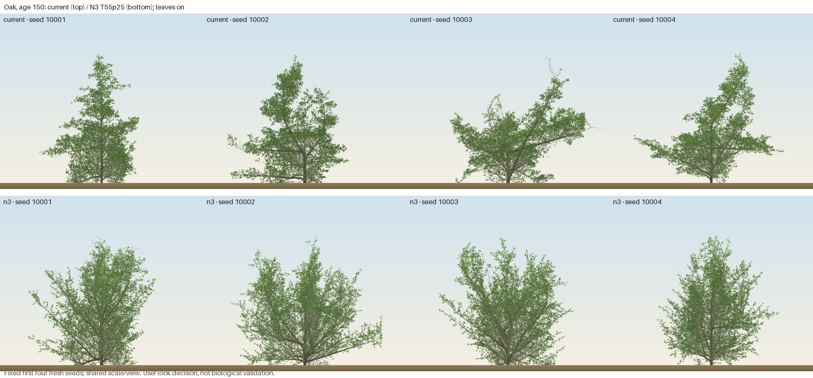
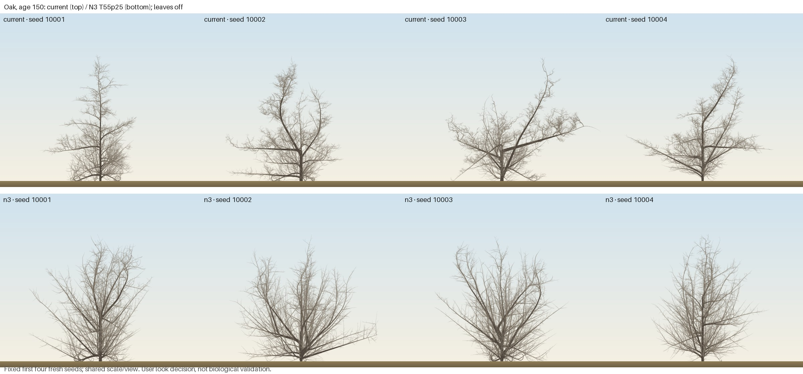

# Day 3 step 5: fixed N3 oak confirmation

## Registration, seed audit and instrument

Step4 (#68) merged by user; growth source **fe1c049**. Gates and the exact fixed
T55p25 patch were committed at **7e08e75** before any step5 run. The candidate
is `analysis/experiments/day3_oak_n3.patch.json`: ten oak-only assignments,
relay2/age25/PTerm.25/crowd10, forkAt1.3/angle35, trunk curve30/length30,
twig lambda.55/dLambdaShare0. Aged set point85 and dLambda.04 remain unchanged.
No fitting, fallback or new mechanism is tested. The user chose **retain current oak** after reviewing the fixed sheets. N3 is
not adopted; shipping oak remains unchanged. This is a look decision.

Explore audited3417 surviving local simulation metadata JSON files in the main
and oak sibling runs, zero parse failures, no10001–10020. Explicit local seed
expressions in surviving tool history also had no proposed-block hits. This audit
cannot cover deleted/external records. Fresh lone seeds **10001–10020** were
frozen before results. Seeds1–30 were tuning/internal,31–50 previously examined;
the latter's night2 results are retained as examined evidence, not fresh confirmation.
Garden/G-forest use examined seeds1–20 at the actual width160/recruits0.25 config.

Current and exact-candidate DAGs were regenerated before simulations, with input
hashes under runs/day3-step5/dag-{current,n3}. N3 opens forkAt/forkAngle and
relayAge/PTerm in lone/garden. relayCrowd remains inactive alone and opens in the
garden. The old relay-off sweep cannot rank this candidate. Its +10% twig-lambda
probe gave D−.097/−.260, W/H−.053/−.059 at100/150, inside baseline spread on
three seeds; the bundled20-seed confirmation is the effect evidence here.

D/W/H use the maintained historical crown_shape on full-precision direct WASM
loneParams, original inflated coarsening resolution0.008621381595730782 and
CRC32-keyed four-view instrument. Stem kinks reproduce night2 oakan.py: root0,
then greatest-radius child, first child wins ties; heading turns strictly>20°,
no renormalisation. Three tests exercise path selection/ties/cutoff/clamping.
Historical raw N3 snapshots were deleted; the kink source was recovered from
local tool history. No raw-snapshot historical kink parity test is claimed.
All40 lone inputs match their dumps and effective DAG parameters; no inherited
native-preset side boundary enters this measurement.

## Fresh lone results: all20 survive both ages

| median | current100 | N3 100 | current150 | N3 150 | fixed gate |
|---|---:|---:|---:|---:|---|
| D | .969640 | .219915 | .772215 | .174370 | .16–.59 |
| W/H | .716682 | .723886 | .728054 | .731511 | .55–.82 |
| height m | 33.0101 | 33.0242 | 32.9360 | 33.1837 | ≤42.9 /48.4 |
| stem kinks | 1.0 | 2.5 | 2.5 | **3.0** | ≤3 |

N3 meets8/8 registered median gates. Age150 kinks are **at its limit**; D's lower
margin is only.014370. Per-seed D coverage is14/20 at100,11/20 at150,11/20 at both;
W/H19/20 at each age. These are descriptive counts, not replacement median gates.
N3 D ranges−.225336–.473798 at100 and−.115767–.532221 at150. Negative tails remain.
These gates do not establish held-out descriptor validation or a general dome.

Previously examined31–50 had D medians.306756/.304010 and kinks2/2, compared with
fresh.219915/.174370 and2.5/3.0. Report this weaker fresh result without seed selection.
Current D is in band on1/20 seeds at each age. N3's fresh height range at150 is
32.7053–33.8342m; current32.5512–34.9902m. Kink tails at150: N3 maximum6, current18.

## Garden kink gate and eligibility

| planted oak measure | current100 | N3 100 | current150 | N3 150 |
|---|---:|---:|---:|---:|
| alive / planted oak | 12/12 | 12/12 | 10/12 | 10/12 |
| eligible seeds /20 | 12/20 | 12/20 | 10/20 | 10/20 |
| pooled kink median | 1.5 | 2.5 | 1.5 | **2.5≤4** |
| kink range | 0–26 | 1–6 | 0–34 | 1–6 |

Eight seeds contain no planted oak; two lose theirs by150 (seed1/tree0,
seed17/tree4), identically in both conditions. No survivor substitution occurs.
At150 current has4/10 trees>4kinks, N3 has2/10; one versus zero trees has≥15.
All20 paired garden params differ in exactly the ten registered oak leaves;
all40 sidecars/hash records match. Source hashes43/43 remain unchanged.
The historical N3 garden median4.0 was at its limit; today's merged-context
median2.5 is different evidence on examined seeds, not fresh garden confirmation.

Closed-stand crown-base0.12–0.37 and regularity remain soft follow-ups; a new
closed-stand programme is not claimed by these garden/lone measurements.

## G-forest against frozen B1

| authoritative check | N3 count /20 | B1−2 bar |
|---|---:|---:|
| floor100 | 0 | ≥−2 |
| planted hd300 | 1 | ≥−2 |
| crown v2 | 14 | ≥12 |
| plateau | 12 | ≥10 |

Four-check verdict **PASS**. The first two relative constraints remain vacuous;
zero floor-band coverage remains an absolute miss. As a historical diagnostic,
N3 reaches old B0's floor0 and hd300 bar1 **at their limits**; this does not replace B1's bars.
Crown v1 is10/20, all-tree H/D13/20, both diagnostic. Separate metamer budget:
median at200 **63,852.5 /66,923 =0.954119×≤1.25×** (bar83,653.75).
Planted survival15054/120 versusB1 53/120; at30037/120 versus36/120. Living-tree
median57 at300 in both. Mean oak share is0.11 versusB1 0.08; composition is soft,
and its shift is not a species-validation result. Full counts remain in ignored runs/.

The fresh native binary has a different digest, so its exact-hash cache correctly
regenerated all40 lone comparators (five/species), even for unchanged species.
All20 stands are fresh; these remain examined garden seeds rather than fresh
held-out confirmation. No cache key or gate was weakened to shorten the run.

## Reproduce

```bash
uv run --project analysis python -m treesim.build_dag runs/day3-step5/dag-current --worktree . --no-figures
uv run --project analysis python -m treesim.build_dag runs/day3-step5/dag-n3 --worktree . --patch analysis/experiments/day3_oak_n3.patch.json --no-figures
uv run --project analysis python analysis/experiments/day3_oak.py --out runs/day3-step5/trials --jobs 8
PATH="$HOME/.cargo/bin:$PATH" uv run --project analysis python -m treesim.gforest run --worktree . --patch analysis/experiments/day3_oak_n3.patch.json --seeds 1-20 --jobs 7 --out runs/day3-step5/gforest --label N3
uv run --project analysis python analysis/experiments/day3_oak.py --mode budget --out runs/day3-step5/budget --jobs 1
```

Raw inputs, full-precision trees, metrics, DAGs, provenance, WASM digest and audit
findings remain in runs/day3-step5/. Rendering-only repeats of firstfour fresh
seeds compare their hashes to the trials. The existing garden renderer draws
natural oak leaf-on/off at100/150 with one shared scale and camera; these repeats
add no independent evidence seeds. See the snapshot/sheet/composer scripts beside
the trial script. Small sheets may be committed; reference data is not included.

## Registered comparison sheets

Current oak is the top row, N3 the bottom; fixed fresh seeds10001–10004, shared
view/scale. All8 rendering-only repeats match the measured trial hashes. The
existing WebGL2 renderer supplies the natural oak leaf style. The fan still has
rising arms; these sheets do not establish a dome on near-level limbs.




Age100: [leaf on](figures/2026-11-07-day3-oak-n3-100-on.jpg),
[leaf off](figures/2026-11-07-day3-oak-n3-100-off.jpg).

## Budget instrument correction

The initial helper retained two live worlds, contrary to ADR0026's actual worker
save-and-free swap. Two current readings308.216/280.232MB and an interrupted third
are **invalid for the garden gate**, preserved in budget-invalid-coexist. Before
any replacement result, the plan records the correction. All12 cases are rerun
with the worker's intoCheckpoint→specimen→dispose→restore path and hash equality.
Seeds, widths, seasons and the230MB peak-linear-memory gate are unchanged; saved
checkpoint bytes outside linear memory are reported separately, as in the worker.

## Corrected fresh-process budget and timing screen

All12/12 registered cases use the actual worker save-free/swap/restore protocol;
all12 restore the forest hash exactly and stay below230MB peak core linear memory
(ADR0026's metric). Saved checkpoint bytes are outside that metric and reported
separately: maxima23.675MB current,22.702MB N3. This is not a browser-RSS/phone-soak result.

| width | seed | current peak MB | N3 peak MB |
|---|---:|---:|---:|
| 160 | 2 | 225.837 | 224.920 |
| 160 | 3 | 187.498 | 186.581 |
| 160 | 9 | 204.276 | 200.147 |
| 66 | 2 | 115.147 | 123.404 |
| 66 | 3 | 115.999 | 125.108 |
| 66 | 9 | 114.754 | 124.715 |

N3 maximum224.920MB leaves5.080MB below the strict230MB bar. Current maximum
225.837MB leaves4.163MB. The two discarded coexistence readings reproduce the
corrected cases' garden/specimen hashes and metamer counts2/2: the correction
changes measurement protocol, not growth or thresholds.

**Cost flags:** specimen metamers increase21.818% on seed2 and28.654% on seed9,
at both widths; seed3 increases0.165%. This is a real recorded structural cost
of the fixed candidate bundle. In the fresh20 lone trials, metamer medians are
25,732.5→32,003 at100 (+24.4%) and28,580→33,715.5 at150 (+18.0%). The registered
stand-median budget still passes0.9541×; specimen counts are not concealed by it.
No original total-time increase exceeds20% (maximum19.756%). Phone66/seed3's
garden time rises27.473% despite identical final hash/count16,806.

Two further exact-case pairs were registered at609dad9 before runs, alternating
current→N3 in fresh processes with no competing simulations. The original12
results remain intact. Repeat garden time ratios are1.02036 and0.91974; total
ratios1.10986 and0.88495. All repeated growth/restored hashes and counts match
the original cases. The original garden timing increase does not repeat; these
local timings show variability, not a general speed or phone-performance claim.
All12 cases, repeats, source/instrument digests and discarded outputs remain in runs/.

## Verification and decision boundary

180 analysis tests pass; foreground stamped Rust/static/WASM checks remain green
at the unchanged engine fingerprint. Both named regressions are unchanged.
No production species, exported preset, Rust growth rule or golden has changed.
Quantitative evaluation is complete. The user explicitly chose **retain current
oak** on the fixed comparison sheets. N3 therefore is not adopted despite meeting
the registered quantitative gates. This records a look decision, not biological
validation or a quantitative failure. Production params, presets and goldens stay
unchanged. No further oak tuning occurs in this step; retain the candidate and all
evidence for future work. Step6 starts only after the user merges PR #69.
