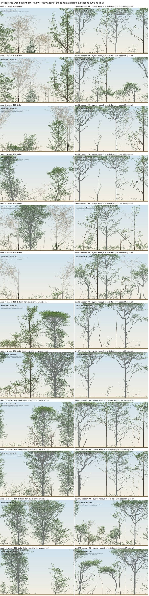
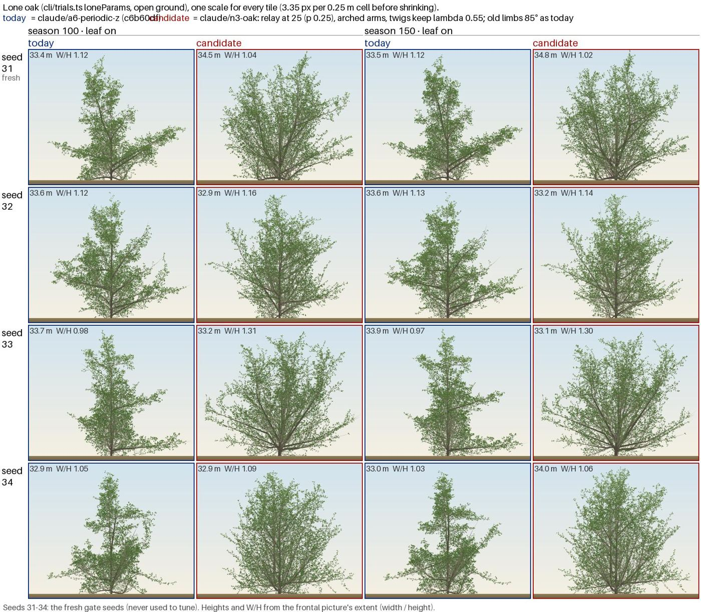

# The night of 6–7 Nov: beech in shade, crown v2, oak's form, the sweep and the DAG

_Brief and gates: [plans/2026-11-06-night2.md](../plans/2026-11-06-night2.md), written before any result. Scripts, gate baselines and logs: [code/2026-11-07-night2/](code/2026-11-07-night2/). Nothing below was adopted; every item awaits the user ([handover](../plans/2026-11-07-handover.md))._

## N1: why planted beech starves in the layered wood (agent, worktree `claude/n1-beech-shade`, no commits)

- **Setting:** A6b's layered wood:
  - a canopy of beech, oak, hornbeam and birch every 21 cells;
  - an understorey half a depth away;
  - a periodic depth of 24 (ADR 0058).
  22 of 24 planted beech die by 150.
- **The chain, seed by seed:**
  1. **Planted beech loses the early race:** 6 m at 20, against its neighbours' 12–14 m.
  2. **The canopy closes by 15–20** and bud light falls to 0.06–0.10. Growth stops, because the model cannot grow less than one metamer a season.
  3. **The spur lifespan strips the sapling** (`r6.lifespan` 20, ADR 0044): every spur sits on wood born in the first ~15 seasons, and the wood-age clock takes them all.
  4. **Production goes to 0** and the tree starves (median death about 64).
  - They are not etiolated (H/D 47–56); they are stripped trunks.
  - The `T_rel` test never fires.
  - Today's beech also starves in its own closed stand: 28% alive at 150, against 80% with the lifespan off.
- **The candidate, beech's `r6.lifespan` off** (`n1/loff-candidate.patch`):

  | measure | gate | today | lifespan off |
  |---|---|---|---|
  | planted beech alive at 150, 12 seeds | ≥ 12 of 24 | 2 | **15** |
  | the same, seeds 1–20 | ≥ 20 of 40 | 6 | **27** |
  | the same, fresh seeds 21–40 | reported | 7 | **26** |
  | lone beech height at 150 | ≤ 44.3 m | — | 42.1 m |
  | lone beech D at 150 | 0.22–0.77 | — | 0.246 (at its edge) |
  | G-forest against B0 | each ≥ base − 2 | 0/1/9/12 | **hd300 0 (needs ≥ 1): fails** |
  | G-forest against HEAD | — | — | passes all four |

  - Stand boles stay clean on dominant trees; spurs return on suppressed ones.
- **Other levers:**
  - Finite lifespans (40–100) only delay the deaths. A lifespan of 150 equals off only because nothing reaches that age.
  - `kShed` > 1 exposes a defect: **R1's deficit counts are not checkpointed**, so a restore diverges from a straight run. That applies to any species with `kShed` > 1.
- **N2 (the layered wood as the garden) was not run,** because beech did not pass its gates.

## The layered-wood sheet (main session; sheet only)

A6b with beech's lifespan off, seeds 6, 2, 3, 9, 10 and 12, at 40, 100 and 150, on laptop and phone. Every forest reads as a wood interior: clear trunks, crowns up top, a dark floor.

## N3: oak's form on fresh seeds (agent, branch `claude/n3-oak` a769a7a, check green)

- **Registered before any fresh-seed run** (`n3/DECLARATION.txt`). The finalist is T55p25:
  - relay from 25 (`relayPTerm` 0.25, `relayCrowd` 10);
  - a fork at 1.3 and 35°;
  - trunk curve 30 over 30;
  - twig λ 0.55 with `dLambdaShare` 0 (ADR 0057).
  The user's aged set point (85) and `dLambda` (0.04) are unchanged.
- **Lone, fresh seeds 31–50** (`n3/FRESH_T55p25.txt`):

  | | gate | 100 | 150 |
  |---|---|---|---|
  | D (median) | 0.16–0.59 | 0.31 | 0.30 |
  | W/H | 0.55–0.82 | 0.68 | 0.69 |
  | height | ≤ 42.9 / 48.4 m | 33.4 | 33.6 |
  | stem kinks > 20° (median) | ≤ 3 | 2 | 2 |

  Per seed, D spreads from −0.14 to 0.66 at 150.
- **Garden:**
  - planted oak kinks median 4.0 at 150, at its limit (≤ 4);
  - G-forest against B0 (crown v1): 0/1/11/13 (floor and hd300 at their limits). Crown v2 was not run on it;
  - composition at 300, against HEAD: oak 0.12 → 0.20, beech 0.33 → 0.25, hornbeam unchanged at 0.13. Hornbeam's fall from B0's 0.43 was already at HEAD. B0 ran before #50's recruit cap (229 live trees against 57), so the cap is the likely cause.
- **The sheet:** the spire is gone. The crown reads as a broad fan of rising arms more than a dome on near-level limbs.

## N4: crown check v2 (main session)

- **v2's rule:** per-species lone comparators over 5 seeds. Per seed, the median of (tree LCR − its species' lone median) < 0 at 150 and 300.
- **Its bar** is ≥ 13 of 20: B0's own count, 15, minus 2. B0 re-run under both versions: `gates/B0-v2.json`.

| condition | v1 crown | v2 crown |
|---|---|---|
| HEAD | 9 | 14 |
| beech twigs keep λ | 6 | 15 |
| birch laterals every node | 6 | 14 |
| oak-form's afternoon candidate (aged set point 55; not N3's) | 12 | 14 |

v1's blocks track its single-seed lone comparator, not the stands. v2 passes all four. Adopting v2 is the user's ruling.

## N5: the sensitivity sweep (main session)

- **Design:** 840 lone jobs, ±10% steps on 17 params × 8 species, 3 seeds, at 100 and 150 (`sweep/`, `dag/sweep_effects.csv`).
- **Result:** only 69 of 272 species × param × season pairs keep one sign of ΔD on all 3 seeds. Most single-knob effects are within seed noise at n 3.
- **Implication:** claims need ≥ 20 seeds.

## N6: the DAG (agent, read-only)

See [background/model-dag.md](../background/model-dag.md).
- `c5.T` is dead in every species.
- Holly's `r2.vigourTreeLo/Hi` have no reader (a config slip).
- Reachability alone separates nothing; the sweep sizes effects.
