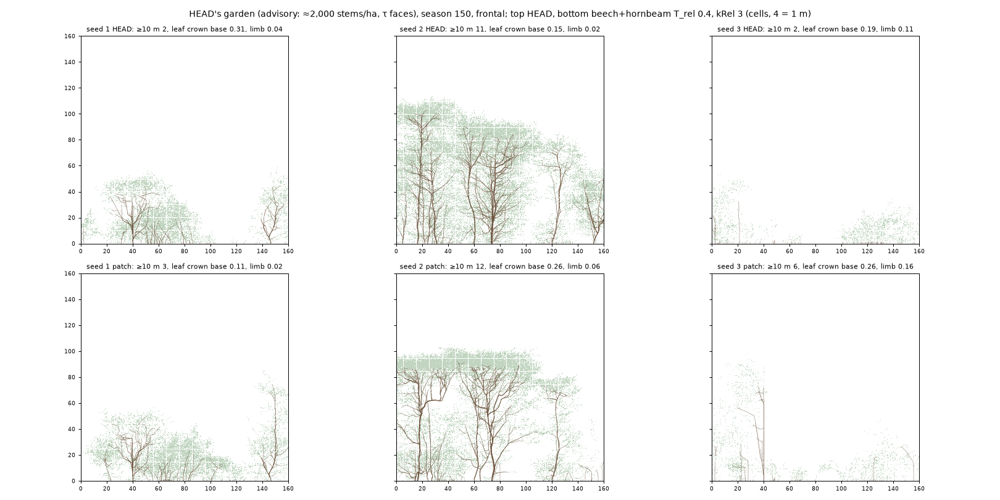
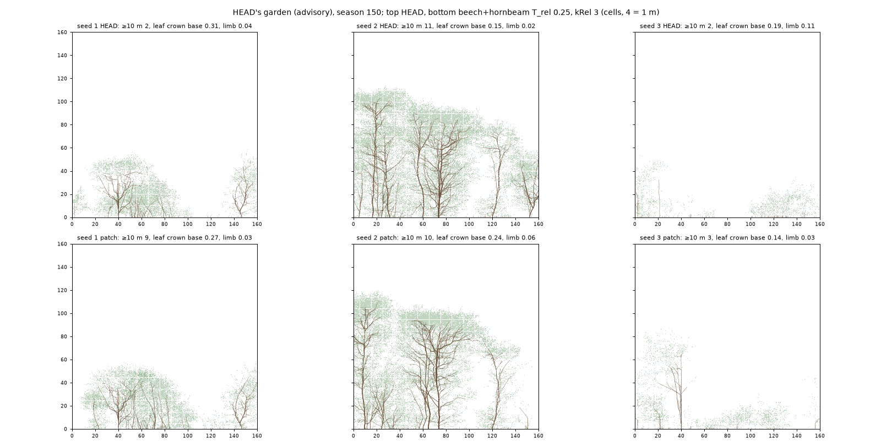

# Does a re-anchored, accumulating T_rel clear beech and hornbeam in a closed stand? (advisory early look)

_2026-11-08. Wayfinder ticket [#88](https://github.com/epabarker/tree-simulation/issues/88), map [#73](https://github.com/epabarker/tree-simulation/issues/73), testing the [bare-bole page](https://github.com/epabarker/tree-simulation/blob/wayfinder/bole-mechanism/docs/features/bare-bole.md)'s proposal. Code at `3d-port` d2c45c8 plus the patch below. **Exploratory: seeds 1–3. Advisory only: this is HEAD's garden (≈ 2,000 stems/ha over the 7 m band, τ faces), not the ADR 0062/0063 garden the page asks for, so nothing here is a pass or a fail of the mechanism.** No turgor patch._

## The patch
- `c5.kRel` (`rust/core/src/principles/c5.rs`): a per-row `dark` counter beside R1's `deficit`. A lateral is shed by C5's relative test only after kRel seasons in a row below T_rel·Q_top; a season above resets it. It is compacted with the rows, and not checkpointed. With kRel 1 (the default) nothing changes: goldens unchanged, `npm run check` green. Either-or with R1's carbon test, as before. Unit test: `an_accumulating_relative_test_sheds_after_k_dark_seasons_and_a_bright_one_resets`.

## Method
- **Conditions** (`code/2026-11-08-bole-probe/params.ts`), patched for beech and hornbeam only (holly keeps 0.021, kRel 1): HEAD; T_rel 0.1, 0.25 and 0.4 at kRel 3; T_rel 0.25 at kRel 1 and 5.
- **Worlds:** HEAD's garden (`forestParams(160)`, 150 seasons) and the lone open-grown 60 m box (ADR 0062; `beechOpen`'s rules, τ 1 all round, 101 seasons) for beech and hornbeam.
- **Numbers:** `rust/core/examples/bole_probe.rs` (#78's `prune_probe` with the kRel label, the leaf share below H/6 and in the top fifth, and limbs born below last season's lowest limb). `summary.py` gives the tables (output kept at `runs/bole-probe/summary.txt`, git-ignored).
- **Pictures:** the feature probe (`code/2026-11-08-bole-probe/probe.ts`, #86's copy with `--lonebox`) for T_rel 0.25 and 0.4 at kRel 3; `figure.py` draws its garden frames. Its "leaf crown base" is the height below which 5% of the leafy buds sit, over the tree's height (median over stems ≥ 10 m, all species).
- **Stems ≥ 10 m are few:** 2–12 per garden run. Hornbeam has one per seed (seeds 1 and 3), always the emergent. Seed 3 plants no beech, and holly reaches 10 m in one seed only. Every per-species number is a handful of trees.

## The garden at season 150

## Diagnostics 1–7

| | HEAD | 0.1, k3 | 0.25, k3 | 0.4, k3 | 0.25, k1 | 0.25, k5 |
|---|---|---|---|---|---|---|
| 1. live crown base, beech ≥ 10 m, seasons 140–150 (median; q90) | 0.017 (0.07) | 0.02 (0.11) | 0.039 (0.38) | 0.057 (0.19) | 0.084 (0.18) | 0.032 (0.12) |
| 1. hornbeam (the emergent) | 0.009 | 0.009 | 0.021 | 0.027 | 0.020 | 0.021 |
| 1. holly | 0.017–0.021 in every condition | | | | | |
| 2. lowest limb's light ÷ Q_top, beech (× T_rel) | 0.26 (33×) | 0.36 (3.6×) | 0.52 (2.1×) | 0.61 (1.5×) | 0.47 (1.9×) | 0.38 (1.5×) |
| 2. hornbeam | 0.22 (9×) | 0.26 (2.6×) | 0.39 (1.6×) | 0.54 (1.4×) | 0.52 (2.1×) | 0.46 (1.9×) |
| 3. first-order limbs shed, beech: P<M / C5 light / both | 639 / 0 / 4 | 647 / 26 / 13 | 663 / 233 / 66 | 336 / 282 / 58 | 188 / 522 / 201 | 690 / 139 / 23 |
| 3. hornbeam | 89 / 0 / 19 | 129 / 16 / 19 | 62 / 107 / 36 | 27 / 168 / 22 | 2 / 157 / 29 | 90 / 60 / 10 |
| 4. hornbeam leaf in the top fifth / below H/6 | 0.45 / 0.035 | 0.46 / 0.04 | 0.62 / 0.014 | 0.70 / 0.001 | 0.62 / 0.011 | 0.52 / 0.018 |
| 4. beech | 0.17 / 0.07 | 0.18 / 0.06 | 0.19 / 0.03 | 0.16 / 0.03 | 0.32 / 0.02 | 0.21 / 0.03 |
| 7. limbs born below the lowest limb, stems ≥ 10 m | 0 | 0 | 1 | 5 | 2 | 3 |

- **1. The bole does not clear.** The lowest living first-order limb stays at 0.25–0.8 m (median), so the live crown base of beech and hornbeam stays 0.02–0.08 against the page's 0.3–0.45. One beech in seed 2 (T_rel 0.25, k3) reaches 0.38 for a few seasons. Holly stays clothed, as intended, but it would in any condition: its T_rel is unchanged.
- **2. The rule is acting** ([histogram](figures/2026-11-08-bole-probe-ratio.png)): the lowest limb's ratio is cut off at T_rel in every patched condition, where at HEAD it sat 9–33× above T_rel. **The lowest limbs survive because they are lit at 0.4–0.6 of Q_top, above even 0.4.** Most are large (100+ metamers) with outer tips in the light; the subtree average saves them, as #78 found for the lone tree.
- **3. C5 shares the work** from T_rel 0.25: C5 alone takes 16–77% of first-order sheds (beech 16–42% at k 3–5, hornbeam 37–77%). At kRel 1 it takes almost everything from R1. The limbs it sheds are mid-crown (median base 4–9 m), not the lowest.
- **4. A lid, at T_rel 0.4 in the closed patch of seed 2:** a thin flat canopy at 22–25 m over a hollow, with hornbeam's leaf 70% in its top fifth (45% at HEAD) and none below H/6. This is the pole-and-cap that ADR 0043's seed 13 warned of. At 0.25 the crowns thin below but keep their depth.
- **5. The lone guard holds by eye and mostly by count, but the ±25% band is narrower than the seed noise.** Lone beech at season 100 keeps 81–95% of HEAD's leafy buds. Its clear bole stays 0.007–0.02, and the sheets show no see-through umbrella. Leaf below H/6 runs 0.66–1.73× HEAD's, and the top fifth 0.85–1.38× (beech). Hornbeam's top-fifth ratio swings 0.16–3.45×, at T_rel 0.1 as well, because HEAD's seed 3 has only 6% of its leaf there. The ±25% test cannot be met even by the mildest patch, so the guard needs a noise floor before the real probe.
- **6. Edge trees:** no edges exist here. x is periodic and every stem stands in the central band. A "gap" proxy (no stem ≥ 0.8 H within 5 m) shows no consistent difference (beech 0.02–0.05 either way, except kRel 1: 0.10 closed against 0.02 open). Both hornbeams ≥ 10 m are emergents, open-topped and lit from the side above their neighbours: not closed-stand trees.
- **7. No re-clothing to speak of:** 0–5 limbs born below the lowest limb on stems ≥ 10 m over 150 seasons (≈ 400–550 tree-seasons). Small trees do it more (150–180 in beech in every condition, HEAD included).
- **Stand:** the cap (57 stems) is full in every condition. Stems ≥ 1.3 m are about the same, and stems ≥ 10 m are 2 at HEAD and 6–9 patched at season 150 (median over seeds), so the patch did not kill the stand.

## What this says for the real probe
- In HEAD's garden the lowest limbs are **not dark relative to their crown**: 0.2–0.3 of Q_top at HEAD. T_rel up to 0.4 removes the dim mid-crown limbs first, which hollows the crown and, at 0.4, makes a lid. Whether the ADR 0062/0063 stand darkens the lowest limbs below the middle ones is the question the real probe has to answer first (diagnostic 2 at HEAD in that garden), before any sweep.
- Two things in the measure may matter whatever the garden. **Q_b/n_b is a subtree mean**, so a big low scaffold with bright tips passes. And **Q_top is the tree's 90th percentile**, so an overtopped tree's whole crown is judged against its own dim top.
- The lone guard's ±25% band needs a noise floor (HEAD's seed-to-seed spread) first.

## Caveats
3 seeds, 150 seasons, few tall stems, and the wrong garden. The probe replays the season phases outside `run_season` (as #78's did); the WASM probe's HEAD frames agree between the two patch runs. The `dark` counter is not checkpointed, so a restored world restarts its dark runs at 0. That is fine for a probe, not for adoption.
