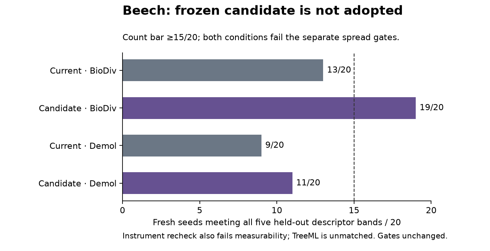

# Day3 step8: species programme

2026-11-08. Step7 preparation merged as #71; phone soak remains explicitly
deferred, RC unreleased. Work starts at470aa3c on codex/day3-species-programme.
No model, garden or planting change has been adopted.

## Beech: bounded end-to-end attempt, rejected

User preserves the five historical holdouts, explicitly **5/18**, not a redrawn
third. length0,limbElevation05,limbUpturn,p3,widestAt remain sealed during training.
The other13 train, including crownBase80/boleSway; leanAngle stays diagnostic.
Registration8d6ec92; separate day3-beech-v7 snapshot atdd3e1a4/7914df0,
old superseded v6 and its guards retained. Recomputed all18 BioDiv distributions
and applicable Demol summaries exactly equal the frozen old values.53BioDiv,
15Demol; raw input/model/code/WASM hashes pinned. No blind hash refresh or redraw.

Current beech is assign={} over shipping defaults, not --hand's historical frozen
Level0/form values. Important: current hJ44.95 rather than the old registration's
77.63. Historical fixed assignments were not restored by this evaluation.
Source naming correction: N1 scripts initially collided with new tool names;
restored unchanged, new tools use day3_species_beech*. Pre-rename pilot registration
is preserved under runs; core and effective inputs were unchanged.

### Seeds and model selection

Audit3,890metadata JSON files plus all run JSON filenames found no reserved-block
hits. It cannot cover deleted/external data or undocumented seed generation.
Training21001–21020, selection21021–21040 (unused), confirmation21041–21060,
TreeML21061–21080. Gallery uses known regression seeds1001–1003, not fresh biology.
Future sycamore22001–22040/ash23001–23040 blocks are separate.

Initial current20stands: matched70,79live measured trees, training location12/13,
spread11/13. Then fixed form-only current/prior-v3/prior-v4 bundles, all20training
seeds each, exact DAG and historical sweep checks before runs (6cf3a57).
All physiology stays current, including lifespan-off; only ten form knobs differ.
DAG levers live; old three-seed sweep is a selector/limitation, not effect evidence.

| Candidate | L0 contribution | L1 training contribution | Total | Match season | Trees |
|---|---|---|---|---|---|
| current | 14.485081 | 7.312134 | 21.797215 |70|79|
| prior-v3 |12.549497|5.365502|17.914999|60|79|
| prior-v4 |10.938815|6.108984|17.047798|80|78|

Prior-v4 frozen ate7a1f1c by registered minimum TOTAL loss, before any held-out
scoring. No new CMA-ES optimisation: this is a bounded warm-start model selection,
not a claim of best achievable form. Candidate still misses training spread:
boleSway2.477484×,tortuosity05.274761×. Current full-trial and stand-only raw dumps
identical120/120. Pilot full trial17.281s; remaining59candidate-seeds443.408s wall,
3470.887s summed evaluator elapsed, **not measured CPU time**. Initial stand-only
timing key named reported_cpu_seconds is a misnomer, corrected in interpretation.

**Protocol erratum:** plan prose said lone to100; the pinned existing level1_eval
serves lone through60. All three use that same existing protocol. No lone100 loss
term exists in the actual Level0 spec; gallery separately measures60/100. Retain
this preregistration discrepancy; do not claim the screen generated lone100
observations or was a new full optimiser. Scored terms/ranking were not altered.

### Fresh confirmation

Forty NEW stands, two frozen conditions ×20fresh seeds;150seasons, standard width84,
depth64,height200,12trees, measured indices4–7, periodic width, opaque depth faces,
no recruitment/storms. Per-condition matching at70;76/75live trees, no seed empty,
no held-out seed z nonfinite; none outside BioDiv's DBH range. Existing instrument
uses cohort size matching and finite per-descriptor seed medians, no new exclusions.

| Condition | Reference | Joint five holdouts | Spread bands within×2 | Failed spread ratios |
|---|---|---|---|---|
| current | biodiv | 13/20 (≥15) | 15/18 | boleSway 4.249505×, tortuosity05 0.347201×, length0 4.960904× |
| current | demol | 9/20 (≥15) | 11/17 | boleSway 2.386277×, forkHeight 2.104807×, length0 22.945222×, p2 2.420945×, pendulousFraction05 2.477038×, tortuosity05 0.480684× |
| winner | biodiv | 19/20 (≥15) | 16/18 | tortuosity05 0.342524×, length0 3.567817× |
| winner | demol | 11/20 (≥15) | 14/17 | length0 16.501902×, pendulousFraction05 2.015718×, tortuosity05 0.474210× |

**Adoption fails.** Candidate's19/20 BioDiv count is not an overall validation:
spread fails; Demol11/20<15 and spread fails. Demol uses applicable tier-A only,
existing BioDiv detrending slopes and frozen site summaries; all17tier-A spreads
were prospectively gated, limbDroop (tierB) excluded from Demol, not from BioDiv.
No alternative finalist or refit chosen after seeing these held-outs.

Gallery shapeFlag clear for both. Existing three-seed named regression, not20-seed
biological evidence: winner nearest round3-cone distance.62 vs current-hand.38;
current.59 vs hand0.00. No user look judgement requested after hard failures.

### Coarsening-tier recheck: measurability failure

Only10/18 old assigned tiers retain their required≥15/20 seeds. Eight groups
fall to8–9/20. Independent audit reproduces every19row's counts exactly (including
diagnostic leanAngle). No converter/helper bug: all76geometry arrays finite,
no below-ground removals.15/76 live trees have no non-trunk wood;17/76 lack
qualifying≥2.5m limbs. Strict tiers._seed_median fails any undefined difference,
leaving only9/20 or8/20 fully measurable seeds in those groups; all fully
measurable seeds in those low-count groups meet the shift tolerance.

This is **not evidence of large coarsening shifts**. It is a failure to retain
measurability across the registered cohort. Keep all20seeds; do not silently filter
suppressed trees, downgrade/drop descriptors or loosen tolerances. The quantitative
form findings remain conditional on this measurement limitation, not validated
biology. leanAngle is not promoted into fitting/gating.

### TreeML: no-refit test completed, unmatched

All14 local beech QSMs and positive measured DBHs, no outcome-driven exclusions.
Own18 descriptor distributions finite. Source/input hashes pinned; target median
DBH.960916675m. Same frozen current/candidate parameters,20new lone seeds each,
150seasons, skeleton window50–100, allometry50–150. All40runs completed.

| Condition | Median DBH100 | First cohort match | Valid skeleton window | Descriptor gate |
|---|---|---|---|---|
| current |.956930824m|110|50–100|unmatched; not scored|
| candidate |.920457430m|120|50–100|unmatched; not scored|

Do not call this0/20 observed descriptor failures: **zero scored**, all20models
per condition complete; the registered valid-match gate fails. No window extension
or refitting after seeing the miss. The real-data transfer control also fails:
17/18descriptor groups pass; limbUpturn d_min13/14 is **at its limit** (needs13),
upper11/14 misses. Borrowed BioDiv tolerances/resolution and no independent TreeML
repeat-noise floor remain limitations. Pilot22.762s evaluator; remaining39runs
384.027s wall/2983.320summed evaluator elapsed.

### Beech decision and provenance

Retain current beech. No species/garden adoption, no G-forest or candidate budget
run for this rejected change; those are **unrun, not passed**. Existing release
checks are inherited, not new biological evidence. No goldens/baselines changed.
No new mechanism justified: a broader search of existing live levers or revised
measurement protocol would need new prospective registration and fresh evidence.

Reproduction (exact measured source commits and hashes remain in manifests):

- day3_beech_register.py: data-only targets/current inputs; existing committed snapshot retained.
- day3_species_beech.py pilot/remaining/analyse: training-only current screen.
- day3_beech_screen.py pilot/remaining/analyse: three fixed full-trial bundles.
- day3_beech_holdout.py run/analyse/gallery; day3_beech_resolution.py.
- day3_beech_treeml.py register/pilot/remaining/analyse; frozen source14summary committed.

Invoke through `uv run --project analysis python analysis/experiments/<script>`.
Raw runs/day3-step8/beech; workers' independent findings in runs/day3-step8.
The prototype comparison code refuses measured-output overwrites; no cache counts
as a fresh run. Raw data intentionally ignored; summaries/aggregate figures only.

## Sycamore/ash: independent programme in progress

Source extraction registered ate73a543; exact separate target/candidate files
frozen at3d42ea9; numeric prototype gatesb86225e. Existing Tallo regional filter,
quantile regression and real-control statistic, no old target changes. Source
height anchors at40cmDBH imply initial maturity110.3177/127.1196cells at fRep.8.
Current maple's own patch is a generic opposite-branching starting prior, not a
field-maple relabel or a measured new-species physiology. Two separate identities;
ash's existing rowan leaf style is a visual proxy, not validation.

Source sycamore H447/CR440/joint418, control19/20; ash H921/CR857/joint815,
control17/20, each bar15. Explicit-species DAG support preserves default roster;
30instrument tests pass. Exact lone/standard-stand/garden physical contexts checked,
no dead maturity/fRep lever and no new relay gate. No mortality-enabled override.

Prototype20training seeds/species are running through existing species trials and
the same Rust core. Fresh confirmation blocks remain untouched; no model/garden
change adopted. Height anchors are source-informed design checks at150, not field
age observations. Level0 H/CR bands, own controlT and fresh15/20gate still required.
Garden G-forest/budget/regressions/density gates remain before any adoption.

### New-species preliminary results and next registered range

All40prototype species-seeds completed, each lone150 +standard stand150; remaining39
pairs486.494s wall. Height design20/20 each, medians27.8022/31.8710m. Stand gate
0/20 each, all120six-score values finite per species; no empty-supported seed.
CR60 median z+1.28356/+1.66469 dominates the misses. Source controls remain19/20
and17/20, no threshold change. Copied physiology is only a prior, not accepted.

E2 λ0±10%80new stands complete: sycamore minus0/20/plus3/20, ash0/20both,
bar15. Plus increases H/narrows absolute CR but also thins DBH, leaving CR-at-DBH
high. No passing candidate selected. Source/model/80input identity checks retained.
Pilot7.650s, remaining79models266.192s wall/2031.074summed evaluator elapsed.

Next prospective grid859aae3/af1a3ee: λ0.66564/.72111 ×pipe scales1.2/1.3,
mw inverse-square; four bundles per species,20training seeds each. All8exact DAGs
retain reader/dead lists;160fullinput comparisons differ only in λ0,r0,mw.
This preserves only fixed-skeleton ideal wood-charge product, not whole behaviour
or bit identity. Pipeline materialisation must not reset mw to64. No new mechanism.
First species80case stage underway; no fresh confirmation or garden adoption yet.
