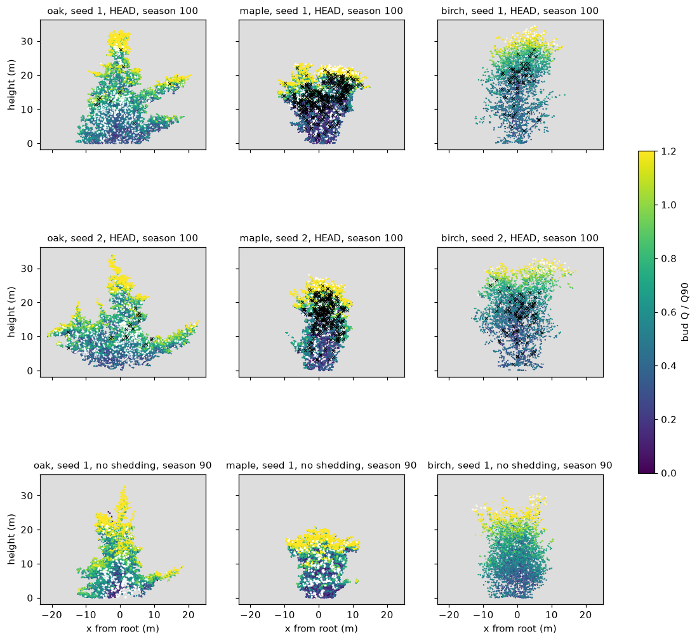

# Where does the flat cap come from at HEAD? (exploratory)

> **Evidence, not a baseline** (ADR 0062, ticket #115, 2026-11-10). Measured in the world of the slab's τ 0.2 walls: a half-walled lone tree, or a stand lit through its faces. The lone-tree stage is now open-grown (a square 60 m box, open on all four sides) and the garden's depth is to become periodic, so re-measure before using these numbers as a baseline.

_2026-11-08. Wayfinder ticket [#79](https://github.com/epabarker/tree-simulation/issues/79), map [#73](https://github.com/epabarker/tree-simulation/issues/73). HEAD d2c45c8. **Exploratory: seeds 1 and 2, lone trees, 150 seasons (100 without shedding).** Facts and pictures only; no adoption claim._

## Method
- `rust/core/examples/cap_probe.rs` replays a params JSON phase by phase, as `prune_probe.rs` (#78) does. After each tree's allocation it labels every branch root `shed_branches` will take (`P<M`, `light`, `both`) and records:
  - its position;
  - its subtree's leaf area and bud states;
  - its light per metamer ÷ Q_top, its P/M, and its buds' Q and age.

  Every 10 seasons it also dumps every live bud (position, raw Q, leaf area) and the tips of that season's new metamers.
- Cases (`params.ts`): a lone oak, maple and birch in `beechOpen`'s field (240 × 64 cells, faces τ 0.2), seeds 1 and 2. The same trees were also run with **no shedding** (C5 off, R1 `shed` not carbon: ADR 0031's diagnostic 1).
- `summary.py` places each leafy bud around the crown's centre. The centre's height is the middle of [5th percentile of leaf height, H]. Positions are normalised by the crown's half-width (95th percentile of |dx|, frontal) and half-depth. An ellipse then fills ρ ≤ 1, and a box fills its corners (ρ up to 1.41 at 45°).
  - The angle θ is measured from vertical. Sectors: top < 30°, **upper flank 30–60°**, side 60–120°, below > 120°. The outer shell is ρ ≥ 0.7.
  - Bud light is shown as Q ÷ Q90, the 0.9 quantile of the leafy buds' Q (C5's own `topQuantile`). Q_top is 0 when C5 is off.
- `figure.py` draws the figure.

## The crowns

| case, season 100 (no-shed: 90) | H (m) | W/H | top fifth's leaf | width at 0.9 H ÷ max | shell ρ at 45° |
|---|---|---|---|---|---|
| oak s1 / s2 | 33 / 34 | 0.77 / 1.06 | 0.11 / 0.02 | 0.22 / 0.04 | 0.48 / 0.39 |
| oak no-shed s1 / s2 | 33 / 33 | 0.57 / 0.84 | 0.01 / 0.03 | 0.06 / 0.07 | 0.76 / 0.50 |
| maple s1 / s2 | 24 / 28 | 0.82 / 0.49 | 0.19 / 0.12 | 0.73 / 0.45 | 1.23 / 1.06 |
| maple no-shed s1 / s2 | 21 / 21 | 0.73 / 0.83 | 0.05 / 0.08 | 0.32 / 0.58 | 0.99 / 1.14 |
| birch s1 / s2 | 35 / 33 | 0.49 / 0.63 | 0.12 / 0.15 | 0.45 / 0.82 | 1.17 / 1.38 |
| birch no-shed s1 / s2 | 31 / 33 | 0.52 / 0.45 | 0.04 / 0.02 | 0.75 / 0.29 | 1.28 / 1.02 |

- **Maple is the flat cap**: a lit, flat-topped layer about 20 m wide at 20–25 m, over a box (ρ at 45° 1.06–1.23, the top tenth 0.45–0.73 of the widest). **Without shedding it is still flat-topped**: a box with a flat lit top at about 17 m. The top fifth holds less of the leaf (0.05–0.08 against 0.12–0.19), because the lower crown keeps its leaf.
- **The oak is not a flat cap at HEAD.** It is a narrow spire over wide-angled low limbs. The upper flank is nearly empty: ρ at 45° is 0.39–0.48, and the flank shell holds 0–1.4% of the leaf. Without shedding it looks the same. Its leader has stalled at 33–34 m since about season 75 (not followed up here).
- **Birch is a column** with a lit top, shed or not.

## Which rules remove shoots, and where (seasons 50–140)

- **By count, most sheds are leafless twigs.** Of the branch roots shed, 91% (maple), 99% (oak) and 71–76% (birch) carry no leaf. Each is one metamer whose buds are all dormant. R1 sees P = 0 < M and sheds it at `kShed` 1.
  - Their light at the shedding is high: median 0.43–0.64 of Q_top.
  - Their buds rested dormant **last season** (bud age 1), when their Q fell below R6's Q_ss (`r6.qMin`). This season their Q is back above Q_ss for 55–87% of them (median Q 0.13–0.27 against Q_ss 0.07–0.14).
  - The phase order makes this happen. Allocation in season s computes P from the bud states that season s − 1's grow phase set, so the twig goes in s's shed phase. That phase comes after s's grow phase, which would have made those buds short shoots again.
  - **One season below Q_ss kills a twig, whatever its light now.** The effective compensation point is R6's Q_ss with a one-season lag, not P < M at a leaf's cost.
- These are **not** R4 bank buds: fewer than 1% of the leafless sheds carry a bud that the previous shed phase made.
- **Leafy sheds** are fewer: maple 3.5–4.5k, birch 0.6–0.7k, oak 0.2–0.4k.
  - Maple's go by `P<M` at a light ratio of 0.17–0.20.
  - Birch's go by **C5's `light` test**: T_rel 0.21, so C5 is live in birch, unlike the other species (#78).
  - The leaf they take is small: **0.3–0.5% of the standing leaf per season in maple, under 0.06% in oak.**
- **Where:** in maple the leaf shed comes from every sector. The outer upper crown (top and flank shell) loses 0.30–0.32% of its leaf per season against 0.47–0.53% elsewhere. In the picture the shed crosses sit just under the lit top layer and through the interior, not on the flank's surface.

## What light the upper flank sees, and where new growth goes (seasons 50–140)

| | maple | oak | birch |
|---|---|---|---|
| flank shell: leaf share | 6–14% | 0–1.4% | 8–9% |
| flank shell: median Q ÷ Q90 | 0.75–0.96 | 1.0–1.8 (few buds) | 1.0 |
| flank interior: median Q ÷ Q90 | 0.39–0.42 | 0.75–0.80 | 0.61–0.65 |
| flank shell: share of new metamers | 5–11% | 0–4% | 32–33% |
| below-shell: share of new metamers | 19–23% | 40–62% | 2–4% |

- **The upper flank is not dark**: its outer buds are lit near Q90 in all three species. Where it is empty (oak), nothing grows into it. The oak's new metamers go to the low limbs' tips (40–62% to the lower outer shell).
- In maple the new growth spreads roughly in proportion to the leaf. The flat top keeps its shape because the top's buds grow outward and level, not up.

## DAG paths (docs/background/model-dag.md)
- **Shedding → top shape, via the twig kill.** Within a season the path is R6 (grow) → bud state. That state is a feedback edge into next season: R1's production (allocate) → P_b < M_b at `kShed` 1 → C5's `shed_branches` (shed) → removal → L1 (less shade) and L2 (less cost). This is the DAG's L4 (carbon-shedding memory) with a memory of zero, and R6's `qMin` acting as the threshold through L7's bud clock. The DAG's reach tables connect `r6.qMin` to every outcome at lag 1, as they do for every live knob, so they cannot say which of these paths sets the top.
- **Allocation → top shape.** The paths are C2 → C3's Borchert–Honda split (λ, R2's levels and vigour shares) → each bud's v → C1's shoot size (the R2 hJ juvenile cap) → R2 and C4 direction. These set where the crown extends. Without shedding the maple stays a flat-topped box and the oak stays a spire, so **at HEAD the top's shape is set on this path.** Shedding changes how the leaf is spread down the crown: shedding moves maple's leaf into the top fifth. It does not set the outline.
- ADR 0031 (hornbeam, round 5) found that no shedding rounds the lone crown. **At HEAD, for maple and oak, it does not.** This agrees with ADR 0031's Decision 4, "the flat top is in growth, not in pruning".

## Limits
- Two seeds, lone trees only, one field (`beechOpen`'s). Hornbeam, ADR 0031's case, was not rerun.
- The sector geometry is frontal (|dx|) and ignores depth. The envelope is a 95th percentile, so a few outlying shoots don't set it.
- Sheds are placed using the crown's geometry at the last dump season (≤ 9 seasons earlier).
