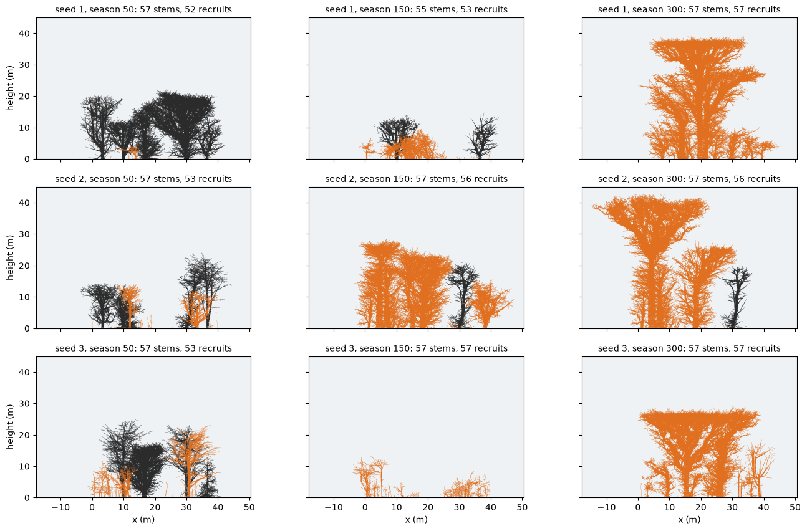
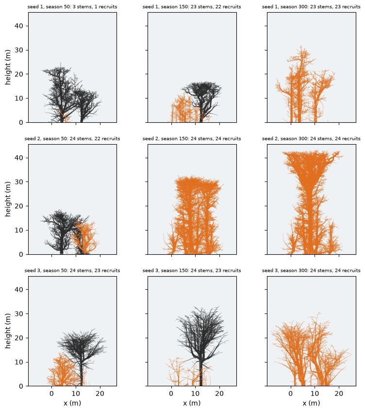

# What the garden's demography does today (2026-11-08)

**Question (wayfinder [#80](https://github.com/epabarker/tree-simulation/issues/80)):** on the current
garden configuration, list every source of new trees with its params, when each starts, the recruit cap
and the starting density. Measure the fraction of drawn stems that are recruits, and how many stems are
drawn at seasons 50, 150 and 300.

**Exploratory:** seeds 1–3, `forestParams` at HEAD (d2c45c8) for the desktop width (160 cells) and the
phone's (66). There is also a desktop control with seed rain off. These are counts and pictures, not an
adoption claim. 4 cells = 1 m. Code: `code/2026-11-08-garden-demography/` (`params.ts` dumps the params,
`summary.py` the counts, `figure.py` the pictures).

## The configuration

`forestParams(width, seed)` = `mixedWood` + `GARDEN_PLANTING` {rows 1, spacing 28, recruits 0.25}
(`src/core/presets.ts`). O4 (`rust/core/src/principles/o4.rs`) is the only source of new trees.

| | desktop (160) | phone (66) |
|---|---|---|
| planted | 6 in one row, every 28 cells (7 m), species turned through `MIXED` by the seed | 2 |
| live-tree cap `o4.maxTrees` = 300 · W/210 · rows · 0.25 | 57 | 24 |
| band seedlings establish in (`o4.band`) | 28 cells (7 m) around the slab's middle, of 64 | same |
| stems/ha at the cap, over the band | ≈ 2,000 | ≈ 2,100 |

**Sources of new trees.** Every source goes through the same gate: ground light ≥ Q_est × C, then p_est
0.3, no live trunk within a cell, and a free place under the cap.
- **Local seeds:** R1 puts `fRep` of the surplus into seeds once a tree is taller than `r1.maturity`. A
  seed costs `c_seed` and lands at Laplace(d), at a random azimuth. A seed outside the band is lost.
- **Seed rain** (ADR 0018): `rain` seeds per 100 cells per season, landing anywhere in the band.
  Only birch (0.2) and willow (1) have it. It runs from season 1.
- **The order:** local seeds are tried first, then rain. Once the cap is full, any seed that reaches the
  gate ends the season's recruitment. A recruit then gets a place only when a tree dies.
- **Nothing else plants:** there is no seedling bank, no masting and no start season. The page draws
  every live tree, seedlings included; there is no display threshold.

| species | maturity (m) | fRep | c_seed | d (m) | Q_est | m₀ /season | rain |
|---|---|---|---|---|---|---|---|
| birch | 10 | 0.1 | 2 | 10 | 0.25 | 0.008 | 0.2 |
| willow | 22.5 | 0.8 | 1.5 | 15 | 0.3 | 0.012 | 1 |
| maple | 7.5 | 0.1 | 5 | 6.25 | 0.05 | 0.004 | |
| beech | 10 | 0.1 | 10 | 3 | 0.03 | 0.002 | |
| holly | 15 | 0.8 | 8 | 10 | 0.01 | 0.003 | |
| rowan | 21.25 | 0.8 | 3 | 12.5 | 0.06 | 0.006 | |
| hornbeam | 28.75 | 0.8 | 5 | 5 | 0.04 | 0.003 | |
| oak | 32.5 | 0.8 | 10 | 6.25 | 0.1 | 0.002 | |

Holly's species patch carries `o4.enabled: false` and `maxTrees: 300`. Neither is read (only the world's
O4 switch and cap are), so holly seeds.

## What happens

| run | cap full at season | drawn 50 / 150 / 300 | recruit fraction 50 / 150 / 300 | planted alive 50 / 150 / 300 | recruits < 5 m at 300 | recruits born by 300 |
|---|---|---|---|---|---|---|
| desktop s1 | 48 | 57 / 55 / 57 | 0.91 / 0.96 / 1.0 | 5 / 2 / 0 | 34 | 98 |
| desktop s2 | 49 | 57 / 57 / 57 | 0.93 / 0.98 / 0.98 | 4 / 1 / 1 | 46 | 143 |
| desktop s3 | 23 | 57 / 57 / 57 | 0.91 / 1.0 / 1.0 | 5 / 0 / 0 | 46 | 200 |
| phone s1 | 101 | 3 / 23 / 23 | 0.33 / 0.96 / 1.0 | 2 / 1 / 0 | 15 | 43 |
| phone s2 | 49 | 24 / 24 / 24 | 0.92 / 1.0 / 1.0 | 2 / 0 / 0 | 15 | 37 |
| phone s3 | 17 | 24 / 24 / 24 | 0.96 / 0.96 / 1.0 | 1 / 1 / 0 | 14 | 84 |

- **The cap sets the stem count.** It is full by seasons 17–49 in five of the six runs, and from then
  on the drawn count stays at the cap.
- **From season 50, recruits are 0.91–1.0 of the drawn stems.** The one exception is phone seed 1,
  whose only parent (an oak) first seeds at season 101. By season 300 no planted tree is alive in five
  of the six runs.
- **Most recruits stay small.** 58–81% of the drawn stems at season 300 are under 5 m, and only
  3–5 are over 15 m. Only 2–11 trees per run are over 10 m at any of the three seasons.
- **Recruits are mostly one species per run:** beech (seeds 1 and 2), birch then hornbeam (seed 3), and
  oak on the phone's seed 1. Willow recruits come only from rain: the planted willows reach 14–19 m, under
  willow's maturity of 22.5 m, so they never seed.
- **First local seeds:** birch at seasons 14–18, beech at 29–39, holly at 56, rowan at 85, hornbeam at
  69–121, and oak at 101 (phone).
- **Rain off (desktop, the same seeds).** At seed 1 the cap fills later (48 → 97; 45 stems at season 50).
  At seeds 2 and 3 it fills at about the same time (39, 25), and at seed 3 the stand drops to 42 stems by
  300. **Rain is not what fills the cap.** Local seeding of birch and beech fills it within 15–35 seasons
  of their maturity.
- **A gap phase.** At desktop seed 3, season 150, all six planted trees are dead and the tallest recruit
  is about 12 m. Two stems are over 10 m. The garden reads as empty (top-middle panel below). Seed 1 at 150
  is similar, with two planted trees left.

## Why the planted trees die young

[#78](https://github.com/epabarker/tree-simulation/issues/78) found that planted garden trees die young,
and did not examine the cause. Here, **none of the planted trees starve.**
- In their last five seasons alive, every one has P/M 2–12, `starved` 0 and a reserve that is level
  or growing.
- The same tree of the same seed dies in the same season at both widths: oak at 114 and willow at 222
  (seed 1), willow at 70 and beech at 82 (seed 2). The stands around them differ.
- That is O4's **background mortality m₀**: a keyed draw on (seed, tree, season) that ignores the
  tree's size, age and vigour (`stand_dynamics`, purpose MORTALITY).
- At m₀ 0.008 (birch) a tree's chance of living to season 150 is 0.30. At 0.012 (willow) it is 0.16, and
  at 0.002 (beech, oak) it is 0.74. With six planted trees, losing most of them by 150 is what the draw
  gives.
- m₀ treats a 30 m canopy tree the same as a seedling.

## The named regressions

- [phoneSeed3](https://github.com/epabarker/tree-simulation/issues/54) is `forestParams(66, 3)`, the
  phone run above. It is unchanged at HEAD: 24 live at 150, 1 planted, 2 over 10 m. Here it reads as
  the cap full of sub-10 m birch recruits under one surviving planted birch, which dies at 204.
- [forestRegeneration](https://github.com/epabarker/tree-simulation/issues/55) is the `forest` preset
  (τ 0), not the garden. It is unchanged at HEAD: 687 recruits born and 23 reaching 5 m by 300.
- Both were rerun with `node cli/regressions.ts` on this branch, and both are unchanged.

## For the demography decision

- The garden is **a capped seedling stand from about season 50**. Its stem count is the cap. Its
  canopy comes from a handful of recruits that get through. Its planted trees are a short opening act,
  ended by m₀ rather than by competition.
- Any schedule (a start season, masting, a seedling bank, a display threshold) acts on a cap that is
  already full. An age delay only postpones the cap; that was the 2026-11-06 recruits note's finding,
  confirmed here: local seeding fills the cap within 15–35 seasons of maturity.
- m₀ that does not depend on size or vigour is a lever the schedule ticket should weigh. Real canopy
  mortality falls with size, and the empty gap phase (seed 3 at 150) comes from it.
