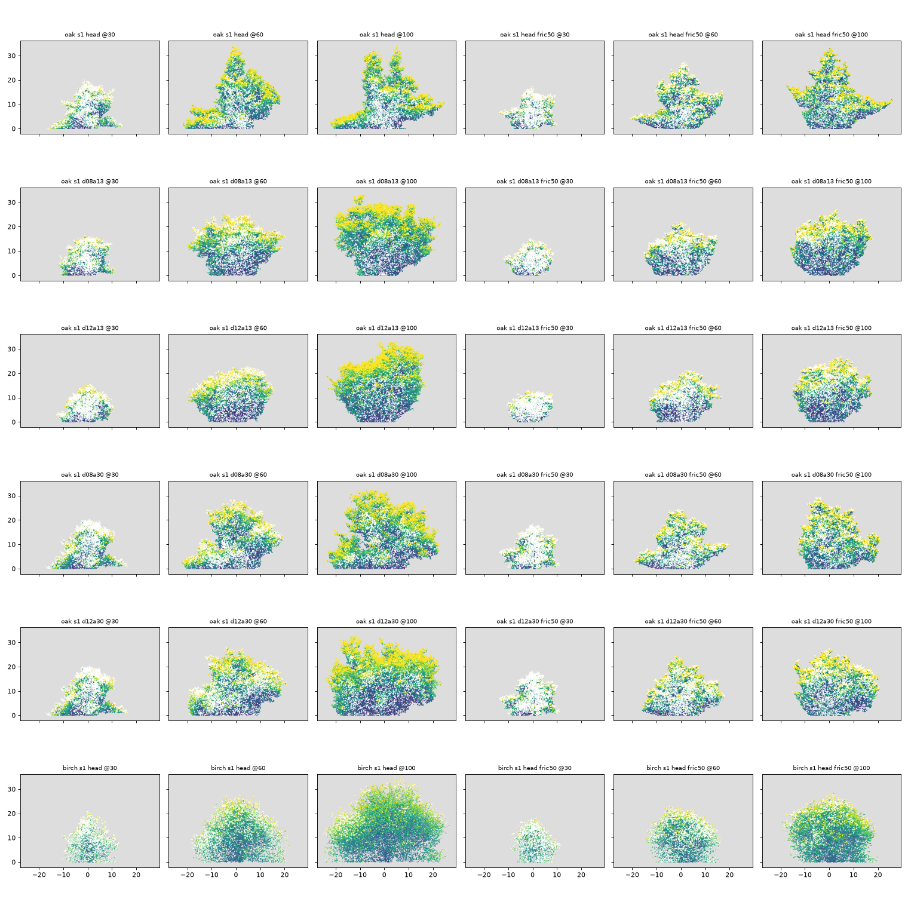
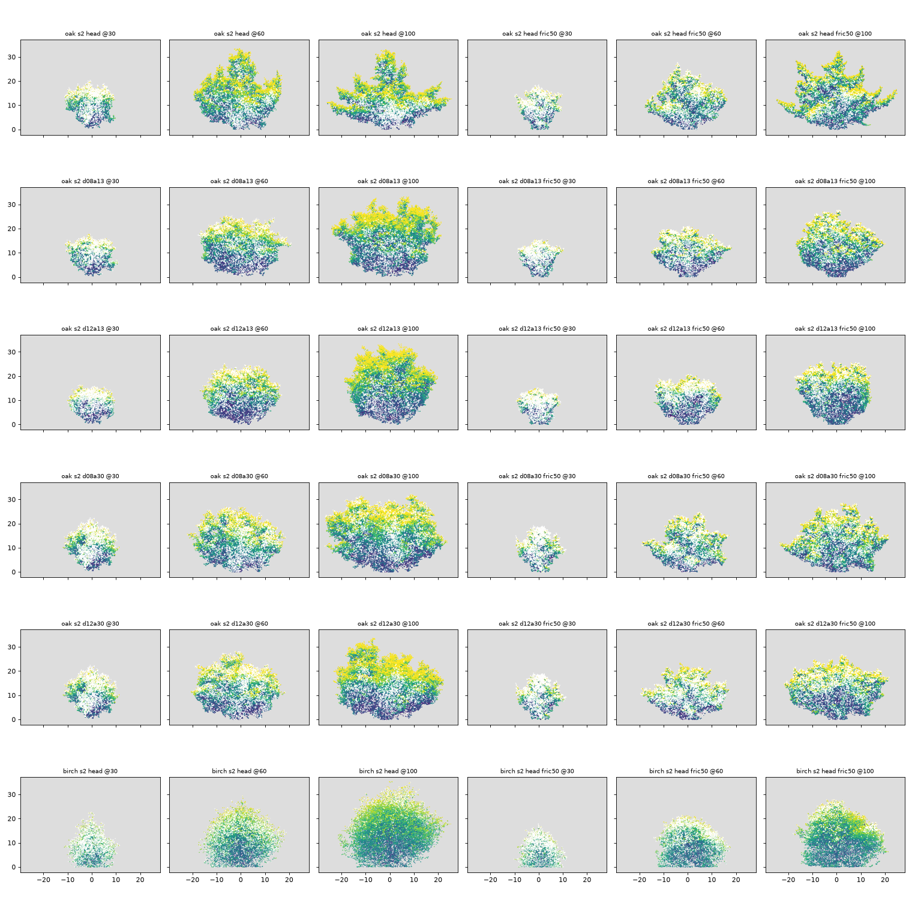

# Does a falling λ (loss of apical control) fill the open-grown oak's flank? (exploratory)

_2026-11-08. Wayfinder ticket [#91](https://github.com/epabarker/tree-simulation/issues/91), map [#73](https://github.com/epabarker/tree-simulation/issues/73). It follows [What keeps the oak's upper laterals from spreading into its flank?](https://github.com/epabarker/tree-simulation/issues/90) ([note](2026-11-08-oak-flank.md)). The code is `wayfinder/oak-flank` 6d2e70e. Only parameters change, nothing in the core. **Exploratory: seeds 1–3, lone trees in the 60 m open-grown box, 101 seasons.** No adoption claim._

## Answer

**Yes. A falling λ fills the oak's flank, and the top divides. `r2.dLambda` 0.12 at `aC` 13.5 (`d12a13`) rounds the oak without the length cap. It costs the young oak's spire and its wide low limbs, though, and no setting reaches the top-fifth band.**

| oak, season 100 | HEAD | d08a13 | d12a13 | d08a30 | d12a30 |
|---|---|---|---|---|---|
| λ on the upper leader (nominal) | 0.52 | 0.42 | 0.38 | 0.42 | 0.38 |
| axis switches on the leader path | 1–5 | 54–66 | 66–72 | 34–54 | 46–55 |
| laterals' light share, upper leader (60–100) | 0.012 | 0.13 | 0.33 | 0.15 | 0.46 |
| flank share of new metamers 60–100, % (≥ 5) | 0.0 | 3.6–7.0 | **5.5–7.3** | 0.2–4.2 | 1.8–3.9 |
| top-fifth leaf (0.15–0.30) | 0.03–0.05 | 0.02–0.05 | 0.05–0.07 | 0.01–0.05 | 0.02–0.03 |
| W/H | 0.96–1.17 | 0.84–1.06 | 0.87–0.89 | 1.06–1.18 | 1.05–1.13 |
| height, m | 33.0–33.9 | 33.0–33.3 | 32.9–33.3 | 32.1–33.2 | 32.9–33.5 |

With the length cap at s* 0.5 (`F`): flank 0.2–2.5% at HEAD, 4.0–6.9% (`d08a13F`), **7.0–14.9%** (`d12a13F`), 1.3–2.3% (`d08a30F`) and 1.2–3.9% (`d12a30F`). Top fifth 0.04–0.13, heights 26–29 m.

- **The top divides.** Once λ is below 0.5 the oak's upper leader behaves like maple's (#90: 51–58 switches, lateral light share 0.75–0.97). Its laterals take 13–46% of the light at a node instead of 1%, and the leader path changes axis 34–80 times. The leader path's own subtree now holds 28–62% of the leaf (HEAD 2%). Lower limbs hold 36–71% (HEAD 91%).
- **The flank fills from the divided top and the lower limbs, not from upper laterals.** The lateral subtrees on the upper leader still hold only 1.4–4.3% of the leaf. The flank's new metamers come from the leader path (19–47%) and the lower limbs (30–67%) in the λ-only settings.
- **`d12a13` is the one setting that passes the flank bar on all three seeds without the cap.** In the pictures it is a full, rounded dome at 33 m (seed 2 the clearest). `d08a13` passes on two seeds and is broader, with a flatter, lit top.
- **A late fall (aC 30) does not round it.** It keeps the young oak's spire at season 30 (20.6–22.6 m, as HEAD), but by 100 the top is a broad, flat lid ([seed 2](figures/2026-11-08-oak-lambda-s2.png), `d12a30`), the ADR 0031 risk, and the flank stays under 5% in all six λ-only runs (0.2–4.2%).
- **The cost.** An early fall turns the oak into a bush from youth: at season 30 it is 15–18 m with no spire (HEAD 20 m). The wide low limbs that reach 25 m from the trunk at HEAD are gone in every falling-λ setting, and `d12a13`'s W/H is 0.87–0.89 (HEAD 0.96–1.17). An open-grown oak's low, wide limbs are part of its real look, so this is a trade, not a clean fix.
- **The top-fifth band (0.15–0.30) is missed everywhere,** 0.01–0.13. The pictures show leafy, lit tops, so this is partly the measure: a dome over a crown that reaches the ground puts little of its leaf above 0.8 H. The band came from maple (#89). It needs re-checking for a full-skirted lone oak before it is used as a gate.
- **The length cap is not needed to round the oak.** With `d12a13` it doubles the flank share (7.0–14.9%), but costs 6–7 m of height (26–27 m) and gives seed 2 a flat-topped dome. As in #89, the cap is a maple decision. For the oak, λ alone does the work.
- **The stall is delayed, not replaced.** HEAD reaches 33 m by season 45–60 and stays there. The falling-λ oaks reach the same 33 m only by season 80–100 (last season with ≥ 0.1 m of gain: 73–100). With the cap they are still growing at 100. The ceiling is still R1's reproductive sink at maturity 32.5 m (#87).
- **Birch, the contrast, is untouched and stays one axis.** Only the oak's species entry was changed. Birch's upper leader runs on its twig level, which keeps λ 0.5 (`dLambdaShare` 0, ADR 0057) while its lower levels fall to 0.45/0.41. Its upper laterals hold 0–4% of the light, and its leader path changes axis 3–7 times. So birch's excurrence comes from twigs-keep-λ, not from its λ schedule. Its outline is still the broad dome of #86 (W/H 0.87–1.17), above #83's W/H ≤ 0.7 contrast, as before.

## What this settles, and what it leaves

- **Loss of apical control is the mechanism for the oak's flank,** ranked third in [How do real crowns become rounded?](https://github.com/epabarker/tree-simulation/issues/74). In this model it is a λ schedule, a species expression with no new rule.
- **Open:** a schedule that divides the top but keeps the young spire and the wide low limbs. The levers are `aC` between 13.5 and 30, and a per-level `dLambdaShare` (ADR 0057) so the low limbs' level keeps its λ while the top's falls. And a top measure that works for a full-skirted crown.

## Method

- **Params** `code/2026-11-08-oak-lambda/conditions.py` writes 36 params files from the open-box dump (`code/2026-11-08-open-box/params.ts`, 240 cells). Oak: `r2.dLambda` 0.04 (HEAD) / 0.08 / 0.12 × `aC` 13.51 (HEAD) / 30, each without and with `c3.sink: "turgorLength"` (g 0.002, r 0.01, Ψ_crit −0.82: #89's fric50). Birch: HEAD and fric50 (Ψ_crit −0.79).
- **Probe** `rust/core/examples/flank_probe.rs` (#90's, unchanged), 101 seasons, dumps every 10. HEAD's oak reproduces #90's heights (20.3 m at 30, 32.8–33.7 at 60). 16 min on 12 workers, `runs/oak-lambda/` (git-ignored).
- **Analysis** `code/2026-11-08-oak-lambda/summary.py` is #90's with a stall table (F) added; output in `summary.txt`. `figure.py` draws the contact sheets.

## Limits

Three seeds, lone trees only, seasons ≤ 100. No garden run, so the effect of a bushier oak in a stand (and on `phoneSeed3`) is unmeasured. The `aC` and `dLambda` grid is coarse. The flank and top-fifth measures are relative to each crown's own box, so they shift when the crown's shape changes.
