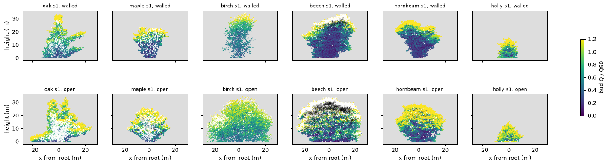

# What does the lone-tree baseline look like in an open-grown box? (exploratory)

_2026-11-08. Wayfinder ticket [#86](https://github.com/epabarker/tree-simulation/issues/86), map [#73](https://github.com/epabarker/tree-simulation/issues/73), after [ADR 0062](https://github.com/epabarker/tree-simulation/blob/wayfinder/light-entry/docs/decisions/0062-light-entry.md). Code at `3d-port` d2c45c8, as #78 and #79 used. **Exploratory: seeds 1–3, lone trees, 101 seasons.** Facts and pictures only; no adoption claim._

## Method
- **Open-grown box** (`code/2026-11-08-open-box/params.ts`): `beechOpen`'s rules, with W = D = 240 cells (60 m), τ = 1 on both z faces, `sidesZ` "open", open x sides, height 200 cells (50 m), and the root at the centre (120, 120).
- **Half-walled control** (`walled.ts`): `beechOpen` as #78 and #79 ran it (240 × 64 cells, τ 0.2 faces, root at x 120), with the same seeds and seasons. Every comparison below is open against this control, not against those notes' numbers, which came from other seeds, seasons and species.
- **Species:** oak, maple, birch, beech, hornbeam and holly, seeds 1–3.
- **Probes:** `rust/core/examples/cap_probe.rs` (#79's, with a per-season count of live buds outside W × H × D and the crown's reach) and `prune_probe.rs` (#78's), both 101 seasons. `summary.py` gives the tables, `ranges.py` the seed ranges, and `figure.py` the figure.
- **Feature probe** ([prototype](https://github.com/epabarker/tree-simulation/tree/wayfinder/feature-probe), kept as `code/2026-11-08-open-box/probe.ts` with a `--lonebox` stage): WASM contact sheets at seasons 30, 60 and 100 under `runs/probe/open-box-<species>/sheet.html` (git-ignored). The sheet's run is the native run: the hashes at season 100 agree (holly s1, 7d5224f3).
- **Cost:** `treesim --bench` (native) and `memory.ts` (WASM in Node, one fresh process per measurement), both unloaded, for beech and oak seed 1.

## The crowns at season 100

Seed 2 looks the same ([figure](figures/2026-11-08-open-box-crowns-s2.png)). The table gives seed ranges, walled → open. W/H is frontal width over height, D/H the same in depth. Top fifth is the share of the leaf above 0.8 H. Top width is the width at 0.9 H over the widest band (about 1 for a flat cap). ρ45 is the leaf envelope at 45° (1.41 for a box, 1 for an ellipse).

| | H (m) | W/H | D/H | top fifth | top width | ρ45 | live buds (k) |
|---|---|---|---|---|---|---|---|
| oak | 33–34 → 33–34 | 0.77–1.06 → 0.96–1.17 | 0.41–0.45 → 0.75–0.98 | 0.02–0.11 → 0.03–0.05 | 0.04–0.22 → 0.17–0.43 | 0.25–0.49 → 0.49–0.82 | 24–28 → 83–91 |
| maple | 23–28 → 25–27 | 0.49–0.82 → 0.83–0.86 | 0.41–0.53 → 0.81–0.84 | 0.12–0.22 → 0.03–0.11 | 0.45–0.73 → 0.18–0.54 | 0.98–1.21 → 0.88–1.16 | 35–42 → 91–95 |
| birch | 30–35 → 30–35 | 0.49–0.67 → 0.87–1.17 | 0.34–0.43 → 0.90–1.14 | 0.04–0.15 → 0.02–0.03 | 0.41–0.82 → 0.26–0.40 | 0.93–1.27 → 0.77–0.87 | 6 → 31–35 |
| beech | 32–34 → 34–36 | 0.90–1.11 → 1.03–1.24 | 0.42–0.46 → 1.09–1.16 | 0.18–0.32 → 0.14–0.17 | 0.26–0.54 → 0.27–0.34 | 1.05–1.22 → 0.90–0.92 | 80–92 → 248–266 |
| hornbeam | 29 → 29 | 0.63–0.94 → 0.72–0.98 | 0.46–0.47 → 0.76–1.04 | 0.12–0.23 → 0.06–0.15 | 0.23–0.37 → 0.25–0.39 | 0.84–1.13 → 0.68–0.91 | 36–48 → 70–110 |
| holly | 15–16 → 15–16 | 0.46–0.77 → 0.74–0.91 | 0.41–0.64 → 0.86–0.93 | 0.01–0.05 → 0.01 | 0.12–0.41 → 0.09–0.13 | 0.61–1.01 → 0.64–0.70 | 3–12 → 12–19 |

- **Every crown is round in plan in the open box.** D/H rises from 0.34–0.64 to 0.75–1.16. The walls had cut each crown to the slab's 16 m (walled reach in depth 4.7–16.9 m from the root, past the faces in all but holly).
- **Heights barely change.** Three species stop at the same height in both boxes: holly at 15–16 m from season ≈ 40–60, hornbeam at 29 m from ≈ 60–75, and oak at 33–34 m from ≈ 60. Beech, maple and birch are still growing at 100.
- **Birch is no longer a column.** In the open box it is a broad, low-leafed dome 46–52 m across, with W/H 0.87–1.17 and only 2–3% of its leaf in the top fifth. Birch is the map's contrast species, the one that should not round.

## The box
- **Buds outside: 0 in 17 of 18 open-box trees, every season.** In the walled control, 14 of 18 trees had buds past a face (up to 893 in beech, 818 in oak, for 62–86 of the 101 seasons). Holly never did, nor maple seed 2.
- **The exception is birch seed 3.** Its leader runs up to 53.8 m by season 90 and passes the box's 50 m top (141 buds, 17 seasons). In a 60 m tall box it reaches 60.7 m and still passes it (5 buds, 3 seasons). At season 91, R3 breaks the leader (−14k metamers) and the tree drops to 30.4 m. About 2,200 leafy buds sit above 35 m at season 80, so this is an emergent second crown, not one whip. The walled seed 3 does the same: 43 m at season 60, 23 m at 75. **It is a seed-specific runaway leader, not a box effect.**
- **The size that holds each exemplar at season 100** is the crown's widest reach from the root, doubled: beech 25.8–27.8 m (needs ≥ 56 m), oak 24–26 m, birch 24–27 m, hornbeam 16–22 m, maple 15–17 m and holly 9–11 m. **60 m square holds them all**, beech with 2.2 m to spare. The 50 m top holds them all except the birch runaway.

## The bole (#78's measures)

| | lowest live limb (m) | clear bole / H | its light ÷ T_rel·Q_top | its P/M | first-order limbs |
|---|---|---|---|---|---|
| oak | 0.25 → 0.25 | 0.01–0.02 → 0.01 | 6–8 → 4–6 | 8–14 → 0–15 | 74–85 → 40–90 |
| maple | 0.25–0.89 → 0.47–0.89 | 0.01–0.03 → 0.02–0.04 | 11–34 → 16–41 | 12–37 → 6–17 | 12–59 → 10–21 |
| birch | 0.25 → 0.25 | 0.01 → 0.01 | 2–4 → 2–3 | 10–13 → 10–12 | 67–88 → 81–91 |
| beech | 0.25–0.49 → 0.25–0.49 | 0.01–0.02 → 0.01 | 19–40 → 25–76 | 2.5–3.1 → 3.4–4.8 | 13–25 → 13–19 |
| hornbeam | 0.25 → 0.25 | 0.01 → 0.01 | 9–15 → 8–21 | 3.7–5.1 → 3.9–6.4 | 11–44 → 10–52 |
| holly | 0.25 → 0.25–0.48 | 0.02 → 0.02–0.03 | 6–23 → 15–50 | 4.6–16 → 8–13 | 32–43 → 32–41 |

**The open box changes nothing here.** The lowest limb is still the first lateral at 0.25 m (or a node or two above it), well lit and paying for itself. The clear bole stays 0.007–0.04 of the height, against real beech's 0.34–0.43. (Oak seed 1's lowest limb had P/M 0 at season 100: one deficit season, not followed up.)

## Shedding, seasons 20–100

| | branch roots shed | P<M / light / both | leafless share | leafless at bud age 1 | leaf shed per season ÷ standing |
|---|---|---|---|---|---|
| oak | 33–37k → 91–107k | 98% / <0.1% / 1–3% → 99% / <0.1% / 1% | 0.98–0.99 → 0.997 | 0.61–0.63 → 0.59–0.64 | 0.05–0.17% → 0.01–0.02% |
| maple | 35–44k → 81–83k | 92% / 0% / 7% → 90% / 0% / 10% | 0.91–0.92 → 0.89–0.90 | 0.52–0.54 → 0.53–0.54 | 0.6–0.7% → 0.8–0.9% |
| birch | 2.8–3.5k → 8.9–9.5k | 46–51% / 40–45% / 9–11% → 26% / 65–67% / 8–9% | 0.57–0.68 → 0.45–0.47 | 0.79–0.83 → 0.67–0.69 | 0.7–0.9% → 0.7–0.9% |
| beech | 55–65k → 162–170k | 96% / 0% / 4% → 97–98% / 0% / 2–3% | 0.09 → 0.07 | 0.64–0.65 → 0.68–0.70 | 4.0–4.4% → 5.0–5.2% |
| hornbeam | 19–31k → 33–68k | 91–94% / 0% / 6–9% → 91–92% / 0% / 8–9% | 0.06–0.08 → 0.06–0.07 | 0.63–0.66 → 0.68–0.71 | 2.0–2.9% → 1.8–3.0% |
| holly | 0.3–2.3k → 1.3–4.0k | 91–97% / ≤1% / 3–9% → 86–89% / <1% / 11–14% | 0.45–0.67 → 0.41–0.54 | 0.77–0.89 → 0.80–0.83 | 0.07–0.35% → 0.17–0.44% |

- **R1's carbon test still does the shedding**, and C5's light test still fires only in birch (T_rel 0.21). In the open box birch's light test takes a larger share: 65–67% of its sheds, against 40–45% walled.
- **The leafless-twig path is species-split, in both boxes.** It is nearly all of oak's and maple's shedding (89–99.7%), half of birch's and holly's, and only 6–9% of beech's and hornbeam's. Those two shed leafy twigs by P<M and turn over 2–5% of their standing leaf a season. 53–83% of leafless sheds carry a bud aged 1, #79's one-season-below-Q_ss path.

## The upper flank and where new growth goes, seasons 50–100

| | flank shell: leaf share | flank shell: Q ÷ Q90 | flank shell: share of new metamers | lower outer shell: share of new metamers |
|---|---|---|---|---|
| oak | 0–2.4% → 0.1–0.2% | 1.0–1.8 → 1.0–1.3 | 0–6% → 0.1–0.3% | 38–61% → 45–59% |
| maple | 7–13% → 3–8% | 0.77–0.89 → 0.69–0.89 | 6–12% → 4–10% | 20–27% → 19–26% |
| birch | 2–9% → 0.2–0.9% | 1.0–1.1 → 1.1 | 18–35% → 2–5% | 2–4% → 14–25% |
| beech | 13–14% → 2–7% | 0.41–0.55 → 0.61–0.73 | 32–43% → 9–21% | 1% → 5–7% |
| hornbeam | 3–16% → 1–5% | 0.47–1.09 → 0.72–1.15 | 10–37% → 8–12% | 1–5% → 6–20% |

**Opening the box moves new growth from the upper flank to the lower outer shell** in birch, beech and hornbeam. The oak's flank is lit and empty in both boxes, and its low limbs take about half of the new growth.

## Which findings of #78 and #79 survive the open box

| Finding | In the open box |
|---|---|
| #78: R1's carbon test does nearly all shedding; C5's T_rel is dormant (except birch) | **Survives.** Light-only sheds ≤ 55 in 91–107k for oak, ≤ 13 elsewhere; birch's C5 is live and larger |
| #78: the lowest limb is the first lateral at 0.25 m for the whole run; clear bole 0.006–0.04 | **Survives**: 0.007–0.04; lowest limb 2–76× T_rel, P/M 3–17. ADR 0043's observation holds in an open-grown tree too |
| #78: the static 0.5·Q_top cut | Not re-run |
| #79: maple is the flat cap | **Weakened, seed-dependent.** The top fifth's leaf falls from 0.12–0.22 to 0.03–0.11 and the top width from 0.45–0.73 to 0.18–0.54, but seed 2 stays flat-topped (top width 0.54, ρ45 1.16). Part of the flat cap was the walls |
| #79: the oak is a spire over wide low limbs; its leader stalls at 33–34 m from ≈ 75 | **Survives.** The leader stalls at 33–34 m from ≈ 60 in both boxes. The upper flank is lit and empty, and the low limbs take 45–59% of the new growth. The crown fills more of its envelope (ρ45 0.49–0.82), but the shape stays |
| #79: birch is a column | **An artefact of the walls.** Open-grown birch is a broad dome (W/H 0.87–1.17) |
| #79: most sheds by count are leafless twigs after one season below Q_ss | **Survives for oak, maple, birch and holly; never true for beech and hornbeam** (6–9% leafless in both boxes; #79 did not measure them) |
| #79: shedding sets the leaf's distribution, not the outline | Not re-tested (no no-shed runs here) |

## Cost: could the lab afford the box?

| beech s1, seasons 91–100, unloaded | native (`treesim --bench`) | WASM (Node) | WASM memory, 100 seasons |
|---|---|---|---|
| open box, 240 × 200 × 240 | **0.91 s/season** (light 0.61) | **0.86 s/season** (max 0.95) | **696 MB** |
| walled, 240 × 200 × 64 | 0.25 s/season | 0.38 s/season | 202 MB |

- **Oak s1 in WASM:** 0.87 s/season open (max 1.35) against 0.26 walled; 531 MB against 141 MB. A small holly already holds 455 MB at season 30, because the light field over W × H × D dominates (ADR 0026: about 1 MB per 64 cells of W·D).
- **Under 3-way parallel load** the native cost of all six seed-1 trees was 0.7–2.3 s per season at seasons 91–101 open, against 0.1–0.44 walled (5–7×). Holly, the smallest tree, cost 0.66 s of light alone.
- **What this means for the lab:** 100 seasons take about 40–50 s in a worker, at 0.9–1.4 s a season late on. Memory is 530–700 MB on a laptop. ADR 0026's 256 MB binds the garden, not the lab. But 700 MB is about 3.5× today's lab specimen, and well past what a phone can be expected to hold. ADR 0062 put accuracy before cost, so this is the budget question it said to revisit, not a reason to clip the crown.

## Surfaced for other tickets
- **Birch rounds in the open box.** This bears on "Which mechanism rounds a crown?": the contrast that should not round now does.
- **Birch seed 3's runaway leader** reaches 60 m in both boxes before R3 breaks it.
- **Three species stop at a fixed height** in both boxes (holly 15–16 m, hornbeam 29 m, oak 33–34 m). This is R1's reproductive sink (STATUS); for oak it is the spire's stall.
- **The lone stage's cost in the lab**: ≈ 0.9 s/season and 530–700 MB.

## Limits
- Three seeds, 101 seasons, lone trees only. The ranges are over three seeds and support no claim about all seeds (AGENTS.md).
- The probes replay the phases outside `run_season`. The probe and `treesim` agree with the WASM world's hash at season 100 for the holly checked.
- The sector geometry is frontal (|dx|) and ignores depth. In the open box the crown is round in plan, so frontal sectors mix front and side.
