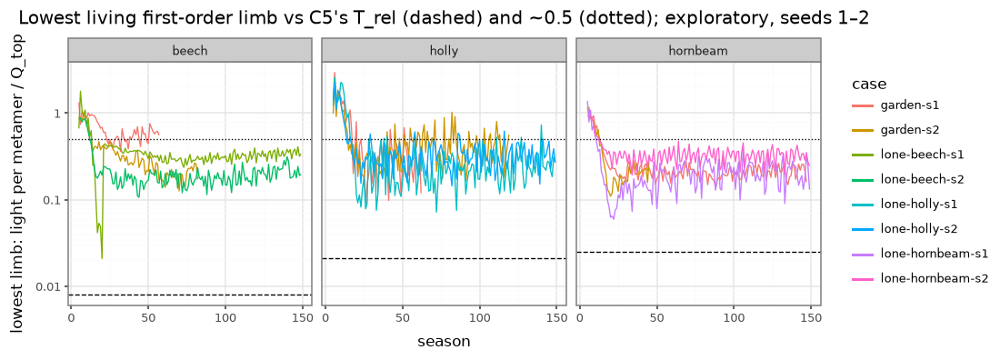

# Is self-pruning happening in the model, and by which rule? (exploratory)

_2026-11-08. Wayfinder ticket [#78](https://github.com/epabarker/tree-simulation/issues/78), map [#73](https://github.com/epabarker/tree-simulation/issues/73). HEAD d2c45c8. **Exploratory: seeds 1 and 2, 150 seasons.** Facts and pictures only; no adoption claim._

## Method
- `rust/core/examples/prune_probe.rs` (adapted from `shed_log.rs`) replays a params JSON phase by phase. After each tree's allocation it reads every **first-order limb** (a lateral on the trunk) with C5's own measure, light per metamer Q_b/n_b ÷ Q_top, and R1's P_b/M_b and deficit run. It applies `shed_branches`'s test to every lateral and labels each branch about to be shed: `P<M` (R1 carbon only), `light` (C5's T_rel·Q_top only) or `both`. First-order limbs that disappear without a label are counted as breakage (R3).
- Cases (`params.ts`): a lone beech, hornbeam and holly in `beechOpen`'s field (240 × 64 cells, faces τ 0.2), and the garden (`forestParams(210)`; both seeds plant one beech, one hornbeam and one holly). Heights are in cells (4 cells = 1 m).
- `summary.py` gives the tables, and `whatif.py` gives the static reading and the figure.

## What the code does (d2c45c8)
- All three species run R1 in `carbon` mode with `kShed` 1. A lateral is shed when **P_b < M_b this season** or its light per metamer is **< T_rel·Q_top**. In carbon mode C5's absolute T is not used.
- **A dead branch is never kept.** There is no dead-limb state. A qualifying branch goes in that season's shed phase with its subtree, leaving a scar (C6) and, with R4's bank, a dormant bud. A limb whose buds have all gone has P = 0 < M, so it goes within a season. R6 lifespan only rests short shoots leafless and removes nothing.
- R3 breakage removes some first-order limbs (0–11 per tree over 150 seasons).

## Measurements

**Shedding is active, and R1's carbon test does almost all of it.** Of the 339,245 branch roots shed by beech, hornbeam and holly across the eight runs, 322,347 were `P<M`, 16,892 `both` and 6 `light` alone. Every first-order limb shed was `P<M` (or `both`). When R1 shed a first-order limb, its light ratio was a median of 0.03–0.22 of Q_top, 4–25× T_rel. **C5's relative test never fires first: it is dormant at the fitted T_rel.**

**The lowest limb never dies.** In 5 of the 6 lone trees and in every planted garden beech, hornbeam and holly, the lowest living first-order limb is the tree's **first lateral, at 1 cell (0.25 m), for the whole run**. The exception is lone beech seed 1: at season 19 its first limb ran one deficit season (P/M 0.81) and was shed, which moved the bole to 1.95 cells. The lowest limbs are large self-supporting scaffolds (up to 3,747 metamers).

| | lowest limb, light / Q_top | × T_rel | lowest limb P/M | clear bole / height |
|---|---|---|---|---|
| lone beech (s1, s2), seasons 40–149 | 0.14–0.36 | 18–45 | 2.5–4.5 | 0.006–0.03 |
| lone hornbeam | 0.11–0.36 | 5–15 | 2.1–5.1 | 0.009–0.02 |
| lone holly | 0.12–0.53 | 6–25 | 3.8–16 | 0.015–0.02 |
| garden beech / hornbeam / holly (while alive) | 0.16–0.61 | 8–68 | 2.6–17 | 0.009–0.04 |

The real-tree reference is clear bole ≈ 1 − CR: **beech 0.34–0.43** (bare-bole note). The model is an order of magnitude short. ADR 0043's observation (the lower branches always survive) **still holds at HEAD**, for the reason it gave: the lowest limbs are well lit and pay for themselves (ADR 0043 found 14–80× T_rel and P/M ≥ 1.5; here 5–68× and ≥ 2).

**Static what-if (bare-bole note, diagnostic 6).** Remove every first-order limb under x·Q_top at a season, ignoring regrowth and re-lighting, and see where the lowest survivor sits (clear bole / height; limbs kept out of all):

| | x = 0 (as run) | 0.25 | 0.5 |
|---|---|---|---|
| garden hornbeam s1, season 120 | 0.009 (37) | 0.037 (12) | **0.30** (9) |
| garden beech s2, season 80 | 0.010 (40) | 0.010 (28) | **0.36** (8) |
| garden hornbeam s2, season 40 | 0.011 (42) | 0.055 (31) | 0.23 (21) |
| lone beech s1 / s2, season 120 | 0.013 / 0.007 | 0.013 / 0.019 | 0.028 / 0.12 (3 / 3 of 13 / 25) |
| lone hornbeam s1 / s2, season 120 | 0.009 / 0.009 | 0.043 / 0.032 | 0.043 / 0.068 (2 / 5) |
| holly, lone and garden | 0.015–0.022 | 0.015–0.054 | 0.016–0.054 (29–37 of 32–43) |

- At ratios near 0.5, the stand beech and hornbeam would clear to about 0.3 of their height, close to real beech. Holly would stay clothed, the intended contrast.
- In the lone trees, the same threshold strips most limbs (beech keeps 3 of 13 or 25) while the bole barely rises: **the lowest limbs are not the darkest ones.** This is the umbrella cliff ADR 0043 hit with Tvig 0.30–0.35.
- This reading is static and does not predict a run.

## Surfaced for other tickets
- **Planted garden trees die young.** Beech died at seasons 57 and 82, holly at 62 and 119, hornbeam (s2) at 45. Two of the four planted birches died before season 16. Recruits are mostly beech. This belongs to "What does the garden's demography do today?"; the cause of death was not examined.
- **Why a low limb is so bright (0.1–0.7 of Q_top) is not split here** into sky, face and side light. That is the bare-bole note's diagnostic 2, and it bears on "Should the slab admit side light from its front and back?".

## Caveats
2 seeds, 150 seasons, three species. The probe replays the season phases outside `run_season`, as `shed_log.rs` does. Its asserts are omitted, so the replay's agreement with the core is assumed, not checked here.
