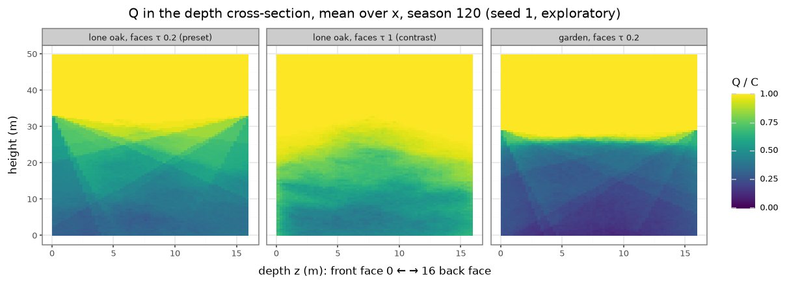
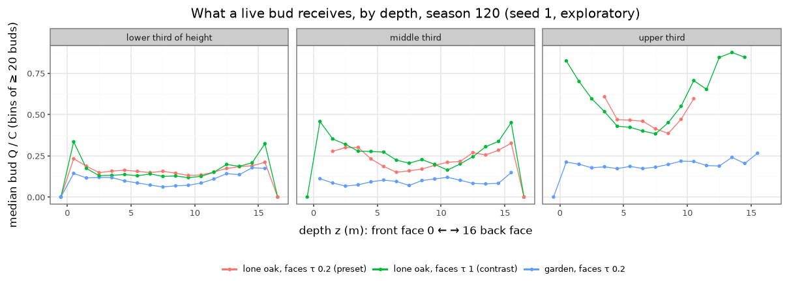

# How light enters the slab (front, back, sides) at HEAD

2026-11-08, at `d2c45c8`. For the wayfinder ticket
["What light does a bud get from the front, back and sides of the slab?"](https://github.com/epabarker/tree-simulation/issues/77),
which feeds the decision "Should the slab admit side light from its front and back?".
**Facts only, no decision.** **Exploratory:** one seed (1), seasons 60 and 120, no adoption claim.
One cell is 0.25 m. The slab is 64 cells (16 m) deep.

## The mechanism (code)

Source: `rust/core/src/light/mod.rs`, `rust/core/src/light/slab_sweep.rs`, the bud sampling in `rust/core/src/season.rs` (`sample_buds`).

- **Light comes only from the sky.** There are K = 16 directions at elevations of 15–90°. Their weights are ∝ sin(elevation) and sum to C = 1. Each season rotates them (`rotate`). There is no direct sun (`skyTilt` 0) and no light from below 15°. Each cell's Q = Σ w·e^(−k_ext·G), with k_ext = 0.5.
- **The march starts at the highest leafy row in the whole world** (`top`). Above it, Q = C exactly. Below it, each ray accumulates the leaf area it crosses.
- **The front face (z < 0, the viewer's side) and the back face (z ≥ D).** A ray that would arrive from beyond a face, below `top`, carries a fixed depth −ln τ / k_ext. The sky through that face therefore reaches the slab at τ. This is ADR 0024's "a wood as tall as the stand". There is no leaf area beyond the faces: `faceWood` 0, which is ADR 0056, parked. So the face acts as a uniform wall of transmission τ, as tall as the tallest tree anywhere in the world, whatever stands locally. Both worlds below use τ = [0.2, 0.2], `fade` 0 and `sidesZ` "open" (ADR 0058's periodic depth is off).
- **The x sides.** In the garden they are periodic: a ring that wraps foliage, light and growth. For the lone oak (`oakOpen`) they are open: beyond the edge the leaf area and depth are zero. The oak's left and right therefore see **open sky at every height (in effect τ = 1)**, while its front and back see τ = 0.2.
- **Outside the box, Q = 0 and V points up.** A bud whose tip has grown past a z face (or past an open x edge) receives nothing. At season 120 that was 101 buds in the garden, 199 on the lone oak, and 514 on the oak with τ = 1.
- **A bud's Q** is sampled at its metamer's tip, from the start-of-season field. Its V is the weighted mean direction of the light.

## The worlds probed

| Case | World (W × H × D, cells) | x sides | Faces τ | Trees | At season 120 |
|---|---|---|---|---|---|
| Lone oak (`oakOpen`) | 160 × 200 × 64 | open | 0.2, 0.2 | 1 oak at z = 32 | height 33 m; crown width 35 of 40 m; 90% of leaf area at z 2–15 m |
| Lone oak, τ = 1 (contrast) | same | open | 1, 1 | same | crown width 40 m, the whole world; 2.6× the buds (65.7k vs 25.6k) |
| Garden (`forestParams(210, 1)`) | 210 × 200 × 64 | periodic | 0.2, 0.2 | 8 planted at z = 32, recruits in a 7 m band; 137 trees | top 29 m; 90% of leaf area at z 1.75–13.75 m |

**The "open-grown" oak exemplar is not open-grown in depth.** It fills nearly the whole box and is lit through τ = 0.2 walls 8 m in front of and behind its trunk.

## The faces alone (no foliage inside)

`faces_alone.py` uses the same sky averaged over 200 rotated seasons, under a 29 m (116-cell) stand top, with τ = 0.2:

| Height | At the face | 1 m in | 2 m in | 4 m in | Middle (8 m in) |
|---|---|---|---|---|---|
| 0.25 m | 0.41 | 0.41 | 0.41 | 0.42 | 0.43 |
| 15 m | 0.52 | 0.54 | 0.56 | 0.59 | 0.62 |
| 22.5 m | 0.60 | 0.65 | 0.71 | 0.79 | 0.86 |
| 27.5 m | 0.63 | 0.84 | 0.94 | 0.99 | 1.00 |

- **Low down, the faces dim the whole depth, not just its edges.** The slab is narrow (16 m) next to the stand's height, so near the ground almost every slanting ray exits a face.
- **Near the top, only the outer metre or two is dimmed.**

## Results





Median Q of the live buds at season 120, by depth band and by third of height (`bud_table.py`):

| Case | Height third | Front edge 0–1 m | Front 1–4 m | Middle | Back 1–4 m | Back edge 0–1 m |
|---|---|---|---|---|---|---|
| Garden | lower | 0.13 | 0.12 | 0.08 | 0.15 | 0.16 |
| Garden | middle | 0.11 | 0.07 | 0.10 | 0.08 | 0.15 |
| Garden | upper | 0.20 | 0.19 | 0.19 | 0.21 | 0.26 |
| Lone oak | lower | 0.22 | 0.16 | 0.15 | 0.18 | 0.20 |
| Lone oak | middle | (2 buds) | 0.30 | 0.18 | 0.27 | 0.29 |
| Lone oak | upper | none | 0.61 (25 buds) | 0.43 | none | none |
| Lone oak, τ = 1 | lower | 0.33 | 0.15 | 0.13 | 0.20 | 0.31 |
| Lone oak, τ = 1 | middle | 0.41 | 0.32 | 0.22 | 0.29 | 0.42 |
| Lone oak, τ = 1 | upper | 0.73 | 0.58 | 0.45 | 0.87 | 0.83 |

On the lone oak, the lower-third buds in the middle depth band differ by distance from an x edge:

| Case | Within 2 m of an x edge | Interior |
|---|---|---|
| Lone oak | 0.39 | 0.145 |
| Lone oak, τ = 1 | 0.43 | 0.13 |

## Observations (facts)

1. **The faces both brighten and darken.**
   - Inside foliage, a τ = 0.2 face is brighter than the stand: the garden's floor in the middle gets 0.10–0.12. So low buds near the faces gain: in the garden, 0.13–0.16 at the edges against 0.08 in the middle.
   - Near the top, the face is darker than open sky, so crown flanks within about 1 m of a face lose light: 0.58–0.66 against 0.84–0.90 at the same height in the middle of the section.
2. **The garden's upper crowns get nearly the same light at every depth** (0.19–0.26), with the back edge highest.
3. **The lone oak's two pairs of sides are lit differently.**
   - Its low buds near an x edge get 0.39, against 0.20–0.22 near a z face and 0.145 in the interior.
   - Opening the z faces (τ = 1) lifts the face-edge buds to 0.31–0.33, close to the x edges.
4. **τ is a strong control on the lone oak's whole size.** At τ = 1 the oak carries 2.6× the buds and its crown spans the full 40 m width (35 m at τ 0.2).
5. **The upper crown keeps to the middle depth at τ 0.2.** Only 25 upper-third buds lie within 4 m of either face, and none behind. At τ = 1 there are 462.
6. **Foliage reaches the faces.** Both the garden (recruit band 7 m, planted at z = 8 m) and the lone oak spread their leaf area to within 1–2 m of each face, and 100–200 buds a season sit past a face with Q = 0.
7. **The streaks in the cross-section are the K = 16 directions' face shadows,** fanning in from the top corners. Rotation moves them between seasons, but one season's field shows them.

## Reproduce

From the repo root (`C=docs/experiments/code/2026-11-08-slab-light`):

```
node $C/probe.ts runs/slab-light/q.csv                                 # ~40 s; also writes q_lad, q_buds, q_trees
uv run --project analysis python $C/bud_table.py runs/slab-light       # the bud tables
uv run --project analysis python $C/fig.py runs/slab-light             # the two figures → docs/experiments/figures/
python3 $C/faces_alone.py                                              # the faces-alone table
```

The probe is deterministic: a second run gave the same samples.
