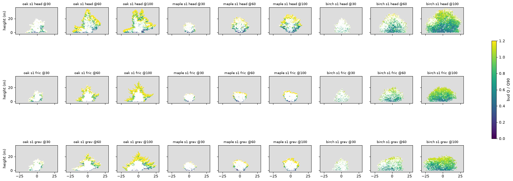

# Does a water-status cap on extension round the open-grown oak and maple? (exploratory)

_2026-11-08. Wayfinder ticket [#87](https://github.com/epabarker/tree-simulation/issues/87), map [#73](https://github.com/epabarker/tree-simulation/issues/73), testing the mechanism proposed in [Which mechanism rounds a crown?](https://github.com/epabarker/tree-simulation/issues/83) ([page](https://github.com/epabarker/tree-simulation/blob/wayfinder/crown-mechanism/docs/features/rounded-crown.md)). Code at `wayfinder/open-box` ed8a2aa plus the patch. **Exploratory: seeds 1–3, lone trees in the open-grown box, 101 seasons; the garden at 160 cells, 150 seasons.** No adoption claim._

## Answer

**No. As specified, the cap rounds neither oak nor maple.** It lowers all three trees by 15–45%, the oak's upper flank stays empty, maple's top gets flatter, and birch gets broader (W/H 1.1–1.6, against ≤ 0.7 wanted). The flank did not fill, so this is not the "flank fills, top stays flat" outcome that triggers the reiteration fallback. The mechanism failed earlier than that.

**Why: in this model a shoot is one metamer.** From season ≈ 30, more than 99.8% of shoots at HEAD grow a single metamer, the leader's too (oak seed 1: 37% of shoots have more than one metamer at season 10, 0.1% at 50 and none from 60 on). So scaling the metamer count can't shorten a shoot. It only switches it on or off: a shoot grows when s·v ≥ 1 and otherwise doesn't grow at all. Lockhart's linear response becomes a threshold gate, and it shuts the leader off first. Diagnostic 3 shows this: the slope of extension against path length and against height is flat (Spearman ρ −0.07 to 0.16, mean shoot 1.00–1.04 metamers, HEAD and patch alike). The cap never acts as a graded limit.

## Method
- **Patch** (`rust/core/src/principles/c3.rs`, `season.rs` `grow_buds`): `c3.sink: "turgor"`, off by default. The bit-identical goldens pass, and `turgor_scale` has a unit test. Ψ = −(g·h + r·L), with h the host node's height above the root and L its path length, both in m. s = max(0, (Ψ − Ψ_crit)/(0 − Ψ_crit)). The shoot gets ⌊s·min(v, cap)⌋ metamers. Whatever it doesn't use goes to R1's reserve, up to `r1.store`·M. R4's light release (one metamer paid from the reserve) is left alone.
- **Settings.** Friction-heavy: g 0.002, r 0.01 MPa/m. Gravity-heavy: g 0.01, r 0.002. The leader's path is about its height (within 2%), so both settings give the leader Ψ ≈ −0.012·H. The settings differ only on long low limbs: oak's reach a path of ~34 m at ~8 m height, giving s 0.33 friction-heavy against 0.72 gravity-heavy. Ψ_crit gives s = 0.25 at today's stall or season-100 height: oak −0.55 (H* 34 m), maple −0.45 (27 m), birch −0.55 (33 m).
- **Lone stage:** the open box (60 m square, τ 1, ADR 0062), with `cap_probe.rs` extended with per-shoot records and DBH (`code/2026-11-08-turgor-cap/summary.py`). The contact sheet comes from the native bud dumps (`figure.py`), not from the WASM probe. A species patch would also apply there; the native run is the cheaper way to get the same tree.
- **Garden:** the feature probe (`probe.ts`, `--lone none`) at 160 cells, seeds 1–3, seasons 50/100/150, with the patch on oak, maple and birch only, plus `phoneSeed3` patched (`regressions.ts`). `forestRegeneration` has no species, so a species patch can't move it.

Seed 2 looks the same ([figure](figures/2026-11-08-turgor-cap-s2.png)).

## Diagnostics (seed ranges, season 100 unless stated; HEAD → friction → gravity)

| | oak | maple | birch |
|---|---|---|---|
| H (m) | 33.0–33.9 → 24.1–29.9 → 27.3–28.8 | 25.4–26.8 → 15.5–15.6 → 14.2–18.4 | 30.4–35.4 → 21.2–22.9 → 21.2–22.1 |
| 1. top-fifth leaf (0.15–0.30 wanted) | 0.03–0.05 → 0.00–0.01 → 0.00 | 0.03–0.11 → 0.07–0.10 → 0.03–0.14 | 0.02–0.03 → 0.02–0.05 → 0.03–0.04 |
| 2. flank shell, new metamers 60–100 (≥ 5% wanted) | 0 → 0–0.2% → 0 | 3.6–10.4% → 2.7–4.1% → 0.9–2.1% | 2.2–5.0% → 2.5–7.2% → 3.7–7.2% |
| lower outer shell, new metamers 60–100 | 47–65% → 48–53% → 52–61% | 19–27% → 26–30% → 28–35% | 12–22% → 13–22% → 14–20% |
| 3. ρ(extension, path) for laterals, 50–100 | 0.01–0.03 → n/a (all 1) → n/a | 0.04–0.06 → n/a → 0.01–0.02 | −0.07–0.14 → −0.05 → −0.05–−0.02 |
| 4. height gain 60–100 (m) | −0.5–0.4 → 2.1–5.9 → 2.9–4.4 | 4.0–4.6 → 1.5–1.9 → 0.0–3.1 | −10.2–7.0 → 0.2–0.8 → 0.6–1.9 |
| 5. W/H (DBH m) | 0.96–1.17 (0.66–0.96) → 0.81–0.87 (0.55–0.66) → 1.15–1.26 (0.59–0.90) | 0.83–0.86 → 0.99–1.06 → 0.97–1.42 | 0.87–1.17 → 1.09–1.48 → 1.40–1.63 |
| 6. ρ45 (cone 0.47, ellipse 1) | 0.49–0.82 → 0.57–0.68 → 0.43–0.50 | 0.88–1.16 → 1.01–1.19 → 0.70–1.10 | 0.77–0.87 → 0.84–0.92 → 0.82–0.94 |
| top width (≈ 1 flat cap) | 0.17–0.43 → 0.02–0.41 → 0.01–0.08 | 0.18–0.54 → 0.21–0.45 → 0.45–0.79 | 0.26–0.40 → 0.21–0.40 → 0.28–0.47 |

- **Oak:** the flank stays empty in both settings. The low limbs still take half of the new growth or more, and the crown is a smaller spire. The gravity-heavy oak becomes a cone (ρ45 0.43–0.50) with no leaf in the top fifth. W/H against DBH falls friction-heavy and stays flat gravity-heavy, so it doesn't rise. **The oak's HEAD stall at 33–34 m is R1's reproductive sink**: maturity 130 cells = 32.5 m, with f_rep 0.8 of net production going to seed above it. Capped oaks never reach maturity, so they keep growing slowly (2–6 m in 60–100) and put the surplus into more single-metamer laterals: about 2× HEAD's shoots per season from 50, but fewer metamers in all (55–83k against 83–91k).
- **Maple:** the cap halves the height (14–18 m against 25–27 m) and leaves a low mound with a **flatter** top (gravity-heavy top width 0.45–0.79). Its flank takes less of the new growth.
- **Birch** becomes a low, wide dome (W/H 1.09–1.63), further from the excurrent ovoid (≤ 0.7) than HEAD is.

## 7. The garden guard (160 cells, seeds 1–3)
- **Bare-bole species:** beech, hornbeam and holly aren't patched, and their trees ≥ 10 m and median bole are within one tree and 0.01 of HEAD in every seed and season, except beech in seed 2 at 150 (10 trees ≥ 10 m → 8 friction-heavy, 9 gravity-heavy). They have no lid to lose: their bole is 0.01–0.02 at HEAD as well. Patched oak and birch are shorter (seed 1 oak 15 m against 26 m at 100; birch 17–22 m against 22–31 m).
- **Named regression phoneSeed3 (#54) gets worse in both settings:** friction-heavy canopy150 2 → 1, metamers150 12,423 → 5,736 (−54%); gravity-heavy metamers150 → 8,215 (−34%), canopy100 3 → 4. `forestRegeneration` is unchanged by construction.
- WASM contact sheets: `runs/probe/turgor-garden-{fric,grav}/sheet.html` in the worktree (git-ignored).

## What this means for the rounded-crown decision
- **A count cap is the wrong form of the rule for this model.** To act as Lockhart's graded limit, the cap has to scale what a one-metamer shoot can still vary, which is **its internode length** (`shoot_length`, as R5's `elongation` does). The metamer count can't do it. That is a sharper question than the reiteration fallback, and a cheaper patch.
- **The oak's spire and stall come from R1's reproductive sink**, not from a missing hydraulic limit. Any cap that holds the leader below 32.5 m removes the stall's cause and keeps the tree growing. A length cap has to be judged with that in mind.
- **Calibration:** "s = 0.25 at the stall" already binds hard from mid-height on, because the leader's s falls linearly from the ground. A length cap would need its own setting.

## Limits
Three seeds, lone trees and one garden width. The cap is applied only to oak, maple and birch in the garden. The patched lone runs ran under load (another agent shared the CPU), which affects their timing, not their results: the runs are deterministic.
