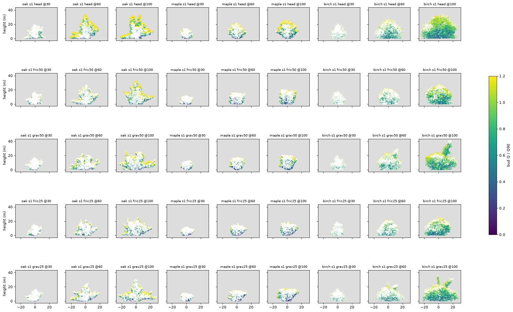

# Does a water-status cap on internode length round the open-grown oak and maple? (exploratory)

_2026-11-08. Wayfinder ticket [#89](https://github.com/epabarker/tree-simulation/issues/89), map [#73](https://github.com/epabarker/tree-simulation/issues/73). It follows [Does a water-status cap on extension round the open-grown oak and maple?](https://github.com/epabarker/tree-simulation/issues/87) ([note](2026-11-08-turgor-cap.md)), which found that a cap on the metamer count acts as a gate. The code is `wayfinder/turgor-probe` 7d399f7 plus the patch. **Exploratory: seeds 1–3, lone trees in the open-grown box, 101 seasons, and the garden at 160 cells for 150 seasons.** No adoption claim._

## Answer

**Maple: mostly yes. Oak: no. Birch: no ovoid, but it is no ovoid at HEAD either.**

- **The cap is now a graded limit.** Each shoot keeps its metamers, and its internodes are s times as long. Lateral extension falls with path length (Spearman ρ −0.10 to −0.35, against −0.06 to +0.09 at HEAD). Mean lateral shoot length falls from 0.25 m at path < 10 m to 0.13–0.21 m at 30–40 m, where HEAD's rises to 0.29 m. The leader's internodes are about half HEAD's from season 60.
- **Maple fills its top.** Top-fifth leaf is 0.08–0.24, with 9 of 12 patched runs in the 0.15–0.30 band, against 0.03–0.11 at HEAD. The upper flank takes 5–21% of new metamers in seasons 60–100, against 4–10% at HEAD (one patched run is at 4.9%, the rest ≥ 5%). The cost is height: 18–24 m against 25–27 m. At s 0.25 the crown is a flat-topped bun (seed 1 gravity-heavy: top width 0.76). At s 0.5 it is a smaller dome.
- **The oak's flank stays empty:** 0.2–3.8% of new metamers, against ≥ 5% wanted. Top-fifth leaf is 0.01–0.08. The cap takes the low limbs' share of new growth from 47–65% at HEAD down to 23–41%, and the crown gets broader (W/H 0.89–1.48), but it is still a spire over wide limbs. The sink limit hands surplus carbon to the reserve, not to the flank. The flank holds almost no leaf (0.1–2%), so it has no buds to take the carbon.
- **The oak's stall moves.** The capped leader reaches R1's maturity (32.5 m) later, by season 100 only in friction-heavy s 0.5, seeds 1–2. It still gains 0.7–9.9 m in seasons 60–100, against −0.5 to 0.4 m at HEAD. So the stall is delayed, not replaced by a hydraulic plateau.
- **Birch:** W/H 0.78–1.56 against ≤ 0.7 wanted (HEAD 0.87–1.17). Gravity-heavy birch sends up runaway leaders (seed 1, s 0.5: a 40.7 m spike over a 25 m dome).
- **Reiteration fallback: not triggered.** That fallback is for "the flank fills but the top stays flat". Maple fills both its flank and its top. The oak fills neither, and its failure is upstream of any sink: it has no buds in the flank.

## Method
- **Patch** (`c3.sink: "turgorLength"`, off by default, goldens unchanged; in `season.rs`, `grow_buds`): the same Ψ = −(g·h + r·L) and s = (Ψ − Ψ_crit)/(0 − Ψ_crit), clamped to [0, 1], as #87. The shoot grows `shoot_size(v)` metamers, as at HEAD. Its internode length is multiplied by s, after R5's elongation and the lognormal factor. (1 − s)·min(v, cap) goes to R1's reserve, up to `r1.store`·M. At s = 0 the bud does not grow, and all of it goes there. R4's light release is untouched. `cap_probe.rs` now records each shoot's length (`ext`, m).
- **Ψ_crit, chosen afresh.** The leader's path is about its height, so in both settings its s = 1 − 0.012·H/|Ψ_crit|, and the leader's growth tends to H_max = |Ψ_crit|/0.012. With s* the leader's s at the HEAD stall or season-100 height H* (oak 34 m, maple 27 m, birch 33 m), two settings are run. **s\* 0.5** (H_max = 2H\*): Ψ_crit oak −0.82, maple −0.65, birch −0.79. **s\* 0.25** (H_max = 1.33H\*): #87's values, −0.55, −0.45 and −0.55, for comparison. Each is run friction-heavy (g 0.002, r 0.01 MPa/m) and gravity-heavy (g 0.01, r 0.002). Conditions `fric50`, `grav50`, `fric25`, `grav25`.
- **The lone stage:** 60 m open box (ADR 0062), 45 native runs (`runs/turgor-length/`, 18 min on 12 workers). HEAD's season tables match #87's byte for byte. Analysis is in `code/2026-11-08-turgor-length/` (`summary.py`, `figure.py`), copies of #87's that read extension as shoot length.
- **Garden guard:** #87's `probe.ts` (`--lone none`, 160 cells, seeds 1–3, seasons 50/100/150), with oak, maple and birch patched at s* 0.5 in both settings, and #87's `regressions.ts` for `phoneSeed3`.

Seeds 2 and 3 ([s2](figures/2026-11-08-turgor-length-s2.png), [s3](figures/2026-11-08-turgor-length-s3.png)) show the same.

## Diagnostics (seed ranges, season 100 unless stated)

| | HEAD | fric50 | grav50 | fric25 | grav25 |
|---|---|---|---|---|---|
| **oak** H (m) | 33.0–33.9 | 31.1–33.1 | 26.7–32.3 | 26.4–30.5 | 29.8–31.7 |
| 1. top-fifth leaf (0.15–0.30) | 0.03–0.05 | 0.03–0.08 | 0.01–0.06 | 0.01–0.05 | 0.02–0.05 |
| 2. flank new 60–100 (≥ 5%) | 0 | 0.2–2.5% | 0.7–2.0% | 0.3–3.8% | 0.3% |
| lower outer shell new 60–100 | 47–65% | 34–36% | 29–35% | 23–30% | 26–41% |
| 4. height gain 60–100 (m) | −0.5–0.4 | 0.7–6.1 | 3.3–9.9 | 2.7–4.6 | 3.5–5.7 |
| 5. W/H | 0.96–1.17 | 0.97–1.07 | 1.14–1.48 | 0.89–1.18 | 1.10–1.30 |
| 6. ρ45 (cone 0.47, ellipse 1) | 0.49–0.82 | 0.39–0.65 | 0.54–1.01 | 0.40–1.03 | 0.45–0.59 |
| **maple** H (m) | 25.4–26.8 | 20.7–21.9 | 21.1–23.7 | 19.3–19.7 | 18.1–20.1 |
| 1. top-fifth leaf | 0.03–0.11 | 0.14–0.19 | 0.11–0.24 | 0.08–0.24 | 0.18–0.22 |
| 2. flank new 60–100 | 3.6–10.4% | 7.4–15.2% | 4.9–12.3% | 5.3–15.1% | 12.4–20.5% |
| 5. W/H | 0.83–0.86 | 0.94–0.96 | 0.73–0.97 | 0.81–1.07 | 1.01–1.36 |
| top width (≈ 1 flat cap) | 0.18–0.54 | 0.38–0.53 | 0.31–0.67 | 0.34–0.64 | 0.35–0.76 |
| **birch** H (m) | 30.4–35.4 | 27.9–35.0 | 26.7–40.7 | 23.7–25.6 | 30.6–36.8 |
| 5. W/H (≤ 0.7) | 0.87–1.17 | 0.94–1.01 | 0.84–1.56 | 1.10–1.36 | 0.78–1.13 |

3. Lateral extension against path length, seasons 50–100 (Spearman ρ): oak −0.12 to −0.35, maple −0.10 to −0.26, birch −0.12 to −0.34, against −0.06 to +0.09 at HEAD. Shoots stay 1.00–1.07 metamers, so the length is what varies.

## 7. The garden guard (s* 0.5, seeds 1–3)
- **Beech, hornbeam and holly** (unpatched) keep their boles: the median for trees ≥ 10 m is ≤ 0.05 in every seed and season, as at HEAD (0.01–0.02). Their counts shift through competition: in seed 1 at 150, beech ≥ 10 m goes from 0 to 6 friction-heavy.
- **Patched oak and birch are shorter:** in seed 1 at 100 the oak is 20 m friction-heavy and 19 m gravity-heavy, against 26 m. In seed 2 at 100 the birch is 23–28 m, against 31 m. No garden seed has a maple ≥ 10 m.
- **`phoneSeed3` (#54):** canopy150 falls from 2 to 1 in both settings, as in #87. Metamers rise 6–21% (#87's count cap cut them by 34–54%).

## What this means for the rounded-crown decision
- **The length form is the right form of the sink limit,** and it rounds maple (exploratory, 3 seeds). Its calibration is open: s* 0.5 keeps more height, while s* 0.25 flattens the top.
- **The oak needs something else.** Its upper flank has no buds, so no sink limit can fill it: carbon is returned to the reserve, and C3 never routes it to the flank. The question becomes why the oak's upper laterals don't spread into the flank: apical control (λ, R2 acrotony) or the upper laterals' set point. The research ranked loss of apical control third. That question comes before reiteration.

## Limits
Three seeds, lone trees and one garden width. The garden guard ran the s* 0.5 settings only. The WASM contact sheets are in `runs/probe/turgor-length-garden-{fric50,grav50}/sheet.html` in the worktree (git-ignored).
