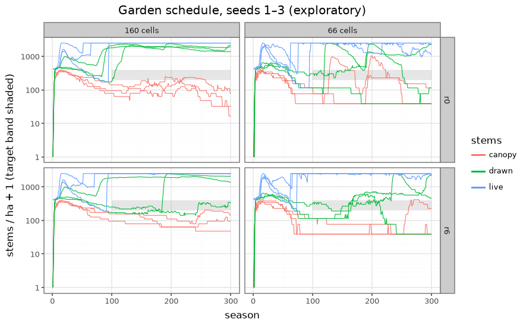

# The garden's schedule on the periodic depth (2026-11-10)

**Exploratory: seeds 1–3, widths 160 and 66.** Not an adoption claim; the ≥ 20-seed acceptance run is the next ticket.

**Question ([#121](https://github.com/epabarker/tree-simulation/issues/121)):** once the garden runs the 0062/0063 schedule (periodic depth, 400 saplings/ha, the two-part mortality, the display threshold), which rates make the settled garden a mature high forest? The bars come from the [playbook page](../features/stand-density-and-demography.md), at seasons 100/200/300:
- drawn stems 200–400/ha (13–26 at 160 cells, 5–10 at 66);
- at least 60% of drawn stems in the canopy;
- a canopy tree in every season after 50;
- the cap never reached;
- no species over 70%.

**Answer: no rate does.** Seven rounds, tuning only the schedule's rates and establishment, never meet the bars. The cap is reached in 45 of 48 runs (rounds r0–r7). Two things in the model, not rates, set the outcome:
1. Understorey trees pay their maintenance, so the suppression rate never acts on them.
2. Canopy crowns are as wide as the period.

This is the ticket's stop condition. The committed schedule is the one-knob best: m_c = 0.003, every other rate at its default.

## Setup

- **Branch:** `ticket/121`. Code: `code/2026-11-10-garden-schedule/`.
  - `sweep.ts` runs each round natively to season 300 and summarises `stand.csv`, `stand-species.csv` and `metrics.csv`.
  - `diag.py` gives crown sizes, light at establishment, seedling lifetimes, and understorey P/M.
  - `deaths.py` gives death causes. `figure.py` draws the figure.
- **Each round** is a params patch over `forestParams(width, seed)`, merged as the feature probe merges it.
- **The garden:** `mixedWood` + `forestParams`.
  - Periodic depth, D = 64.
  - `o4.planting` {400/ha, spacing 12 cells, `MIXED`}: 26 trees at 160 cells, 11 at 66.
  - `o4.mortality: "twoPart"`. The cap is a guard at 2,500/ha: 160 at 160 cells, 66 at 66.
- **Runs:**
  - Sheets: `runs/garden-schedule/<round>/` (`summary.json` and the six runs).
  - The probe on the committed schedule: `runs/probe/garden-schedule-121/sheet.html`. Its stand numbers equal round r6's bit for bit.
  - Neither is committed.

## The rounds

Counts are over the 6 runs (3 seeds × 2 widths) or the 18 judged frames (6 runs × seasons 100/200/300).

| round | patch | cap-free runs | drawn in band | canopy ≥ 60% | top species ≤ 70% | canopy every season > 50 |
|---|---|---|---|---|---|---|
| r0 | none (bare rates: m_c 0.01, H_c 120, γ_c 2, m_s 1, β_s 0.92) | 0/6 | 1/18 | 3/18 | 9/18 | 6/6 |
| r1 | p_est 0.3 → 0.03, every species | 0/6 | 2/18 | 0/18 | 8/18 | 6/6 |
| r2 | m_c 0.003, m_s 0.3 | 0/6 | 5/18 | 1/18 | 11/18 | 6/6 |
| r3 | m_c 0.003; p_est → 0.003, every species | 2/6 | 5/18 | 2/18 | 6/18 | 6/6 |
| r4 | m_c 0.006, γ_c 0.5 (nearly size-blind) | 0/6 | 3/18 | 2/18 | 8/18 | 6/6 |
| r5 | m_c 0.003; Q_est → 0.2 for the shade-bearers (gap-only establishment) | 1/6 | 4/18 | 2/18 | 8/18 | 6/6 |
| **r6** | **m_c 0.003 (committed)** | 0/6 | 4/18 | 2/18 | 7/18 | 6/6 |
| r7 | r6 + holly `r1.maturity` 60 → 30 (probe patch only) | 0/6 | 4/18 | 1/18 | 9/18 | 6/6 |

**The committed schedule (r6), per run.** Each frame gives drawn (per ha), canopy share and the top species' share. The bank is live − drawn, the mean from season 100.

| width | seed | 100 | 200 | 300 | cap reached (seasons) | bank |
|---|---|---|---|---|---|---|
| 160 | 1 | 11 (172), 0.55, beech 27% | 12 (188), 0.33, hornbeam 50% | 22 (344), 0.14, hornbeam 86% | 184 | 146 |
| 160 | 2 | 16 (250), 0.69, beech 19% | 155 (2422), 0.03, hornbeam 87% | 133 (2078), 0.05, hornbeam 86% | 230 | 74 |
| 160 | 3 | 119 (1859), 0.08, hornbeam 71% | 122 (1906), 0.06, hornbeam 81% | 88 (1375), 0.10, hornbeam 88% | 252 | 40 |
| 66 | 1 | 3 (114), 0.33, beech 33% | 14 (530), 0.07, hornbeam 93% | 1 (38), 1.00, hornbeam 100% | 174 | 60 |
| 66 | 2 | 3 (114), 0.33, beech 33% | 18 (682), 0.06, hornbeam 78% | 60 (2273), 0.02, hornbeam 97% | 231 | 52 |
| 66 | 3 | 8 (303), 0.38, beech 25% | 9 (341), 0.22, hornbeam 56% | 12 (455), 0.50, hornbeam 75% | 172 | 47 |

**What the rounds did.**
- **m_c = 0.003 is the one rate with a clear effect.** At 0.01, 14–18 canopy trees per desktop run died of O4. At 0.003 it is 1–5, so the planted canopy lasts. Two runs stay in band at season 100 (160 s1 and s2), where r0 had one.
- **m_s 0.3 changed nothing visible.** r2 against r6 is within seed noise, so it was dropped.
- **Cutting establishment does not cap the stand.** r1 and r3 cut p_est to a tenth and a hundredth, and the stand still fills, because the seed supply is vast. Under r6, hornbeam alone makes 0.2–0.6 million seeds per run over 300 seasons. Even at p_est 0.003, 474 hornbeam recruits established in one desktop run.
- **Gap-only establishment (r5) only delays the flood.** Raising Q_est to 0.2 is also a flora change, and it contradicts user story 23: beech and holly wait in the seedling bank.

## Why: two limits that are not rates

**1. The understorey is never suppressed.** The suppression rate is m_s·(1 − P/M)₊·e^(−β_s(T − 1)), read from one season's P/M, and it is zero whenever P ≥ M.
- Under the canopy, the drawn non-canopy trees (hornbeam, beech, holly) have P/M 2–15. At r0, 160 s2, season 200: hornbeam median 6.8, beech 4.9, holly 15.
- Only 3–21% of understorey tree-seasons from season 100 have P/M < 1. Desktop r6: 221 of 1,756, 600 of 16,019, and 1,030 of 22,182.
- Recruits establish at a ground light of 0.06–0.09 (hornbeam's Q_est is 0.04). They grow up with R1's acclimated leaf cost, so in the shade of 5–10 canopy trees they pay their way and persist.
- The canopy rate rises with height, so it barely reaches a 7 m tree. Making it nearly size-blind (r4) kills the canopy as fast as the understorey.
- So every maturity pulse of a shade-bearer fills the cap within a few seasons (r0 160 s1: 12 live at 80, 160 at 100). The stand stays there, hornbeam-dominated (> 70% in most frames after 100).
- **Density cannot emerge from mortality** while suppression reads only P/M < 1. The spec's other option, a reserve falling over consecutive seasons, is not implemented (one-season P/M was the user's choice). Neither is a growth-based vigour.

**2. Canopy crowns span the period.**
- At seasons 100–150, canopy crowns are 37–63 cells wide (median), up to 100–122. Their depth runs up to 78–104 cells, against the 64-cell depth period.
- At 66 cells a single canopy tree fills the garden: one canopy tree at seasons 100 and 150 in seeds 1 and 2.
- The bars need at least 8 canopy trees at 160 cells and 3 at 66, so crowns of about 7 m. The planted stand self-thins to 5–11 canopy trees at 160 and 1–3 at 66. Most thinning is by R1 starvation; O4 and storm throws take a few.
- With crowns this wide, "mostly canopy" at 200–400/ha cannot be met at 66 cells whatever the rates. A longer depth period (ADR 0062: "unless the density target needs a longer period") would not narrow the crowns either.

## The open points

**Holly.**
- Under r6, holly sets seed only where a planted holly reaches its fitted maturity of 60 cells, which happened in seed 2 at both widths:
  - 160 s2: 658 seeds, 91 recruits, 13 drawn;
  - 66 s2: 226 seeds, 47 recruits, 2 drawn.
- In seeds 1 and 3 its planted trees top out near 49–51 cells: no seeds and no recruits.
- With maturity 30 cells (the regeneration note's value; r7, probe patch only), holly also seeds at 160 s1 and s3:
  - 160 s1: 392 seeds, 84 recruits, 4 drawn;
  - 160 s2: 604 / 109 / 15;
  - 160 s3: 1,467 / 40 / 15;
  - 66 s2: 340 / 59 / 4.
- At 66 cells in seeds 1 and 3 it still never seeds: no holly survives there.
- The bars are no better (r7 ≈ r6). Holly's maturity is a flora decision for the user.

**The seedling bank exists, and R1 empties it, not the suppression rule.**
- Recruits that die below 1.3 m live a median of 5–17 seasons:
  - beech 5–11, hornbeam 8–17, holly 19–20, maple 5–8;
  - birch, oak and willow 4–8.
- Most of them die of R1 starvation. Desktop r6 seed 1: 883 starved against 406 by the O4 draw.
- So seedlings do not die too fast for a bank to exist. The bank is 40–146 stems per run (mean from season 100) and is limited by the cap. The problem is the drawn understorey above 1.3 m, which nothing removes.

## Named regressions (not re-baselined)

`npm run regressions` at the committed schedule; not `--update`d.

- **`phoneSeed3`** (`forestParams(66, 3)`) moved. Each entry is old → new:

  | | 50 | 100 | 150 |
  |---|---|---|---|
  | live | 24 → 15 | 23 → 66 | 24 → 66 |
  | planted | 1 → 0 | 1 → 0 | 1 → 0 |
  | canopy (≥ 40 cells) | 2 → 6 | 3 (unchanged) | 2 (unchanged) |
  | metamers | 15,692 → 34,267 | 16,923 → 25,514 | 12,423 → 24,945 |

  live = 66 is the cap.
- **`forestRegeneration`** (the `forest` preset, τ 0) is unchanged: 687 / 23 / 300 / 16 / 86,909. It is not a garden preset, so this ticket does not reach it.

`phoneSeed3`'s `planted*` reads `p.trees.length`, which is 0 now that `o4.planting` plants the garden. Its definition needs revisiting in the re-baseline ticket (user story 72).

## For the next step

- **No rate schedule meets the playbook's bars** on this model. Each of these is a decision for the user:
  - a suppression signal that reaches vigorous understorey: the spec's "reserve falling over consecutive seasons", or a growth or light-ratio vigour;
  - narrower canopy crowns in a stand;
  - a lower density target for the 66-cell garden.
- **Hornbeam's seed supply** (fRep 0.8) dominates every run. It is a flora value, not a schedule rate.
