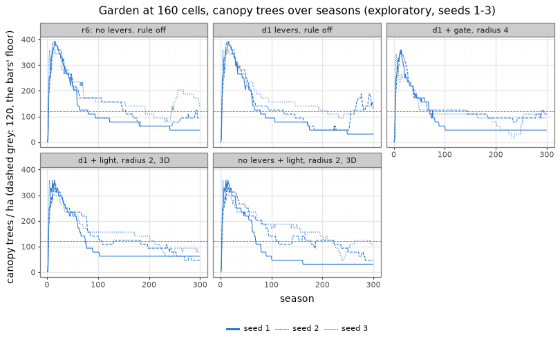

# Crown occupancy: space competition between trees in the garden (2026-11-11)

> **Merged as docs by [#121](https://github.com/epabarker/tree-simulation/issues/121) (2026-11-12). Its rule was not merged.** `c1.occupancy` and its season-loop changes live only on the unmerged branch `probe/121-occupancy`, so its rounds cannot be re-run at HEAD (HEAD ignores the params its patches name). The note is unchanged below this box. Its canopy counts use half the tallest tree, the definition before [ADR 0065](../decisions/0065-garden-demography-reported-targets.md).

**Exploratory: seeds 1–3, widths 160 and 66.** This is the third probe round for [#121](https://github.com/epabarker/tree-simulation/issues/121), on the branch `probe/121-occupancy` (cut from `probe/121-suppression`). Nothing is adopted:
- the rule is a probe param, off by default and bit-identical;
- no flora, preset, golden or regression changes.

**Question.** The [levers note](2026-11-11-garden-canopy-levers.md) proposed occupancy-gated growth: a shoot does not extend into a cell that holds another tree's foliage (Palubicki et al. 2009's space competition). Does it narrow stand crowns enough for the garden to hold ≥ 120 canopy trees/ha and meet the amended bars?

**Answer: no.**
- **No condition meets either width's bars in any run.** 3 rounds, 13 rule conditions and 2 rule-off baselines, 6 runs each.
- **The closest condition:** dark-top θ_q 0.15 + hornbeam c_seed 300 + the "light" form of the rule over a 5 × 5 × 5-cell neighbourhood (`O3-D-light-r2-3d`).
  - It holds 94 canopy trees/ha at 160 cells, the same as d1 without the rule.
  - At the phone width it never reaches the cap in its 3 runs, but holds 1 canopy tree, not 2.
- **The rule works as a mechanism.** At radius 4 it cuts the 3D cells two canopy crowns share at season 25 from 3.5% to 0.2%, and the summed crown area over the plot from 3.5 to 2.1.
- **The canopy count does not follow.** The stand still self-thins to 3–7 canopy trees per 0.064 ha by season 100. The survivors' crowns still spread until they cover 0.9–0.98 of the plot.
- **The levers note's diagnosis was partly wrong** (section 3):
  - In the baseline, canopy crowns share only 0.5–3.5% of their 3D cells. Light competition (C2) already keeps them apart cell by cell.
  - "Summed crown area 3.4–3.7× the plot" measures each crown's extent ellipse, and crowns stacked one over another.
  - So the count is set by overtopping and mortality, plus crowns' plastic spread into vacated space, not by interpenetration.

## 1. The rule as built (probe only)

`c1.occupancy` (absent: `"off"`, bit-identical), read from the owner grid O2/R5 build at the start of each season. That grid is filled in phase 1 from every live leafy bud's tip, so every tree reads the same field, as AGENTS.md's staging requires. The flag also switches the grid on, so it is never read empty.

Two forms:
- **`"gate"`:** in `grow_shoot`, before each new metamer, the cell its end would occupy is checked, at the same place as the obstacle check. If it holds another tree's foliage the shoot stops there. If nothing has grown yet, the bud rests ACTIVE and tries again next season; otherwise a terminal bud forms.
  - The resource allocated to the bud this season is lost.
  - Code: `principles/c1.rs` (`Space`, `space_blocks`).
- **`"light"`:** in phase 2, right after the buds sample the light field, a bud whose next cell (one internode along its heading) holds another tree's foliage perceives Q = 0. This is Palubicki et al.'s bud whose markers are taken. C3's basipetal sums and Borchert–Honda allocation then send the resource elsewhere, and C5 sheds limbs that stay dark.
  - Code: `season.rs` (`unlit_by_neighbours`).

Knobs (all world-level):
- `c1.occupancyRadius` r: cells within r in x and z count, not only the target cell.
- `c1.occupancyRise`: rows within that many above and below count too. Rise = r gives Palubicki's isotropic occupancy zone (a cube on the grid; their radius is 2 internodes, spec §O3.4).
- `c1.occupancyP` (`"gate"` only): the chance that an occupied cell stops the shoot, drawn from the new RNG purpose `OCCUPANCY` (20) and keyed by the bud's birthId, the season and the metamer. At 1 (the default) nothing is drawn.

What "occupied" means (`principles/o2.rs::occupied`):
- a cell holds another tree's foliage when its owner tag is neither EMPTY nor the tree's own id;
- a SHARED cell counts as occupied, because it holds at least one other tree's foliage;
- the depth wraps as the grid does.

The rule keeps no state, so the checkpoint layout is unchanged.

**Tests** (each local rule test-first):
- `o2::a_cell_is_occupied_only_by_another_trees_foliage`: own, other, shared, wrap, radius and rise;
- `c1::a_shoot_stops_before_a_cell_holding_another_trees_foliage`: empty air and its own foliage let the whole shoot grow; a neighbour's cell in the first metamer's place stops it with the bud resting ACTIVE; a neighbour's cell in the second place grows one metamer;
- `season::a_bud_facing_another_trees_foliage_perceives_no_light`.

**Bit-identity, rule off:**
- `cargo test -p tree-core --release --test golden`: 2 of 2 pass.
- The six rule-off d1 runs (`O-D0`) reproduce the levers note's `L-d1-cSeed300-q15` hashes exactly: ff6f2156, 362a095f, 71dca8ec, 888b9333, d91600ca, 3536fda3. So the r6 runs from that round serve as this note's no-lever baseline.

**Lone tree, rule on:** see section 5.

## 2. Rounds

- **Setup:** `sweep.ts` (the garden schedule's runner, now with metamer snapshots at 100/200), `forestParams(width, seed)` with r6's schedule, seasons 300, seeds 1–3 × widths 160 and 66.
- **"d1 levers" (D):** `o4.suppressionSignal: "topLight"`, `topLightThreshold` 0.15, hornbeam `o4.cSeed` 300. **N** is without them.
- **Simulators:** at most 6 at a time; another agent's oak round ran up to 6 beside them.
- **Analysis:** `occupancy.py` computes every column from the core's own CSVs:
  - the **160 cells** columns judge the per-hectare bars at seasons 100/200/300: band 200–400 drawn/ha; canopy share ≥ 0.6; mix, no species > 70% (frames of 9); a canopy tree in every season > 50; cap never reached (runs of 3);
  - the **66 cells** columns judge the phone bar: ≥ 2 canopy trees in every season from 100 (the stricter reading of "from season 100"; at the judged frames 100/200/300 alone, the closest condition also fails), no gap, cap-free (runs of 3), mix (frames of 9);
  - "canopy/ha" is the median over seasons 100–300. One tree is 15.6/ha at 160 cells and 37.9/ha at 66;
  - "robust W" is the median over canopy trees (over half the top height) of the 5–95% spread of their metamer tips in x, in metres. It includes subordinate trees just over half the top height. The dominants alone are 12.5–19 m (the levers note's §1: 16–19 m; `fate.py` on `O-N-gate` 160 s1 at season 300: 14.5, 12.5, 12.5 m);
  - "area/plot" is the canopy trees' summed extent ellipses (π/4 · crownWidth · crownDepth) over the plot, at seasons 25/50/100.

| round | condition | 160: band / canopy / mix | 160: no gap, cap-free | 160 runs passing | 66: ≥ 2 canopy, no gap, cap-free | 66 mix | 66 runs passing | canopy/ha 160 / 66 | robust W 160 (m) at 100/200/300 | area/plot at 25/50/100 | hornbeam share 160 / 66 |
|---|---|---|---|---|---|---|---|---|---|---|---|
| base | r6 (N, rule off) | 2 / 1 / 3 | 3, 0 | 0 | 0, 3, 0 | 4 | 0 | 94 / 38 | –/–/9.1 | 3.48/3.06/2.01 | 0.81 / 0.75 |
| base | O-D0 (D, rule off) | 0 / 3 / 5 | 3, 1 | 0 | 1, 3, 0 | 6 | 0 | 94 / 76 | –/–/10.2 | 3.50/3.09/2.09 | 0.63 / 0.60 |
| 1 | N gate | 1 / 1 / 4 | 3, 0 | 0 | 0, 3, 0 | 4 | 0 | 62 / 38 | –/–/12.5 | 3.24/2.78/2.30 | 0.83 / 0.89 |
| 1 | D gate | 0 / 4 / 4 | 3, 1 | 0 | 0, 3, 1 | 6 | 0 | 62 / 76 | –/–/12.6 | 3.24/3.06/2.30 | 0.76 / 0.50 |
| 1 | D gate, p 0.5 | 1 / 4 / 4 | 3, 2 | 0 | 0, 3, 0 | 3 | 0 | 47 / 38 | –/–/16.8 | 3.39/2.84/1.90 | 0.80 / 1.00 |
| 1 | D gate, r 1 | 1 / 3 / 4 | 3, 0 | 0 | 0, 2, 2 | 2 | 0 | 78 / 38 | –/–/13.1 | 3.14/3.00/2.02 | 0.72 / 1.00 |
| 1 | N light | 1 / 0 / 3 | 3, 0 | 0 | 1, 3, 0 | 6 | 0 | 109 / 76 | –/–/12.2 | 3.31/3.14/2.24 | 0.87 / 0.60 |
| 1 | D light | 1 / 4 / 5 | 3, 1 | 0 | 0, 3, 0 | 4 | 0 | 78 / 38 | –/–/13.3 | 3.36/3.11/2.34 | 0.68 / 1.00 |
| 2 | D gate, r 2 | 1 / 4 / 5 | 3, 1 | 0 | 0, 3, 1 | 5 | 0 | 78 / 38 | 10.6/11.4/11.5 | 2.94/3.14/2.17 | 0.60 / 0.67 |
| 2 | D gate, r 4 | 3 / 1 / 7 | 3, 0 | 0 | 0, 3, 0 | 3 | 0 | 94 / 38 | 8.7/10.2/11.3 | **2.10**/2.25/2.16 | 0.57 / 0.95 |
| 2 | D light, r 1 | 0 / 4 / 4 | 3, 1 | 0 | 0, 3, 0 | 3 | 0 | 62 / 38 | 8.1/11.8/14.8 | 2.98/2.66/2.04 | 0.76 / 1.00 |
| 2 | D light, r 2 | 2 / 3 / 4 | 3, 1 | 0 | 0, 3, 1 | 4 | 0 | 62 / 38 | 9.9/10.5/10.4 | 2.64/2.60/2.28 | 0.73 / 1.00 |
| 2 | D light, r 4 | 2 / 3 / 6 | 3, 1 | 0 | 0, 3, 2 | 3 | 0 | 78 / 38 | 8.6/10.5/12.7 | 2.06/2.27/2.16 | 0.56 / 1.00 |
| 2 | N light, r 2 | 1 / 0 / 5 | 3, 0 | 0 | 0, 3, 0 | 6 | 0 | 109 / 38 | 8.3/8.8/13.5 | 2.67/2.76/2.57 | 0.68 / 0.33 |
| 2 | N gate, r 2 | 2 / 0 / 3 | 3, 0 | 0 | 0, 3, 0 | 6 | 0 | 94 / 38 | 10.0/13.7/12.8 | 2.86/3.19/2.27 | 0.73 / 0.50 |
| 2 | D light, r 2, O2 on | 2 / 3 / 5 | 3, 1 | 0 | 0, 3, 2 | 3 | 0 | 62 / 38 | 7.7/11.4/14.4 | 2.54/2.67/1.98 | 0.67 / 1.00 |
| 2 | D light, r 2, R5 local signal | 2 / 0 / 5 | 3, 0 | 0 | 0, 3, 0 | 4 | 0 | 94 / 38 | 8.4/9.5/10.6 | 2.54/2.15/2.04 | 0.63 / 0.80 |
| 3 | D gate, r 2, rise 2 (3D) | 1 / 3 / 5 | 3, 1 | 0 | 0, 3, 1 | 2 | 0 | 62 / 38 | 8.6/11.3/12.2 | 2.15/2.45/1.73 | 0.59 / 1.00 |
| 3 | **D light, r 2, rise 2 (3D)** | 2 / 3 / 7 | 3, 1 | 0 | 0, 3, **3** | 2 | 0 | **94** / 38 | 7.1/9.3/12.5 | 2.21/2.51/2.23 | **0.47** / 1.00 |
| 3 | N light, r 2, rise 2 (3D) | 1 / 0 / 4 | 3, 0 | 0 | 0, 3, 0 | 5 | 0 | 109 / 38 | 8.5/9.3/14.8 | 2.13/2.46/2.19 | 0.74 / 0.62 |

**Reading the table:**
- **Canopy/ha is quantised and noisy.** 47–109/ha at 160 cells is 3–7 trees on the plot. Across the gate's radii 0/1/2/4, three seeds give 62/78/78/94/ha with no trend, and p 0.5 gives 47.
  - No rule condition beats the rule-off baselines (94/ha) by more than one tree.
  - N light (109) is within that spread.
- **The rule narrows young crowns only from radius ≥ 2 in 3D, or radius 4 in the row.** Summed area at season 25 falls from 3.5 to 2.1–2.2. By season 100 every condition is back at 1.7–2.6.
- **Hornbeam's share falls** with the rule and the levers at 160 (0.47–0.60 against 0.63). It does not fall at 66.
- **The phone width holds one canopy tree almost everywhere.** 2 of 51 runs keep ≥ 2 from season 100: the rule-off d1 seed 2 and one N-light run; with the rule, 1 of 45. That is what the levers note's §5 arithmetic expects.
  - The closest condition is cap-free in 3 of 3 runs at 66, but its single crown spans the ring: robust 15 m on a 16.5 m ring.
- **O2 and R5 interact little:**
  - O2 abrasion on top of light r 2 changes nothing beyond seed noise;
  - R5's local signal instead of the neighbour signal gives 94 against 62/ha, i.e. 2 trees on seeds 1–3.

**The closest condition per run** (`O3-D-light-r2-3d`). Each frame gives drawn (per ha), canopy share and the top species.

| width | seed | 100 | 200 | 300 | canopy trees at 25 / 50, min from 100 | seasons at cap |
|---|---|---|---|---|---|---|
| 160 | 1 | 7 (109), 0.71, hornbeam 43% | 4 (62), 1.00, hornbeam 75% | 5 (78), 0.80, hornbeam 80% | 19 / 15, 4 | 0 |
| 160 | 2 | 18 (281), 0.50, birch 22% | 47 (734), 0.13, hornbeam 51% | 43 (672), 0.07, beech 51% | 20 / 15, 3 | 237 |
| 160 | 3 | 55 (859), 0.18, maple 58% | 51 (797), 0.18, hornbeam 47% | 16 (250), 0.31, hornbeam 56% | 19 / 15, 4 | 168 |
| 66 | 1 | 1 (38), 1.00, hornbeam 100% | 1 (38), 1.00, hornbeam 100% | 3 (114), 0.33, hornbeam 100% | 8 / 4, 1 | 0 |
| 66 | 2 | 1 (38), 1.00, hornbeam 100% | 1 (38), 1.00, hornbeam 100% | 3 (114), 0.33, hornbeam 100% | 8 / 6, 1 | 0 |
| 66 | 3 | 4 (152), 0.75, beech 25% | 3 (114), 0.33, hornbeam 67% | 4 (152), 0.75, hornbeam 75% | 7 / 6, 1 | 0 |

**What the planted cohort dies of** (160 cells, 78 planted trees over seeds 1–3). Cause as in `fate.py`; class by height at the last live season.

| condition | O4 draw, below canopy | O4 draw, canopy | R1 starved | R3 thrown | alive at 300 |
|---|---|---|---|---|---|
| O-D0 (rule off) | 26 | 23 | 8 | 6 | 15 |
| O3-D-light-r2-3d | 30 | 12 | 10 | 8 | 18 |

With the rule:
- half as many planted canopy trees die by the O4 draw, and 3 more planted trees reach season 300;
- more die below the canopy (overtopped, then dark-topped);
- the canopy count at season 100 and later is unchanged.

## 3. Why occupancy does not raise the canopy count

`overlap.py` bins each canopy tree's metamer tips into plan columns (x, z) and into 3D cells:

| run | season | canopy trees | plan cover of the plot | plan columns shared (median per tree) | 3D cells shared (median per tree) | height gap in shared columns (cells) |
|---|---|---|---|---|---|---|
| O-D0 160 s1 (rule off) | 25 | 22 | 0.96 | 0.78 | 0.035 | 10 |
| O-D0 160 s1 | 50 | 14 | 0.96 | 0.76 | 0.018 | 18 |
| O-D0 160 s1 | 300 | 2 | 0.94 | 0.09 | 0.005 | 4 |
| O-D0 160 s3 | 300 | 9 | 0.96 | 0.84 | 0.007 | 32 |
| D gate r 4, 160 s1 | 25 | 16 | 0.90 | 0.38 | 0.002 | 15 |
| D gate r 4, 160 s1 | 50 | 11 | 0.94 | 0.58 | 0.002 | 23 |
| D gate r 4, 160 s1 | 100 | 4 | 0.95 | 0.19 | 0.000 | 20 |

The season-25/50 rows come from a re-run of the same record to season 50 with snapshots (`runs/occ-diag/`). The 300 rows come from the sweep runs.

- **Crowns barely interpenetrate even without the rule:** 2–4% of a canopy tree's cells at season 25, under 1% later. C2's light competition already keeps foliage out of a neighbour's cells, as spec §O2.4 notes ("light competition alone already keeps crowns apart").
- **What "summed crown area 3.5×" counted** is mostly stacking. 78% of a crown's plan columns also hold another canopy tree, 10–30 cells (2.5–8 m) higher or lower. That is a co-dominant crown spreading over a shorter one, into empty air above it, which no occupancy rule can see.
- **The rule removes what interpenetration there is.** At gate r 4 the shared 3D cells fall to 0.2% and the plan overlap at season 25 halves. The stand then still thins from 16 canopy trees at season 25 to 4 at 100, and the 4 survivors cover 0.95 of the plot.
- **So the canopy count is set by:**
  1. how many co-dominants the O4 draw (dark-top or carbon) and R1 starvation keep through seasons 25–100;
  2. how far a survivor's crown spreads into the space a dead neighbour leaves. Crowns grow to fill the plot whatever the rule, because the rule only blocks space that is occupied, and vacated space is not.
- **The real-forest contrast** is a crown size limit. A closed-stand canopy tree's crown does not double when its neighbour dies, and the maximum crown radius is bounded by size (Pretzsch et al. 2015's envelope, the levers note §1). The garden has nothing that bounds a crown's lateral reach by its size. That is a different rule (a per-species crown-extent limit, or a cost of branch length), not a variant of this one, and was not built here.

## 4. Variants considered and not run

- **"A shaded-out, dying neighbour's cells do not count."** Removing blocks can only let survivors spread further. With 0.2–3.5% shared cells there is nothing for it to act on, so it cannot raise the canopy count.
- **A fourth round.** The three rounds span the gate and light forms, the chance, radius 0–4, row and 3D neighbourhoods, and O2 and R5 on and off. All land at 47–109 canopy/ha against ≥ 120, with no trend in radius. Section 3 explains why. Inventing a further rule is out of this probe's scope.

## 5. Guard and cost

### The lone open-grown guard, rule on

`guard.py` on `npm run probe -- --lone 100 --widths ""`, seeds 1–3, HEAD against the patch:
- **`{"c1": {"occupancy": "light", "occupancyRadius": 2, "occupancyRise": 2}}`**, all six exemplars: bit-identical in 18 of 18 runs. Season-100 state hashes, seeds 1/2/3:

  | species | hashes |
  |---|---|
  | oak | 9d18cdbd, 175ce3f9, 66d455d6 |
  | maple | ee97a454, 4ba74db9, 5084cd52 |
  | birch | af874297, 88c2739e, 2c600b57 |
  | beech | c9f55e42, 300c8d73, ee7b6037 |
  | hornbeam | 859812b6, 66b88c89, f4a96f3e |
  | holly | 7d5224f3, 3ed714b3, c8adb5e5 |

- **`{"c1": {"occupancy": "gate", "occupancyRadius": 4}}`**, hornbeam: bit-identical in 3 of 3 (the same hashes).
- **Why it holds:** the lone stage's owner grid holds only the tree's own id, so the rule never fires and draws nothing.

### Cost

Seed 1, season 300, d1 levers. Each run alone, with no other simulator running; the machine's load average was about 7 from other work.
- **Native:** treesim wall time. Hashes equal the sweep's.
- **WASM:** `wasm-cost.ts` (the worker's stepping), ms/season over seasons 101–120, and linear memory at the end.

| condition | native 160 (s) | native 66 (s) | WASM 160 ms/season | WASM 66 ms/season | WASM memory 160 / 66 (MB) |
|---|---|---|---|---|---|
| O-D0 (rule off) | 58.8 | 35.5 | 133 | 60 | 202 / 81 |
| D gate, r 4 (row) | 62.9 (×1.07) | 27.1 | 160 (×1.20) | 68 | 186 / 83 |
| D light, r 2, rise 2 (closest) | 162.7 (**×2.8**) | 51.3 (×1.4) | 279 (**×2.1**) | 115 (×1.9) | 189 / 84 |

- **The light form's 3D neighbourhood** reads 5 × 5 × 5 = 125 owner cells for each live bud each season. At 160 cells that doubles the page's season time, to about 0.28 s.
- **The gate checks only at metamers that grow,** so it costs little.
- **A cheaper closest form, if one were wanted:** the light form in the row only (r 2: 25 cells), or a once-a-season dilation of the owner grid (one pass over the grid, then one read per bud).
- The sweep's own wall times ran 6 at a time beside another agent's 6 and are load-confounded (`summary.json` `wallSeconds`); these single runs replace them.

## 6. Verdict

**Negative.** Crown occupancy, as a gate or as Palubicki's unlit bud, at any radius tried, does not bring the garden to the bars at either width.
- **Closest:** `O3-D-light-r2-3d` (d1 levers + `c1.occupancy: "light"`, radius 2, rise 2).
- **At 160 cells:** canopy 94/ha (≥ 120 needed); band 2 of 9 frames; canopy share 3 of 9; mix 7 of 9; no gap 3 of 3; cap-free 1 of 3; 0 of 3 runs pass.
- **At 66 cells:** ≥ 2 canopy trees from 100 in 0 of 3 runs (it holds 1); no gap 3 of 3; cap-free 3 of 3; mix 2 of 9 frames; 0 of 3 runs pass.
- **Still failing:** the canopy count and therefore the band and canopy share at 160; the cap at 160 in seeds 2–3 (the bank); the phone width's one-crown stand; hornbeam's share at 66.

No condition passed seeds 1–3, so no 20-seed run and no contact sheet were made.

## 7. What adoption would require (if the user wants the rule anyway)

The rule has no effect on the bars, so I do not recommend adopting it for #121. If it were adopted for its own sake (abutting crowns, fewer interleaved twigs), it would need the following.

- **Params:** `c1.occupancy` ("off" | "gate" | "light"), `c1.occupancyRadius`, `c1.occupancyRise`, `c1.occupancyP`. They are world-level:
  - read from the world's params in `phase_light`, `phase_grow` and `phase_sample`;
  - `space_blocks` reads them from the species' params today. Nothing patches c1 per species, but adoption should read the world's.
  - The §8 ablation name would be the mode.
- **Code:**
  - `principles/o2.rs::occupied` (the owner-grid reader);
  - `principles/c1.rs::{Space, space_blocks}` and the check in `grow_shoot`;
  - `season.rs::unlit_by_neighbours`;
  - the owner-grid switch in `phase_light`.
  - A principle file header would move to `c1.rs`, or a new `occupancy.rs` beside `obstacles.rs`.
- **Spec sections touched:**
  - §C1 item 9 ("Multi-tree: no difference"): it now differs between trees;
  - §O3 (space colonization): its occupancy zone used between trees, with the light field kept (C2), so §O3.9's "no height advantage, wrong for stands" no longer applies, because light still sets height;
  - §6, the season loop: the owner grid is read in phase 2 (light form) or in growth (gate form);
  - §5 lists the owner tag already.
- **State and checkpoint:** none. The rule reads only the start-of-season owner grid, which is rebuilt each season and not checkpointed.
- **RNG:** purpose `OCCUPANCY` = 20, used only by `"gate"` at occupancyP < 1 and keyed by the bud's birthId, the season and the metamer index. Keep or drop it, but never renumber.
- **Defects to fix before adoption:**
  1. A gate-blocked bud with nothing grown is restored ACTIVE, so it never ages toward R4's abort and its allocated resource is lost each season. It belongs on the resting path, as the light form effectively does.
  2. R4's light release pays its one-metamer reserve cost before `grow_shoot`, so a release the gate blocks still debits the reserve.
  3. The light form zeroes Q before C5's `crown_top_light`, so with the dark-top suppression signal (`o4.suppressionSignal: "topLight"`) a tree pressed against a neighbour reads a darker top. The two rules interact, and the 3-seed numbers here cannot separate them.
- **The ADR to write (if adopted):** "Crown occupancy between trees: shoots do not grow (gate) or buds see no light (light) where another tree's foliage stood at the start of the season."
  - It records radius and rise, the cost, and that it does not change the stand count (this note).
  - It amends none of ADR 0063's decisions by itself.
- **The two levers it was tested with are separate decisions:**
  - **hornbeam `o4.cSeed` 5 → 300:** a species expression change to a fitted flora value (`flora-fitted.ts` from the fit and `hand-overrides.toml`). It needs AGENTS.md's ≥ 20-seed rule with a stated pass rate and a recorded reason. It does not change the lone tree (the levers note's guard, bit-identical).
  - **the dark-top suppression signal (θ_q 0.15):** amends ADR 0063 decision 3 (the suppression signal) and spec §O4. No checkpoint change.

## 8. Open questions for the user

1. **Crown size.** Section 3 says the canopy count is set by thinning plus unbounded crown spread into vacated space. Should the next probe be a size-bounded crown extent (a per-species maximum lateral reach scaled by height or stem diameter, anchored to Pretzsch et al. 2015 or Tallo)? Or a slower thinning of co-dominants (O4/R1)? Either is a new rule; this note did not build one.
2. **The bar.** At 160 cells the canopy holds 3–7 trees (47–109/ha) under every rule tried. Is ≥ 120 canopy trees/ha (8 on the plot) the right bar for a 40 × 16 m garden, or should the per-hectare bars be judged on drawn stems with a lower canopy share?
3. **The phone width** holds one canopy crown in 49 of 51 runs. Should its bar be "≥ 1 canopy tree, no gap, no cap, no species > 70%", given the levers note §5's arithmetic (2–3 real crowns fit at most)?
4. **Keep the rule?** It makes crowns abut (0.2% shared cells against 2–4%) at a cost (section 5). Is that worth having in the core as an ablatable C1 refinement, apart from #121?

## Files

- **Code** (`code/2026-11-10-garden-schedule/`):
  - `sweep.ts`: the runner; metamer snapshots at 100/200 by default now, `SWEEP_SNAPSHOTS=""` for the old output;
  - `occupancy.py`: the bars and the table;
  - `overlap.py`: section 3;
  - `occupancy_figure.py`: the figure;
  - `wasm-cost.ts`: now takes a round patch;
  - `guard.py`: the lone guard.
- **Rule:** `rust/core/src/principles/{o2,c1}.rs`, `rust/core/src/season.rs`, `rust/core/src/params.rs`, `rust/core/src/rng.rs`, `src/core/params.ts`.
- **Runs (not committed):**
  - rounds: `runs/garden-schedule/occ-{1,2,3}.json` and the round directories `O-*`, `O2-*`, `O3-*`; tables in `runs/garden-schedule/occ-*.table.md`;
  - the season-25 diagnostic: `runs/occ-diag/`;
  - the lone guards: `runs/probe/guard-occ-light-*`, `runs/probe/guard-occ-gate-hornbeam`.
